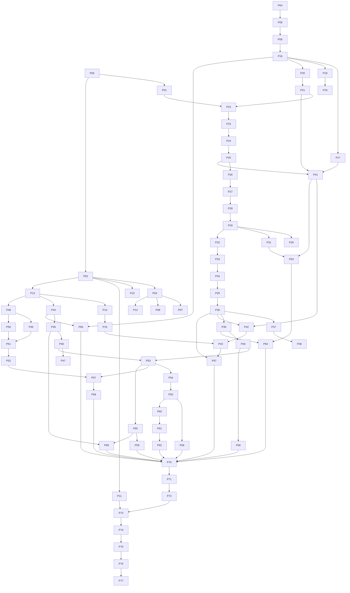

# ZATCA B2B Standard Tax Invoicing — Implementation Blueprint

**Repository:** `coursefer` (Laravel host) + `packages/zatca` (local path package) + `lms-admin-frontend` (Vue 3 admin SPA)
**Branch inspected:** `feat/zatca-b2b` (HEAD `9e65a203a`), admin frontend `feat/zatca-b2b` (HEAD `af29263e`)
**Date:** 2026-09-28
**Status:** PLAN ONLY. No code, migration, configuration, test or commit was created while producing this document.

---

## 0. How to read this document

### 0.1 Evidence tags

Every material statement carries one of these tags. A statement without a tag is a proposal, not a fact.

| Tag | Meaning |
|---|---|
| **[CODE]** | Verified by reading the code in this repository during this investigation (file and, where useful, line are cited). |
| **[DOC]** | Verified from an official ZATCA artefact that is physically present in the uploaded material (`Desktop/Zatca/API-DOCS/*.pdf`, the ZATCA Java SDK 3.4.8 samples under `Desktop/Zatca/ZACTA-SDK-JAVA/Data/Samples`, the SDK readme/CSR templates). |
| **[VERIFY]** | Requires sandbox evidence, an official document that was **not** in the uploaded set, or a stakeholder/tax-advisor decision. Statements quoted from the earlier planning notes (`b2b - investigation.txt`, `suggested form.txt`, `comprehiensie plan.txt`, `More Comprehinsice Plan.txt`, `Unified_ZATCA_B2B_Implementation_Plan_V4.txt`) that cite the XML Implementation Standard, the Detailed Guidelines or the WATHQ OpenAPI specs are tagged **[VERIFY]** because those source documents were not available to me to re-read. |

### 0.2 Important honesty notes

1. **No Clearance API document was uploaded.** The uploaded API set is: Compliance CSID, Compliance Invoice, Production CSID, Reporting. The only official Clearance information available is (a) the shared response schema `ClearedInvoiceResultModel` (fields `invoiceHash`, `clearedInvoice`, `status` ∈ {`Cleared`,`Not Cleared`}, `warnings`, `erros`) and (b) the `InfoModel` description ("the result of the clearance or reporting API endpoints when the clearance flag is turned on or off … instructing the client to see the other api") **[DOC]**. The Clearance endpoint path, HTTP status codes, headers, idempotency behaviour, cleared-XML/QR behaviour and hash-chain semantics are all **[VERIFY]**. Every Clearance design element in this plan is therefore gated. **Update 2026-09-28:** the user supplied ZATCA's official Clearance API page (https://sandbox.zatca.gov.sa/IntegrationSandbox/clearance-api, "e-Invoicing Sandbox Release (2.1.0)", page last updated 22 April 2025). It documents the path, headers, request body, auth and the response catalogue (200/202/208/303/400/401/500), which closes the documentary part of G-03 and part of G-04/G-06/G-07/G-16; §14.1 and the Facts Register (`docs/zatca-b2b/facts-register.md`) cite it. Real behaviour still has to be captured in the sandbox (P28–P31).
2. **The CSR `invoice.type` semantics are not documented in the uploaded set.** The SDK template has a `csr.invoice.type` field and ZATCA's own EN example uses `1100` **[DOC]**, but the meaning of each digit is described only in the Developer Portal manual §4.3, which was not uploaded **[VERIFY]**.
3. **The ZATCA business rules (BR-KSA-xx) quoted for Standard invoices** (buyer name, VAT format, BT-46, Saudi address, KSA-5 supply date) come from the earlier investigation notes **[VERIFY]**. Structural expectations that are visible in ZATCA's official SDK samples (`Standard_Invoice.xml`, `Standard_Credit_Note.xml`, `Standard_Debit_Note.xml`) are **[DOC]**.
4. **WATHQ facts** (endpoints, fields, status codes, pricing, rate limits) come only from the earlier notes **[VERIFY]**. There is no WATHQ code in the repository **[CODE]**.
5. **Approved user story found during the investigation:** `B2B-User-Stories/First.txt` (#33496 "Select Invoice Buyer Type During Checkout", created in the repository on 2026-09-28 13:44, untracked). It is treated as the product-approved source for the student checkout behaviour and it **overrides** earlier planning notes where they conflict: (a) when the buyer-type selector is shown, **neither option is pre-selected** and a selection is **required** (AC-01/AC-02); (b) when CR verification is part of the configured flow (i.e., WATHQ enabled), an unverified CR **cannot** be used and a WATHQ outage **does not** fall back to manual entry or to Individual (Alt-06/07, AC-06, BR-08); (c) verified company information is **not freely editable** (Alt-08, AC-07); (d) a confirmation step shows the invoicing data before payment (BR-12); (e) the payment method must never change the buyer type (AC-09). The story references two documents not available to me ("Pasted text(20260916-144013)", "lms_business_rules_admin_student") [VERIFY].
5b. **Second approved user story:** `B2B-User-Stories/Second.txt` (#33502 "Company Information & Commercial Registration Verification", committed 2026-09-28, read the same day). It details the WATHQ step of #33496 and is traced in §17.7. It changes three things: CR verification starts **automatically** once a well-formed CR is entered — there is no Verify button (BR-02, AC-02); the result is shown under the CR field in five states (BR-03); changing the CR clears the previous result and re-verifies (Alt-04, AC-09). One contradiction inside the story is open as D-45 (Step 5 "student can edit any information" vs BR-07 "retrieved information should not be freely modified"); the plan follows BR-07 until decided. Everything else in #33502 matches the approved decisions (D-39 no fallback while WATHQ is on, D-40 completion of missing fields, D-43 manual mode when WATHQ is off).
6. **Decisions approved by the user on 2026-09-28** (recorded in §38.3; they take precedence over the recommendations and over #33496 where noted): D-38 (no buyer-type selector while B2B is disabled), D-39 (no manual company-entry fallback; any WATHQ failure blocks company verification while WATHQ is enabled), D-40 (optional ZATCA fields never block company checkout; missing fields may be completed manually; only ZATCA-mandatory fields are required before invoice generation — this **replaces** the earlier option A and deviates from #33496 Alt-08 for the missing fields only), D-42 (admin company-data override with a mandatory reason and an audit trail), D-26 (no IBAN for company purchases). Second batch (also 2026-09-28): D-43 approved (Case D manual company entry stays available when WATHQ is disabled), D-41 approved (a request without `buyer_type` is Individual; the request field is named `buyer_type` as in the approved text — it replaces the working name `buyer_type`), D-26 restated (no company IBAN or other banking data is collected), P02 location approved (`docs/zatca-b2b/`). Still open: D-44 (whether the IBAN payment method is listed when Company is selected) — see §38.3.
7. **Official-documentation rule (R-DOC, user instruction 2026-09-28):** before any ZATCA-related phase is implemented, every ZATCA requirement it encodes is checked against official ZATCA documentation and cited in the Verified Facts Register (P01). If the official document is not available, a verification gate is created (or the existing one kept open) and **that phase stops** until the requirement is confirmed. No ZATCA rule is written from memory or from examples. See §39.0.
6. The user's prompt announces "THREE major business scenarios" but spells out two. This plan treats **Scenario 3 = Admin unpaid assignment that is later settled**, because it is the only remaining invoice-producing path in the code and is explicitly requested elsewhere in the prompt (§4, §15, §19, §20). Round-change-only is treated as a **must-not-invoice guard**, not a scenario.

### 0.3 Numbering

Sections 1–42 follow the order requested. Appendix A is the second-pass production-failure review, Appendix B the third-pass B2C regression review, Appendix C the full evidence register, Appendix D the register of latent B2C defects found during the investigation (to be handled as separate, individually approved tickets — never silently inside B2B work).

---

## 1. Executive Summary

### 1.1 What the system is today

* B2C Simplified Tax Invoicing (KSA-2 `0200000`, Reporting model) is live through a well-hardened local package `packages/zatca` (≈8.5k LOC, 400 package tests passing on isolated SQLite, 3 SDK-dependent tests skipped — run during this investigation) **[CODE]**.
* The package already supports: per-EGS credentials and ICV/PIH state, two-step reserve→sign generation with PIH re-chaining, snapshot-based regeneration, draft completion, Credit Notes (full/partial/price adjustment/bundle discount allocation, `active_line_key` ledger) and Debit Notes (additional course / price adjustment) — all **Simplified**, all **Reporting** **[CODE]**.
* The package is **Reporting-only**: `HttpConnector::reportInvoice()` posts to `/invoices/reporting/single` with `Clearance-Status: 0` (`packages/zatca/src/Services/Connectors/V2/HttpConnector.php:98-100`) and there is no Clearance method on `ZatcaConnectorInterface` **[CODE]**.
* The XML generator hard-codes `InvoiceTypeCode name="0200000"` (`AbstractSimplifiedUblDocumentXmlGenerator.php:200`), emits a buyer block containing **only** `RegistrationName` (lines 185-190), never emits `buyerVatNumber`, and has no `cac:Delivery` **[CODE]**.
* Both host invoice sources put the **student's username** as buyer and `null` VAT (`app/Zatca/PaymentInvoiceSource.php:143`, `app/Zatca/TransactionInvoiceSource.php:39`) **[CODE]**.
* The live student frontend for this backend is the Vue SPA **inside this repository** (`resources/app`, built by Vite; `resources/app/views/Cart.vue`) **[CODE]** — the sibling repos `lms-student-front` (deploys to `mek-student.innoeg.com`, points to `lms-core-backend`), `student-dashboard` (last commit 2026-04-11) and `coursefer-vue` (not a git repo) are not the live checkout for this backend (evidence in §6.4) **[CODE]**, final confirmation **[VERIFY]**.

### 1.2 The headline design

```
INDIVIDUAL (unchanged)                    COMPANY (new, additive)
Cart / Assign                             Cart / Assign / Settle
  -> existing sources                       -> sale_buyers row (immutable once locked)
  -> EGS "default"                          -> Lane resolver (single decision point)
  -> Simplified 0200000                     -> EGS "b2b" (own CSR, cert, ICV, PIH)
  -> sign -> ReportZatcaInvoiceJob           -> Standard 0100000 (new generators)
  -> Reporting                              -> sign -> ClearZatcaInvoiceJob (new)
  -> PDF+email right after signing          -> Clearance -> cleared XML stored
                                            -> Standard PDF + tax-invoice email ONLY after Cleared
```

Credit/Debit Notes inherit **document subtype, buyer snapshot and EGS from the original document's frozen snapshot**, never from current flags or profiles.

### 1.3 The ten findings that shape the plan (all [CODE] unless noted)

1. **Every signing path funnels into `ReportZatcaInvoiceJob`/`RetryZatcaInvoiceJob`** — ≈11 dispatch sites (payment job, credit/debit note jobs, regeneration, draft completion, admin edit-XML, `zatca:recover`, `zatca:report-pending`, `zatca:requeue`, admin retry/retry-all, certificate-renewal resume). A Standard document must be made physically un-reportable at the single choke point `Zatca\Jobs\Concerns\ReportsZatcaInvoice::report()` **and** carry statuses the existing B2C queries never select.
2. **Tax policy is looked up per EGS and falls back to `exclusive`** (`app/Services/Admin/ZatcaSettingService.php:74-82`); only `default` is seeded `inclusive` (`database/migrations/2026_08_20_120300_set_zatca_price_tax_policy_inclusive.php`). A new `b2b` EGS without special handling would **add 15 % VAT on top of already VAT-inclusive prices** on every B2B invoice and note (`VatCalculator::isInclusive`, `AdminCreditNoteService:629`, `AdminDebitNoteService:447,453,538`).
3. **Cross-EGS double invoicing is possible**: the only uniqueness is `(egs_identifier, environment, source_reference)` (`2026_07_27_000004_create_zatca_invoices_table.php`) and `findExisting()` is per-EGS (`ProductionInvoiceOrchestrator.php:774-781`). The same `payment:N` could be invoiced once on `default` and once on `b2b`.
4. **Admin "edit XML and resubmit" mutates an already-submitted document in place** — clears signature, re-signs with the **same UUID and ICV**, re-chains PIH (`AdminZatcaInvoiceService::updateXmlAndResubmit`, lines 832-878); it blocks credit notes only. This is incompatible with "never mutate a rejected tax document" and with hash-chain integrity.
5. **`zatca:repair-generated-documents` auto-regenerates every 4xx-rejected document every 10 minutes** (`app/Console/Kernel.php:27`, `AdminZatcaInvoiceService::regenerationCandidates()` line 1223) from the frozen snapshot. For a Standard invoice rejected for buyer data it would burn up to five ICVs re-submitting the same wrong buyer.
6. **Regeneration deliberately cannot change buyer data** (spec decision in `specs/001-admin-zatca-invoices/spec.md` Q&A: "a rejection caused by … a wrong buyer VAT number is out of this action's reach"). B2B buyer-correction reissue must be a **new, separate operation**, not `regenerate()`.
7. **Payment invoice generation runs synchronously inside the payment callback** (`GenerateZatcaInvoiceJob::dispatchSync`, `app/Listeners/GenerateZatcaInvoiceForPaymentListener.php:67`; also `TransactionService.php:242`) since commit `90b452278` so the confirmation email PDF carries the signed QR. B2B must not deliver the tax invoice before Clearance, so the B2B lane needs its own delivery trigger.
8. **The "unpaid → settled" branch of `TransactionService::createTransactions()` is unreachable from the current admin UI**: `AssignCourseModal.vue:64` treats any active row as round-change-only and `pages/students/index.vue:302-304` omits `payment_source` in that case. Settlement needs an explicit, locked endpoint.
9. **Guzzle timeouts are not caught** by `HttpConnector::send()` (catches `RequestException` only; Guzzle 7.15 throws `ConnectException` for `CURLE_OPERATION_TIMEOUTED`) **[CODE]**. For Reporting this is survivable (409 "already reported" idempotency, **[DOC]**). For Clearance a timeout is an **in-doubt** outcome and needs explicit design **[VERIFY]**.
10. **The production deploy workflow runs `migrate --force` and `optimize:clear` but never `queue:restart`** (`.github/workflows/asas_prod.yml`). Long-lived workers would keep old job code after a B2B deploy — which is why the plan uses a dormant release train (§32) and treats enum/snapshot readers as a prerequisite release.

### 1.3b Product requirements source

The student checkout design follows user story #33496 (`B2B-User-Stories/First.txt`, §0.2 item 5). Two consequences are worth stating up front: (1) when B2B is available, **every** student — including individuals — must actively choose "فرد" or "شركة" before paying (a visible change to the B2C checkout UX that product has asked for; when B2B is unavailable the selector is not shown and B2C is exactly as today; API clients that do not send the field keep today's behaviour); (2) with WATHQ enabled, company checkout is blocked while WATHQ is unavailable (retry or switch to Individual explicitly) — manual company entry exists only when WATHQ is disabled (flag Case D).

### 1.4 What is blocked until verified

| Gate | Blocks | Why |
|---|---|---|
| G-01 Official Standard-invoice rules | Standard generators/validator go-live | BR-KSA rules only [VERIFY] |
| G-02 CSR invoice type & second EGS acceptability | B2B EGS onboarding | digit semantics not in uploaded docs |
| G-03 Clearance API contract | connector | no Clearance doc uploaded |
| G-04 Clearance response catalogue (16 scenarios) | normalizer/state machine | must be captured, not assumed |
| G-05 Hash-chain semantics (our hash vs cleared hash; rejected docs) | chain commit point | ZATCA behaviour |
| G-06 Cleared XML & QR | PDF, storage | ZATCA behaviour |
| G-07 Duplicate UUID / timeout reconciliation | retry & in-doubt design | ZATCA behaviour |
| G-08 Tax advisor: student pays, company invoiced; BNPL; refunds; supply date; issue date after settlement | business rules BR-01..BR-30 | legal |
| G-09 WATHQ contract, key, pricing, rate limits, status code list | WATHQ phases | external |
| G-10 Live student repo confirmation | frontend work | evidence strong but must be confirmed |
| G-11 Host test DB strategy | host automated tests | host suite unusable today |
| G-12 Flag semantics after B2B turned off (drain vs pause) | flag implementation | product/ops decision |
| G-25 User story #33496 reconciliation (D-38…D-42) | student checkout and WATHQ phases (P49–P52, P57, P58, P62) | product decisions; two documents the story cites are missing |

The complete list of 25 gates is in §35.

### 1.5 Size and shape of the plan

* **78 phases** (P00–P77) in 16 tracks, each independently reviewable, most independently deployable dormant (flags off).
* A **three-release train**: R1 "dormant vocabulary" (enums, snapshot v3 reader, columns, guards) → R2 "dormant clearance machinery" → R3 "dormant host capture"; enablement happens only by flags after production B2B EGS onboarding. Rolling back below R1 is forbidden once any B2B row exists.
* The very first engineering work is **not** B2B: it is the B2C golden baseline (P03–P10), the deploy-pipeline fix (P11) and alert wiring (P12).

### 1.6 Recommended first three actions

1. Run P00 (decision workshop) with the decision sheet in §38 — including D-38…D-42 raised by user story #33496 — and P01 (obtain the missing official documents — especially the Clearance API swagger and Developer Portal manual §4.3).
2. Approve the host test strategy (G-11) and start P03–P06 in parallel with P01.
3. Request ZATCA sandbox OTP for a second EGS and WATHQ sandbox access, so P27–P31 are not on the critical path later.

---

## 2. Current Architecture Understanding

### 2.1 Components

| Component | Where | Notes |
|---|---|---|
| Laravel host (PHP 8.3 locally, Laravel 10-compatible package constraints) | `C:\Users\zbook\Herd\coursefer` | Admin API (`routes/admin.php`), student API (`routes/student_dashboard.php`, `routes/api.php`), Blade payment callbacks (`resources/views/payments/*`) [CODE] |
| ZATCA package `zatca/zatca` (`@dev`, composer path repo) | `packages/zatca` | Own `composer.json`, own `vendor/`, own PHPUnit (Testbench, in-memory SQLite), migrations auto-loaded by `ZatcaServiceProvider::boot()` [CODE] |
| ZATCA Java SDK 3.4.8 | server path from `ZATCA_SDK_EXECUTABLE`/`ZATCA_SDK_ROOT` | signing, hash, QR, validation via `ZatcaSdkAdapter` with isolated per-call workspaces [CODE] |
| Queue | `QUEUE_CONNECTION` (local `.env`: database); ZATCA jobs on connection `ZATCA_QUEUE_CONNECTION`, queue `zatca` [CODE] | |
| Scheduler | `app/Console/Kernel.php:25-31` — `zatca:report-pending` (5 min), `zatca:requeue --only-transient` (hourly), `zatca:repair-generated-documents` (10 min, withoutOverlapping), `zatca:certificate:check` (daily), `zatca:status` (hourly), prune commands [CODE] | |
| Student SPA | `resources/app` (Vue 3, Vite, `laravel-vite-plugin`, input `resources/app/app.js`) [CODE] | built by the same deploy (`npm run build`) |
| Admin SPA | `C:\Users\zbook\Herd\lms-admin-frontend` (Vue 3 `<script setup>`, Pinia, Element Plus, Vitest) [CODE] | separate repo & deploy |
| Payment gateways | Apple Pay via Tap (`TapApplePayService`), Tabby (`TabbyPaymentService` + Blade callback), Tamara (`TamaraPaymentService` + Blade callback); CIB/Rajhi/Mashriq legacy paths; IBAN = client-side instructions only [CODE] | |
| Permissions | spatie/laravel-permission, seeded by `database/seeders/RolesAndPermissionsSeeder.php` (with cleanup sweep) [CODE] | ZATCA perms: `list/show/download/export/retry_zatca_invoices`, `issue_zatca_credit_notes`, `issue_zatca_debit_notes`, `show_zatca_settings` |
| Auditing | owen-it/laravel-auditing on selected models (e.g. `ZatcaSetting`, `Admin`) [CODE] | |
| Error tracking | Sentry (`config/sentry.php`) [CODE] | |
| CI/CD | `.github/workflows/asas_prod.yml` (push to `asas_prod` → ssh deploy: `composer install`, `npm run build`, `migrate --force`, `optimize:clear`), `zatca_tests.yml` (package tests), staging workflow disabled by branch name `asas_stg________` [CODE] | no `queue:restart` |

### 2.2 Package internals (short form — full map in §7)

```
GenerateZatcaInvoiceJob(sourceType, sourceId, egs)
  -> InvoiceSourceResolverContract::resolve()          (Eloquent find)
  -> ProductionInvoiceOrchestrator::generate()
       reserveDraft(): findExisting(egs, env, sourceRef) ─┐ idempotent
                       InvoiceSourceContract::toInvoiceData()   (host mapper)
                       InvoiceDataValidator::validate()         (arithmetic)
                       DB tx { ICV reserve (row lock on zatca_egs_states)
                               XmlGeneratorFactory::forData()->generate()
                               ZatcaInvoice::create(Draft + snapshot) }
       sign():        DB tx { lock chain head -> lock invoice row
                              rechain() if head moved
                              SDK sign (cert/key temp workspace)
                              PIH head := invoiceHash
                              status := PendingReporting }
                      Event ZatcaInvoiceGenerated
  -> ReportZatcaInvoiceJob::dispatch(id)
       ReportsZatcaInvoice::report(): gate, cert-expired skip,
         HttpConnector::reportInvoice()  (no row lock during HTTP)
         DB tx { status mapping, attempt row, note accepted_at }
         events: NeedsAttention / CreditNoteAccepted / DebitNoteAccepted
```

### 2.3 Data stores relevant to invoicing

| Table | Owner | Role |
|---|---|---|
| `payments` | host | one online checkout; created **before** gateway redirect by `PaymentTrait::createPayment()`; `is_paid`, `amount`, `courses`, coupon/bundle ids, `confirmation_email_claimed_at` [CODE] |
| `transactions` | host | one course enrolment/sale row; `merchantRefNum` = payment id for online sales; `is_paid`, `status` (1 active, 0 deactivated), `paidfrom`, `price`, `created`, bundle fields, `debit_note_id`, `deactivated_reason` [CODE] |
| `invoices` | host | local "platform invoice" (number `INV-000123` / `INV-TX-000045`), `payment_id` or `transaction_id`, `zatca_invoice_id` (populated only sometimes — see `specs/001-admin-zatca-invoices/research.md` §K), `courses_snapshot`, coupon/bundle snapshots [CODE] |
| `zatca_settings` | host | per-EGS `price_tax_policy` [CODE] |
| `zatca_egs_credentials` | package | per (egs, env, credential_type) encrypted secrets/cert/key/CSR [CODE] |
| `zatca_egs_states` | package | per (egs, env, state_type) ICV + PIH head [CODE] |
| `zatca_invoices` | package | technical fiscal documents (invoices + notes), snapshot JSON, regeneration links, claims [CODE] |
| `zatca_submission_attempts` | package | append-only attempt history with actor and error code [CODE] |
| `zatca_credit_notes` / `_lines` / `_events` | package | business records + `active_line_key` ledger [CODE] |
| `zatca_debit_notes` / `_lines` / `_events` | package | business records [CODE] |
| `zatca_compliance_documents` | package | onboarding test documents [CODE] |

---

## 3. Current B2C Flow

### 3.1 Student online purchase (Apple Pay / Tabby / Tamara)

1. **Cart** — `resources/app/views/Cart.vue`. Payment methods offered when `inSaudia`: `tabby`, `tamara`, `apple_pay`, `iban` (Rajhi option commented out at line ~1206) [CODE]. Tabby pre-scoring calls `checkout('tabby', coupon)` with `confirm=false` (line ~107) which creates **no** `payments` row since commit `fbfb93708` [CODE].
2. **Checkout API** — `POST /checkout` (`routes/student_dashboard.php:193`, `routes/api.php:134`) → `CheckoutController::checkout(CheckoutRequest)` → `CheckoutService::__invoke()` [CODE]. `CheckoutRequest` validates only `student_ip` for mobile [CODE].
   * Zero total + `confirm=true` → free enrolment inside `DB::transaction`, **no invoice** [CODE].
   * `extend_id` → course extension purchase; payment later marked `expired_course='1'`; **never invoiced** (`PaymentZatcaEligibility`) [CODE].
3. **Payment row** — `PaymentTrait::createPayment()` inserts `payments` (amount, user, courses JSON, coupon/bundle ids) **before** the redirect/charge, for Tabby (`confirm=true` only), Tamara and Apple Pay (`TapApplePayService::__invoke`) [CODE].
4. **Gateway**
   * Tabby: redirect to Tabby → success → `tabby.callback` → Blade `payments/tabby/callback.blade.php` inserts transactions (check-then-insert on `reference_code`, **no lock, no DB transaction**, line 71) and dispatches `PurchaseCompletedEvent` (line 217). Tabby webhook `postWebhooks → capturePayment` renders the same view [CODE].
   * Tamara: redirect → `tamara.callback?payment_id=` → Blade `payments/tamara/callback.blade.php` (same pattern, line 49; event at line 210) [CODE].
   * Apple Pay: `POST /tap-apple-pay/charge` → `TapApplePayService::createCharge()`; if `CAPTURED` → `handleCallback()`; or redirect callback `tapApplePayCallback` → `handleCallback()`; `handleCallback` runs `DB::transaction` with an **unlocked** `is_paid` check (line 131-132), creates transactions via `TransactionCreation`, dispatches `PurchaseCompletedEvent` **inside** the transaction (line 155) [CODE].
5. **`PurchaseCompletedEvent` listeners** (`app/Providers/EventServiceProvider.php:33-35`) [CODE]:
   * `GenerateZatcaInvoiceForPaymentListener` (synchronous): `PaymentZatcaEligibility` (extension / zero total excluded) → if `ZatcaGate::enabled()` → `GenerateZatcaInvoiceJob::dispatchSync(Payment, id, ZatcaSettingService::egsIdentifier())` inside try/catch → `InvoiceBuilder::findOrCreate($payment)` (local invoice).
   * `SendPostPurchaseEmailListener` (queued, `tries=1`) → `PurchaseEmailDispatcher::send()` — atomic claim on `payments.confirmation_email_claimed_at`, builds local invoice, renders `pdf.post_purchase_invoice` with the ZATCA document found by `source_reference = payment:{id}` (no EGS filter), mails via `resend` [CODE].
6. **Generation** — `PaymentInvoiceSource::toInvoiceData()`: lines from paid transactions ordered by id; bundle courses at `bundle_course_original_price` + document-level `ZatcaAllowanceCharge` per bundle (`poolKey` `bundle:{id}`, `lineIndexes`); rounding drift absorbed on inclusive policy only, larger mismatch throws; buyer = username; issue date = `payments.created` [CODE].
7. **Signing** inline (Java SDK in the web request), `status=pending_reporting`, then `ReportZatcaInvoiceJob` queued [CODE].
8. **Reporting** — `ReportsZatcaInvoice::report()` → status `reported` / `reported_with_warnings` / `retrying` / `manual_review` [CODE].
9. **Enrolment** is complete before any ZATCA work (transactions inserted by the callback) [CODE].

### 3.2 Admin assignment (`AssignCourseModal.vue` → `POST /transactions`)

`TransactionsController::store(StoreTransactionRequest)` → `TransactionService::createTransactions(studentId, packages[], roundId, paymentSource, actualPaidAmount)` — **no DB transaction, no row locks** [CODE]. Per package:

| Branch | Condition | Writes | Invoice |
|---|---|---|---|
| New paid | no active row, `payment_source=bank_transfer` | new transaction `is_paid=1`, `price=actual_paid_amount`, `paidfrom=bank_transfer`, `created=now` | `dispatchZatcaInvoice()` → sync generation `transaction:{id}` → `InvoiceBuilder::findOrCreateForTransaction()` → `SendTransactionInvoiceEmailJob::dispatch()->afterCommit()` |
| New unpaid | no active row, `payment_source=unpaid` | `is_paid=0`, `price=0` | none |
| Settle | active row `is_paid=0` and `payment_source` present and ≠ unpaid | updates round/end/price/`is_paid=1`/`paidfrom`; **`created` unchanged** | `dispatchZatcaInvoice()` (issue date = original `created`) |
| Round change | active row otherwise (or no payment source) | updates round/end_date only | none |

`dispatchZatcaInvoice()` skips rows with `merchantRefNum`, unpaid/inactive rows and zero price [CODE]. `SendTransactionInvoiceEmailJob` → `PurchaseEmailDispatcher::sendForTransaction()` has **no idempotency claim** [CODE].

UI behaviour [CODE]: `AssignCourseModal.vue` fetches the student's transactions; **any** active row for the course switches the modal to round-change mode (`isRoundChangeOnly`, line 64); `pages/students/index.vue:302-304` then omits `payment_source`. Consequently the backend "Settle" branch is only reachable by direct API calls.

### 3.3 Credit Notes (B2C)

Admin → `POST /zatca-invoices/{id}/credit-notes` (`issue_zatca_credit_notes`) → `AdminCreditNoteService` → `CreditNoteIssuer::issue()` / `issuePriceAdjustments()` under `SELECT … FOR UPDATE` on the original and its authoritative head; ledger (`CreditNoteLedger`) computes availability from `active_line_key`; bundle discount allocator; debit-note sources; totals guard; `InvoiceDataValidator`; lines persisted with unique `active_line_key`; `GenerateZatcaCreditNoteJob` after commit → `generateCreditNote()` (same EGS chain) → `ReportZatcaInvoiceJob`; on terminal success `accepted_at` + `ZatcaCreditNoteAccepted` → host `DeactivateTransactionsOnCreditNoteAccepted` (queued) revokes access for cancellation-type notes [CODE]. Rejected notes keep their line reservations until an admin cancels (`CreditNoteCanceller` releases `active_line_key` only after a definitive 4xx, excluding 401/403) [CODE].

### 3.4 Debit Notes (B2C)

`DebitNoteIssuer::issue()` (no ledger claim, idempotency key, eligibility) → `GenerateZatcaDebitNoteJob` → reporting → `accepted_at` + `ZatcaDebitNoteAccepted` → `GrantCourseAccessOnDebitNoteAccepted` → `TransactionService::createTransactionForDebitNote()` (price 0, `is_paid=0`, never invoices) [CODE].

### 3.5 Recovery and repair (B2C)

| Mechanism | What it does | Trigger |
|---|---|---|
| `zatca:report-pending` | re-dispatch `RetryZatcaInvoiceJob` for `pending_reporting`/`retrying` | every 5 min |
| `zatca:requeue --only-transient` | requeue `manual_review` whose last attempt was HTTP 0/5xx | hourly |
| `zatca:repair-generated-documents` | complete unsigned drafts + **regenerate** 4xx-rejected documents | every 10 min |
| Admin retry / retry-all / regenerate / regenerate-all / complete-generation | same policies, per-document claims | manual (`retry_zatca_invoices`) |
| Admin edit XML | overwrite `unsigned_xml`, reset to Draft, re-sign same UUID/ICV, report sync | manual |
| `zatca:recover --payment-id|--transaction-id` | resume generation → report (sync) → local invoice → email | manual |
| Certificate renewal resume | re-dispatch pending/retrying after renewal (auto-renewal disabled by default) | manual |

### 3.6 PDF and email (B2C)

* One Blade template `resources/views/pdf/post_purchase_invoice.blade.php` (778 lines): title `فاتورة ضريبية مبسطة` when a ZATCA document backs VAT, otherwise `فاتورة`; customer block = `$invoice->student` username/email; seller block from `InvoiceSellerProfile` (EGS config); QR rendered locally by `InvoiceQrRenderer` (after #32445) [CODE].
* Email timing: online purchase — queued listener immediately after the callback (ZATCA signed synchronously just before, so QR is present, reporting may still be pending); admin assignment — `SendTransactionInvoiceEmailJob` after commit [CODE].
* Student download `GET /student-invoices/{id}/download-pdf` resolves `invoices.zatca_invoice_id` → `payment:` → `transaction:` **without `authoritative()`** (`StudentInvoiceController.php:165-167`) [CODE].

### 3.7 Statuses (B2C)

`draft → pending_reporting → reported | reported_with_warnings | retrying → manual_review`; `generated` and `failed` exist in data but no current path writes them (`ReportPendingInvoices` docblock; admin filter comment) [CODE].

---

## 4. Proposed B2B Flow

### 4.1 End-to-end (company lane)

```
[Student Cart] -- selector hidden (B2B unavailable) ----------> existing B2C flow, byte-identical request
      |
      +-- selector shown (B2bReadiness::ready()): "فرد" / "شركة", NOTHING pre-selected, choice required (#33496 AC-01/02)
      |
      +--Individual (explicit) -----------------------------------> existing B2C flow (payload adds buyer_type=individual only)
      |
      +--Company
             |  WATHQ mode (WathqGate::enabled()): CR -> [تحقق] -> server stores verification (verification_id, TTL, user-bound)
             |       legal name / CR / status come ONLY from WATHQ, read-only (AC-07)
             |       national address: WATHQ values read-only; fields WATHQ did not return may be typed (D-40, address_source=wathq_completed)
             |       only ZATCA-mandatory buyer fields (Facts Register, G-01) must be filled; optional ones never block
             |       not found / inactive / WATHQ unavailable -> blocked; retry or explicit switch to Individual (Alt-06/07, BR-08)
             |  Case D (WATHQ disabled; D-43 approved): typed CR / legal name / address, cr_source=manual,
             |       address_source=manual; configured mode only, never a fallback from WATHQ mode (D-39)
             |  VAT registered? yes -> VAT no. (student-typed, format-checked) / no -> CR used as BT-46 CRN
             |  Authorisation declaration (product rule)
             |  Confirmation step: buyer type, name, CR, VAT, address shown; student confirms (BR-12)
             |  Payment methods: no company banking data collected (D-26); IBAN listing for Company = D-44; method never changes buyer type (AC-09)
             v
POST /checkout {method, confirm:true, buyer_type:'company', buyer:{...}, verification_id (WATHQ mode)}
      -> CheckoutRequest validates buyer only when buyer_type=company and flags allow
      -> PaymentTrait::createPayment() (unchanged)  -> SaleBuyerRecorder::recordForPayment()  (same DB tx)
      -> gateway redirect / Apple Pay charge (unchanged)
      -> callback (unchanged) -> transactions inserted -> PurchaseCompletedEvent
      -> GenerateZatcaInvoiceForPaymentListener
             LaneResolver::forSource('payment:N')  -> 'b2b' | 'b2c' | 'held'
             'b2b' -> GenerateZatcaInvoiceJob::dispatchSync(Payment, N, egs='b2b')
                        router -> CompanyPaymentInvoiceSource (decorates PaymentInvoiceSource output:
                                  same lines/totals/allowances; adds BuyerParty, subtype=Standard, supplyDate)
                        orchestrator: StandardInvoiceDataValidator, StandardInvoiceXmlGenerator (0100000),
                                      submission_model=clearance, status after signing = pending_clearance
                        -> ClearZatcaInvoiceJob (queued)   [NEVER ReportZatcaInvoiceJob]
             'held' -> no ZATCA document; sale_buyers.held_at; admin alert (B2B disabled/not ready at dispatch)
      -> InvoiceBuilder::findOrCreate()  (local invoice, unchanged numbering)
      -> SendPostPurchaseEmailListener -> B2B branch: enrolment confirmation WITHOUT tax-invoice PDF
ClearZatcaInvoiceJob -> clearance endpoint [VERIFY] -> cleared | cleared_with_warnings | clearance_* 
      cleared* -> store cleared XML -> ZatcaInvoiceCleared -> SendTaxInvoiceEmail (claim, once)
      rejected -> ZatcaInvoiceClearanceRejected -> admin: correct buyer & reissue (new UUID/ICV) or cancel/credit path
```

### 4.2 End-to-end (admin lane)

```
AssignCourseModal (new assignment only, payment_source=bank_transfer) -- Company section
  -> POST /transactions {..., buyer_type:'company', buyer:{...}}
  -> TransactionService: pre-flight every package (must all be NEW paid) -> DB tx per package with row locks
       -> create transaction -> SaleBuyerRecorder::recordForTransaction() -> commit
       -> dispatchZatcaInvoice(): LaneResolver -> egs 'b2b' -> sync sign -> ClearZatcaInvoiceJob
       -> local invoice; tax-invoice email deferred until Cleared
Settle unpaid (NEW explicit action, not the assign modal)
  -> POST /transactions/{id}/settle {amount, payment_source, buyer_type, buyer?}
  -> lock row; must be is_paid=0 & status=1; set paid; record sale_buyer if company; dispatch invoice
Round change -> never accepts buyer data; never invoices (unchanged backend behaviour, now enforced by validation)
```

### 4.3 What does not change (protected B2C behaviour)

* Individual checkout, all existing endpoints' B2C payloads, the Simplified generators' output (byte-for-byte), B2C snapshot bytes, `default` EGS certificate/ICV/PIH, reporting job semantics, B2C statuses, B2C notes, B2C PDF template, B2C email timing, enrolment timing, all scheduled commands' B2C selections.
* Enforcement: golden tests (P04–P05), characterization tests (P06–P09), dormant release train (§32), and the touchpoint register (Appendix B).

---

## 5. Three Business Scenarios

### 5.1 Scenario 1 — Student pays, company is invoiced

**Flow:** Cart → Company → company data → payment (Apple Pay / Tabby / Tamara) → payment success → enrolment → Standard Tax Invoice → signing → Clearance → cleared invoice → PDF/XML → delivery.

**Application view**
* The enrolment owner remains the **student** (`transactions.student_id`), unchanged [CODE].
* The payment owner remains the **student** (`payments.user_id`), unchanged [CODE].
* The invoice buyer becomes the **company** (new `sale_buyers` row → `BuyerParty` in the invoice snapshot).
* The local platform invoice (`invoices.student_id`) remains owned by the student for access control; the PDF shows the company as buyer.

**ZATCA view**
* Standard tax invoice `0100000`, `388`, Clearance **[DOC]** (sample) / clearance-required **[VERIFY]** (rule source).
* Buyer party must identify the company (name, VAT or other ID, address) **[VERIFY]** (BR-KSA rules); sample buyer block order PostalAddress → PartyTaxScheme → PartyLegalEntity **[DOC]**.
* ZATCA has no notion of "payer" in the invoice; payment means code is `10` (cash) in both samples and in our generator **[DOC]/[CODE]** — whether a different `PaymentMeansCode` should be used for card/BNPL is **[VERIFY]** (the B2C generator has always sent `10`).

**Accounting view** — revenue is recognised against the company as customer; receivable is settled by a third party (the student) **[VERIFY]** with the client's accountant: how the ERP/accounting export attributes the receipt (the admin ZATCA export `app/Exports/ZatcaInvoicesExport.php` currently has no buyer columns [CODE]).

**Payment view** — gateways receive the student's identity (`TabbyPaymentService` buyer name/email/phone; `TamaraPaymentService` consumer; Tap customer) [CODE]; nothing changes there. The gateway receipt is in the student's name; the tax invoice is in the company's name.

**Tax/business rules** — whether a tax invoice may be issued to a company when an individual pays with personal means is a **tax-advisor decision (G-08)**. The plan assumes "yes, with an authorisation declaration" and records the declaration; if the advisor says otherwise the company option must be restricted (e.g., to bank transfer from the company account via admin) and Scenario 1 is dropped.

**Refunds** — a Credit Note against a Standard invoice is issued to the **company** (inherited buyer); the money goes back to the student's original payment method outside the platform (current B2C behaviour: "no automatic financial refund", `DeactivateTransactionsOnCreditNoteAccepted` docblock) [CODE]. Advisor must confirm that a company credit note with a refund paid to an individual is acceptable **[VERIFY]**.

**BNPL (Tabby/Tamara)** — the BNPL contract is personal to the student; the merchant receives the full amount; the invoice buyer is the company. Risk: BNPL providers' terms may restrict business purchases **[VERIFY]** (Tabby/Tamara merchant agreements). Tamara/Tabby callbacks can arrive late (webhook/capture) — buyer data must already be persisted (it is, at Payment creation).

**Transaction ownership** — the company never becomes a platform user; there is no company login; company data is attached to the sale only.

**Places where "payer = buyer" is assumed today [CODE]** (each gets an explicit decision in the plan):

| # | Location | Assumption | B2B treatment |
|---|---|---|---|
| 1 | `app/Zatca/PaymentInvoiceSource.php:143` | buyer = payment user's username | company source overrides buyer (decorator) |
| 2 | `app/Zatca/TransactionInvoiceSource.php:39` | buyer = student username | company source overrides buyer |
| 3 | `resources/views/pdf/post_purchase_invoice.blade.php` (customer block ~line 207-209) | "العميل" = student username/email | new Standard template: Buyer = company; "Paid by / purchased by" = student (decision D-17) |
| 4 | `PurchaseEmailDispatcher::send()/sendForTransaction()` | recipient = student email | tax invoice goes to the student (who requested it); optional company invoice email (decision D-18) |
| 5 | `CreditNoteDataFactory.php:180`, `DebitNoteDataFactory.php:86` | copy `buyerName/buyerVatNumber` from original | copy the full `BuyerParty` + subtype |
| 6 | `StudentInvoiceController` ownership (`student_id`) | the student owns the invoice | unchanged (student requested it); company has no portal |
| 7 | Tabby/Tamara/Tap payloads | payer identity | unchanged (payer really is the student) |
| 8 | `DeactivateTransactionsOnCreditNoteAccepted` (`invoice->student_id`) | enrolment owner = student | unchanged (correct: access belongs to the student) |
| 9 | Admin ZATCA list "student" column, export | customer = student | add buyer type + company legal name columns; keep student column |
| 10 | `InvoiceBuilder` (`invoices.student_id`) | owner = student | unchanged |
| 11 | `CustomInvoiceController` (manual "customized invoice" with editable recipient) | workaround for company-named invoices | keep for B2C; not a tax invoice; B2B replaces the need |

### 5.2 Scenario 2 — Admin assigns a paid / bank-transfer course to a company buyer

**When is the invoice created today?** Immediately in the same HTTP request that creates the paid transaction (`TransactionService::createTransactions()` → `dispatchZatcaInvoice()` with synchronous generation) [CODE]. "Assignment" is **not** payment: an unpaid assignment creates no invoice [CODE].

**Business rules proposed (require approval — D-05, D-06):**

| Question | Rule |
|---|---|
| Where is buyer data stored? | `sale_buyers` keyed `transaction:{id}`, written in the same DB transaction as the transaction row, before any ZATCA dispatch. |
| When does it become immutable? | At lock time = the moment the lane is decided for dispatch (`locked_at` set atomically, before `GenerateZatcaInvoiceJob`). Practically: within the same request. |
| Can the buyer change before settlement? | For an unpaid assignment **no buyer is captured** (no invoice will exist); buyer is captured at settlement. |
| Originally created as Individual (paid) | Already invoiced as B2C Simplified → cannot become company (BR-19). Future conversion would be Credit Note + new Standard invoice (out of scope v1). |
| Originally Company (paid) | Already locked; corrections only through rejected-invoice reissue (§22). |
| Changing buyer type after unpaid creation | Allowed — nothing was invoiced; decided at settlement. |
| Settled twice | Second attempt sees `is_paid=1` under row lock → 409-style refusal, no second invoice, no second email. |
| Race conditions | Row lock (`SELECT … FOR UPDATE`) on the transaction for settle; for new assignment, a unique active-assignment guard per (student, course) with lock on the student row or an advisory lock `assign:{student}:{course}` (decision D-07); plus zatca unique indexes. |
| Duplicate invoice prevention | (1) row lock, (2) `sale_buyers.source_reference` unique, (3) `zatca_invoices (environment, source_reference)` unique across EGS (P19), (4) orchestrator idempotency. |
| Round changes | Never invoice, never accept buyer payload (422 if sent). |
| WATHQ for admins | User story #33496 covers the **student** checkout only. Proposal (D-42): admins verify through WATHQ the same way; when WATHQ is on but unavailable or returns no usable address, an admin may type the data **with a mandatory reason**, recorded as `cr_source`/`address_source=admin_manual` with actor and reason. This is the "admin-assisted purchase" the student messages point to (D-40 A). |
| Transaction reuse | Re-assignment after a credit note creates a **new** transaction row (`status=1` filter since #33224) → new `transaction:{newId}` → new invoice; the old sale_buyer stays with the old reference. |
| Multiple courses in one request | One transaction → one Standard invoice per course (existing "one invoice per transaction" [CODE]); the same buyer payload is recorded once per transaction. Mixed requests (some new, some existing) with a company buyer are rejected up-front (pre-flight) before any write. |

### 5.3 Scenario 3 — Admin unpaid assignment later settled (bank transfer)

* Today the settle branch exists in the backend but is unreachable from the UI (§3.2) [CODE].
* Design (§19): explicit **Settle** endpoint and UI action on the student's transactions list; captures payment amount/source and Individual/Company; row-locked; idempotent; invoice issue date = settlement time for B2B (decision D-09, because the B2C path keeps using `transactions.created`, see Appendix D-12).

---

## 6. Existing Code Map (host)

### 6.1 Invoicing core

| File | Role | B2B relevance |
|---|---|---|
| `app/Zatca/ZatcaInvoiceSourceRouter.php` | the single `InvoiceSourceContract` binding (`AppServiceProvider:39`); dispatches Payment→`PaymentInvoiceSource`, Transaction→`TransactionInvoiceSource` | add lane-aware routing (company decorators) |
| `app/Zatca/PaymentInvoiceSource.php` | Payment → ZatcaInvoiceData (lines, bundle allowances, drift guard, dates) | reused unchanged via decorator |
| `app/Zatca/TransactionInvoiceSource.php` | Transaction → one-line ZatcaInvoiceData | reused via decorator |
| `app/Zatca/PaymentZatcaEligibility.php` | extension / zero-value exclusion | reused; also gates company option |
| `app/Zatca/VatCalculator.php` | net/VAT split per EGS policy | **must resolve policy by business owner EGS** (P15) |
| `app/Zatca/InvoiceSellerProfile.php` | seller block for PDFs from EGS config; falls back to `EgsRegistry::default()` | b2b EGS must expose identical seller data (P14) |
| `app/Zatca/InvoiceQrRenderer.php` | local QR image | reused; QR source for Standard [VERIFY G-06] |
| `app/Listeners/GenerateZatcaInvoiceForPaymentListener.php` | payment → sync generation → local invoice | lane + EGS selection (P55) |
| `app/Services/Admin/TransactionService.php` | admin assignment branches, `dispatchZatcaInvoice()` | company path, locks, settle (P60–P61) |
| `app/Services/PostPurchase/InvoiceBuilder.php` | local invoice records | EGS-aware ZATCA lookup (P65) |
| `app/Services/PostPurchase/PurchaseEmailDispatcher.php` | confirmation/invoice emails + PDF | B2B branch (P64) |
| `app/Listeners/SendPostPurchaseEmailListener.php` | queued email listener | unchanged; dispatcher branches |
| `app/Jobs/SendTransactionInvoiceEmailJob.php` | admin-path email | B2B deferral (P64) |
| `app/Http/Controllers/api/StudentInvoiceController.php` | student invoice list/download | B2B states, authoritative (P59, P65) |
| `app/Services/Admin/AdminZatcaInvoiceService.php` (1697 lines) | admin list/details/retry/regenerate/complete/edit-XML/bulk | clearance isolation (P38), reissue (P68) |
| `app/Services/Admin/AdminCreditNoteService.php`, `AdminDebitNoteService.php` | note options/preview/issue | tax policy owner, B2B disabled reason (P43) |
| `app/Services/Admin/ZatcaSettingService.php` | settings payload, `egsIdentifier()`, tax policy | primary EGS invariant (P14–P15) |
| `app/Console/Commands/RecoverZatcaInvoice.php` | resume pipeline | EGS/lane aware + clearance (P55) |
| `app/Console/Commands/RepairZatcaGeneratedDocuments.php` | scheduled completion + regeneration | exclude Standard regeneration (P38) |
| `app/Listeners/DeactivateTransactionsOnCreditNoteAccepted.php`, `GrantCourseAccessOnDebitNoteAccepted.php` | note acceptance effects keyed on `payment:`/`transaction:` references | unchanged if source_reference scheme is kept (it is) |
| `resources/views/pdf/post_purchase_invoice.blade.php`, `credit_note.blade.php`, `debit_note.blade.php` | PDFs | new Standard templates (P63) |
| `resources/views/payments/tabby/callback.blade.php`, `tamara/callback.blade.php`, `app/Services/Payment/TapApplePayService.php` | completion | unchanged (buyer persisted earlier) |
| `app/Services/CheckoutService.php`, `app/Http/Traits/PaymentTrait.php`, `app/Http/Requests/CheckoutRequest.php` | checkout | buyer capture (P57) |
| `app/Http/Requests/Admin/Transaction/StoreTransactionRequest.php`, `app/Http/Controllers/Admin/TransactionsController.php` | admin assignment | buyer fields (P60) |
| `app/Http/Controllers/Admin/ZatcaInvoicesController.php`, `ZatcaCreditNotesController.php`, `ZatcaDebitNotesController.php`, `ZatcaSettingsController.php` | admin API | new fields/actions |
| `app/Http/Resources/Admin/Zatca/*` | admin API resources | buyer/clearance fields |
| `app/Exports/ZatcaInvoicesExport.php` | Excel export | buyer/type columns (P66) |
| `app/Console/Kernel.php` | schedule | add `zatca:clear-pending` (P37) |
| `routes/admin.php`, `routes/student_dashboard.php`, `routes/api.php` | routes | new endpoints |
| `database/seeders/RolesAndPermissionsSeeder.php` | permissions (cleanup sweep) | new permission `reissue_zatca_invoices` (P68) |

### 6.2 Frontends

| File | Role |
|---|---|
| `resources/app/views/Cart.vue` (1731 lines), `resources/app/composables/useCart.js`, `resources/app/api/cart.api.js` | student checkout (live) |
| `resources/app/views/MyInvoices.vue`, `resources/app/composables/useInvoices.js` | student invoices |
| `lms-admin-frontend/src/components/organisms/AssignCourseModal.vue`, `src/pages/students/index.vue` | admin assignment |
| `lms-admin-frontend/src/pages/zatca-invoices/{index,InvoiceDetails,CreditNoteDetails,DebitNoteDetails}.vue`, `components/Issue{Credit,Debit}NoteModal.vue`, `src/stores/zatcaInvoices.js`, `src/utils/zatca.js` (status maps), `src/utils/zatcaRules.js`, `src/pages/zatca-settings` | admin ZATCA UI |

### 6.3 Tests

* Package: 43 test classes, 400 tests (all pass locally, 3 skipped) [CODE]. XML tests are **assertion-based, not golden** (`tests/Unit/XmlGeneratorTest.php`, `SimplifiedNoteXmlGeneratorTest.php`) [CODE].
* Host: 18 Feature + 12 Unit test files, several ZATCA-related (`ZatcaInvoiceDispatchTest`, `RecoverZatcaInvoiceCommandTest`, `ZatcaVatCalculatorTest`, `PostPurchaseEmailTest`, `InvoiceBuilderTest`, `TabbyPaymentServiceTest`, …) using `RefreshDatabase` against the configured MySQL (`phpunit.xml` has SQLite commented out) [CODE]; the suite is known to fail on the `advexams` migration (project memory, not re-run here because it would touch the local MySQL database) [VERIFY].
* Admin frontend: Vitest with 7 spec files incl. `zatcaSubmissionStatus.spec.js`, `zatcaValidationDetails.spec.js`, `utils/zatcaRecovery.spec.js` [CODE].
* Student SPA: no test runner in `package.json` (`dev`, `build` only) [CODE].

### 6.4 Live student frontend — evidence

| Repo | Evidence | Conclusion |
|---|---|---|
| `coursefer/resources/app` | Vite input `resources/app/app.js`; `Cart.vue` calls `POST checkout`, `tap-apple-pay/charge`, `tabby-checkout/{id}`; `MyInvoices.vue` added in the ZATCA commit `0dcc20653`; built by the prod deploy (`npm run build`) | **Live for this backend** (strong) |
| `lms-student-front` (branch `lms-demo`) | `deploy.sh` → `/home/vito/mek-student.innoeg.com`; API root `lms-core-backend.test/api/student`; default `masr-alkhair-api.local` | different tenant/backend |
| `student-dashboard` (remote `lms-student-frontend`, `main`) | last commit 2026-04-11; API `lms-core-backend.test/student-dashboard/` | stale |
| `coursefer-vue` | not a git repo; copy of an older SPA | not deployable |

Final confirmation with the team is still required (G-10) because production web-server configuration was not inspected.

---

## 7. Existing ZATCA Package Map

| Area | Class | Responsibility | B2B change class |
|---|---|---|---|
| Entry | `ZatcaServiceProvider` | bindings, migrations, commands | register new commands/bindings (additive) |
| Gate | `Support/ZatcaGate` | global kill switch, fail-open parsing | add `b2bEnabled()` (fail-closed) |
| Registry | `State/EgsRegistry` | EGS config resolution; `default()` = first identifier | add `primary()` explicit; b2b entry |
| DTOs | `ZatcaInvoiceData`, `ZatcaInvoiceLine`, `ZatcaAllowanceCharge`, `EgsConfig`, `InvoiceSequenceReservation`, `InvoiceSourceReference`, `ZatcaApiResult`, payload DTOs | data contracts | new optional fields; new `BuyerParty`, `BuyerAddress`, `BuyerOtherId`, `ClearancePayload` |
| Snapshot | `Support/InvoiceDataSnapshot` | v1 invoice / v2 notes, strict version check | v3 standard (reader first) |
| Enums | `ZatcaComplianceDocumentType` (also the production `document_type`), `ZatcaInvoiceStatus`, `ZatcaResponseStatus`, `ZatcaCreditNote*`, `ZatcaDebitNote*`, `ZatcaEnvironment`, `ZatcaCredentialType`, `ZatcaCertificateState` | vocab | new cases + helpers |
| Orchestration | `Services/Execute/ProductionInvoiceOrchestrator` | reserve/sign/regenerate/completeGeneration/notes | submission model, cross-EGS guard, standard validator, reissue op |
| XML | `Services/Invoice/XmlGeneratorFactory`, `XmlGenerators/V2/AbstractSimplifiedUblDocumentXmlGenerator` + 3 subclasses | UBL | new Standard family + interface |
| Validation | `Services/Invoice/InvoiceDataValidator` | arithmetic + note requirements | unchanged; new `StandardInvoiceDataValidator` |
| Onboarding | `Services/OnBoarding/ComplianceOnboardingOrchestrator`, `Services/Invoice/ComplianceTestInvoiceDataFactory`, `Console/Commands/Onboard` | CSR, CCSID, compliance docs, PCSID | standard steps |
| Transport | `Services/Connectors/ConnectorFactory`, `V2/HttpConnector`, `V2/RequestMapper`, `V2/ResponseNormalizer` | V2 API | `clearInvoice`, `normalizeClearance` |
| Jobs | `GenerateZatcaInvoiceJob`, `ReportZatcaInvoiceJob`, `RetryZatcaInvoiceJob`, `Concerns/ReportsZatcaInvoice`, `RegenerateZatcaInvoiceJob`, `CompleteZatcaInvoiceGenerationJob`, `GenerateZatcaCreditNoteJob`, `GenerateZatcaDebitNoteJob` | async work | choke-point guard, submission-aware dispatch, new `ClearZatcaInvoiceJob` |
| Policies | `Regeneration/RegenerationPolicy`, `Generation/DraftCompletionPolicy`, `CreditNote/*EligibilityPolicy`, `DebitNote/*EligibilityPolicy` | eligibility | Standard/clearance awareness |
| Notes | `CreditNote/*` (Issuer, Ledger, LedgerSnapshot, DataFactory, DiscountAllocator, SourceResolver, Canceller, StatusResolver), `DebitNote/*` | notes | inheritance + clearance statuses |
| State | `AbstractInvoiceCounterManager`, `AbstractPreviousInvoiceHashManager` (+Compliance/Production) | ICV/PIH per (egs, env, state_type) | unchanged; isolation by EGS |
| Security | `ZatcaCredentialStore`, `ZatcaSigningKeyProvider`, `LaravelCredentialEncrypter`, `ZatcaSanitizer`, `CsrGenerator` | secrets | unchanged; CSR type per EGS |
| Certificates | `Certificate/CertificateLifecycleManager`, `CertificateParser` | expiry, renewal (auto disabled) | resume branch by submission model |
| Diagnostics | `Diagnostics/ZatcaInspector`, commands `zatca:status`, `zatca:health-check`, `zatca:inspect` | ops | B2B sections |
| Commands | `ReportPendingInvoices`, `RequeueInvoices`, `CheckCertificate`, `RenewCertificate`, `GenerateCredentials`, `Onboard`, `PruneSubmissionAttempts`, `PruneSdkFiles`, `SdkSmokeTest`, `InspectZatca`, `ZatcaHealthCheck`, `ZatcaStatus` | ops | isolation + new `zatca:clear-pending` |
| SDK | `ZatcaSdkAdapter` (`signInvoice`, `generateHash`, `validateInvoice`), `ZatcaSdkRuntimeManager`, output parsers V3_4_8, `SignedInvoiceXmlReader` | Java SDK | reused; `validateInvoice` used for Standard fixtures |
| Docs | `README.md` (says CN/DN not in v1 — **outdated** [CODE]), `docs/OPERATIONS.md`, `PROBLEMS_GUIDES.md`, `WHEN_SOMETHING_BREAKS.md`, `DATABASE.md`, `COMPATIBILITY.md`, `AI_SUPPORT_PROMPT.md` | ops knowledge | update per phase |

**Versioning conventions [CODE]:** API connector per `ZATCA_API_VERSION` (`V2` only, `ConnectorFactory`), XML generators per `ZATCA_XML_PROFILE_VERSION` (`V2` only), SDK parsers per SDK version folder (`V3_4_8`), compatibility matrix in config + `docs/COMPATIBILITY.md`; README states adding B2B "would likely bump to 2.0.0". **Proposal:** keep V2 folders (Standard generators under `XmlGenerators/V2/`, Clearance under `Connectors/V2/`), bump package to `2.0.0` at R2 with a CHANGELOG entry; no config version knob changes.

---

## 8. Historical B2C Bug Audit

Sources: git history on all branches since 2026-07-20 for `packages/zatca`, `app/Zatca`, admin ZATCA services/controllers/resources, payment services/callbacks, listeners, PDFs and commands (≈100 commits reviewed by message and file list, key ones by diff/body); package docs (`PROBLEMS_GUIDES.md`, `WHEN_SOMETHING_BREAKS.md`, `OPERATIONS.md`); migration names and comments; code docblocks describing past failures; `specs/001-admin-zatca-invoices/research.md` (risks R-1…R-8, decisions); test class names. "Inferred" marks a root cause deduced from the fix rather than stated.

### 8.1 Fixed issues (historical)

| ID | When / commit | Area | Symptom | Root cause | Existing fix |
|---|---|---|---|---|---|
| H-01 | 2026-07-28 migration `fix_zatca_egs_states_genesis_pih_default` | PIH | first invoice of a chain carried a wrong PIH | genesis value was `base64("0")` instead of `base64(hex(sha256("0")))` | default corrected; comment in `AbstractInvoiceCounterManager::reserve()` [CODE] |
| H-02 | 2026-07-29 migration `make_zatca_invoices_signing_columns_nullable` + `ProductionInvoiceOrchestratorIcvSafetyTest` | ICV | a signing failure after ICV reservation could consume a second ICV / create a second invoice on retry (inferred) | reservation and signing were not separable | two-step reserve (Draft row + ICV in one DB tx) → sign; retry reuses the Draft [CODE] |
| H-03 | `e64e246ab` (2026-08-17) + `ProductionInvoiceOrchestratorPihOrderingTest` | PIH chain | two invoices could carry the same PIH (fork) when a Draft was signed after the head moved | PIH captured at reservation, signing up to 10 min later (backoff) | chain head locked across resolve→sign→commit; `rechain()` swaps PIH node [CODE] |
| H-04 | `EgsConfig::clean()` docblock | XML/QR | ZATCA rejection "seller name does not match with qr code seller name" | quoted `.env` values kept surrounding/invisible whitespace; SDK trims for QR TLV, XML kept it | normalise config values (trim incl. NBSP/zero-width) [CODE] |
| H-05 | 5 commits "Fix Zatca sdk global config" (2026-08-18) | SDK | signing/config interference (inferred: SDK global `Configuration/config.json` shared across calls) | shared SDK global state | isolated per-call runtime workspace (`ZatcaSdkRuntimeManager`, `ZatcaSdkRuntimeManagerIsolationTest`) [CODE] |
| H-06 | `88fe5bc20` (2026-09-07) | Pipeline/recovery | temp-certificate dir not writable → signing threw after Draft reserved → **aborted remaining `PurchaseCompletedEvent` listeners** (email never sent) | exception propagated out of a synchronous listener | try/catch around ZATCA dispatch in listener; `zatca:recover` command; `PaymentZatcaEligibility` extracted [CODE] |
| H-07 | `90b452278` (2026-08-13) | Email/PDF timing | confirmation email PDF needed the signed QR | generation was queued after commit | generation made synchronous (`dispatchSync`) in payment listener and admin path; listener docblock still says afterCommit (drift) [CODE] |
| H-08 | #32445 `a91bbf4d3` | QR | QR unreadable; payload (seller, VAT, totals, stamp) sent to a public QR service | remote QR image URL, no quiet zone | local `InvoiceQrRenderer` (TCPDF, quiet zone, ECC M) [CODE] |
| H-09 | #32476, #32536 | Admin diagnostics | validation errors shown multiple times / not as list | flat message arrays | paired `validationErrors/validationWarnings` code+message lists in normalizer [CODE] |
| H-10 | #32488 `02f672c34` (+ partial revert `97504f4ac`) | PDF amounts | decimal values rounded/ceiled | display formatting | preserve decimals [CODE] |
| H-11 | #32546, #32616 | PDF | bundle discount display wrong/unclear | presentation of allowances | PDF shows pre-discount totals + bundle/coupon breakdown [CODE] |
| H-12 | #32555 | PDF | Arabic invoice not RTL | template direction | RTL template [CODE] |
| H-13 | `PaymentInvoiceSource::absorbRoundingDrift()` docblock | Amounts | a coupon validated at checkout but failed at callback → invoice for full prices against a discounted charge (passes every ZATCA arithmetic rule) | invoice built from transaction rows that disagreed with the charge | mismatch > per-line rounding now throws; no invoice until fixed [CODE] |
| H-14 | `InvoiceDataValidator` docblock | Amounts | negative lines / non-reconciling totals reaching signing | upstream price distribution faults | arithmetic gate before ICV consumption [CODE] |
| H-15 | `6cce15a22` (2026-09-16) | Bundles | bundle discount baked into line prices; later notes could not know which lines a discount belonged to | allocation not frozen | lines at original price + document-level `ZatcaAllowanceCharge` with `poolKey`/`lineIndexes` in snapshot [CODE] |
| H-16 | #33228 `224641866` | CN + bundles | partial credit notes consumed bundle discount incorrectly | no per-pool consumption tracking | `CreditNoteDiscountAllocator` + ledger per pool (`CreditNoteBundleDiscountTest`, 17 tests) [CODE] |
| H-17 | #33283 `f1a54e722` → reverted `79235bb86` | CN price adjustment | a new minimum rule blocked valid small corrections | rule encoded before agreement | reverted; per-course cap is the agreed rule [CODE] |
| H-18 | #33238, #33240 `2dc010260` | CN + DN | DN-added course not creditable; CN blocked after CN→DN | ledger only knew original lines | `CreditSourceResolver` includes accepted DN lines; ledger recomputed each call [CODE] |
| H-19 | #33259 `00096d0a9` | CN | price adjustment reason unsupported | only cancellation modelled | `ZatcaCreditNoteReason::PriceAdjustment`, `pa:` keys [CODE] |
| H-20 | #33276 `1fa5df41b` | Admin | wrong actions/info on note details (XML download, original ref, cancellation date) | resource mapping | resources fixed [CODE] |
| H-21 | #33278 `5af0dd2bd` | DN | price adjustment listed only original items | ignored DN-added courses | include related courses [CODE] |
| H-22 | #33280 `d82004927` | DN | price adjustment on fully credited items allowed | DN ignored credit ledger | DN issuer consults `CreditNoteLedger` [CODE] |
| H-23 | #33289 `83d236f94` | CN | partial refund did not include the related DN increase | ledger plan missed DN adjustments | ledger plans DN increases [CODE] |
| H-24 | #33295 `2384fc9ff` | CN↔DN | price adjustments not reflected across flows | separate caps | merged adjustable value + `planAdjustment()` [CODE] |
| H-25 | `5278d1c4d` (2026-09-21) | CN/DN | multi-course price adjustment | single-course model | `PriceAdjustmentInput[]`, all-or-nothing note [CODE] |
| H-26 | `0c5a35f5a` | DN | "VAT adjustment" reason removed | unsupported/unsafe | reason removed [CODE] |
| H-27 | #33224 `1c761c235` | Assignment | cannot reassign a course after a credit note | `status=0` rows treated as enrolled | `status=1` filter in `TransactionService` [CODE] |
| H-28 | #33226 `4fedaf6e7` | CN | CN allowed for a course with student progress | missing host guard | host guard in `AdminCreditNoteService` [CODE] |
| H-29 | #33293 `c22a7e111`, `dc218c091` | Enrolment | inactive (`status=0`) transactions counted as active | queries ignored status | queries filter active [CODE] |
| H-30 | #32883 `d58f39eba` | Cart | student could buy again a course the admin just assigned | cart not cleared on assignment | cart item removed on assignment [CODE] |
| H-31 | `fbfb93708` (2026-09-02) | Tabby | pre-scoring requests created `payments` rows | checkout had side effects on probes | `confirm` flag; preview reference ids [CODE] |
| H-32 | PR #336 `hotfix/cart-transaction-bug` | Cart/transactions | (commit message only) | [VERIFY] | merged 2026-09-02 |
| H-33 | `9d915c218`, `c8a7d8e12` | Kill switch | ZATCA had to be stoppable without stopping payments; "bug one" in callbacks | no single gate | `ZatcaGate` at every entry point; guard placement rule (never early-return before non-ZATCA work) [CODE] |
| H-34 | `6e690286b` | Admin actions | pre-mandate invoices could be resent/regenerated | no cutoff | `ZATCA_EFFECTIVE_DATE` restriction [CODE] |
| H-35 | package docs Q2.1a/Q2.1b | Onboarding | production CSID refused ("not done with … simplified-credit-note-compliant, simplified-debit-note-compliant"); KSA-10 reason rejected at `cbc:Note` | ZATCA tracks each document type; reason path is `PaymentMeans/InstructionNote` | CN/DN onboarding steps; InstructionNote [CODE]/[DOC-evidence recorded in repo docs] |
| H-36 | research D-008 | Reporting | duplicate reporting | idempotency | 409 accepted only when body says "already … reported" [CODE] |
| H-37 | research R-2 | Retry | admin retry racing scheduler → duplicate submission | check-then-act | atomic conditional UPDATE claim [CODE] |
| H-38 | regeneration design | ICV | concurrent regenerations consuming two ICVs | no claim | `regeneration_claimed_at`, resumable replacement, abandoned drafts, depth cap 5 [CODE] |
| H-39 | troubleshooting table | Certificates | `certificate_expires_at` null → expiry never alerted | parser bug at onboarding | `zatca:certificate:check` repairs from stored cert [CODE] |
| H-40 | troubleshooting table | Migrations | MySQL "identifier too long"; `doctrine/dbal` required | long index names; column change | named indexes; dbal dependency [CODE] |
| H-41 | `c16408e82` | Admin list | pre-production list resource bug | resource mapping | fix + `ZatcaInvoiceListResourceTest` [CODE] |
| H-42 | research §K | Resolution | `invoices.zatca_invoice_id` resolves only a minority (3/37) | FK populated only if ZATCA doc existed when local invoice built | 3-step read-time resolution (FK → payment: → transaction:) [CODE] |
| H-43 | `7f5ba515f`, `9b9dcef4d` | Callbacks | email errors broke callbacks; extension callback bugs | unguarded side effects | error handling in callbacks [CODE] |
| H-44 | `ffbdc5846` | Rajhi | callback decryption failed | env read under config cache | config-based values [CODE] |
| H-45 | #33275 `c92531335` | Dashboard | income ignored notes | aggregation | includes CN/DN [CODE] |
| H-46 | `feat/admin-custom-invoice` (`08b8b1ba1`, `a2a0c9c9d`, `43d4b6d8f`) | Business | admins needed invoices in another recipient's name | no B2B | non-tax "customized invoice" PDF with editable recipient [CODE] |
| H-47 | `SimplifiedDebitNoteXmlGenerator` TODO | DN XML | free-text Arabic InstructionNote for 383 never proven in sandbox | only fixed placeholder onboarded | open TODO [CODE] |
| H-48 | README/listener docblocks | Docs | README says CN/DN not supported; listener docblock says afterCommit | docs not updated with code | open [CODE] |

### 8.2 Latent issues discovered during this investigation (not yet fixed)

Full register with recommended handling in Appendix D. Short list [CODE]:

| ID | Issue | Location |
|---|---|---|
| L-01 | Guzzle `ConnectException` (timeouts/DNS) not caught; reporting job fails with no attempt row | `HttpConnector::send()` line 157 |
| L-02 | Payment completion races: Tabby/Tamara Blade callbacks check-then-insert without lock/transaction; Apple Pay `is_paid` check without `lockForUpdate` | `tabby/callback.blade.php:71`, `tamara/callback.blade.php:49`, `TapApplePayService.php:131-132` |
| L-03 | `createTransactions()` has no DB transaction and no locks (duplicate assignment, double settlement, partial multi-course writes) | `TransactionService.php:22-110` |
| L-04 | `sendForTransaction()` has no idempotency claim (duplicate emails on double dispatch) | `PurchaseEmailDispatcher.php:90` |
| L-05 | Edit-XML re-signs an already submitted document with the same UUID/ICV and moves the PIH head (chain fork if later docs exist); debit notes not excluded | `AdminZatcaInvoiceService.php:832-878` |
| L-06 | Scheduled auto-regeneration of every 4xx rejection (burns ICVs for data-caused rejections) | `Kernel.php:27`, `regenerationCandidates()` |
| L-07 | Student PDF download ignores `authoritative()` (may render a rejected, superseded document) | `StudentInvoiceController.php:165-167` |
| L-08 | No host listeners for `ZatcaInvoiceNeedsAttention` / `ZatcaCertificateExpiring` (alerts fire into the void) | `EventServiceProvider.php` |
| L-09 | Deploy never runs `php artisan queue:restart` | `.github/workflows/asas_prod.yml` |
| L-10 | Settlement keeps `transactions.created` → invoice issue date = assignment date | `TransactionService.php:58-65`, `TransactionInvoiceSource::issuedAt()` |
| L-11 | Tax policy per EGS with `exclusive` fallback | `ZatcaSettingService.php:74-82` |
| L-12 | Tax policy/VAT rate not snapshotted on payments (project memory claims it is — stale); a policy change affects invoices generated later for earlier sales | `PaymentInvoiceSource`, `payments` schema |
| L-13 | `max_attempts` code default 4 vs config 12 | `ReportsZatcaInvoice.php:104` vs `config/zatca.php` |
| L-14 | No per-document lock during the reporting HTTP call (two jobs can submit concurrently; mitigated by 409) | `ReportsZatcaInvoice::report()` |
| L-15 | Hard-coded Tap **test secret key** for user id 999999 in source | `TapApplePayService.php` constructor |
| L-16 | Rajhi/CIB/Mashriq callbacks never dispatch `PurchaseCompletedEvent` (such sales are never ZATCA-invoiced) — Rajhi option is commented out in the Cart | `resources/views/payments/*_callback.blade.php` |
| L-17 | Host test suite cannot run safely (MySQL `RefreshDatabase`, broken `advexams` migration) | `phpunit.xml`, project memory |
| L-18 | ZATCA lookups by `source_reference` without EGS filter in several places (harmless with one EGS) | `TransactionService:255`, `InvoiceBuilder`, `PurchaseEmailDispatcher`, `StudentInvoiceController`, `AdminZatcaInvoiceService::hydrateZatcaInvoices()` |

---

## 9. Historical B2C Lessons Applied to B2B

Format: **Root cause → Existing fix → B2B exposure → B2B prevention (exact mechanism) → Automated test → E2E scenario → Operational safeguard.** Phase references in brackets.

**LA-01 ← H-01 Genesis PIH.** RC: wrong genesis constant. Fix: corrected default. Exposure: the new `b2b` EGS starts a brand-new chain — the genesis path runs again. Prevention: B2B uses the same `AbstractInvoiceCounterManager::reserve()` (no new chain code); a new test asserts the first `b2b` production reservation returns `base64(hex(sha256("0")))` and ICV 1; B2B chain experiments (P30) record ZATCA's acceptance of the first Standard invoice. Test: `InvoiceCounterManagerTest` extended with `egs=b2b` [P16/P30]. E2E: first B2B sandbox invoice after onboarding is cleared (E2E-Z01). Ops: `zatca:inspect state --egs=b2b` shown in onboarding runbook.

**LA-02 ← H-02 ICV safety.** RC: non-separable reserve/sign. Fix: Draft row + resume. Exposure: Standard generation uses the same orchestrator; a Standard-specific validator must run **before** reservation (otherwise a data error consumes an ICV). Prevention: `StandardInvoiceDataValidator` called in `reserveDraft()` next to `InvoiceDataValidator` before `DB::transaction` [P22]; buyer validation also at capture (P45) so it rarely reaches the package. Test: invalid buyer → exception, `zatca_egs_states.icv` unchanged. E2E: invalid VAT typed in checkout is refused at form level (E2E-S13). Ops: log `[ZATCA][b2b] validation refused before ICV`.

**LA-03 ← H-03 PIH ordering.** RC: stale head. Fix: lock + rechain. Exposure: B2B has its own chain; clearance adds a new question — should the next PIH be our hash or ZATCA's cleared hash? Prevention: keep commit-at-signing (existing, tested) unless G-05 proves otherwise; if ZATCA requires the cleared hash, switch B2B to "sign next only after previous cleared" via a per-EGS serial clearance queue (documented alternative ADR-05B). Test: `ProductionInvoiceOrchestratorPihOrderingTest` duplicated for `b2b`; new test that B2C head never changes when B2B signs and vice versa [P16]. E2E: E2E-Z20 (two B2B invoices back-to-back, second references first). Ops: health-check compares last signed hash to state head per EGS.

**LA-04 ← H-04 Whitespace/invisible characters.** RC: unnormalised strings reach XML and QR differently. Exposure: **much larger in B2B** — buyer legal name, street, district, city come from WATHQ or user typing (Arabic, NBSP, zero-width, mixed digits). Prevention: `BuyerNormalizer` (P45) trims incl. NBSP/zero-width, converts Arabic-Indic digits to ASCII for numeric fields, collapses internal whitespace, rejects control characters; the same normalisation applied before persistence (sale_buyers) so the snapshot is already clean. Test: unit table of inputs (Arabic digits `٣١٢…`, NBSP, ZWJ) → expected normalised; XML contains normalised values. E2E: WATHQ record with trailing spaces clears (E2E-W03). Ops: none beyond logs.

**LA-05 ← H-05 SDK shared state.** RC: shared SDK workspace. Exposure: Standard signing runs through the same SDK adapter; clearance might run concurrently with B2C signing on other workers. Prevention: reuse `ZatcaSigningKeyProvider::prepareSigningWorkspace()` and `ZatcaSdkAdapter` unchanged; signing still serialized per EGS by the chain lock, B2C and B2B in parallel is safe because workspaces are isolated. Test: existing isolation test + a new test signing B2C and B2B drafts in sequence verifies each used its own EGS certificate (mock SDK asserts cert path) [P23]. E2E: concurrent B2C and B2B purchases (E2E-C05). Ops: `zatca:sdk-smoke-test` before enabling.

**LA-06 ← H-06 Exceptions aborting listeners.** RC: synchronous ZATCA work throwing inside an event listener. Exposure: B2B adds more synchronous work in the listener (lane resolution, sale_buyer lock). Prevention: lane resolution + dispatch kept **inside the existing try/catch** (never before the local invoice), and a lane failure is recorded as `held` (never throws out). Test: listener test where the lane resolver throws → local invoice still created, email listener still runs, sale_buyer marked held [P55]. E2E: B2B EGS credentials missing during a purchase (E2E-F02) → enrolment + confirmation OK, invoice held, alert. Ops: held-sales count in `zatca:status`.

**LA-07 ← H-07 Synchronous generation for email QR.** RC: email needed a signed QR. Exposure: for B2B the tax invoice may only go out **after Clearance**; a signed-but-uncleared Standard invoice must never be mailed. Prevention: B2B lane: confirmation email has no tax-invoice PDF; `ZatcaInvoiceCleared` listener sends the tax invoice with a delivery claim row (P64). Generation stays synchronous (keeps Draft + early failure visibility) but clearance is queued. Test: B2B purchase → confirmation mail without attachment; clearance success → exactly one tax-invoice mail; clearance rejection → no tax-invoice mail [P64]. E2E: E2E-S01..S03, E2E-Z03. Ops: delivery table monitor (cleared but not delivered > 30 min).

**LA-08 ← H-08 QR leak/unreadable.** Exposure: Standard PDF QR source may be ZATCA's cleared QR [VERIFY G-06]. Prevention: reuse `InvoiceQrRenderer` (local, no network); QR payload taken from the stored cleared XML when G-06 says so. Test: PDF render test asserts no external URL and presence of data-URI image [P63]. E2E: scan QR with ZATCA's app on a sandbox cleared invoice (E2E-P03). Ops: none.

**LA-09 ← H-09 Error display.** Exposure: clearance rejections will be the main B2B admin workload. Prevention: `normalizeClearance()` returns the same paired `validationErrors/validationWarnings` shape so existing diagnostics UI renders them unchanged [P33]. Test: fixture with multiple errors → ordered pairs. E2E: forced rejection shows every rule code once (E2E-Z05). Ops: none.

**LA-10/11/12 ← H-10/H-11/H-12 PDF decimals, bundle display, RTL.** Exposure: a **new** Standard template (P63) could regress all three. Prevention: the Standard template reuses the same partials/helpers for amounts and breakdown (extract shared Blade partials only if the B2C template output stays byte-identical — verified by the PDF HTML snapshot test in P08), RTL root. Test: HTML snapshot of the Standard template for bundle + coupon cases; decimal cases (0.01, 1.005). E2E: E2E-P01, P02. Ops: none.

**LA-13 ← H-13 Charge vs rows mismatch.** Exposure: company decorator must not bypass the guard. Prevention: `CompanyPaymentInvoiceSource` **calls** `PaymentInvoiceSource::toInvoiceData()` and only replaces buyer/subtype/supply date/EGS fields; pricing logic is never duplicated [P54]. Test: decorator output lines/totals/allowances equal the B2C source output for the same payment (property test over fixtures) and mismatch throws identically. E2E: coupon-discounted company purchase (E2E-S07). Ops: none.

**LA-14 ← H-14 Negative/non-reconciling.** Prevention: `InvoiceDataValidator` still runs for Standard docs (in addition to the Standard validator). Test: same arithmetic tests with Standard subtype. [P22]

**LA-15/16 ← H-15/H-16 Bundle allowances & allocation.** Exposure: Standard XML must render allowances exactly like Simplified; Standard notes must consume pools exactly like Simplified. Prevention: Standard generator copies the allowance/tax-subtotal rendering verbatim (golden totals equality with B2C for the same data); notes use the same `CreditNoteIssuer/Ledger/Allocator` (only data factory output changes subtype/buyer) [P23, P41]. Test: run `CreditNoteBundleDiscountTest` scenarios parametrised with a Standard original (new data provider) — all 17 must pass. E2E: E2E-N04 (partial CN on bundle company invoice). Ops: none.

**LA-17 ← H-17 Rule encoded before agreement.** Exposure: B2B has many unagreed business rules (BR list §10). Prevention: every BR has an owner and an approval record in the ADR log (P02); code comments cite the BR id; no rule is implemented while its gate is open. Test: none (process). Ops: change-control rule in P02.

**LA-18…25 ← H-18…H-25 CN/DN ledger family.** Exposure: none of these rules depend on buyer identity **[CODE: CreditNoteLedger/Issuer never read buyer fields]**, but all run on B2B originals. Prevention: no ledger change for B2B; B2B-specific additions limited to data factory inheritance and eligibility generalisation (P41); every existing CN/DN feature test re-run with a Standard original via data providers (P41 test plan). Test: `CreditNoteDebitSourceTest` (30), `CreditNotePriceAdjustmentTest` (21), `DebitNoteIssuerTest` (21) parametrised. E2E: E2E-N01…N10. Ops: none.

**LA-26 ← H-26 VAT adjustment reason removed.** Relevant: the removed reason must not reappear in B2B debit note options. Test: options endpoint for a B2B invoice lists the same reasons as B2C [P43].

**LA-27/29 ← H-27/H-29 status=0 treated as active.** Exposure: company re-purchase after a credit note must create a new transaction and new `sale_buyers` row for the new reference. Prevention: sale_buyers keyed by source_reference (new row per new transaction/payment), never by (student, course). Test: CN accepted → reassign as company → new invoice with new buyer row; old row untouched [P60]. E2E: E2E-A09.

**LA-28 ← H-28 progress guard.** Relevant unchanged (host guard applies regardless of buyer). Test: host guard test with B2B invoice [P43].

**LA-30 ← H-30 cart after assignment.** Unchanged behaviour; B2B admin path must keep the cart cleanup (new code path must call the same cleanup). Test: [P60].

**LA-31 ← H-31 pre-scoring side effects.** Exposure: the company form could create `sale_buyers` rows on probes. Prevention: `SaleBuyerRecorder` is invoked **only where `createPayment()` is invoked** (i.e., `confirm=true`); probes never persist buyer data; validation of buyer payload happens only when `confirm=true`. Test: checkout with `confirm=false` and a buyer payload → zero `sale_buyers` rows [P57]. E2E: Tabby pre-scoring with company selected (E2E-S05).

**LA-33 ← H-33 Guard placement.** Exposure: new B2B/WATHQ gates could be placed where they skip non-ZATCA work. Prevention: B2B gates guard **only** B2B-specific actions (company option, lane `b2b`, WATHQ calls); never an early return before local invoice/email/enrolment. Test: flag matrix tests assert local invoice + email always happen [P13, P55]. Ops: runbook "flag flip = optimize:clear + queue:restart".

**LA-34 ← H-34 Effective date.** Relevant: B2B effective date is its go-live; the existing `ZATCA_EFFECTIVE_DATE` check applies unchanged. No new knob.

**LA-35 ← H-35 Onboarding completeness.** Exposure: the B2B EGS needs Standard compliance steps (and possibly Simplified ones, depending on CSR type) before Production CSID. Prevention: onboarding command gets explicit standard steps; a pre-flight "which steps does this EGS's invoice type require" check driven by the evidence from P27 (not by assumption); Standard CN/DN XML must carry `PaymentMeans/InstructionNote` (same as Simplified). Test: onboarding orchestrator note test for standard types [P26]. E2E: sandbox onboarding (P27). Ops: runbook lists exact order.

**LA-36 ← H-36 409 already-reported.** Exposure: the clearance equivalent is unknown [VERIFY G-07]. Prevention: `normalizeClearance()` treats a duplicate/“already cleared” response as success **only** if (a) the response body confirms it for this UUID/hash and (b) contains a cleared document or the admin reconciles manually; otherwise `clearance_manual_review`. Test: fixtures from P29. E2E: E2E-Z08/Z09.

**LA-37 ← H-37 Retry race.** Exposure: clearance retries (scheduler + admin + in-doubt resolver) — and clearance is not idempotent-by-design as far as we know. Prevention: per-document `submission_claimed_at` claim (atomic conditional UPDATE) held for the duration of one HTTP call; stale-claim recovery after a timeout window [P36]. Test: two jobs same document → one HTTP call (fake connector counts) [P36]. E2E: E2E-C03.

**LA-38 ← H-38 Regeneration ICV discipline.** Exposure: reissue after rejection consumes ICVs. Prevention: reissue uses the same claim/resume/abandon mechanics (`regeneration_claimed_at`, resumable replacement); depth cap 5 shared [P68]. Test: concurrent reissue requests → one replacement. E2E: E2E-R04.

**LA-39 ← H-39 Missing expiry.** Exposure: B2B certificate monitoring. Prevention: `zatca:certificate:check` and `zatca:status` already iterate all EGS identifiers [CODE]; b2b appears automatically; runbook sets expectations. Test: status command lists b2b certificate row [P40].

**LA-40 ← H-40 Migration pitfalls.** Prevention: explicit short index names (`zatca_inv_env_src_uq`, `sale_buyers_src_uq`), `->nullable()` additive columns, no `->change()` on B2C columns. Test: package `MigrationTest` extended; MySQL 8 dry-run on a staging copy [P18/P19/P44].

**LA-42 ← H-42 ZATCA document resolution.** Exposure: with two EGS, `where('source_reference', …)->first()` lookups become ambiguous only if duplicates exist — P19 makes duplicates impossible; still, B2B code uses EGS-aware helpers and `authoritative()` [P65]. Test: resolution helper test with documents on both EGS (only possible in tests with the index disabled → asserts helper picks by lane).

**LA-43 ← H-43 Callback side-effect errors.** Prevention: no B2B code runs inside Blade callbacks; buyer data is already persisted before redirect. Test: callback tests unaffected (characterization P07).

**LA-46 ← H-46 Customized invoice workaround.** Relevant as product context: once B2B is live, customized invoices must not be used as a substitute for company tax invoices. Prevention: admin UI shows a hint on the customized-invoice modal linking to B2B flow (P66, optional).

**LA-47 ← H-47 Unproven DN reason text.** Exposure: Standard DN also carries free text. Prevention: P29 captures a Standard DN with Arabic free-text reason in sandbox; Simplified DN Arabic text also proven (closes the B2C TODO as evidence only, no B2C code change). Test: fixture. E2E: E2E-N08.

**LA-48 ← H-48 Doc drift.** Prevention: each phase's DoD includes README/OPERATIONS/PROBLEMS updates (P02 rule).

**Latent issues mapped:**

* **LA-L01 ← L-01 timeouts.** B2B cannot inherit this: clearance connector classifies `ConnectException` by cURL errno (6/7 "not sent" vs 28 "maybe sent") and returns a typed `inDoubt` result; `ClearZatcaInvoiceJob` sets `clearance_in_doubt` (never reissue/cancel while in doubt) [P32, P37]. B2C unchanged (Appendix D recommends a separate ticket).
* **LA-L02 ← L-02 callback races.** B2B exposure: duplicated transactions rows for a company payment → the drift guard throws under the inclusive policy (no wrong invoice) but no invoice is produced until fixed; duplicated `PurchaseCompletedEvent` → listener idempotent via zatca unique + sale_buyer lock. Prevention for B2B: sale_buyer lock is atomic; B2B generation refuses when paid transaction count ≠ course count of the payment (extra guard in the company decorator). Recommend separate B2C hardening ticket HT-01 (lock the callback) **before B2B GA** (gate G-21).
* **LA-L03 ← L-03 assignment without locks.** B2B admin paths (P60, P61) are new code with explicit DB transactions and row/advisory locks; B2C branch unchanged (HT-02 recommended).
* **LA-L04 ← L-04 duplicate transaction emails.** B2B uses the new delivery claim table; B2C unchanged (HT-03).
* **LA-L05 ← L-05 edit-XML.** Hard block for any Standard/clearance document at service and controller level + hide in UI (P38). B2C unchanged (HT-04 recommends also blocking post-submission edits for B2C).
* **LA-L06 ← L-06 auto-regeneration.** `RegenerationPolicy` refuses `submission_model=clearance` (new verdict `CLEARANCE_USE_REISSUE`); `regenerationCandidates()` filters `submission_model='reporting'` (P38).
* **LA-L07 ← L-07 PDF not authoritative.** B2B resolution helper always uses `authoritative()` and only renders `cleared*` documents as tax invoices (P65). B2C unchanged (HT-05).
* **LA-L08 ← L-08 no alert listeners.** P12 wires listeners for existing events (additive ops behaviour) and P39 adds B2B events.
* **LA-L09 ← L-09 no queue:restart.** P11 fixes the pipeline before any B2B code ships; runbook adds verification (`php artisan queue:restart` + worker heartbeat).
* **LA-L10 ← L-10 settlement date.** B2B settlement records `settled_at` and uses it as issue/supply date (decision D-09); B2C unchanged (HT-06 for advisor review).
* **LA-L11 ← L-11 tax policy fallback.** P15 resolves policy through the primary EGS for every EGS, with a test that the `b2b` split equals the `default` split for the same price.
* **LA-L12 ← L-12 policy not snapshotted.** B2B inherits the risk; decision D-10: snapshot `price_tax_policy`/`vat_rate` on `sale_buyers` at capture? No — policy is business-wide; instead P15 adds a guard that refuses to generate if the policy changed between payment creation and generation (compare `zatca_settings.updated_at` audit) — **[VERIFY with owner]**; recommended HT-07 for B2C.
* **LA-L13 ← L-13 attempts default.** Clearance uses explicit config `zatca.retries.clearance.max_attempts` with the same default as config, no code-level mismatch (P37).
* **LA-L14 ← L-14 no lock during HTTP.** Clearance uses the submission claim (P36).
* **LA-L15 ← L-15 test key in source.** Not B2B-scoped; flagged to security (HT-08) because B2B pilots will run Apple Pay tests.
* **LA-L16 ← L-16 Rajhi/CIB/Mashriq not invoiced.** B2B company option is offered **only** for Apple Pay, Tabby, Tamara (server-side allow-list), never for methods that do not invoice (P57).
* **LA-L17 ← L-17 host tests.** P03 establishes an isolated harness; no B2B host phase is "done" without automated tests in that harness.
* **LA-L18 ← L-18 lookups without EGS.** P19 makes cross-EGS duplicates impossible; new code uses EGS-aware helpers.

**Historical items judged irrelevant to B2B (and why):** H-44 Rajhi decryption (Rajhi is not a B2B channel); H-45 dashboard income (buyer-agnostic aggregation, B2B documents are included automatically; re-verified by a dashboard test in P66 anyway); H-20/H-41 resource mapping bugs (specific resources; covered generally by resource tests for new fields).

---

## 10. Requirements Matrix

### 10.1 Functional requirements

| ID | Requirement | Source | Evidence | Phases |
|---|---|---|---|---|
| REQ-01 | Individual purchases keep the existing Simplified/Reporting flow byte-for-byte | User §5 | [CODE] baseline | P04–P10, all |
| REQ-02 | Company purchases produce a Standard Tax Invoice (KSA-2 `01`, `InvoiceTypeCode name="0100000"`, 388) | User §9; ZATCA | [DOC] sample; rule [VERIFY G-01] | P16, P23 |
| REQ-03 | Standard documents are submitted through Clearance only, never Reporting | User §6/§9 | Reporting API reports "SIMPLIFIED" only [DOC]; clearance rule [VERIFY] | P32–P38 |
| REQ-04 | Standard documents use a separate B2B EGS with its own certificate/ICV/PIH, if officially acceptable | User §9 | per-EGS state [CODE]; acceptability [VERIFY G-02] | P14, P27 |
| REQ-05 | Buyer data is persisted server-side before any gateway redirect and never read from the browser afterwards | User §14 | `createPayment()` before redirect [CODE] | P44, P46, P57 |
| REQ-06 | A mutable profile is never a live source for an issued document | User §8 | — | P44, P46, P47 |
| REQ-07 | Buyer snapshot frozen per sale; invoice snapshot frozen per document; notes inherit from the original document snapshot | User §8/§12 | snapshot mechanism [CODE] | P20–P21, P41 |
| REQ-08 | Standard CN/DN inherit subtype, buyer, EGS; cleared through Clearance | User §12 | sample [DOC]; rule [VERIFY] | P24, P41–P42 |
| REQ-09 | Rejected Standard invoice is never mutated; correction creates a new document (new UUID, new ICV) linked to the original, with audit | User §13 | regeneration link model [CODE] | P68 |
| REQ-10 | Enrolment never waits for Clearance | User §16; ZATCA FAQ in `zatca.txt` | [CODE] enrolment precedes ZATCA | P55, P60 |
| REQ-11 | Final tax invoice delivered only after Clearance; never twice | User §16 | — | P64 |
| REQ-12 | Company option hidden and rejected server-side when `ZATCA_B2B_ENABLED` is effectively false or B2B EGS not ready | User §6 | — | P13, P53, P57, P60 |
| REQ-13 | WATHQ effectively disabled whenever B2B is effectively disabled | User §6 | — | P13, P52 |
| REQ-14 | Manual company entry works when WATHQ is disabled/unavailable | User §6/§7 | — | P45, P58 |
| REQ-15 | Flags turned off never reroute an existing Standard document to Reporting | User §6 | — | P35, P38 |
| REQ-16 | Round-change-only never produces a second tax invoice and never accepts buyer data | User §15 | backend already no-invoice [CODE] | P60, P62 |
| REQ-17 | Unpaid assignments produce no invoice until settled; settlement is idempotent and locked | User §4/§15 | backend branch exists [CODE] | P61, P62 |
| REQ-18 | Company option offered only where an invoice is actually produced (Apple Pay, Tabby, Tamara, admin bank transfer, settlement) | V4 plan §23; code | extensions/zero excluded [CODE] | P57, P60 |
| REQ-19 | Admin sees subtype, submission model, buyer type & company data, clearance status, warnings/errors, cleared XML | User §17 | — | P66, P67 |
| REQ-20 | Standard PDF distinguishable ("فاتورة ضريبية"), shows company buyer data | User §16 | B2C title hardcoded [CODE] | P63 |
| REQ-21 | Full observability: generation, clearance attempts/failures/retries/rejections, WATHQ calls/failures/rate limits, duplicates, reissues, notes, queues, email, PDF | User §27 | — | P39, P40, P51, P64 |
| REQ-22 | No secrets or unnecessary personal data exposed | User §27/§28 | sanitizer [CODE] | all |
| REQ-23 | Price/VAT split for B2B equals B2C for the same sale | derived from L-11 | [CODE] | P15, P54 |
| REQ-24 | One sale can never have both a B2C and a B2B document | V4 §14; L-18 | [CODE] risk | P19, P53 |
| REQ-25 | Clearance outcome "in doubt" (timeout) never triggers reissue/cancel | derived | [VERIFY G-07] | P37 |
| REQ-26 | Existing CN/DN ledger rules (bundles, price adjustment, DN sources, `active_line_key`) apply unchanged to B2B | User §12 | [CODE] | P41 |
| REQ-27 | Rejected B2B notes do not lock lines forever (release via cancel) | User §12 | canceller exists [CODE] | P42 |
| REQ-28 | Rollback never converts B2B documents into B2C documents | User §26 | — | §33 |
| REQ-29 | Every B2B business rule traceable to an approved decision | LA-17 | — | P02 |
| REQ-30 | B2B lane and B2C lane share the source_reference namespace (`payment:N`, `transaction:N`) so existing note-acceptance listeners keep working | derived | listeners key on prefix [CODE] | P53 |
| REQ-31 | When the buyer-type selector is shown, neither option is pre-selected and a choice is required before payment | #33496 AC-01, AC-02, Alt-01, BR-01 | — | P58 |
| REQ-32 | Switching Individual ↔ Company is allowed until payment is submitted; company data never leaks into an Individual sale | #33496 Alt-02/03, AC-08, BR-04 | — | P57, P58 |
| REQ-33 | WATHQ mode: an unverified CR (not found, inactive, WATHQ unavailable) can never complete a company checkout; no silent fallback to manual entry or to Individual | #33496 Alt-06/07, AC-06, BR-08 | — | P50, P57, P58 |
| REQ-34 | WATHQ mode: WATHQ-sourced company data is read-only for the student and enforced server-side; fields WATHQ did not return may be completed manually (D-40, approved) | #33496 Alt-08, AC-07; D-40 | — | P50, P57, P58 |
| REQ-35 | Company checkout shows a confirmation step (buyer type, name, CR, VAT, address) before payment | #33496 BR-12, main scenario 3 | — | P58 |
| REQ-36 | The payment method never changes the buyer type | #33496 AC-09 | — | P57, P58 |
| REQ-37 | Abandoned company checkout produces no invoice, no ZATCA submission, no transaction; temporary data is never treated as issued | #33496 Alt-09 | — | P55, P57 |
| REQ-38 | Choosing Company never changes cart, prices, coupon, bundle discount or enrolment, and never creates a duplicate enrolment | #33496 BR-11, AC-12 | — | P55, P57 |
| REQ-39 | WATHQ mode: CR verification starts automatically once the entered CR passes the format check — no Verify button; a retry action exists only after "unable to verify" | #33502 BR-02, AC-02, Alt-02, AC-06 | — | P52, P58 |
| REQ-40 | The verification state is shown directly under the CR field: Verifying, Verified, Not found, Unable to verify (service/technical failure, rate limit), Verification failed (CR found but not usable — inactive status, or an unusable response); a technical failure is never shown as "not found" | #33502 BR-03, BR-09, AC-03, AC-05, AC-06 | — | P51, P58 |
| REQ-41 | Changing the CR clears the previous verification result and company data at once and re-verifies automatically; the new data replaces the old only after a successful verification | #33502 Alt-04, AC-09 | — | P58 |

### 10.2 Business rules (proposed; each needs the listed approval)

| BR | Rule | Approval |
|---|---|---|
| BR-01 | Individual → Simplified/Reporting/default EGS (unchanged) | — |
| BR-02 | Company → Standard/Clearance/b2b EGS, **regardless of amount** (no "simplified allowed below SAR 1,000" optimisation) | D-04 |
| BR-03 | v1 supports Saudi companies only (`country_code = SA`) | D-11 |
| BR-04 | Company option hidden if B2B not effectively enabled **or** B2B EGS not ready (credentials, valid cert, standard compliance done) | D-19 |
| BR-05 | Standard documents never submitted via Reporting (hard guard) | — |
| BR-06 | Enrolment/access never waits for Clearance | — |
| BR-07 | Tax invoice delivered only after Clearance | — |
| BR-08 | Legal name required | G-01 |
| BR-09 | Full Saudi national address required (street, building no. 4 digits, district, city, postal code 5 digits) | G-01 |
| BR-10 | VAT number (15 digits, `^3\d{13}3$`) when VAT-registered | G-01 |
| BR-11 | When no VAT number, CR as other buyer ID, `schemeID="CRN"` | G-01, D-12 |
| BR-12 | Buyer snapshot per sale; immutable once locked | — |
| BR-13 | Issued documents' buyer snapshot immutable | — |
| BR-14 | Notes inherit buyer and subtype from the authoritative original document | — |
| BR-15 | Standard notes use Clearance | G-01 |
| BR-16 | Round-change-only never invoices and rejects buyer payloads | — |
| BR-17 | Rejected documents are immutable | — |
| BR-18 | Buyer correction creates a new document (new UUID/ICV), original stays rejected & linked | G-05, G-07 |
| BR-19 | Converting an issued B2C invoice to B2B is out of scope for v1 | D-01 |
| BR-20 | (future) conversion = full CN + new Standard invoice | — |
| BR-21 | **WATHQ mode** (`WathqGate::enabled()`): any WATHQ failure (not found, inactive, timeout, 5xx, circuit open, rate limit) **blocks** company checkout; the student may retry or explicitly switch to Individual; no silent fallback to manual entry or Individual. **Manual mode** (Case D, WATHQ disabled) is a separate configured mode, never an automatic fallback; available to students (D-43, approved) (#33496 Alt-06/07, AC-06, BR-08) | D-39, D-43 (approved) |
| BR-22 | Authorisation declaration is a product control, not XML | D-15 |
| BR-23 | CR status not "active" → block company checkout (no "warn" alternative: #33496 AC-06 treats it as not verified) | D-13 (exact status list), G-09 |
| BR-24 | WATHQ mode: legal name, CR and CR status are read-only for the student and taken server-side from the stored verification (client values ignored). National address: every value WATHQ returned is read-only (the student may pick among candidates); address fields WATHQ did **not** return may be completed by the student (D-40, approved), are format-checked, recorded in `sale_buyers.manual_fields` and set `address_source=wathq_completed`. Editable: VAT registered?, VAT number, declaration, invoice email, missing address fields. Manual mode (Case D, D-43 approved): all typed, format-checked, declaration required, `cr_source=manual`, `address_source=manual` (#33496 Alt-08, AC-07) | D-14, D-40, D-43 |
| BR-37 | Company checkout is never blocked because a ZATCA-**optional** buyer field is empty; only the ZATCA-**mandatory** buyer fields for a Standard invoice (list taken from the official XML Implementation Standard via the Facts Register, G-01 — never from memory) must be present, and they are re-checked by the pre-generation guard (P22) before any invoice is generated. Until G-01 closes, the list is not implemented and the phases that need it stop (R-DOC). An empty optional field is **omitted** from the XML, never emitted as an empty tag, because ZATCA validates an optional tag whenever it is present, including when blank (Facts Register F-CL-11) | D-40 (approved), G-01, F-CL-11 |
| BR-38 | Admin override of company data (D-42, approved): allowed only with a mandatory free-text reason; records actor, time, reason and the before/after values; `cr_source`/`address_source=admin_manual`; never edits an issued invoice (corrections go through the reissue flow, §13) | D-42 |
| BR-25 | Company option not offered for course extensions or zero-value checkouts; no company IBAN or other banking data is collected for B2B invoicing (D-26, approved); whether the IBAN payment method is listed when Company is selected is D-44 (plan default until decided: not listed); the buyer type is never changed by the method (#33496 AC-09) | D-26, D-44 |
| BR-26 | Unpaid assignment captures no buyer; buyer chosen at settlement | D-06 |
| BR-27 | Settlement issue/supply date = settlement timestamp (B2B) | D-09, G-17 |
| BR-28 | If a company sale reaches dispatch while B2B is not ready, it is **held** (no document), alerted, and resolved by an explicit admin action | D-08 |
| BR-29 | Credit/Debit notes on Standard invoices are blocked while B2B is effectively disabled (clear reason) | D-19 |
| BR-30 | Rejected Standard notes: lines released only by admin cancellation after a definitive rejection (same as B2C) | D-21 |
| BR-31 | Buyer type must be chosen explicitly when the selector is shown; nothing pre-selected (a confirmed earlier selection may only be reused if D-38 allows) | D-38 |
| BR-32 | Switching Company → Individual discards the company data and verification from the checkout state; the Individual request carries no buyer fields | — |
| BR-33 | Company checkout requires an explicit confirmation of the invoicing data before payment; the confirmed data is what is recorded (snapshot BR-12) | — |
| BR-34 | A request with `buyer_type=company` that fails any check returns 422 and creates nothing; it is never downgraded to Individual | — |
| BR-35 | A request without `buyer_type` (older SPA build, older mobile versions, other clients) is treated as Individual: today's B2C flow, unchanged, and counted in metrics | D-41 (approved) |
| BR-36 | After issuance, the buyer type/data of an issued invoice cannot be changed through checkout; corrections use the separate correction / credit-note flow (#33496 BR-04, AC-11) | D-01 |

### 10.3 Data classification (company buyer)

| Field | ZATCA-required | Product-required | WATHQ-derived | Entered by student/admin | System | Stored in | Frozen at |
|---|---|---|---|---|---|---|---|
| Legal name (BT-44) | Yes [VERIFY G-01] | Yes | CR `name` [VERIFY] | when manual | — | `sale_buyers.legal_name` → snapshot `buyer.registration_name` | lock / signing |
| CR number | Only as BT-46 when no VAT [VERIFY] | Yes (drives WATHQ, audit) | echo | yes | — | `sale_buyers.cr_number` | lock |
| Unified national number (`700…`) | Optional scheme `700` [VERIFY] | No (store if returned) | CR `crNationalNumber` [VERIFY] | — | — | `sale_buyers.cr_national_number` | lock |
| VAT registered? | — | Yes | No (WATHQ has no VAT) | yes | — | `sale_buyers.vat_registered` | lock |
| VAT number (BT-48) | If registered [VERIFY] | Yes | No | yes | format check | `sale_buyers.vat_number` → snapshot | lock |
| Other ID scheme/value (BT-46) | If no VAT [VERIFY] | — | — | — | derived `CRN`+CR | snapshot `buyer.other_id` | signing |
| Street (BT-50) | Yes [VERIFY] | Yes | NA `street` | manual mode only | — | `sale_buyers.street` | lock |
| Building number (KSA-18) | Yes, 4 digits [VERIFY] | Yes | NA `buildingNumber` | manual mode only | — | `sale_buyers.building_number` | lock |
| District (KSA-4) | Yes [VERIFY] | Yes | NA `district` | manual mode only | — | `sale_buyers.district` | lock |
| City (BT-52) | Yes [VERIFY] | Yes | NA `city` | manual mode only | — | `sale_buyers.city` | lock |
| Postal code (BT-53) | Yes, 5 digits [VERIFY] | Yes | NA `postCode` | manual mode only | — | `sale_buyers.postal_code` | lock |
| Additional number | Not mandatory; XML mapping unverified [VERIFY G-18] | Optional | NA `additionalNumber` | manual mode only | — | `sale_buyers.additional_number` (not emitted in v1) | lock |
| Country (BT-55) | Yes | — | — | — | `SA` | snapshot | signing |
| Unit no., region, coordinates, isPrimary, NA status | No | No (not stored except `is_primary` for selection) | NA | — | — | not stored | — |
| CR status, entity type, HQ city | No | CR status for BR-23 | CR | — | — | `sale_buyers.cr_status_*` | lock |
| Managers/parties & their IDs | No | **Never stored** (PDPL) | CR | — | — | — | — |
| Authorisation declaration | No | Yes | — | checkbox | timestamp, actor, text version, (IP per D-15) | `sale_buyers.authorization_*` | lock |
| Company invoice email | No (no buyer contact element) | Optional (D-18) | CR contact [VERIFY] (not used) | yes | — | `sale_buyers.invoice_email` | lock |
| Buyer type | — | Yes | — | yes | — | `sale_buyers.buyer_type` | lock |
| Address/CR source flags | — | Yes (audit) | — | — | derived | `sale_buyers.address_source`, `cr_source` | lock |
| WATHQ verification reference | — | Yes (proves AC-06/AC-07 server-side) | the stored lookup | — | `verification_id`, `verified_at` | `sale_buyers.wathq_lookup_id`, `verified_at` | lock |
| Buyer-type confirmation | — | Yes (BR-12 of #33496) | — | confirm click | timestamp | `sale_buyers.confirmed_at` | lock |
| Supply date (KSA-5) | Yes for tax invoices [VERIFY] | — | — | — | sale/settlement date (D-09, G-17) | snapshot `supply_date` | signing |
| Subtype / transaction code | Yes | — | — | — | `01`/`0100000` | `zatca_invoices.document_type` + snapshot | reservation |
| UUID, ICV, PIH, hash, QR, signature | Yes | — | — | — | package | `zatca_invoices` | reservation/signing |
| Cleared XML, clearance status | Yes (legal copy) [VERIFY G-06] | — | — | — | ZATCA | `zatca_invoices.cleared_xml_base64` | clearance |

---

## 11. Data Model Changes

All changes are **additive**. No existing column is altered; no data backfill; every new column is nullable or has a default that reproduces today's meaning. Migrations run automatically on production deploy (`migrate --force`) [CODE], so each must be safe to run while the previous code version is still serving requests.

### 11.1 Package (`packages/zatca/database/migrations`)

**M-P1 `add_b2b_columns_to_zatca_invoices_table`** (R1)

| Column | Type | Default | Meaning |
|---|---|---|---|
| `submission_model` | string(16) | `'reporting'` | `reporting` / `clearance`; written at reservation, never changed |
| `clearance_status` | string(32) nullable | null | raw ZATCA `clearanceStatus` / `status` string (e.g. `CLEARED`, `NOT_CLEARED`) |
| `cleared_xml_base64` | longText nullable | null | the cleared document returned by ZATCA (legal copy) [VERIFY G-06] |
| `cleared_invoice_hash` | string nullable | null | hash of the cleared XML (computed by SDK `generateHash`) — only if G-05 requires |
| `cleared_at` | timestamp nullable | null | first successful clearance |
| `submission_claimed_at` | timestamp nullable | null | per-document in-flight claim for clearance HTTP calls |
| `in_doubt_since` | timestamp nullable | null | first in-doubt outcome (timeout after send) |
| `reissue_reason` | string(32) nullable | null | `buyer_correction` for B2B reissues (regeneration keeps null) |
| `reissued_by_type` / `reissued_by_id` | string / unsignedBigInteger nullable | null | actor of a buyer-correction reissue |

Indexes: `(submission_model, status)` named `zatca_inv_model_status_idx`.

Why not reuse `reporting_status` for clearance: keeps B2C column semantics untouched and avoids mixed vocabularies in existing admin filters [CODE: `ZatcaInvoiceListResource` reads `reporting_status`].

**M-P2 `add_env_source_unique_to_zatca_invoices_table`** (R1, separate migration for independent rollback)

* Pre-flight command `zatca:check-source-uniqueness` (read-only) lists `(environment, source_reference)` groups with count > 1; migration aborts with a clear message if any exist.
* Unique index `zatca_inv_env_src_uq` on `(environment, source_reference)`.
* Rationale: makes a second document for the same sale on **another EGS** physically impossible (REQ-24). Replacement references (`#rN`) stay unique by construction [CODE `nextReplacementReference()`].

**M-P3 (none for credit/debit note tables in v1)** — note business records already carry `egs_identifier` and `document_snapshot`; the note subtype is derived from the snapshot v3 `document_type` and the technical row's `document_type`. A `submission_model` is not duplicated there.

**Enum value additions (no schema change):**
* `zatca_invoices.document_type`: `standard_invoice`, `standard_credit_note`, `standard_debit_note` (column is a string [CODE]).
* `zatca_invoices.status`: `pending_clearance`, `clearance_retrying`, `clearance_in_doubt`, `cleared`, `cleared_with_warnings`, `clearance_rejected`, `clearance_manual_review` (final set after G-04).
* `zatca_compliance_documents.document_type`: same three `standard_*` values.
* `zatca_submission_attempts.outcome`: `cleared`, `cleared_with_warnings`, `failed` (existing), `in_doubt`.

### 11.2 Host (`database/migrations`)

**M-H1 `create_sale_buyers_table`** (R3)

| Column | Type | Notes |
|---|---|---|
| `id` | bigIncrements | |
| `source_reference` | string(64) **unique** `sale_buyers_src_uq` | `payment:{id}` / `transaction:{id}` |
| `payment_id` | unsignedBigInteger nullable, index | exactly one of payment/transaction |
| `transaction_id` | unsignedBigInteger nullable, index | |
| `student_id` | unsignedBigInteger index | payer/enrolment owner |
| `buyer_type` | string(16) | `company` (v1 writes company rows only) |
| `legal_name` | string(255) | normalised |
| `cr_number` | string(10) | digits |
| `cr_national_number` | string(10) nullable | `700…` if returned |
| `vat_registered` | boolean | |
| `vat_number` | string(15) nullable | |
| `street`, `district`, `city` | string(255) | |
| `building_number` | string(4) | |
| `postal_code` | string(5) | |
| `additional_number` | string(4) nullable | |
| `country_code` | char(2) default `SA` | |
| `address_source` | string(16) | `wathq` / `wathq_completed` (WATHQ values + manually completed missing fields, D-40) / `manual` (Case D, D-43 approved) / `admin_manual` (D-42); no `wathq_edited`: WATHQ-returned values are never overwritten, BR-24 |
| `manual_fields` | json nullable | names of the address fields typed by a person because WATHQ did not return them (D-40); null when every value came from WATHQ |
| `cr_source` | string(16) | `wathq` / `manual` / `admin_manual` |
| `manual_override_reason` | text nullable | required when a source is `admin_manual` (D-42) |
| `manual_override_by_id` / `manual_override_at` | unsignedBigInteger / timestamp nullable | admin who overrode and when (D-42 audit trail; with the before/after values in `buyer_override_audits`, M-H8) |
| `cr_status_code` / `cr_status_label` | string nullable | from WATHQ [VERIFY G-09] |
| `cr_verified_at` | timestamp nullable | |
| `wathq_lookup_id` | unsignedBigInteger nullable | audit link |
| `company_verification_id` | unsignedBigInteger nullable | M-H7 row consumed by this sale (WATHQ mode; null in manual mode) |
| `buyer_confirmed_at` | timestamp | explicit confirmation before payment (#33496 BR-12) |
| `invoice_email` | string nullable | D-18 |
| `authorization_declared_at` | timestamp | |
| `authorization_text_version` | string(16) | e.g. `v1` |
| `authorization_actor_type` / `_id` | string / bigint | student or admin |
| `authorization_ip` | string(45) nullable | only if D-15 approves |
| `captured_by_type` / `captured_by_id` | string / bigint | `student`/`admin` |
| `company_profile_id` | unsignedBigInteger nullable | if P47 ships |
| `lane` | string(16) default `pending` | `pending` → `b2b` / `held` / `b2c_override` |
| `locked_at` | timestamp nullable | set when lane decided for dispatch |
| `held_at`, `held_reason` | timestamp / string nullable | BR-28 |
| `resolved_at`, `resolved_by_type`, `resolved_by_id`, `resolution` | nullable | held-sale resolution audit |
| `zatca_invoice_id` | unsignedBigInteger nullable | first document id (convenience; truth is `zatca_invoices.source_reference`) |
| timestamps | | |

Immutability: model-level guard — any update of buyer fields when `locked_at` is not null throws `SaleBuyerLockedException`; only lane/held/resolution columns may change after lock, and only via `SaleBuyerLockService`. Optional MySQL trigger (decision D-30) as defence in depth.

**M-H2 `create_wathq_lookups_table`** (P51): `id`, `service` (`cr`/`national_address`), `cr_number`, `requested_by_type/id`, `http_status`, `outcome` (`ok`/`not_found`/`inactive`/`invalid`/`timeout`/`error`/`rate_limited`/`disabled`), `duration_ms`, `cache_hit` bool, `response_excerpt` json (allow-list: name, status code/label, entity type, city names, address fields; **no managers/parties/IDs/phones/emails**), `created_at`. Retention: prune after N days (D-15).

**M-H3 `create_buyer_correction_audits_table`** (P68): `id`, `original_zatca_invoice_id`, `replacement_zatca_invoice_id` nullable (filled after signing), `before` json, `after` json, `changed_fields` json, `reason` text, `zatca_errors` json (sanitized copy of the rejection codes that motivated it), `actor_type/id`, `created_at`.

**M-H4 `create_zatca_document_deliveries_table`** (P64): `id`, `zatca_invoice_id`, `purpose` (`tax_invoice`), `channel` (`email`), `recipient_hash` (sha256 of lowercased email), `claimed_at`, `sent_at` nullable, `failed_at` nullable, `last_error` text nullable, `attempts` int; unique `(zatca_invoice_id, purpose, channel)`.

**M-H5 `create_company_profiles_table`** (P47, optional D-16): `id`, `student_id`, `cr_number`, `legal_name`, `vat_registered`, `vat_number`, address fields, `last_verified_at`, soft deletes, timestamps; unique `(student_id, cr_number)`.

**M-H6 `add_settled_at_to_transactions_table`** (P61): `settled_at` timestamp nullable, `settled_by_type/id` nullable. B2C code does not read it.

**M-H7 `create_company_verifications_table`** (P50, #33496 AC-06/AC-07): `id`, `token` (ULID, unique — the `verification_id` given to the SPA), `user_id` (the student or admin who verified; the token is refused for anyone else), `actor_type`, `cr_number`, `outcome` (`verified` / `not_found` / `inactive` / `unavailable` / `invalid`), `result` json (allow-listed mapped DTO only: legal name, CR status code/label, national number, address candidates with an index, and per candidate the list of address fields WATHQ did not return — D-40; a verified CR with no address at all is still `verified` with an empty candidate list and every address field to be completed), `cr_lookup_id`, `address_lookup_id` (links to M-H2), `expires_at` (default 30 min, configurable), `last_used_at` nullable, `use_count` int default 0, timestamps. Only `outcome=verified`, unexpired rows owned by the same user can be used; the claim is a conditional `UPDATE` inside the checkout DB transaction. Reuse within the TTL by the same user is allowed (gateway retry after a failed payment). Rows are pruned with `wathq_lookups` (D-15). This is temporary checkout data and is never shown as an invoice (#33496 Alt-09).

**M-H8 `create_buyer_override_audits_table`** (P60/P62, D-42): `id`, `sale_buyer_id` nullable (null while the assignment is still being prepared), `source_reference`, `actor_id`, `reason` text (required, min length set in P60), `before` json nullable, `after` json, `wathq_outcome` (why WATHQ was not used), `created_at`. Append-only (no update/delete in the application; D-30 trigger optional). Distinct from M-H3, which audits post-issuance buyer corrections.

**No change** to `payments`, `invoices`, `zatca_settings` schemas. (Tax policy is resolved through the primary EGS row — P15 — so no `b2b` row is needed.)

### 11.3 Migration order and release mapping

| Release | Migrations | Safe with previous code? |
|---|---|---|
| R1 | M-P1, M-P2 | yes — defaults reproduce B2C meaning; old code never reads new columns; unique index only rejects a case old code cannot produce with one EGS |
| R2 | none | — |
| R3 | M-H1, M-H2, M-H4, M-H6, M-H7, M-H8 (+M-H5 if approved) | yes — new tables |
| R3+ | M-H3 | yes |

---

## 12. Architecture Proposal

### 12.1 Principles

1. **Additive, parallel lane.** New classes for Standard generation, Clearance transport, Clearance jobs, company sources, buyer persistence and WATHQ. Existing B2C classes are changed only at **named touchpoints** (Appendix B), each protected by a golden or characterization test.
2. **One decision point per concern.**
   * *Lane* (B2C vs B2B vs held): `App\Zatca\Lane\LaneResolver` (host).
   * *Submission model*: derived from document type in the package (`ZatcaComplianceDocumentType::submissionModel()`), persisted on the row at reservation.
   * *Flags*: `Zatca\Support\ZatcaGate` (`enabled()`, new `b2bEnabled()`); host `App\Support\WathqGate` composes it.
   * *Readiness*: `Zatca\Support\B2bReadiness` (package: EGS configured, production credentials present, certificate valid, standard compliance steps recorded).
3. **Fail closed for B2B, fail open for B2C.** `ZATCA_ENABLED` keeps its fail-open parsing [CODE]; the new flags enable only on an explicit true.
4. **Choke points over call-site discipline.** A Standard document is refused by `ReportsZatcaInvoice::report()` whatever dispatched it, and a Simplified document is refused by `ClearsZatcaInvoice::clear()` whatever dispatched it.
5. **Dormant release train.** Vocabulary readers (enum cases, snapshot v3 reader, columns) ship before writers.

### 12.2 New package classes (proposed names)

| Class | Purpose |
|---|---|
| `DTOs/BuyerParty`, `DTOs/BuyerAddress`, `DTOs/BuyerOtherId` | structured buyer |
| `Enums/ZatcaSubmissionModel` | `Reporting`, `Clearance` |
| `Services/Invoice/StandardInvoiceDataValidator` | Standard buyer/supply-date rules |
| `Services/Invoice/UblDocumentXmlGenerator` (interface) | common `generate()` contract |
| `Services/Invoice/XmlGenerators/V2/AbstractStandardUblDocumentXmlGenerator` + `StandardInvoiceXmlGenerator`, `StandardCreditNoteXmlGenerator`, `StandardDebitNoteXmlGenerator` | Standard XML |
| `Services/Invoice/StandardComplianceTestInvoiceDataFactory` | onboarding data with sample buyer |
| `DTOs/Payloads/ClearancePayload` | typed clearance result (status, clearedInvoice, warnings, errors, inDoubt, transportErrno) |
| `Jobs/ClearZatcaInvoiceJob`, `Jobs/Concerns/ClearsZatcaInvoice` | clearance submission |
| `Console/Commands/ClearPendingInvoices` (`zatca:clear-pending`), `CheckSourceUniqueness` | ops |
| `Events/ZatcaInvoiceCleared`, `Events/ZatcaInvoiceClearanceRejected`, `Events/ZatcaInvoiceClearanceInDoubt` | signals |
| `Support/B2bReadiness` | readiness |
| `Services/Execute/BuyerCorrectionReissuer` (or orchestrator method `reissueWithCorrectedBuyer()`) | REQ-09 |

### 12.3 New host classes (proposed names)

| Class | Purpose |
|---|---|
| `App\Models\SaleBuyer`, `App\Services\Buyer\SaleBuyerRecorder`, `SaleBuyerResolver`, `SaleBuyerLockService`, `BuyerNormalizer`, `BuyerPartyFactory` | buyer persistence & mapping |
| `App\Rules\SaudiVatNumber`, `SaudiPostalCode`, `SaudiBuildingNumber`, `SaudiCrNumber`, `App\Http\Requests\Concerns\BuyerPayloadRules` | validation |
| `App\Zatca\Lane\LaneResolver`, `LaneDecision` | lane decision |
| `App\Zatca\CompanyPaymentInvoiceSource`, `CompanyTransactionInvoiceSource` | decorators over existing sources |
| `App\Services\Wathq\WathqClient`, `CommercialRegistrationLookup`, `NationalAddressLookup`, `CompanyVerificationService`, `WathqResultDto`s, `App\Support\WathqGate` | WATHQ |
| `App\Http\Controllers\api\CompanyVerificationController`, `Admin\CompanyVerificationController`, `Admin\TransactionSettlementController`, `Admin\ZatcaReissueController`, `Admin\HeldCompanySalesController` | endpoints |
| `App\Listeners\SendTaxInvoiceOnZatcaInvoiceCleared`, `AlertOnZatcaInvoiceNeedsAttention`, `AlertOnZatcaInvoiceClearanceRejected`, `AlertOnZatcaCertificateExpiring` | delivery & alerts |
| `App\Services\PostPurchase\TaxInvoiceDeliveryService` | claim-based delivery |
| `resources/views/pdf/standard_tax_invoice.blade.php`, `standard_credit_note.blade.php`, `standard_debit_note.blade.php` | Standard PDFs |

### 12.4 Sequence — company online purchase (target)

```
Browser        CheckoutService      PaymentTrait   SaleBuyerRecorder   Gateway   Callback   Listener(ZATCA)        Package                 ClearJob     ZATCA
  |--checkout(company)-->|               |               |                |         |          |                      |                       |            |
  |                      |--validate---->|               |                |         |          |                      |                       |            |
  |                      |  DB tx { createPayment ; recordForPayment(sale_buyer lane=pending) }                |                       |            |
  |<--redirect url-------|                                                |         |          |                      |                       |            |
  |-----------------------------------------------pay-------------------->|         |          |                      |                       |            |
  |                                                                       |--success/webhook-->| insert transactions; PurchaseCompletedEvent  |            |
  |                                                                                  |--------->| LaneResolver: lock sale_buyer (lane=b2b)       |            |
  |                                                                                  |          |--dispatchSync(Payment,N,'b2b')-->| reserve (Standard, clearance)  |
  |                                                                                  |          |                      | sign (b2b chain) -> pending_clearance|
  |                                                                                  |          |                      |--dispatch ClearJob---->|            |
  |                                                                                  |          | InvoiceBuilder (local) |                       |--clear---->|
  |                                                                                  | email listener: confirmation w/o tax PDF              |<--result---|
  |                                                                                                                                              cleared -> event -> tax invoice email (claim)
```

### 12.5 State ownership

| State | Owner | Mutated by |
|---|---|---|
| Lane of a sale | `sale_buyers.lane` | `SaleBuyerLockService` only |
| Document subtype | `zatca_invoices.document_type` | reservation only |
| Submission model | `zatca_invoices.submission_model` | reservation only |
| Clearance status | `zatca_invoices.status` (+`clearance_status`) | `ClearsZatcaInvoice` only (and reissue linking) |
| Buyer in a document | `zatca_invoices.invoice_data_snapshot.buyer` | reservation only (reissue creates a new row) |
| Delivery | `zatca_document_deliveries` | `TaxInvoiceDeliveryService` only |

---

## 13. B2B EGS Strategy (incl. PIH / ICV / hash chain)

### 13.1 Why a separate EGS is the preferred direction

| Fact | Evidence |
|---|---|
| Credentials are per `(egs_identifier, environment, credential_type)` | unique index `zatca_egs_creds_unique` [CODE] |
| ICV/PIH are per `(egs_identifier, environment, state_type)` | unique index `zatca_egs_states_unique` [CODE] |
| Signing is serialized per EGS by locking the chain row | `sign()` → `lockCurrent()` [CODE] |
| Config supports many EGS entries, but ships one env-keyed entry | `config/zatca.php` `'egs' => [env('ZATCA_EGS_IDENTIFIER','default') => [...]]` [CODE] |
| Certificate type is fixed per CSR (`csr.invoice.type` from `EgsConfig::invoiceType`, default `0100`) | `CsrGenerator.php:65` [CODE]; `.env.example` `ZATCA_INVOICE_TYPE=0100` [CODE] |
| Changing the B2C EGS to a Standard-capable type would require a new CSR and re-onboarding of the **live** B2C EGS | inferred from the above [CODE] + certificate-per-CSR [VERIFY G-02] |

A separate `b2b` EGS keeps the production B2C certificate, chain and onboarding untouched and lets B2B be onboarded, tested and switched off independently. **Acceptability** (may one VAT number run two EGS units, one Standard-only) and the **right `invoice.type` value** (`1000`? `1100`?) are **[VERIFY G-02]**. The only in-repo evidence: ZATCA's EN CSR example uses `1100` and the SDK sample certificate's title attribute decodes to `1100` [DOC] — this proves `1100` is a valid value, not what `1000` means.

**Fallback (ADR-01 option B):** single EGS with a Standard+Simplified type → new CSR, full re-onboarding of the live EGS, same chain for both subtypes. Used only if G-02 rules out option A.

### 13.2 Configuration composition (P14)

Problem [CODE]: seller identity lives in the EGS entry (`vat_number`, names, CR, address, VAT %). Two entries filled from two sets of env vars would drift, and the B2B invoice would name a different seller.

Design:
* `config/zatca.php` builds the `default` entry exactly as today (byte-identical keys/values), then — only when `ZATCA_B2B_EGS_IDENTIFIER` is set — adds a second entry built as `array_merge($default, [b2b CSR identity overrides])`. Overrides allowed: `common_name` (`ZATCA_B2B_CSR_COMMON_NAME`), `serial_number` (`ZATCA_B2B_CSR_SERIAL_NUMBER`), `invoice_type` (`ZATCA_B2B_INVOICE_TYPE`), `organization_unit_name` (`ZATCA_B2B_ORG_UNIT_NAME`, optional), `environment` (`ZATCA_B2B_ENVIRONMENT`, defaults to the default entry's). Seller fields are **not** overridable.
* Order guaranteed: `default` first. `EgsRegistry::primary()` (new) returns the configured primary identifier explicitly (`ZATCA_EGS_IDENTIFIER`), not "first array key"; `ZatcaSettingService::egsIdentifier()` switches to `primary()` (touchpoint TP-11, identical value today).
* `zatca:health-check` asserts every EGS shares VAT number, organisation identifier, legal names, CR and address with the primary, and that the b2b `invoice_type` is one of the allowed values recorded after G-02.

### 13.3 Readiness (P13/P40)

`B2bReadiness::ready()` = `ZatcaGate::b2bEnabled()` ∧ b2b entry configured ∧ production credentials present for b2b (`ZatcaSigningKeyProvider::hasProductionCredentials`) ∧ b2b production certificate state `valid` ∧ standard compliance steps recorded in `zatca_compliance_documents` for b2b (set determined by P27 evidence). Cached per request only (never across requests — flags are config-cached anyway).

### 13.4 Hash chain behaviour — what happens when…

Current mechanics [CODE]: ICV reserved at `reserveDraft()`; PIH provisional at reservation; at `sign()` the chain head is locked, the Draft is re-chained if the head moved, signed, and the head is set to **our** `invoiceHash` — **before** any submission. The B2B chain uses exactly this, on its own state row.

| Event (B2B EGS) | ICV | PIH head | Document | Evidence / gate |
|---|---|---|---|---|
| Generation (reserve) succeeds | +1 (b2b row only) | unchanged | Draft with provisional PIH | [CODE] |
| Generation fails before reserve (validation) | unchanged | unchanged | none | [CODE] validator before tx |
| Generation fails inside reserve tx | rolled back | unchanged | none | [CODE] |
| Signing succeeds | unchanged | := our hash | `pending_clearance` | [CODE] mechanics; correctness of "our hash" for Standard [VERIFY G-05] |
| Signing fails | unchanged | unchanged | Draft stays (resumable) | [CODE] |
| Clearance succeeds | unchanged | unchanged (default design) — **or** := cleared hash (if G-05 says so) | `cleared*` + cleared XML | [VERIFY G-05] |
| Clearance transient failure | unchanged | unchanged | `clearance_retrying` | design |
| Clearance timeout (maybe received) | unchanged | unchanged | `clearance_in_doubt` | design; ZATCA reconciliation [VERIFY G-07] |
| Clearance rejected | unchanged | unchanged (rejected doc's hash **stays** as predecessor of the next doc) | `clearance_rejected` | reportedly per ZATCA FAQ ("every document shall have its own hash and counter value") [VERIFY G-05] |
| Retry | unchanged | unchanged | same UUID/hash/XML resent | [CODE] retry principle |
| Same UUID resent after success | never sent (terminal guard) | — | — | [CODE] guard; ZATCA response [VERIFY G-07] |
| Reissue after rejection | +1 | := replacement hash | new UUID, new ICV, `#rN` reference, original `superseded_by_id` → replacement | [CODE] regeneration mechanics reused |
| Credit/Debit note generated/signed | +1 / := note hash | same chain as invoices | notes share the EGS chain | [CODE] "no separate debit-note counter" |
| Credit/Debit note rejected | unchanged | unchanged | `clearance_rejected`; lines released only by cancellation | design (BR-30) |
| B2C activity | **b2b row untouched** | untouched | — | [CODE] per-EGS rows |

If G-05 shows ZATCA expects the **cleared** document's hash as the next PIH, ADR-05 option B applies: B2B signing becomes "sign only when the previous B2B document is terminal", implemented as a per-EGS FIFO (next Draft waits in `draft` with `awaiting_predecessor` flag), with a stricter throughput limit. This option is fully specified but not implemented until the gate decides.

---

## 14. Clearance Strategy

### 14.1 Known vs unknown

| Item | Status |
|---|---|
| Response schema `ClearedInvoiceResultModel {invoiceHash, clearedInvoice, status: Cleared/Not Cleared, warnings, erros}` | [DOC] (schema section of uploaded API PDFs) |
| "Clearance flag turned on/off → informational message pointing to the other API" | [DOC] `InfoModel` description |
| `Clearance-Status` header exists (`0` disabled / `1` enabled) on the reporting endpoint | [DOC] |
| Endpoint `POST /invoices/clearance/single` — "Clears a single Standard invoice, credit note, or debit note"; body JSON: schema `InvoiceRequest {invoiceHash, invoice}` (base64 XML) while the page's example also sends `uuid` — include `uuid` as the reporting call does and confirm in P28; headers `Authorization` (Basic: `binarySecurityToken` as username, `secret` as password, from the **production** CSID response), `Clearance-Status` (required; `0` disabled, `1` enabled), `Accept-Version` (required; value not stated on the page — reporting uses `V2` [CODE], confirm in P28), `accept-language` (`en`/`ar`, default English) | [DOC: ZATCA Clearance API page] — documentary part of G-03 closed; sandbox confirmation P28 |
| Validations performed before clearing: UBL 2.1 XSD, EN 16931 rules, KSA rules (KSA overrides EN where both exist), QR (if any), cryptographic stamp (if any), previous invoice hash (PIH) | [DOC: ZATCA Clearance API page] |
| On success ZATCA "signs the invoice, applies a QR code and returns back" the document as `clearedInvoice` (base64) | [DOC: ZATCA Clearance API page] — documentary part of G-06; P31 confirms what changes in the XML |
| Response `ClearedInvoiceResultModel {validationResults, clearedInvoice, clearanceStatus ∈ {CLEARED, NOT_CLEARED}}`; `validationResults {infoMessages, warningMessages, errorMessages, status ∈ {PASS, WARNING, ERROR}}` | [DOC: ZATCA Clearance API page] (field names on this page differ from the older schema above: `clearanceStatus`, not `status`) |
| Documented HTTP codes: **200** cleared (`CLEARED`, PASS); **202** cleared with warnings (`CLEARED`, WARNING); **208** "Invoice Hash Previously Submitted" (example body `CLEARED` with a `clearedInvoice`); **303** "submitted invoice is a Standard Invoice while clearance is deactivated" (body `message`: use `/invoices/reporting/single` instead); **400** invalid request / hash / XSD / EN / KSA rule violation (`NOT_CLEARED`, `clearedInvoice: null`); **401** bad credentials; **500** internal error. No 406/409 is documented for clearance (the reporting page documents them). | [DOC: ZATCA Clearance API page] — documentary part of G-04; real bodies captured in P29 before any status mapping is final |
| Whether the cleared XML contains ZATCA's cryptographic stamp and a replaced QR | [VERIFY G-06] |
| Re-submission of a cleared UUID / same hash | page documents **208** for an invoice hash previously submitted; behaviour for a changed hash with the same UUID is not documented | [DOC: ZATCA Clearance API page] + [VERIFY G-07] (P29/P30) |
| Sandbox limits: "scenarios involving backend exceptional handling (e.g. overriding the clearance process) will not be part of the ISB" | [DOC] — so clearance switch-off may be **untestable** in sandbox (G-16) |

### 14.2 Investigation before implementation (P28–P31)

Capture, with a sandbox B2B EGS, for each scenario: raw HTTP status, headers of interest (no secrets), raw body (sanitized: tokens stripped; the cleared XML kept as a fixture), latency; then the SDK's own `validate` on our XML and on the cleared XML; then hash comparisons. Output: `packages/zatca/tests/Fixtures/Clearance/V2/*.json|xml` + an evidence register entry per scenario (date, EGS, request id, who ran it).

### 14.3 Per-response handling matrix

Status names are provisional (final after G-04). "Admin" = ZATCA details screen + diagnostics; "Student" = invoice list/PDF.

**CL-01 Successful clearance**
* Raw: HTTP [VERIFY], body with `clearanceStatus`/`status`=cleared, `clearedInvoice` base64, validationResults PASS.
* Normalized: `ZatcaApiResult{successful:true, status:Pass, payload: ClearancePayload{cleared:true, clearedXml, warnings:[]}}`.
* Internal status: `cleared`; `cleared_at`, `cleared_xml_base64`, `clearance_status` set.
* Retryable: no (terminal success).
* Visibility: admin "تم الاعتماد"; student sees tax invoice available.
* Logging: info `[ZATCA][clearance] cleared #id` with egs, icv, attempt, http.
* Audit: `zatca_submission_attempts` row outcome `cleared`, actor.
* Queue: job ends; event `ZatcaInvoiceCleared` after commit; notes → `accepted_at` + existing accepted events.
* Idempotency: terminal guard + claim prevents re-send.
* Next: tax-invoice delivery (P64).

**CL-02 Cleared with warnings**
* Raw: [VERIFY] (status cleared, warningMessages non-empty).
* Normalized: `successful:true, status:Warning`.
* Internal: `cleared_with_warnings`; warnings stored in `last_zatca_response.validationWarnings`, `last_error` = joined warnings (B2C convention [CODE]).
* Retryable: no. Visibility: admin badge + warning list; student normal.
* Logging: warning level with codes. Audit: attempt row `cleared_with_warnings`.
* Queue/idempotency/next: as CL-01; plus weekly warnings report (P40).

**CL-03 Business rejection (KSA/EN rules)**
* Raw: [VERIFY] (4xx, `status: NOT_CLEARED`, errorMessages).
* Normalized: `successful:false, status:Error, httpStatus 4xx`.
* Internal: `clearance_rejected` (terminal failure).
* Retryable: **no** (identical bytes fail identically).
* Visibility: admin shows every code/message pair; student sees "قيد المعالجة" (no ZATCA errors to students — B2C convention in `zatca.txt`).
* Logging: error; `ZatcaInvoiceClearanceRejected` → alert.
* Audit: attempt row `failed` with `error_code`.
* Queue: stop. Idempotency: terminal-failure guard; scheduler never re-selects.
* Next: if buyer-data rule → **Correct buyer & reissue** (P68); if generator/structure → fix generator then reissue with unchanged buyer (same operation, no buyer diff); if amounts → cancel path + Credit/Debit Note decision.

**CL-04 Validation failure (XSD/QR/signature/hash)**
* As CL-03, but classified `error_category` ∈ {`XSD`, `QRCODE_VALIDATION`, `SIGNATURE_ERRORS`, `INVOICE_HASHING_ERRORS`} (categories seen in the Reporting doc examples [DOC]).
* Next: engineering incident (these are our bugs), never auto-reissue; health-check marks B2B "degraded"; optionally auto-disable B2B readiness after N consecutive CL-04 (decision D-31).

**CL-05 Authentication / certificate failure (401/403)**
* Raw: `{"timestamp":…, "status":401,"error":"Unauthorized"}` shape seen for reporting [DOC]; clearance [VERIFY].
* Internal: `clearance_manual_review` with reason `credentials`.
* Retryable: not automatically; requeue after credential fix (same document).
* Visibility: admin + critical alert (all B2B documents will fail). Readiness false until fixed (cert state check).
* Next: fix credentials/renew; `zatca:requeue --model=clearance --status=clearance_manual_review --reason=credentials`.

**CL-06 Timeout**
* Raw: Guzzle `ConnectException` errno 28 (operation timed out) or errno 6/7 (DNS/connect) [CODE Guzzle].
* Normalized: `successful:false, httpStatus:0, payload.transportErrno`, `inDoubt = (errno == 28 || errno == 52 /*empty reply*/ )`; errno 6/7/35 → definitely not received.
* Internal: `clearance_in_doubt` (possibly received) or `clearance_retrying` (definitely not received).
* Retryable: yes, same payload, backoff; in-doubt never reissued/cancelled.
* Visibility: admin "بانتظار التأكيد"; student "قيد المعالجة".
* Logging: warning with errno, elapsed ms. Audit: attempt `in_doubt` / `failed`.
* Queue: retry via `zatca:clear-pending` schedule; max attempts → `clearance_manual_review` (reason `in_doubt_exhausted`).
* Idempotency: depends on ZATCA duplicate behaviour [VERIFY G-07].
* Next: reconciliation procedure (P37): resend; if ZATCA says "already cleared" without the document → manual reconciliation via Fatoora portal (runbook), mark `cleared` only with evidence recorded by an admin action (audited).

**CL-07 HTTP 5xx**
* Raw: `{"category":"HTTP-Errors","code":"500",…}` shape seen for reporting [DOC].
* Internal: `clearance_retrying` until budget, then `clearance_manual_review` (reason `transient_exhausted`); the hourly transient requeue equivalent re-picks them (P37).
* Visibility/logging/audit: as B2C transient [CODE conventions].
* In doubt? A 5xx after receipt could still have cleared — treat 502/504 as **in-doubt**, 500/503 as not-cleared **[VERIFY G-07]**.

**CL-08 Duplicate UUID**
* Raw: [VERIFY G-07].
* Handling: if response proves already cleared **and** carries the cleared document → `cleared` (reconciled); if proves cleared without the document → `clearance_manual_review` (reason `already_cleared_no_document`); if rejects as duplicate of a **different** document → CL-03 + incident (UUID collision is our bug).

**CL-09 Repeated submission (same document after success)**
* Prevented by terminal guard in `clear()` + claim [design]; if an operator forces it, response per CL-08.

**CL-10 Retry**
* Always the stored `signed_xml_base64`, `invoice_hash`, `uuid` — never regenerated [CODE principle]. Attempt counter separate from B2C (`attempt_count` reused on the row; clearance max from `zatca.retries.clearance.max_attempts`).

**CL-11 Cleared XML**
* Stored verbatim (base64) in `cleared_xml_base64`; SHA-256 and SDK `generateHash` recorded; validated with SDK `validate` on first receipt (log only, never blocks); downloadable by admins with `download_zatca_invoices` (P67); PDF QR from it when G-06 says so.

**CL-12 QR behaviour**
* Decided by G-06: (a) ZATCA replaces/adds QR in cleared XML → PDF uses the cleared QR; (b) our QR remains authoritative → PDF uses `qr_code`. Until decided, Standard PDFs are not generated for delivery (P63 blocked).

**CL-13 Clearance disabled / switched off**
* Raw: `InfoModel` message ("see the other API") [DOC shape], HTTP [VERIFY].
* Internal: `clearance_manual_review` (reason `clearance_switched_off`), **never** auto-routed to Reporting (REQ-15).
* Next: a separate, explicit, audited admin/ops action "report during clearance switch-off" is **out of scope** until ZATCA's official procedure is documented (G-16).

**CL-14 Recovery after failure**
* `zatca:clear-pending` (every 5 min) picks `pending_clearance`, `clearance_retrying`, `clearance_in_doubt` whose claim is free; `zatca:requeue --model=clearance` for manual review items; `zatca:recover` routes clearance documents to `ClearZatcaInvoiceJob` (P55).

**CL-15 Concurrency**
* Claim: `UPDATE zatca_invoices SET submission_claimed_at=now() WHERE id=? AND submission_claimed_at IS NULL (or older than claim TTL) AND status IN (clearable)`; only the claimant sends; claim released in `finally`; TTL > HTTP timeout × 2.

**CL-16 Duplicate queue execution**
* Two `ClearZatcaInvoiceJob` for one document → second fails the claim → exits without HTTP; test asserts one connector call.

### 14.4 Submission-model guards (both directions)

| Guard | Where | Behaviour |
|---|---|---|
| Standard doc never reported | `ReportsZatcaInvoice::report()` first lines after gate | if `submission_model = clearance` or `document_type->isStandard()` → log error, **no HTTP**, dispatch `ClearZatcaInvoiceJob` if clearable, return |
| Simplified doc never cleared | `ClearsZatcaInvoice::clear()` | if `submission_model = reporting` → log error, no HTTP, return |
| Status namespaces disjoint | enum + queries | B2C selections use B2C status values only [CODE]; clearance commands select clearance values and `submission_model='clearance'` |
| Connector-level assertion | `HttpConnector::clearInvoice()` | optional belt: parse `InvoiceTypeCode@name` from the signed XML and refuse `02…` (cheap XML read, decision D-32) |

---

## 15. WATHQ Strategy

### 15.1 What WATHQ is used for (and not)

| Use | API (from earlier notes) | Status |
|---|---|---|
| CR existence, legal name, CR status, entity type, HQ city, national/unified number | Commercial Registration `GET /fullinfo/{id}` | [VERIFY G-09] |
| National address candidates (building no., street, district, city, postcode, additional no., isPrimary, status) | SPL National Address `GET /spl/national/address/info/{crNumber}` on `api.wathq.sa` | [VERIFY G-09] |
| VAT registration / VAT validity | **not available from WATHQ** (earlier notes) | treat VAT as student-typed, format-checked only |
| Authority of the student to represent the company | **not provided**; a Power-of-Attorney API may exist, out of scope | declaration checkbox (BR-22) |

WATHQ is a **verification aid**, never the source of truth for an issued document: whatever the student/admin confirms is written to `sale_buyers` and frozen.

### 15.2 Client design (P48)

* `App\Services\Wathq\WathqClient` using Laravel `Http` (so `Http::fake()` works in tests), base URL/keys from `config/services.php` → `wathq.*` (host convention for third parties [CODE: tabby/tamara/tap/gemini in services config]).
* Auth header name/value per WATHQ spec [VERIFY]; key only in `.env`, never logged; `Http::withHeaders()` redacted in exception messages.
* Timeouts: connect 3 s, total 8 s (configurable `WATHQ_TIMEOUT`); **one** retry only on 5xx/connect errors with 300 ms jitter; no retry on 4xx.
* Circuit breaker (cache key `wathq:circuit`): open after 5 consecutive failures for 60 s → lookups return `unavailable` immediately → in WATHQ mode the company checkout is **blocked** with a retry option and an explicit "switch to Individual" choice (BR-21, #33496 Alt-07). There is **no** automatic fallback to manual entry.
* Language parameter per spec [VERIFY]; Arabic names preferred for `RegistrationName` (seller convention is Arabic-first [CODE `invoiceLegalName()`]).
* Responses mapped to DTOs (`CommercialRegistrationResult`, `NationalAddressCandidate[]`); unknown fields ignored; missing required fields → `invalid` outcome (not exception).

### 15.3 Rules (P49–P50)

* CR input: 10 digits (`^\d{10}$`) — also accept unified `7\d{9}` if the spec supports lookup by it [VERIFY]. Arabic-Indic digits normalised first.
* "Active" CR: exact status code list from the WATHQ spec (earlier note: `status.id == 1`, not in liquidation, no deletion date) [VERIFY G-09]. Default business rule BR-23: block checkout on non-active (D-13).
* Address selection: exclude non-active addresses; prefer the single primary; if several remain, return all for the student to choose (choosing a candidate is not editing it); none, or a candidate with missing fields → still `verified`; the response lists the missing address fields, the student completes them (format-checked), and the sale is recorded with `address_source=wathq_completed` and `manual_fields` (D-40, **approved 2026-09-28**; this deviates from #33496 Alt-08 for missing fields only — values WATHQ did return stay read-only). Checkout is blocked only while a ZATCA-**mandatory** buyer field is still empty (BR-37); which fields are mandatory comes from the official XML Implementation Standard (G-01, R-DOC).
* **Server-side verification record (#33496 AC-06/AC-07):** `POST /company/verify {cr}` (P52) runs the CR lookup and the national-address lookup, stores the allow-listed result in `company_verifications` (M-H7) and returns `{verification_id, outcome, legalName, crStatus, addresses[]}`. `POST /checkout` in WATHQ mode must carry a `verification_id` that (a) belongs to the same user, (b) has `outcome=verified`, (c) is unexpired and unconsumed, (d) matches the submitted CR. The server copies legal name, CR, CR status and the chosen address candidate **from that record**; any client-sent value for those fields is ignored (and a mismatch is logged as `wathq.client_tamper`). So "read-only" is enforced by the server, not only by disabled inputs.
* Manual mode (Case D, WATHQ disabled; **D-43 approved 2026-09-28**): company checkout stays available; every field is typed and format-checked, `cr_source=manual`, `address_source=manual`, no `verification_id`, authorisation declaration and confirmation required. It is chosen by configuration (`WATHQ_ENABLED=false`) only, never as an automatic fallback from WATHQ mode (D-39). Admins see `cr_source=manual` on the sale.

### 15.4 Cost, abuse and caching (P51)

* Cache per CR 24 h (`WATHQ_CACHE_TTL`), negative results 10 min; cache stores the mapped DTO only (no raw body).
* Rate limiting (host convention `RateLimiter::for` in `RouteServiceProvider` [CODE]): `wathq-lookup` 10/min and 30/day per user (student), 60/min per admin; global daily budget counter with alert at 80 % (cost control).
* Automatic verification (#33502 BR-02) must not multiply WATHQ calls: the SPA sends a CR only after it passes the format check (length/digits per G-09) and after a short pause in typing (~600 ms), cancels the in-flight request when the CR changes, and never re-sends a CR it already holds a result for in this checkout; server-side, a cache hit does not consume the per-user daily allowance (only upstream calls do), so correcting a typo back to a verified CR costs nothing.
* Audit: `wathq_lookups` row per call (including cache hits flagged) with allow-listed excerpt; **no manager/party IDs, phones, emails** (PDPL).

### 15.5 Gating (P13, P52)

`WathqGate::enabled() = ZatcaGate::b2bEnabled() && strictTrue(config('services.wathq.enabled'))`. Every WATHQ entry point (controllers, service, client) checks it; the client itself refuses to send when disabled (defence in depth, so a stray call can never reach WATHQ). Endpoints return `404 feature_disabled` JSON when disabled.

---

## 16. Feature Flag Matrix

### 16.1 Definitions

| Name | Where | Parsing | Default |
|---|---|---|---|
| `ZATCA_ENABLED` | `config('zatca.enabled')` via `ZatcaGate::enabled()` | existing fail-open (missing/empty/unparseable ⇒ on) [CODE] | on |
| `ZATCA_B2B_ENABLED` | `config('zatca.b2b.enabled')` via `ZatcaGate::b2bEnabled()` | **fail-closed**: only `true/"true"/1/"1"/"on"/"yes"` enables | off |
| `WATHQ_ENABLED` | `config('services.wathq.enabled')` via `WathqGate::enabled()` | fail-closed | off |
| `ZATCA_B2B_EGS_IDENTIFIER` (+ CSR overrides) | `config('zatca.egs')` composition | presence adds the b2b entry | unset |

Effective values: `b2b = zatca ∧ B2B`, `wathq = b2b ∧ WATHQ`, `ready = b2b ∧ B2bReadiness`.

### 16.2 Configuration behaviour matrix

| # | ZATCA | B2B | WATHQ | Company option | New B2B documents | Pending B2B clearance | WATHQ calls | B2B notes / reissue | B2C |
|---|---|---|---|---|---|---|---|---|---|
| A1 | off | off | off | hidden; payload 422 | none | frozen (all ZATCA jobs exit quietly) | none | blocked (ZATCA disabled) | today's "ZATCA off" behaviour (local invoices/emails continue) |
| A2 | off | off | on | hidden | none | frozen | **none** | blocked | same |
| A3 | off | on | off | hidden (b2b=false) | none | frozen | none | blocked | same |
| A4 | off | on | on | hidden | none | frozen | **none** | blocked | same |
| B1 | on | off | off | hidden; payload 422 | none; late company sales → **held** | drain (D-19 option A, recommended) / paused (option B) | none | blocked (`b2b_disabled`) | normal |
| B2 | on | off | on | hidden | none | as B1 | **none** (effective off) | blocked | normal |
| D  | on | on | off | selector visible **iff ready**, no default; manual company entry (D-43 approved) | yes | normal | none; verify endpoint 404 | allowed | normal |
| E  | on | on | on | selector visible iff ready, no default; WATHQ verification **required**; WATHQ failure blocks company checkout (retry / explicit switch), **no manual fallback** | yes | normal | yes (gated, cached, limited) | allowed | normal |
| X1 | on | on | any | hidden when **not ready** (no creds/cert/compliance) | none; late sales held | per cert state | none when hidden | blocked | normal |
| X2 | on | on | any | b2b certificate expired | none (not ready) | paused (like reporting skip on expired cert [CODE]) | none | blocked | normal |

### 16.3 Flips after B2B documents exist

| Flip | Effect | Never |
|---|---|---|
| B2B on → off | company option disappears; checkout/assign reject company payloads; company payments already created but paid later are **held** at dispatch (BR-28); pending clearance drains (A) or pauses (B); cleared docs remain viewable/downloadable; notes/reissue blocked with reason | never reroute to Reporting; never regenerate as Simplified |
| B2B off → on | held sales listed for admin release; paused queue resumes via `zatca:clear-pending` | never auto-issue held sales without admin action (they may have waited long; issue date decision D-08) |
| ZATCA on → off | existing kill-switch semantics incl. clearance jobs (exit quietly, no status change) [CODE pattern] | — |
| WATHQ on → off | next checkout page load shows manual mode (D-43); a submit still carrying a `verification_id` is accepted if the record is valid; stored verification flags unchanged | no re-verification of locked buyers |
| WATHQ off → on | a manual-mode company submit arriving after the flip is refused with 422 `verification_required` (student verifies, then pays); never accepted silently as unverified | never downgrade to Individual |
| b2b EGS identifier removed from env | `EgsRegistry::for('b2b')` throws → readiness false; admin screens must still render B2B rows (use stored data; label "EGS not configured") | never delete b2b credentials/state rows |

Every flip requires `php artisan optimize:clear` **and** `php artisan queue:restart` (existing rule for `ZATCA_ENABLED` [CODE README]); runbook P02/P11.

---

## 17. Student Checkout Design

### 17.1 Where buyer-type selection happens

`resources/app/views/Cart.vue`, in the payment summary area **before** the payment-method radios, as new components `resources/app/components/checkout/BuyerTypeSelector.vue`, `CompanyBuyerForm.vue` and `InvoiceBuyerConfirmation.vue`. The selector is shown only when (a) `GET /checkout/b2b-options` says `available=true` (server computes readiness + flags; the response also says `mode: wathq|manual`), (b) cart total > 0, (c) not an extension checkout (`ModalExtend.vue` path never shows it). When it is **not** shown, the checkout is exactly today's (no new field sent, no new click) — this is how "B2C unchanged" and #33496 are reconciled (D-38).

When the selector is shown (#33496):

* **Nothing is pre-selected** and the payment button is disabled until a choice is made; pressing pay without a choice shows "يرجى اختيار نوع المشتري في الفاتورة." (AC-01, AC-02, Alt-01). Reusing a previously confirmed choice (AC-01 exception) is off in v1 and only possible via D-38.
* **Order of steps:** buyer type → (Company: company data → verification → confirmation) → payment method → pay. The payment-method list is computed **from** the buyer type; choosing a method never changes the buyer type (AC-09). No company banking data is collected (D-26). Whether IBAN is listed with Company selected is D-44; the plan default until decided is not listed, with a note that company bank-transfer purchases are handled by the admin team, because the student IBAN option only shows transfer instructions and creates no server record the company data could be attached to [CODE]. Apple Pay, Tabby and Tamara are listed for Company.
* **Switching** (AC-08, Alt-02/03, story BR-04): allowed freely until the pay request is sent. Company → Individual clears the company form, the `verification_id` and the confirmation from the checkout state (BR-32) so nothing company-related can be sent with the Individual request. Individual → Company requires the full company flow again. Cart, prices, coupon and bundle discount are unaffected (story BR-11); the totals shown must not change when switching (tested E2E-S23).
* **Server-side B2B loss mid-checkout:** if `/checkout` answers 422 `b2b_unavailable`, the page shows the message and asks the student to choose again; it never re-submits as Individual on its own (BR-34).

### 17.2 Form (proposal; open points in §38 D-11…D-18, D-38…D-42)

```
نوع المشتري في الفاتورة *:   ( ) فرد   ( ) شركة        ← nothing selected
[Company — WATHQ mode]
  رقم السجل التجاري *  [__________]          ← no button: verification starts automatically (#33502 BR-02)
  state under the field: جارٍ التحقق… / تم التحقق من السجل التجاري / السجل التجاري غير موجود / تعذّر التحقق، حاول مرة أخرى / فشل التحقق
  after verification succeeds (read-only, from WATHQ):
     الاسم القانوني للشركة · حالة السجل · العنوان الوطني (candidate list if several; choose one)
     fields WATHQ did not return: shown as inputs to complete (D-40); only ZATCA-mandatory ones are required (BR-37)
  after verification fails: message under the field; [إعادة المحاولة] only for "unable to verify"; payment stays disabled; no manual entry (D-39)
  هل الشركة مسجلة في ضريبة القيمة المضافة؟ * ( ) نعم ( ) لا
  الرقم الضريبي * [3____________3]   (if نعم)
  [ ] أقر بأنني مفوّض بالشراء باسم هذه الشركة *
  (optional, D-18) البريد الإلكتروني لإرسال الفاتورة
[Company — manual mode (Case D, WATHQ disabled; D-43)]
  رقم السجل التجاري * · الاسم القانوني * · VAT as above ·
  العنوان الوطني: رقم المبنى* · الشارع* · الحي* · المدينة* · الرمز البريدي* · الرقم الإضافي · declaration · email
[Confirmation — Company only, before payment methods are enabled]
  المشتري: شركة · الاسم · السجل التجاري · الرقم الضريبي (أو "غير مسجلة") · العنوان
  [تأكيد بيانات الفاتورة]   [تعديل]  ← تعديل returns to the form (WATHQ fields stay read-only; re-verify to change CR)
```

The confirmation writes nothing on the server; it sets `buyer_confirmed_at` in the pay request, and the server records it with the snapshot (BR-33). Individual has no confirmation step (the story's main scenario 2 has none), so the Individual path gains exactly one click: the selector.

Arabic validation messages (to align with existing i18n style in `resources/app/lang/locale/ar.json` [CODE]; final wording is a product/UX decision):

| Case | Message |
|---|---|
| No buyer type selected | يرجى اختيار نوع المشتري في الفاتورة (فرد أو شركة). |
| CR format | رقم السجل التجاري يجب أن يكون 10 أرقام. |
| CR not found (WATHQ) | تعذّر التحقق من السجل التجاري. يرجى التأكد من الرقم والمحاولة مرة أخرى. |
| CR inactive (WATHQ) | السجل التجاري غير فعّال، ولا يمكن إصدار الفاتورة باسم هذه الشركة. |
| WATHQ unavailable / timeout / circuit open | خدمة التحقق غير متاحة حاليًا. يرجى المحاولة لاحقًا أو اختيار "فرد". |
| Rate limited | تجاوزت عدد محاولات التحقق المسموح بها. يرجى المحاولة بعد {n} دقيقة. |
| Address fields missing from WATHQ (D-40) | لم تتوفر بعض بيانات العنوان الوطني من المصدر الرسمي. يرجى إكمال الحقول المطلوبة. |
| Mandatory buyer field still empty (BR-37) | يرجى إكمال الحقول المطلوبة لإصدار الفاتورة الضريبية. |
| Verification expired / not found at submit | انتهت صلاحية التحقق. يرجى التحقق من السجل التجاري مرة أخرى. |
| Confirmation missing | يرجى تأكيد بيانات الفاتورة قبل الدفع. |
| VAT format | الرقم الضريبي يجب أن يكون 15 رقمًا يبدأ وينتهي بالرقم 3. |
| Postal code (manual mode) | الرمز البريدي يجب أن يكون 5 أرقام. |
| Building number (manual mode) | رقم المبنى يجب أن يكون 4 أرقام. |
| Additional number (manual mode) | الرقم الإضافي يجب أن يكون 4 أرقام. |
| Declaration | يجب الإقرار بالتفويض قبل المتابعة. |
| B2B unavailable (server) | خيار الفاتورة باسم شركة غير متاح حاليًا. يرجى اختيار نوع المشتري مرة أخرى. |

### 17.3 Backend path

1. `CheckoutRequest` gains an optional `buyer_type` (`individual|company`):
   * **absent** ⇒ today's request, zero new validation (older cached SPA builds and any other client keep working; counted as `checkout.buyer_type_absent` for monitoring; D-41 approved: a missing `buyer_type` is always Individual);
   * `individual` ⇒ `buyer`, `verification_id`, `buyer_confirmed` are **prohibited** (422 `buyer_not_allowed`) so company data can never ride along with an Individual sale (#33496 Alt-03, BR-32);
   * `company` ⇒ `BuyerPayloadRules` + `buyer_confirmed=accepted` (BR-33) + in WATHQ mode `verification_id` **required** (manual-mode fields for name/address are ignored in WATHQ mode; BR-24).
2. `CheckoutService::__invoke()` — after computing `$total`:
   * `buyer_type=company` and (`total <= 0` or `extend_id` present or method ∉ allow-list or `!B2bReadiness::ready()`) ⇒ 422 with the unavailable message **before** any write.
   * Tabby with `confirm=false` ⇒ validate nothing about buyer, persist nothing (LA-31).
   * Any company failure is a 422 that creates nothing; it is never retried or downgraded as Individual (BR-34, #33496 BR-08).
3. Persistence: the three payment services call `createPayment()` [CODE]; a new `SaleBuyerRecorder::recordForPayment($payment, $buyerPayload, actor)` is called right after it in the same request. In WATHQ mode the recorder first claims the verification (`UPDATE company_verifications SET last_used_at=now(), use_count=use_count+1 WHERE token=? AND user_id=? AND outcome='verified' AND expires_at>now()`; 0 rows ⇒ whole transaction rolled back, 422 `verification_expired`) and builds the buyer from the stored record, not from the client. Reuse by the same user inside the TTL is allowed on purpose, so a failed gateway attempt followed by a retry does not force a new WATHQ call; `sale_buyers.company_verification_id` links each sale to the record it used. Because `createPayment()` is not wrapped in a DB transaction today [CODE], the recorder call is wrapped with the payment insert in a new `DB::transaction` **only for company checkouts** (B2C path stays byte-identical). Implementation option: `CheckoutService` passes the buyer DTO down via the `$request` object (existing style) and each service calls a trait method `recordBuyerIfAny($payment, $request)` right after `createPayment()` — 3 one-line touchpoints, each covered by a characterization test proving the B2C branch never calls the recorder.
4. Snapshot fields frozen at capture: everything in §10.3 except lane/lock.
5. Gateways: unchanged payloads (payer = student).
6. Callbacks: unchanged (no buyer data in the browser; Tabby webhook, Tamara redirect, Apple Pay capture all resolve the Payment by id [CODE]).
7. Dispatch: `GenerateZatcaInvoiceForPaymentListener` asks `LaneResolver::forPayment($payment)` → EGS; lane `held` ⇒ skip ZATCA, keep local invoice + email (P55).

### 17.4 Survival analysis per payment method

| Method | Payment row created | Buyer persisted | Completion trigger | Browser needed after redirect? | Delayed confirmation |
|---|---|---|---|---|---|
| Apple Pay | `POST /checkout` (method `apple_pay`, confirm) [CODE] | same request | `tapApplePayCharge` (immediate CAPTURED) or `tapApplePayCallback` redirect [CODE] | no — callback resolves by charge id → payment id | handled by callback; race L-02 (HT-01) |
| Tabby | `POST /checkout` confirm=true [CODE] | same request | redirect `tabby.callback` or webhook `postWebhooks → capturePayment → view` [CODE] | no — webhook path works without browser | yes (webhook); lane decided at completion |
| Tamara | `POST /checkout` [CODE] | same request | redirect `tamara.callback?payment_id=` [CODE]; `tamara.authorize` view | redirect required today for completion [CODE] → **if the browser is closed before the redirect, the sale is not completed by current code** (B2C behaviour; buyer row simply waits) | lane decided when (if) completion happens |

**Abandoned checkout (#33496 Alt-09).** Nothing before the pay request writes a sale: the selector, the form, the confirmation and even a successful verification only produce a `company_verifications` row (temporary, expires in 30 min, never listed as an invoice) and `wathq_lookups` audit rows. If the student pays and then abandons at the gateway, today's code has already created a `payments` row [CODE]; the company flow adds a `sale_buyers` row with `lane=pending` and no transaction, no local invoice, no ZATCA document and no submission. These rows are excluded from every invoice list, report and admin buyer screen (`lane=pending` filter), and a purge job removes them after 30 days (PDPL, D-15), never touching locked rows. Proof: E2E-S16 and E2E-S26.

### 17.5 Success messaging (P59)

Company purchase success toast/page: "تمت عملية الشراء بنجاح. ستصلك الفاتورة الضريبية باسم الشركة بعد اعتمادها من هيئة الزكاة والضريبة والجمارك." `MyInvoices.vue` shows state `قيد الاعتماد` until cleared, then enables download.

### 17.6 User story #33496 traceability

| Story item | Design | Enforced where | Tests |
|---|---|---|---|
| Main 1, BR-01, AC-01, AC-02, Alt-01 — buyer type required, nothing pre-selected | §17.1 selector; pay disabled | SPA; server `buyer_type` optional only for legacy (D-41) | E2E-S18, S19; P58 unit |
| Main 2, AC-03 — Individual = existing B2C | `buyer_type=individual` → existing path, no buyer fields | `CheckoutRequest` prohibits buyer fields | E2E-S20; golden B2C (§26) |
| Main 3, AC-04, Alt-04, Alt-05, BR-05 — company data required and valid before payment | `BuyerPayloadRules`, form validation | SPA + server 422 | E2E-S12…S14 |
| AC-05, Alt-08 — WATHQ verification and display | `POST /company/verify`, M-H7 | server | E2E-W01, W02 |
| Alt-06, AC-06 — CR cannot be verified | outcome `not_found`/`inactive`, pay disabled, retry | server refuses company submit without a verified `verification_id` | E2E-W05, W06, S24 |
| Alt-07 — WATHQ unavailable | outcome `unavailable`, retry, explicit switch only | server (no manual fallback in WATHQ mode) | E2E-W07…W09, G08 |
| AC-07, Alt-08 — verified data not freely editable | read-only UI; server copies from M-H7 | server ignores client values, logs tamper | E2E-W12, S25 |
| Alt-08 deviation approved as D-40 — missing address fields completed manually | inputs only for fields absent from the WATHQ result | server accepts client values only for fields the M-H7 record lists as missing; records `manual_fields` | E2E-W13, W15 |
| BR-12, main 3 — confirmation before payment | `InvoiceBuyerConfirmation.vue`, `buyer_confirmed` | SPA + server 422 | E2E-S21 |
| Alt-02, Alt-03, AC-08, story BR-04 — switching before payment | state cleared on switch | SPA + server prohibits buyer fields on Individual | E2E-S22, S23 |
| story BR-08, BR-34 — no silent fallback | 422, never downgraded | server | E2E-S10, S24; G02 |
| AC-09 — payment method independence | methods derived from buyer type; IBAN listing for Company per D-44 | SPA + server allow-list | E2E-S11, S27 |
| Alt-09 — abandoned checkout | §17.4 | server (no invoice before completion) | E2E-S16, S26 |
| story BR-09, AC-10 — buyer snapshot | `sale_buyers` lock + ZATCA snapshot | model guard (M-H1) | P53 tests, E2E-B snapshot rows |
| story BR-10 — student ≠ buyer | enrolment on student, buyer on invoice | unchanged enrolment code | E2E-S01 |
| story BR-11, AC-12 — same cart, no duplicate enrolment | recorder adds a row only | characterization tests on payment services | E2E-S07, S08, S28 |
| story BR-04, AC-11 — no change after issuance | issued docs immutable; corrections via CN/reissue (§20, §22) | package + host guards | E2E-R rows |
| story BR-13 — routing | LaneResolver (§14) | server | E2E-S01, S20 |
| Data fields table (Country "as applicable", Additional Buyer ID "conditional") | SA only (BR-03); CR as BT-46 when not VAT-registered (BR-11) | server | E2E-S06 |

### 17.7 User story #33502 traceability

`B2B-User-Stories/Second.txt` — "Company Information & Commercial Registration Verification" (WATHQ mode unless stated).

| Story item | Design | Enforced where | Tests |
|---|---|---|---|
| Main 1, BR-01, AC-01 — Company shows the CR field and company section; CR required | §17.2 form | SPA + server 422 | E2E-S12 |
| Main 2, BR-02, AC-02 — basic format check, then automatic verification, no Verify button | REQ-39; debounce + format gate + no repeat (§15 rate limiting) | SPA; server re-validates the format | E2E-W16 |
| AC-03, BR-03 — verifying state under the CR field | REQ-40 | SPA | E2E-W16 |
| Main 3, AC-04, BR-04 — verified: data retrieved, fields populated, marked verified | `POST /company/verify` → M-H7 record | server | E2E-W01, W02 |
| Main 3 "complete any required information that was not retrieved", Alt-03, AC-08, BR-05 | D-40: inputs only for fields the record lists as missing | server accepts client values only for those fields | E2E-W13, W15 |
| Step 4 — "company information could not be retrieved automatically" → manual entry | only where allowed: WATHQ disabled → manual mode (D-43); CR verified with data missing → completion (D-40); WATHQ unavailable while enabled → blocked, retry (D-39) | server | E2E-W07…W09, W13, S15 |
| Alt-01, BR-08, AC-05 — CR not found: not verified, correct the CR, verification re-runs automatically | outcome `not_found`; REQ-41 | server refuses company submit without a verified `verification_id` | E2E-W05, W17 |
| Alt-02, BR-09, AC-06 — service unavailable: distinct message, not verified, retry; manual entry "if allowed" | outcome `unavailable` (timeout, 5xx, circuit open, rate limit) → "تعذّر التحقق"; never "not found"; manual entry not allowed while WATHQ is enabled (D-39) | server + SPA | E2E-W07…W10 |
| BR-03 "Verification failed" | interpretation (flag if wrong): CR found but not usable — `inactive` (BR-23) or `invalid` (unusable response) | server | E2E-W06 |
| Alt-04, AC-09 — change CR: previous result cleared, re-verified, new data replaces old after success | REQ-41; `verification_id` bound to its CR | SPA + server (claim must match the submitted CR) | E2E-W17, S24 |
| Alt-05 — Company → Individual: company data not used | BR-32 (buyer fields prohibited on Individual) | server | E2E-S22 |
| Alt-06, BR-12, AC-12 — leave before payment: no invoice, no ZATCA submission, no transaction | only a `company_verifications` row exists (M-H7, pruned) | server | E2E-S16, S26 |
| BR-06 — verification covers the CR and company data only, not the student's relationship to it | unchanged; the declaration checkbox is the student's own statement, not a verification | — | — |
| BR-07 — retrieved information not freely modifiable; another company needs another CR | BR-24 read-only fields, server copies from M-H7 | server ignores client values, logs tamper | E2E-W12, S25 |
| Step 5 "student can edit any information" | **contradicts BR-07 — open as D-45**; plan default: every value the student typed stays editable until confirmation, retrieved values do not (change the CR instead) | — | — |
| BR-10, AC-10, AC-11 — validate, review and confirm before payment | `buyer_confirmed`, confirmation step | SPA + server 422 | E2E-S21 |
| BR-11 — student remains the learner | enrolment on the student, buyer on the invoice | unchanged enrolment code | E2E-S01 |
| BR-13 — buyer snapshot | `sale_buyers` lock + ZATCA snapshot | model guard (M-H1) | E2E-B snapshot rows |
| Data fields — legal name "verification / manual if allowed", VAT conditional, address "as applicable" | legal name from WATHQ in WATHQ mode (D-45 b for a verified CR without a name), typed in manual mode; VAT per BR-11; address mandatory set from G-01 (D-40/BR-37) | server | E2E-S06, W13 |

---

## 18. Admin Assignment Design

### 18.1 Cases

| Case | Company option visible | Buyer capture | Persistence & lock | Invoice | Settlement | Duplicate prevention | Enrolment | Dispatch | CN/DN implications |
|---|---|---|---|---|---|---|---|---|---|
| **A. New paid (bank transfer)** | yes (if ready) | in modal | `sale_buyers(transaction:{id})` in the same DB tx as the transaction insert; lock at dispatch | Standard, b2b EGS | n/a | pre-flight + row/advisory lock + sale_buyers unique + zatca unique | immediate | sync sign → `ClearZatcaInvoiceJob`; email after Cleared | notes inherit company buyer |
| **B. New unpaid** | **no** (hidden; payload with buyer → 422) | none (BR-26) | none | none | later via Settle | — | immediate (current behaviour) | none | none until settled |
| **C. Settle unpaid** (new explicit action) | yes (if ready) | in Settle dialog | `sale_buyers(transaction:{id})` in the settle DB tx | Standard or Simplified per choice | this action | `SELECT … FOR UPDATE` on the transaction; `is_paid=0` precondition | unchanged | as A | as A |
| **D. Round-change only** | **no** | none; payload with buyer → 422 | none | **never** | n/a | backend branch never dispatches [CODE] | unchanged | none | none |

### 18.2 Backend changes (P60)

* `StoreTransactionRequest`: `buyer_type` (`individual|company`, optional), `buyer.*` via `BuyerPayloadRules` when company; `payment_source` must be `bank_transfer` when company.
* `TransactionService::createTransactions()` stays unchanged for the individual path. A new method `createCompanyPaidAssignment(studentId, packageIds, roundId, amount, BuyerPayload, actor)` is invoked by the controller when `buyer_type=company`:
  1. Pre-flight for every package: course exists, default/explicit round exists, **no active row exists** (else 422 "round-change cannot carry a company buyer").
  2. Per package: `DB::transaction` { advisory lock `GET_LOCK('assign:{student}:{course}')` or `SELECT … FOR UPDATE` on `students` row (D-07); re-check no active row; insert transaction exactly like the B2C "new paid" branch (same columns); `SaleBuyerRecorder::recordForTransaction()`; cart cleanup (same query as B2C) }.
  3. After commit: `dispatchZatcaInvoice()` equivalent with lane resolution → b2b; local invoice; **no** `SendTransactionInvoiceEmailJob` (delivery after Cleared).
* Multi-course: one sale_buyer per transaction (same data), one invoice per transaction (existing model [CODE]).

### 18.3 UI changes (P62)

`AssignCourseModal.vue`: new "الفاتورة باسم" section rendered only when `!isRoundChangeOnly && selectedPaymentSource === 'bank_transfer' && b2bAvailable`; reuses a shared `CompanyBuyerForm` component in `lms-admin-frontend/src/components/molecules/` with the same fields/messages as the student form; admin verify endpoint for WATHQ; buyer type has no default when the section is shown (mirrors #33496, D-38). Admin manual override when WATHQ fails or has no address: allowed only with a mandatory reason and flagged `admin_manual` (D-42); never available to students in WATHQ mode. `pages/students/index.vue` sends `buyer_type` + `buyer` only for new assignments (existing `is_round_change` guard at line 302 [CODE]).

---

## 19. Unpaid → Settled Design

* **Endpoint:** `POST /admin/transactions/{id}/settle` guarded by `permission:add_transactions` — the permission that already guards `POST /transactions` (`TransactionsController.php:25` [CODE]); a dedicated `settle_transactions` permission is an option (D-20). Body: `payment_source=bank_transfer`, `actual_paid_amount`, `buyer_type`, `buyer?`. Note: `PUT/DELETE /transactions/{id}` currently have **no** permission middleware [CODE] (Appendix D L-19); P60 adds a guard that refuses deleting/editing a transaction that has a `sale_buyers` row or a **Standard** ZATCA document (B2B-scoped; B2C behaviour unchanged, broader fix proposed as HT-13).
* **Algorithm:** `DB::transaction` { `SELECT … FOR UPDATE` transaction; require `status=1`, `is_paid=0`, `merchantRefNum IS NULL`; update exactly the fields the B2C settle branch updates today (`round_id?` unchanged unless provided, `price`, `is_paid=1`, `paidfrom`, `modified`) **plus** `settled_at=now()`, `settled_by_*`; record sale_buyer if company }; after commit dispatch invoice via lane.
* **Idempotency:** second call sees `is_paid=1` → 409 `already_settled` (no side effects). Double-click from UI protected by button state + server lock.
* **Individual settlement:** same endpoint with `buyer_type=individual` produces the B2C Simplified invoice through the existing `dispatchZatcaInvoice()` — **decision D-20**: whether B2C settlement also moves to this endpoint (recommended, since the UI has no settle path today) or stays API-only. If moved, the B2C invoice issue date would still come from `transactions.created` (unchanged B2C source) — Appendix D HT-06 raises the date question separately.
* **B2B dates:** `CompanyTransactionInvoiceSource` uses `settled_at` (when present) as issue date and supply date (D-09, G-17).
* **Buyer type change:** allowed freely before settlement (nothing captured before).
* **Settled twice / concurrently:** lock + precondition ⇒ exactly one invoice (tests P61).
* **Round change after settlement:** unchanged round-change branch; never invoices.

---

## 20. Credit Note Design (Standard)

* **Eligibility** (`CreditNoteEligibilityPolicy`): replace `document_type !== Invoice` (line 46 [CODE]) with `! $invoice->document_type->isInvoiceKind()` (true for Simplified and Standard invoices); keep `isTerminalSuccess()` (extended to include `cleared*`); add host-level check "B2B effectively enabled" for Standard originals (reason `b2b_disabled`), and "b2b EGS ready" (reason `b2b_not_ready`).
* **Data:** `CreditNoteDataFactory::note()` copies `$original->buyer` (BuyerParty), `$original->invoiceSubtype`, `$original->supplyDate` (or note supply date per G-17) and chooses `StandardCreditNote` when the original is Standard; everything else unchanged. Simplified originals produce byte-identical output (golden).
* **Ledger/allocator/sources:** unchanged (LA-18…25).
* **EGS:** already inherited from the authoritative original (`createNote()` writes `$authoritative->egs_identifier` [CODE]).
* **Submission:** `GenerateZatcaCreditNoteJob` → orchestrator writes `submission_model=clearance` (from doc type) → after signing dispatch through the submission router (`ZatcaSubmission::dispatchFor($doc)`) → `ClearZatcaInvoiceJob`.
* **Acceptance:** on `cleared*` the same `accepted_at` write + `ZatcaCreditNoteAccepted` event as reporting (moved into a shared private helper used by both concerns — touchpoint TP-07, logic unchanged) → host listener deactivates access exactly as today.
* **Rejection:** `CreditNoteStatusResolver`/`CreditNoteCanceller` learn the clearance statuses: `clearance_rejected` = definitive rejection ⇒ cancellable (releases `active_line_key`); `clearance_in_doubt`/`clearance_retrying`/`pending_clearance` ⇒ not cancellable; `clearance_manual_review` ⇒ cancellable only when reason is a document rejection, never for credentials/in-doubt.
* **Regenerate/edit XML for Standard notes:** blocked; correction = cancel + new note.
* **Scenarios covered:** full; partial; multi-course; bundle discount consumption; price adjustment (single & multi-course); DN-sourced lines; CN after DN; DN after CN; rejected; retry; duplicate request (idempotency key [CODE]); concurrent requests (row lock [CODE]).

## 21. Debit Note Design (Standard)

* Eligibility generalised like §20; B2B disabled/not-ready reasons.
* `DebitNoteDataFactory::make()` copies buyer/subtype/supply date; `StandardDebitNote` for Standard originals.
* VAT split for new DN lines via `VatCalculator` with the **policy owner EGS** (P15) — otherwise double VAT (L-11).
* Acceptance on `cleared*` → `accepted_at` + `ZatcaDebitNoteAccepted` → `GrantCourseAccessOnDebitNoteAccepted` (unchanged).
* Rejection: status resolver learns clearance statuses; canceller unchanged (no lines to release [CODE]); a rejected Additional-Course DN never grants access (acceptance-only listener [CODE]).
* Scenarios: additional course; price adjustment (incl. DN-added course); multiple DNs; rejected; retry; duplicate; concurrent (allowed by business rule [CODE docblock]).

## 22. Rejected Invoice / Reissue Design

### 22.1 Why `regenerate()` cannot be reused

`ProductionInvoiceOrchestrator::regenerate()` [CODE]: rebuilds from the original's frozen snapshot **by design** ("What is frozen: every business value"), refuses terminal successes, depth ≤ 5, reuses unsigned replacement drafts only if the regenerated XML is byte-identical. The spec explicitly states buyer-data rejections are out of its reach [CODE spec]. Reusing it for buyer correction would either (a) not change the buyer (useless) or (b) require weakening its core invariant for B2C.

### 22.2 New operation `reissueWithCorrectedBuyer(ZatcaInvoice $original, BuyerParty $corrected, array $actor, string $reason)`

Preconditions (all under `SELECT … FOR UPDATE` on the original, then on the authoritative head):
1. original `document_type` is Standard (invoice; notes excluded in v1, BR-30);
2. status `clearance_rejected` (or `clearance_manual_review` with reason in {document rejection} — never credentials/in-doubt/switched-off);
3. not superseded; no regeneration/reissue claim in flight; depth < 5;
4. ZATCA and B2B effectively enabled and b2b EGS ready;
5. corrected buyer passes `StandardInvoiceDataValidator` and differs from the original buyer **or** the admin explicitly confirms "no buyer change — generator fix" (records reason `generator_fix`).

Steps:
1. Claim `regeneration_claimed_at` (reuse column; one in-flight replacement per original).
2. Build `ZatcaInvoiceData` = original snapshot with **only** the `buyer` replaced (lines, totals, allowances, dates, currency, subtype unchanged) — enforced by a structural diff assertion (any other difference ⇒ exception).
3. Reserve new ICV/UUID on the same EGS; `source_reference = root#rN` (existing `nextReplacementReference()`); `regenerated_from_id = original`; `reissue_reason = buyer_correction`; actor columns.
4. Sign; link `superseded_by_id` only after signing (existing `linkSupersededBy()` semantics).
5. Dispatch clearance.
6. Host writes `buyer_correction_audits` (before/after/diff/reason/zatca error codes/actor) in the same request; the original `sale_buyers` row stays untouched (it records what the customer submitted); the corrected buyer lives in the replacement's snapshot (legal truth) and the audit table.

Result: original remains `clearance_rejected`, immutable, linked; new document new UUID/ICV/hash; notes later issue against the authoritative head (existing `lockAuthoritative()` [CODE]) and therefore inherit the corrected buyer.

Blocked/other paths: auto-regeneration excluded (LA-L06); edit-XML excluded (LA-L05); `zatca:requeue` excludes `clearance_rejected` (same bytes would fail).

---

## 23. PDF Design

| Topic | B2C (unchanged) | B2B (new) |
|---|---|---|
| Template | `pdf.post_purchase_invoice` [CODE] | new `pdf.standard_tax_invoice` (+ `standard_credit_note`, `standard_debit_note`); no conditionals added to B2C templates |
| Title | "فاتورة ضريبية مبسطة" / "فاتورة" [CODE] | "فاتورة ضريبية / Tax Invoice"; notes: "إشعار دائن" / "إشعار مدين" with "ضريبي" wording per advisor (G-08) |
| Buyer | student username/email [CODE] | company legal name, VAT **or** CR (labelled), full national address — read from the **document snapshot** (`buyer`), never from `sale_buyers` or profiles |
| Payer | — | optional line "تم الشراء بواسطة: {student name}" (D-17) |
| Seller | `InvoiceSellerProfile::viewData($zatcaInvoice)` [CODE] | same (b2b EGS shares seller identity by construction, P14) |
| Dates | `invoices.issued_at` (local) [CODE] | ZATCA issue date/time from snapshot + supply date (KSA-5) |
| Invoice number | local `INV-…` [CODE] | local number **and** ZATCA document id (`cbc:ID`, e.g. `payment:412` or `payment:412#r1`) (decision D-33 for display) |
| Amounts/lines | from snapshot + `courses_snapshot` titles by position [CODE] | same helpers (shared partials extracted only if B2C HTML stays byte-identical) |
| QR | local render of `qr_code` [CODE] | local render of the QR decided by G-06 (cleared QR or ours) |
| When renderable as tax invoice | any time a ZATCA doc exists [CODE] | **only** when authoritative document is `cleared`/`cleared_with_warnings`; otherwise a non-tax "order summary" (or 409 "not yet cleared") |
| Resolution | FK → payment: → transaction: [CODE] | `ZatcaDocumentLocator::forInvoice($invoice)->authoritative()` restricted to the lane's EGS |
| Footer | compliance text for simplified [CODE] | "فاتورة ضريبية معتمدة من هيئة الزكاة والضريبة والجمارك" only when cleared (exact wording by advisor) |

Rendering engine: existing mPDF facade (`\PDF::loadView`, A4) [CODE]; RTL root; Arabic fonts as B2C.

## 24. Email Design

### 24.1 Existing behaviour [CODE]

* Online: `SendPostPurchaseEmailListener` (queued, tries=1) → `PurchaseEmailDispatcher::send()` with atomic claim `payments.confirmation_email_claimed_at` → attaches PDF.
* Admin: `SendTransactionInvoiceEmailJob` (tries=3) → `sendForTransaction()` without a claim.
* Both render the PDF with whatever ZATCA document exists at render time.

### 24.2 B2B design

| Moment | Email | Attachment | Idempotency |
|---|---|---|---|
| Payment success (company lane) | enrolment/purchase confirmation (same Mailable, B2B variant text) | **none** (or non-tax order summary PDF, D-34) | existing payment claim [CODE] |
| Admin company assignment/settlement | confirmation (new B2B mail) | none | `zatca_document_deliveries` claim on purpose `confirmation` keyed by transaction (or a transactions column) |
| Clearance success | "Your tax invoice" | Standard PDF (+ cleared XML optional, D-35) | claim row `(zatca_invoice_id, tax_invoice, email)` unique; `claimed_at` set before sending; `sent_at` after; retry only if `sent_at` null and `failed_at` set by the job's own failure |
| Clearance rejected | none to student (admin alert only) | — | — |
| Reissue cleared | tax invoice for the replacement (new document id ⇒ new claim) | — | the rejected original never had a delivery |

Implementation touchpoints:
* `PurchaseEmailDispatcher::send()` — first statement after the claim: `if ($this->isCompanySale($payment)) { $this->sendCompanyConfirmation(...); return; }` (B2C path below unchanged; TP-17).
* `TransactionService::dispatchZatcaInvoice()` — company lane never dispatches `SendTransactionInvoiceEmailJob` (the company method is separate, P60/P61; B2C method unchanged).
* New queued listener `SendTaxInvoiceOnZatcaInvoiceCleared` (`tries=3`, backoff) → `TaxInvoiceDeliveryService::deliver($zatcaInvoiceId)`.
* Recipient: student email (requester); optional company `invoice_email` in CC (D-18).
* Retry safety: queue retries after a partial failure cannot double-send because the claim is taken before `Mail::send` and a failure records `failed_at`; a manual "resend" admin action (optional, P67) creates a new delivery row with purpose `tax_invoice_resend`, audited.

Enrolment never waits: nothing in the enrolment path depends on these jobs [CODE].

## 25. Admin UI Design (lms-admin-frontend)

Every item tied to a requirement; nothing added "because a generic plan had it".

| Screen | Change | Requirement |
|---|---|---|
| `zatca-invoices/index.vue` list | columns: "نوع الفاتورة" (مبسطة/قياسية), "المشتري" (فرد/شركة + legal name), status badges for new statuses; filters: subtype, buyer type, submission model (only when B2B has ever been enabled — hide otherwise) | REQ-19 |
| `utils/zatca.js` | add the 7 clearance statuses to `ZATCA_INVOICE_STATUS` + `FILTERABLE_STATUSES` (the map is documented as "must stay in sync with the enum" [CODE]) | REQ-19 |
| `InvoiceDetails.vue` | Buyer card (legal name, VAT or CR, address, `address_source`, `cr_source`, CR status at capture, declaration timestamp/actor); Clearance card (model, EGS, status, cleared_at, attempts, warnings/errors list reusing `zatcaValidationDetails`), download cleared XML; hide "edit XML" and "regenerate" for Standard; show "تصحيح بيانات المشتري وإعادة الإصدار" only when eligible | REQ-09, REQ-19 |
| Reissue dialog (new) | pre-filled buyer form, diff preview, mandatory reason, ZATCA error list shown, confirmation | REQ-09 |
| `CreditNoteDetails.vue`, `DebitNoteDetails.vue` | inherited buyer (read-only), clearance status, blocked reasons | REQ-08 |
| `IssueCreditNoteModal.vue`, `IssueDebitNoteModal.vue` | banner "سيُرسل الإشعار للاعتماد (Clearance)" for Standard originals; blocked reason when B2B disabled/not ready | REQ-08, BR-29 |
| `AssignCourseModal.vue` + `CompanyBuyerForm` | company section (Case A only) | Scenario 2 |
| Student transactions view (new "تسوية" action) | Settle dialog | Scenario 3 |
| Held company sales (new small page or filter) | list + actions "إصدار الآن" (after re-enable), "إصدار كفرد (مبسطة)" (only if D-08 allows) | BR-28 |
| `zatca-settings` | B2B section: flags (read-only), b2b EGS environment, certificate status/expiry, invoice type, compliance steps passed, WATHQ enabled, readiness verdict with reasons | ops |

## 26. Security Design

| Asset / risk | Control | Existing convention |
|---|---|---|
| ZATCA secrets/keys/CSID (b2b) | same encrypted store (`ZatcaCredentialStore`, `APP_KEY`), signing only through `ZatcaSigningKeyProvider` temp workspaces [CODE]; never in `.env` | reuse |
| WATHQ API key | `.env` → `config/services.php`; redacted in logs/exceptions; not exposed to frontends | services config pattern [CODE] |
| Buyer data (company) | business data, but may contain natural-person data for sole proprietors (CR of an establishment) → treat as personal data: no WATHQ managers/party IDs stored; `sale_buyers` access only through authorised endpoints; retention for abandoned rows | PDPL review G-15 |
| Authorisation declaration | store timestamp, actor, text version; IP only if D-15 approves (retention period) | — |
| Student endpoints | `auth` + ownership (sale_buyer only via own payment); verification endpoint rate-limited | `StudentInvoiceController` ownership pattern [CODE] |
| Admin permissions | reuse `show/download/retry_zatca_invoices`, `issue_zatca_*_notes`, `add_transactions`; **new** `reissue_zatca_invoices` and (optional) `settle_transactions`, `verify_companies`; seeder via `$entityActions` map (R-7 risk: cleanup sweep) [CODE] | reuse pattern |
| Cleared XML download | `download_zatca_invoices`; audit log line with admin id | existing download permission [CODE] |
| Reissue | permission + reason mandatory + audit table + actor on the document row | new |
| Rate limiting | `RateLimiter::for('wathq-lookup')`, `('company-verify-admin')` | `RouteServiceProvider` pattern [CODE] |
| Input normalisation | `BuyerNormalizer` (control chars, NBSP, zero-width, digits) | `EgsConfig::clean` precedent [CODE] |
| XML injection | all buyer fields escaped by the generator (`htmlspecialchars ENT_XML1`) as B2C [CODE] | reuse |
| Logs | `ZatcaSanitizer` for all ZATCA payloads; WATHQ excerpt allow-list; never log VAT+name+address together at info level | [CODE] sanitizer |
| Transactions update/delete without permission | B2B-scoped guard (P60); HT-13 for general fix | finding L-19 |
| Hard-coded Tap test key | HT-08 (remove before pilots) | finding L-15 |
| Audit of admin actions | owen-it auditing on `SaleBuyer` (attributes allow-listed) + domain audit tables | `ZatcaSetting` precedent [CODE] |

## 27. Observability Design

### 27.1 Logs (structured context, `Log::info/warning/error` with `[ZATCA][b2b]`, `[WATHQ]` prefixes)

| Event | Level | Context keys (no secrets, no full buyer) |
|---|---|---|
| lane decided | info | source_reference, lane, egs, reason |
| sale held | warning | source_reference, reason |
| B2B generation reserved/signed | info | doc id, egs, icv, doc type |
| clearance attempt | info | doc id, attempt, http, duration_ms, outcome |
| clearance in-doubt | warning | doc id, errno, elapsed |
| clearance rejected | error | doc id, error codes (list), http |
| clearance manual review | error | doc id, reason |
| guard tripped (Standard→report / Simplified→clear) | critical | doc id, dispatcher class |
| reissue requested/completed | info | original id, replacement id, actor, changed field names only |
| WATHQ call | info | service, outcome, http, duration_ms, cache_hit |
| WATHQ circuit open / budget 80 % | warning | counts |
| delivery claimed/sent/failed | info/error | doc id, purpose, attempts |

### 27.2 Metrics (derived from DB; no metrics stack exists today [CODE: none found])

`zatca:status` gains checks: B2B pending clearance age > N min (fail), in-doubt count (warn), rejected in last 24 h (warn), held company sales (warn), cleared-but-not-delivered > 30 min (warn), b2b certificate expiry (existing loop covers it [CODE]), WATHQ failures ratio last hour (warn), guard-trip count (fail). `--json` output for monitors (existing flag [CODE]).

### 27.3 Alerts

* New host listeners (P12, P39): `ZatcaInvoiceNeedsAttention`, `ZatcaCertificateExpiring` (existing events, currently unheard — L-08), `ZatcaInvoiceClearanceRejected`, `ZatcaInvoiceClearanceInDoubt`, guard trips → Sentry event + admin notification (existing `AdminNotificationService` pattern [CODE: `app/Services/AdminNotificationService.php`]) + optional email to ops.
* Scheduler: `zatca:status` hourly already scheduled [CODE]; add `emailOutputOnFailure` per OPERATIONS.md recommendation [CODE docs] (ops decision).

### 27.4 Admin diagnostics

Reuse `ZatcaInvoiceDiagnosticsResource` allow-list approach [CODE]; add clearance fields; never serialize `cleared_xml_base64` in diagnostics (download endpoint only).

### 27.5 Audit trail

| What | Where |
|---|---|
| Every submission attempt (reporting and clearance) | `zatca_submission_attempts` (actor, http, error code) [CODE] |
| Buyer capture & declaration | `sale_buyers` columns + owen-it audit |
| Lane decisions, holds, resolutions | `sale_buyers` columns |
| Reissues | `buyer_correction_audits` + document actor columns |
| WATHQ usage | `wathq_lookups` |
| Deliveries | `zatca_document_deliveries` |
| Note lifecycle | existing `zatca_credit_note_events` / `zatca_debit_note_events` [CODE] |

---

## 28. Testing Architecture

### 28.1 Layers

| Layer | Location | Runner | Database | External calls | CI |
|---|---|---|---|---|---|
| **A. Unit** | `packages/zatca/tests/Unit`, `tests/Unit` (host, pure classes only) | PHPUnit 10 (package), host PHPUnit | none | none | package: `zatca_tests.yml` [CODE]; host unit: new workflow job (P03) |
| **B. Package feature** | `packages/zatca/tests/Feature` | Testbench + SQLite `:memory:` [CODE] | isolated | `Http::fake`/Mockery for connector; SDK mocked except opt-in | `zatca_tests.yml` |
| **C. Host service** | `tests/B2B/Service` (new suite in `phpunit.b2b.xml`, P03) | host PHPUnit | isolated in-memory SQLite with a curated migration set (G-11 decided: SQLite only) | `Http::fake` (WATHQ, gateways), package connector faked | new job |
| **D. Integration** | `tests/B2B/Integration` | same harness | isolated | package **real** orchestrator with fake SDK + fake connector; real listeners/jobs with `Queue::fake` or sync queue | new job |
| **E. Frontend** | admin: `lms-admin-frontend/src/**/*.spec.js` (Vitest [CODE]); student: new Vitest setup in `resources/app` (D-25) or documented manual scripts | Vitest / manual | — | mocked HTTP | admin CI (if exists) or pre-merge local |
| **F. Sandbox** | scripted runbooks + optional artisan `zatca:sandbox-probe` (dev-only command, never registered in production — decision D-36) | human + artisan | staging DB | ZATCA sandbox/simulation, WATHQ sandbox, gateway test modes | manual, evidence recorded |
| **G. E2E business scenarios** | staging | human/QA checklist + DB assertions script | staging | all real test services | manual sign-off |
| **H. Regression** | golden fixtures in package; characterization tests in host harness | PHPUnit | isolated | none | every PR |
| **I. Concurrency/idempotency** | package feature (SQLite cannot hold real row locks; G-11 chose SQLite only, so this group skips itself on SQLite and is covered by review, unique constraints and staging drills — P71) | PHPUnit `@group concurrency` | MySQL 8 container | none | nightly + pre-release |
| **J. Failure/recovery** | package feature + staging chaos runbook | PHPUnit + manual | isolated / staging | fault-injecting fakes | per PR (unit) / pre-release (staging) |

### 28.2 Conventions

* Test names state the rule (existing style: `test_it_…`, `/** @test */ snake_case`) [CODE].
* Golden fixtures: `packages/zatca/tests/Fixtures/Golden/V2/{simplified,standard}/*.xml|.json`, regenerated only by an explicit `composer golden:update` script that is **never** run in CI; diff must be reviewed.
* Clearance fixtures: `packages/zatca/tests/Fixtures/Clearance/V2/*.json` captured in P29 with a README listing date/env/scenario.
* Fakes: `FakeZatcaConnector` (records calls, scripted responses incl. exceptions with errno), `FakeZatcaSdk` (deterministic hash/QR per input), `FakeWathqServer` via `Http::fake` sequences.
* Every phase lists **before / during / after** tests: *before* = characterization of the code about to change; *during* = unit/feature for new code; *after* = regression suites + sandbox evidence where external.
* Host tests never touch the developer's MySQL (G-11) — enforced by a bootstrap assertion that the connection driver is `sqlite` and the database is `:memory:`.

### 28.3 What exists vs what is missing (baseline analysis, "tests exist ≠ protected")

| Area | Existing | Gap |
|---|---|---|
| Simplified XML | assertion tests (7 + 5) [CODE] | **no byte-for-byte golden** → P04 |
| Snapshot | `InvoiceDataSnapshotTest` (10) [CODE] | no golden JSON of v1/v2 arrays → P05 |
| ICV/PIH | counter + PIH ordering + ICV safety tests [CODE] | no multi-EGS isolation test → P06 |
| Reporting outcomes | normalizer unit tests (9), kill switch (11) [CODE] | no test for `ConnectException` path; no test enumerating every status whitelist → P06 |
| Commands | `CommandsTest` (1), requeue/status covered partly in `OperationalVisibilityTest` (22) [CODE] | selection characterization per status → P06 |
| CN/DN | extensive (≈150 tests) [CODE] | none for Standard (by definition) |
| Host sources | `ZatcaVatCalculatorTest` (unit) [CODE]; source mapping tests in MySQL suite (unrunnable) | runnable characterization → P07 |
| Host dispatch branches | `ZatcaInvoiceDispatchTest` (9, unrunnable) [CODE] | runnable → P07 |
| Email | `PostPurchaseEmailTest` (unrunnable) [CODE] | runnable → P08 |
| PDF | `PostPurchaseInvoiceViewTest`, `InvoiceSellerProfileTest` (unrunnable) [CODE] | HTML snapshot → P08 |
| Payment callbacks | `TabbyPaymentServiceTest` (pre-scoring) [CODE] | callbacks untested → P07 characterization (read-only on Blade logic via HTTP test) |
| Student SPA | none | D-25 |
| Admin SPA | 7 Vitest specs [CODE] | assign modal & zatca maps → P09 |
| Sandbox | onboarding evidence in docs [CODE] | no recorded B2C baseline pack → P10 |

## 29. Full Test Matrix

Legend — Layer letters from §28.1; Env: L = local/CI, S = staging+sandbox, P = production pilot.

### 29.1 B2C regression (must pass before and after every release)

| ID | Scenario | Expected | Layer | Env |
|---|---|---|---|---|
| E2E-B01 | Student Individual + Apple Pay | Simplified 0200000, reported, email with QR PDF, enrolment immediate | C,D,G | L,S |
| E2E-B02 | Student Individual + Tabby (incl. pre-scoring confirm=false) | as B01; no payments row from pre-scoring | C,D,G | L,S |
| E2E-B03 | Student Individual + Tamara | as B01 | C,D,G | L,S |
| E2E-B04 | Admin Individual new paid | Simplified `transaction:N`, email | C,D,G | L,S |
| E2E-B05 | Admin new unpaid then round change | no invoice | C,G | L,S |
| E2E-B06 | B2C Credit Note full / partial / bundle / price adjustment | unchanged XML (golden), accepted, access revoked as today | B,G | L,S |
| E2E-B07 | B2C Debit Note additional course / price adjustment | unchanged, access granted | B,G | L,S |
| E2E-B08 | B2C rejection → regenerate (manual + scheduled) | unchanged behaviour | B,G | L,S |
| E2E-B09 | B2C transient failure → retry/requeue | unchanged | B | L |
| E2E-B10 | `ZATCA_ENABLED=false` | unchanged kill-switch behaviour | B,C | L,S |
| E2E-B11 | 100 % coupon / extension | no invoice | C | L |
| E2E-B12 | Golden XML/snapshot/PDF HTML | byte-identical | H | L |
| E2E-B13 | B01–B03 repeated with B2B **available** and "فرد" explicitly selected (#33496 AC-03) | same Simplified documents, emails and enrolment as B01–B03; the only request difference is `buyer_type=individual`; no `sale_buyers` row | C,D,G | L,S |

### 29.2 B2B student

| ID | Scenario | Expected | Layer | Env |
|---|---|---|---|---|
| E2E-S01 | VAT-registered company + Apple Pay | sale_buyer at checkout; Standard 0100000 on b2b; cleared; confirmation w/o tax PDF; tax invoice email after clearance | C,D,G | S,P |
| E2E-S02 | VAT-registered + Tabby (redirect) | as S01 | C,D,G | S,P |
| E2E-S03 | VAT-registered + Tamara | as S01 | C,D,G | S,P |
| E2E-S04 | Tabby webhook completes without browser | as S02 | D,G | S |
| E2E-S05 | Tabby pre-scoring with company selected | no sale_buyer row | C | L |
| E2E-S06 | Non-VAT company (CRN as BT-46) | XML has `PartyIdentification schemeID="CRN"`, no PartyTaxScheme CompanyID [VERIFY G-01] | B,G | L,S |
| E2E-S07 | Company + coupon | totals equal B2C for the same cart | C,D | L |
| E2E-S08 | Company + bundle (allowance) | same allowances as B2C; cleared | B,G | L,S |
| E2E-S09 | Multi-course company cart | one Standard invoice, N lines | C,G | L,S |
| E2E-S10 | Company option when not ready / B2B off | hidden; forced payload → 422 | C,E | L |
| E2E-S11 | Company with extension / zero total / IBAN | refused / disabled | C,E | L |
| E2E-S12 | Missing authorisation | 422 message | C,E | L |
| E2E-S13 | Invalid VAT (length, not 3…3) | 422 | A,C | L |
| E2E-S14 | Invalid postal code / building number | 422 | A,C | L |
| E2E-S15 | Case D (WATHQ off; D-43): manual company entry | `cr_source=manual`, `address_source=manual`; declaration and confirmation required; cleared | C,G | L,S |
| E2E-S16 | Browser closed after Tamara redirect | sale not completed (existing behaviour); buyer row stays pending; purge after 30 d | C | L |
| E2E-S17 | B2B turned off between checkout and callback | sale held; enrolment + confirmation OK; alert | D | L,S |
| E2E-S18 | Selector shown, nothing chosen, pay pressed (#33496 Alt-01, AC-01/02) | nothing pre-selected on load; pay blocked with message; no payments/transactions/sale_buyers rows | C,E | L,S |
| E2E-S19 | B2B unavailable (flags off or not ready) | selector hidden; request byte-identical to today (no `buyer_type`) | C,E | L |
| E2E-S20 | Individual explicitly chosen → paid (#33496 AC-03) | B2C Simplified; buyer = student; no company fields sent | C,G | L,S |
| E2E-S21 | Company without confirmation / with confirmation (#33496 BR-12) | 422 `buyer_confirmed` and nothing created / proceeds; `buyer_confirmed_at` stored | C,E | L |
| E2E-S22 | Company data entered and verified, then switched to Individual and paid (#33496 Alt-03, AC-08) | Individual request carries no buyer fields; Simplified invoice with student as buyer; no `sale_buyers` row | C,E,G | L,S |
| E2E-S23 | Individual → Company → Individual → Company switching (#33496 Alt-02, AC-08, story BR-11) | company flow required each time; cart, prices, coupon, bundle discount and totals unchanged on every switch | C,E | L |
| E2E-S24 | Company submit with failed / expired / other user's / mismatched-CR `verification_id` (#33496 AC-06, story BR-08) | 422; nothing created; never downgraded to Individual | C | L |
| E2E-S25 | Forged request changing legal name / address after verification (#33496 AC-07) | server uses the stored verification values; `wathq.client_tamper` logged | C | L |
| E2E-S26 | Abandoned checkout (#33496 Alt-09): (a) verified, never paid; (b) paid attempt abandoned at gateway | (a) only `company_verifications` + `wathq_lookups` rows; (b) pending `sale_buyers` row, no transaction, no invoice, no ZATCA row, excluded from all lists; purged after 30 d | C,D | L,S |
| E2E-S27 | Company chosen, payment method changed Apple Pay ↔ Tabby ↔ Tamara (#33496 AC-09) | buyer type stays Company; IBAN not listed; forced `iban` with company → 422 | C,E | L |
| E2E-S28 | Company purchase, single and multi-course (#33496 AC-12) | exactly the same number of transactions/enrolments as the equivalent Individual purchase; no duplicate enrolment | C,D | L,S |
| E2E-S29 | `buyer_type=individual` with buyer fields | 422 `buyer_not_allowed`; nothing created | C | L |
| E2E-S30 | B2B available, client sends no `buyer_type` (cached old SPA / other client; D-41) | today's Individual flow; `checkout.buyer_type_absent` metric incremented | C | L |

### 29.3 WATHQ

| ID | Scenario | Expected | Layer | Env |
|---|---|---|---|---|
| E2E-W01 | WATHQ enabled, valid active CR, one primary address | `verification_id` returned; name + address shown read-only; `wathq` sources after checkout | C,G | L,S |
| E2E-W02 | Multiple addresses | user chooses; choice stored | C,E | L,S |
| E2E-W03 | Values with spaces/NBSP/Arabic digits | normalised | A | L |
| E2E-W04 | Invalid CR format | 422 before call | A,C | L |
| E2E-W05 | CR not found (#33496 Alt-06) | message + retry; company checkout blocked; no manual entry offered | C | L,S |
| E2E-W06 | Inactive / liquidated CR | blocked (BR-23) | C | L,S |
| E2E-W07 | WATHQ timeout (#33496 Alt-07) | service error + retry; company checkout blocked; lookup row `timeout`; no manual fallback; not shown as verified | C | L |
| E2E-W08 | WATHQ 5xx | one retry then `unavailable`; blocked as W07 | C | L |
| E2E-W09 | Circuit open | no HTTP; `unavailable`; blocked as W07 | C | L |
| E2E-W10 | Rate limit exceeded | 429 with countdown | C,E | L |
| E2E-W11 | WATHQ disabled / B2B disabled | zero HTTP (`Http::assertNothingSent`) | C | L |
| E2E-W12 | Verified fields in the UI (#33496 Alt-08, AC-07) | legal name, CR, status, address are read-only; only candidate choice, VAT fields, declaration, email editable | C,E | L |
| E2E-W13 | CR verified but WATHQ returns no active national address (D-40) | outcome `verified`, all address fields listed as missing; student completes them; `address_source=wathq_completed`, `manual_fields` recorded; checkout proceeds once the ZATCA-mandatory fields (G-01) are filled | C | L,S |
| E2E-W15 | Candidate missing only an optional field (e.g. one that the Facts Register marks optional) | checkout not blocked; field stays empty; XML omits it; a client value sent for a field WATHQ **did** return is ignored and logged | C | L,S |
| E2E-W14 | WATHQ switched on while a manual-mode form is open | submit → 422 `verification_required`; nothing created | C | L |
| E2E-W16 | Automatic verification (#33502 BR-02/03) | no Verify button; nothing sent for a malformed CR; one request after the typing pause; "Verifying" then the result under the field; a CR already verified in this checkout is not sent again | E | L |
| E2E-W17 | Change CR after a result (#33502 Alt-04, AC-09) | previous result and company data cleared immediately; new CR verified automatically; new data shown only after success; submitting with the old `verification_id` → 422 | C,E | L |

### 29.4 B2B admin

| ID | Scenario | Expected | Layer | Env |
|---|---|---|---|---|
| E2E-A01 | New paid bank-transfer company assignment | Standard `transaction:N`, cleared, deferred email | C,D,G | S,P |
| E2E-A02 | New unpaid with company payload | 422; no rows | C | L |
| E2E-A03 | Unpaid → settle as company | Standard invoice dated `settled_at` | C,D,G | L,S |
| E2E-A04 | Unpaid → settle as individual | Simplified (existing source) | C,D | L,S |
| E2E-A05 | Settle retried / double click / concurrent | one invoice, 409 on second | C,I | L |
| E2E-A06 | Round-change only with company payload | 422; no invoice | C | L |
| E2E-A07 | Round change after company invoice | round updated; no invoice | C | L |
| E2E-A08 | Multiple courses as company | one Standard invoice per transaction, same buyer | C,D | L,S |
| E2E-A09 | Re-assign after accepted CN as company | new transaction, new sale_buyer, new invoice | C | L |
| E2E-A10 | Duplicate assignment request (two tabs) | one transaction | I | L |
| E2E-A11 | Mixed new + existing packages with company | 422 before writes | C | L |
| E2E-A12 | Delete/edit a company-invoiced transaction | refused | C | L |

### 29.5 ZATCA / Clearance

| ID | Scenario | Expected | Layer | Env |
|---|---|---|---|---|
| E2E-Z01 | First B2B document on new chain | genesis PIH, ICV 1, cleared | B,F | S |
| E2E-Z02 | Successful clearance | `cleared`, cleared XML stored | B,F | S |
| E2E-Z03 | Clearance with warnings | `cleared_with_warnings`, warnings listed | B,F | S |
| E2E-Z04 | Business rejection | `clearance_rejected`, alert, no email | B,F | S |
| E2E-Z05 | Validation failure (forced XSD) | rejected, every code shown once | B,F | S |
| E2E-Z06 | Auth failure (wrong secret) | `clearance_manual_review` (credentials), readiness false | B,F | S |
| E2E-Z07 | Timeout (proxy delay) | `clearance_in_doubt`, retried, reconciled | B,J,F | L,S |
| E2E-Z08 | 5xx (fault injection in fake; sandbox if possible) | retrying → manual review after budget | B,J | L |
| E2E-Z09 | Duplicate UUID resend | per G-07 finding | F | S |
| E2E-Z10 | Retry reuses same bytes | identical hash/uuid/xml | B | L |
| E2E-Z11 | Requeue manual-review clearance doc | clearance job, never reporting | B | L |
| E2E-Z12 | Recovery command for company payment | clearance path | C | L |
| E2E-Z13 | Clearance switched off response | manual review, not reported | B (fixture) | L |
| E2E-Z14 | B2B disabled with pending docs | drain/pause per D-19 | B,C | L,S |
| E2E-Z15 | Standard doc dispatched to ReportZatcaInvoiceJob (forced) | guard trips; no HTTP to reporting; clearance dispatched; critical log | B | L |
| E2E-Z16 | Simplified doc dispatched to ClearZatcaInvoiceJob (forced) | guard trips; no HTTP | B | L |
| E2E-Z17 | Two ClearZatcaInvoiceJobs concurrently | one HTTP call | I | L |
| E2E-Z18 | Worker killed mid-HTTP | claim TTL expires; in-doubt path | J | L,S |
| E2E-Z19 | b2b certificate expired | clearance paused; readiness false | B | L |
| E2E-Z20 | Two B2B docs back-to-back | second PIH = first hash (or cleared hash per G-05) | B,F | S |
| E2E-Z21 | B2C and B2B concurrently | independent chains unchanged | I | L |

### 29.6 Notes

| ID | Scenario | Expected | Layer | Env |
|---|---|---|---|---|
| E2E-N01 | Full Standard CN | 0100000/381, buyer inherited, cleared, access revoked | B,G | S |
| E2E-N02 | Partial Standard CN | selected lines; ledger | B,G | S |
| E2E-N03 | Multi-course Standard CN (price adjustment) | as B2C logic | B,G | S |
| E2E-N04 | Bundle discount consumption on Standard | as B2C (17-test data provider) | B | L |
| E2E-N05 | Rejected Standard CN | lines reserved until cancel; cancel releases | B,G | L,S |
| E2E-N06 | Standard DN additional course | cleared → access granted | B,G | S |
| E2E-N07 | Standard DN price adjustment | cleared | B,G | S |
| E2E-N08 | Standard DN Arabic free-text reason | cleared (closes H-47 evidence) | F | S |
| E2E-N09 | Rejected Standard DN | no access granted; cancellable | B | L |
| E2E-N10 | Duplicate/concurrent note requests | idempotency key / row lock | B,I | L |
| E2E-N11 | Notes while B2B disabled | blocked with reason | C | L |
| E2E-N12 | CN on reissued (replacement) invoice | inherits corrected buyer | B | L,S |

### 29.7 Reissue

| ID | Scenario | Expected | Layer | Env |
|---|---|---|---|---|
| E2E-R01 | Rejected Standard invoice → correct VAT → reissue | new UUID/ICV, `#r1`, original rejected & superseded, cleared | B,C,G | L,S |
| E2E-R02 | Reissue attempts to change amounts | refused (structural diff) | B | L |
| E2E-R03 | Reissue on B2C / cleared / in-doubt doc | refused | B,C | L |
| E2E-R04 | Concurrent reissue requests | one replacement | I | L |
| E2E-R05 | Reissue audit | before/after/actor/reason recorded | C | L |
| E2E-R06 | Reissue chain depth 5 | refused | B | L |

### 29.8 Configuration matrix (explicit)

| ID | ZATCA | B2B | WATHQ | Assertions |
|---|---|---|---|---|
| E2E-G01 | false | false | false | B2C "off" behaviour; company hidden; no WATHQ |
| E2E-G02 | true | false | true | company hidden; payload 422; **zero WATHQ HTTP**; verify endpoint 404 |
| E2E-G03 | true | true | false | selector visible iff ready, no default; Case D manual entry (D-43); zero WATHQ HTTP |
| E2E-G04 | true | true | false | *(listed twice by the user; second run with b2b EGS **not ready** → company hidden, late sales held)* |
| E2E-G05 | true | true | true | full flow |
| E2E-G06 | false | true | true | effective all-off; zero WATHQ HTTP |
| E2E-G07 | true | false | false | B2C normal; pending B2B docs drain/pause (D-19) |
| E2E-G08 | true | true | true + circuit open | company checkout blocked with retry / switch message; **no** manual fallback; B2C unaffected |
| E2E-G09 | malformed values (`ZATCA_B2B_ENABLED=yes please`, empty) | fail-closed B2B/WATHQ; ZATCA fail-open | unit on gates |
| E2E-G10 | flip B2B off→on with held sales | held listed; nothing auto-issued | C |

Invariant tested in every row: **if effective B2B is false, WATHQ makes no HTTP request and no B2B document is created.**

### 29.9 Concurrency & failure (selected)

| ID | Scenario | Expected |
|---|---|---|
| E2E-C01 | Duplicate Tabby callback (redirect + webhook) for company payment | one invoice; lane lock once |
| E2E-C02 | Duplicate `PurchaseCompletedEvent` | one document (unique + findExisting) |
| E2E-C03 | Admin retry + scheduler clearance | one HTTP |
| E2E-C04 | Two settle requests | one invoice |
| E2E-C05 | B2C + B2B signing simultaneously | both succeed, isolated chains |
| E2E-F01 | SDK missing on worker | Draft kept; completion later |
| E2E-F02 | b2b credentials missing at dispatch | sale held, alert |
| E2E-F03 | DB deadlock during reserve | retry by job policy, no ICV gap |
| E2E-F04 | Mail provider down after clearance | delivery `failed_at`, retried, sent once |
| E2E-F05 | PDF render failure | delivery failed, alert, retry |
| E2E-F06 | Deploy without queue:restart (simulated old worker) | no Standard doc reported (status namespace) |
| E2E-F07 | ZATCA disabled mid-clearance | job exits quietly; status unchanged |

### 29.10 PDF & email

| ID | Scenario | Expected |
|---|---|---|
| E2E-P01 | Standard PDF, VAT company | title "فاتورة ضريبية", buyer block, RTL |
| E2E-P02 | Standard PDF, CRN company, bundle + coupon | breakdown correct, decimals preserved |
| E2E-P03 | QR scan (ZATCA app) | valid for cleared doc |
| E2E-P04 | PDF for uncleared B2B doc | not a tax invoice (summary or 409) |
| E2E-P05 | Tax invoice email exactly once across retries | one delivery row `sent_at` |
| E2E-P06 | Student download after reissue | replacement document |

## 30. Regression Strategy

1. **Freeze** (P04–P10): golden Simplified XML (invoice, invoice+bundle allowance, CN full/partial/price-adjustment/with DN lines, DN additional course/price adjustment), golden snapshot arrays (v1, v2), PDF HTML snapshots (B2C invoice/CN/DN with and without ZATCA doc), host characterization of sources, VAT, dispatch branches, email pipeline, recovery command, sandbox B2C evidence pack.
2. **Protect**: any PR touching a file in the touchpoint register (Appendix B) must run the golden + characterization suites; CODEOWNERS-style rule in the PR template (P02).
3. **Isolate**: new behaviour lives in new classes; shared classes changed only at touchpoints with explicit B2C-identity tests (e.g., `XmlGeneratorFactory::forData(simplified data)` returns the same class).
4. **Dormant release**: R1/R2/R3 shipped with flags off; production B2C verified after each (P73 checklist).
5. **Sandbox re-run**: E2E-B01…B12 on staging after each release and before enabling B2B.
6. **Rollback floor**: never roll back below R1 once any B2B row exists (Appendix A F-19).

## 31. Sandbox Validation Plan

### 31.1 Environments

| Env | Base URL (config [CODE]) | Use |
|---|---|---|
| ZATCA developer-portal sandbox (ISB) | `https://gw-fatoora.zatca.gov.sa/e-invoicing/developer-portal` | API shape discovery, fixtures (P28–P31) |
| ZATCA simulation | `…/e-invoicing/simulation` | realistic onboarding with real company data + end-to-end before production [VERIFY which OTP/portal] |
| Production | `…/e-invoicing/core` | pilot |
| WATHQ sandbox | [VERIFY G-09] | P48–P52 |
| Tabby/Tamara/Tap test modes | existing config [CODE] | E2E-S01..S04 |

### 31.2 Sequence

1. Staging deployed with R1+R2 (flags off) → B2C regression (E2E-B*) → evidence.
2. Configure b2b EGS (sandbox), `zatca:generate-credentials --egs=b2b`, `zatca:onboard compliance --egs=b2b --otp=…`, record CSR type experiment (P27).
3. `zatca:onboard test-standard-invoice|credit-note|debit-note --egs=b2b` (+ simplified steps if required) → `production --egs=b2b`.
4. Clearance capture campaign (P29) using a dev-only probe command with fixed payload variants (valid, invalid VAT, missing address, XSD break, wrong hash, duplicate UUID, wrong secret, proxy delay).
5. Chain experiments (P30), QR/cleared XML analysis (P31).
6. R3 on staging, flags on in staging only, E2E matrix (§29) with gateways in test mode.
7. Sign-off meeting: evidence register reviewed; gates G-03…G-07 closed with recorded evidence.

### 31.3 Evidence register format

`docs/zatca-b2b/evidence/EV-###.md`: date, environment, EGS, scenario id, request (sanitized), response (sanitized), our interpretation, decision impact, reviewer. (Docs path decided in P02; nothing created now.)

---

## 32. Production Rollout Plan

### 32.1 Release train

| Release | Contents | Flags | Rollback target |
|---|---|---|---|
| R0 | P11 deploy pipeline fix (`queue:restart`), P12 alert listeners, B2C baseline tests | n/a | previous |
| R1 "dormant vocabulary" | P13–P26, P34 enum cases, P35 guards, P38 isolation, M-P1/M-P2 migrations | all B2B off | R0 (only while **no** B2B row exists anywhere in that DB) |
| R2 "dormant clearance" | P32–P33, P36–P37, P39–P43 | off | R1 |
| R3 "dormant capture & UI" | P44–P69 (host + admin + student UI hidden behind flags/readiness) | off | R2 |
| Enablement | flags + onboarding (P74–P77) | stepwise | flags only |

Rule: **readers before writers** — every value a later release can write (enum cases, snapshot v3, statuses, document types) is understood by the release before it, so rolling back one release never makes rows unreadable (Appendix A F-19).

### 32.2 Step-by-step (production)

| # | Step | Command / check | Go/no-go |
|---|---|---|---|
| 1 | Confirm all B2B flags **off** in prod `.env`: `ZATCA_B2B_ENABLED` absent/false, `WATHQ_ENABLED` absent/false, `ZATCA_B2B_EGS_IDENTIFIER` absent | `php artisan tinker --execute="dump(app(Zatca\Support\ZatcaGate::class)->b2bEnabled())"` (after R1) | false |
| 2 | Deploy R1 (push `asas_prod`) | workflow runs migrate + optimize:clear + (after P11) `queue:restart` | CI green |
| 3 | Migrations | `php artisan migrate:status` — M-P1/M-P2 ran; `zatca:check-source-uniqueness` = 0 groups | ok |
| 4 | Verify B2C | `php artisan zatca:health-check`, `zatca:status`; one real low-value B2C purchase by staff (Apple Pay) → reported; one admin bank-transfer assignment → reported; email received | all green |
| 5 | Repeat 2–4 for R2 and R3 (separate days) | same | same |
| 6 | Verify B2B configuration | set `ZATCA_B2B_EGS_IDENTIFIER=b2b`, b2b CSR identity (real values, G-13), `ZATCA_B2B_INVOICE_TYPE` (G-02); `optimize:clear`, `queue:restart`; `zatca:health-check` shows b2b seller identity equal to default | ok |
| 7 | Verify B2B EGS onboarding | `zatca:generate-credentials --egs=b2b`; `zatca:onboard compliance --egs=b2b --otp=…`; standard (and required) test steps; `zatca:onboard production --egs=b2b` | Production CSID stored |
| 8 | Certificate & readiness | `zatca:certificate:check --egs=b2b`; `zatca:status` b2b rows; readiness verdict in settings screen = ready (still hidden: B2B flag off) | ok |
| 9 | Health check | `zatca:health-check` exit 0 | 0 |
| 10 | Controlled admin test | enable `ZATCA_B2B_ENABLED=true` with pilot allow-list (D-37) = [pilot admin ids, pilot student ids]; `optimize:clear`; `queue:restart`; admin assigns a real low-value course to an internal student as the client's own company (or a consenting partner company) via bank transfer → Standard invoice cleared; PDF/email checked; ZATCA portal shows it | cleared + correct buyer |
| 11 | Controlled student test | internal student account buys as company with Apple Pay | cleared |
| 12 | Each payment method | Tabby, Tamara (small amounts, refundable) | cleared |
| 13 | Credit Note | partial CN on one pilot invoice → cleared → access revoked as expected | ok |
| 14 | Debit Note | DN (price adjustment) on a pilot invoice → cleared | ok |
| 15 | Monitor (≥ 7 days) | `zatca:status` hourly green; no guard trips; no held sales unexplained; delivery backlog 0 | stable |
| 16 | Enable WATHQ | `WATHQ_ENABLED=true` (pilot allow-list still on); verify lookups/costs/latency; circuit stays closed | stable 3 days |
| 17 | Gradual enablement | remove allow-list for students (keep monitoring) → general availability | sign-off (G-23) |

## 33. Rollback Plan

| Level | Trigger examples | Action | Effect on existing B2B documents | Never |
|---|---|---|---|---|
| RB-1 WATHQ off | cost spike, WATHQ outage, wrong data | `WATHQ_ENABLED=false` + optimize:clear + queue:restart | none | — |
| RB-2 B2B off | clearance incident, wrong buyer data pattern, legal pause | `ZATCA_B2B_ENABLED=false` (+RB-1 implied) | new sales stop; late sales held; pending clearance drains (A) or pauses (B) per D-19; cleared docs stay valid | reroute to Reporting; convert to Simplified |
| RB-3 Pause clearance only | ZATCA-side incident affecting clearance | only if D-19 option B was chosen (`clearance paused` state) — otherwise RB-2 + ZATCA status page | pending docs wait | re-sign |
| RB-4 ZATCA off | global incident | `ZATCA_ENABLED=false` (existing) | everything frozen, nothing written | — |
| RB-5 Code rollback | defect in R3/R2 | redeploy previous release **not below R1**; `queue:restart` | rows remain readable (readers-first rule) | roll back below R1 while B2B rows exist; drop B2B columns/tables |
| RB-6 Data | wrong document issued (cleared) | issue Credit Note (legal correction) — never delete/modify | — | delete `zatca_invoices` rows (package docs forbid [CODE]) |
| RB-7 Chain issue on b2b | PIH/ICV anomaly detected by health-check | readiness false (company hidden), stop b2b signing; investigate; never edit `zatca_egs_states` by hand [CODE docs] | wait | manual chain edits |

Rollback drills (P71/P75): RB-1, RB-2 and RB-5 rehearsed on staging with B2B documents present, verifying admin screens, student downloads and scheduled commands still work.

## 34. Architectural Decision Records

Each ADR: **Decision · Options · Chosen direction · Why · Evidence · Risks · Verify before finalising.** Status for all: *Proposed* until the listed verification completes.

**ADR-01 Separate B2B EGS vs shared EGS.** Options: A separate `b2b` EGS; B single EGS re-onboarded with Standard+Simplified capability. Chosen: **A**. Why: live B2C certificate/chain untouched, independent onboarding/rollback, B2B incidents cannot stall B2C signing. Evidence: per-EGS credentials/state [CODE]. Risks: two certificates to renew; seller identity drift (mitigated P14); ZATCA may not allow/like a Standard-only second EGS. Verify: G-02 (official doc + sandbox onboarding of a second EGS).

**ADR-02 CSR invoice type of the b2b EGS.** Options: `1000` (standard only, assumed meaning), `1100` (both). Chosen: **undecided**; default hypothesis `1000` if ZATCA permits, else `1100` (then Simplified compliance steps also required for that EGS). Evidence: `1100` valid [DOC]; meaning of digits [VERIFY]. Risks: wrong type = re-onboarding. Verify: Developer Portal manual §4.3 + sandbox experiment P27.

**ADR-03 Chain isolation.** Chosen: separate state row per EGS (existing mechanism). Evidence [CODE]. Risk: none for B2C. Verify: E2E-Z21.

**ADR-04 Clearance state model.** Options: A reuse B2C statuses + `submission_model` filter everywhere; B distinct clearance statuses + `submission_model` column. Chosen: **B**. Why: existing B2C queries whitelist B2C statuses [CODE], so B2B rows are invisible to them without editing ~10 queries; fail-safe against old workers. Risk: more enum cases in UI/filters; `isTerminalSuccess()` must include cleared statuses (touchpoint). Verify: final status set after G-04.

**ADR-05 PIH commit point for Standard.** Options: A commit at signing (existing); B commit after clearance with serialised B2B signing. Chosen: **A provisional**. Evidence: mechanics [CODE]; ZATCA semantics [VERIFY G-05]. Risk: if B is required, throughput limits and redesign of `sign()` for b2b. Verify: P30.

**ADR-06 Buyer snapshot architecture.** Options: A host `sale_buyers` (immutable per sale) + package `BuyerParty` in snapshot v3; B store buyer only in package snapshot; C reuse `invoices` table. Chosen: **A**. Why: buyer must exist before the gateway redirect (no ZATCA row yet) and survive callbacks; package must stay host-agnostic. Risk: two copies (sale_buyers vs snapshot) — the snapshot is the legal truth after signing. Verify: none external.

**ADR-07 company_profiles in v1.** Options: include; defer. Chosen: **defer** (P47 optional) unless product insists (D-16). Why: reduces PII surface and scope; architecture already supports copy-into-sale_buyer. Risk: repeated typing for frequent buyers.

**ADR-08 WATHQ failure handling.** Options: A manual entry as an automatic fallback when WATHQ is unavailable/not found; B WATHQ mode blocks company checkout on any WATHQ failure, manual entry exists only as a configured mode when WATHQ is disabled (Case D). Chosen: **B**. Why: user story #33496 (Alt-06/07, AC-06, story BR-08) forbids continuing with unverified company information and forbids silent fallback. Risk: a WATHQ outage blocks company checkouts (mitigated by caching, retry, clear messaging and the admin-assisted path); typos in Case D manual addresses → rejections → reissue workload. Verify: G-09, G-25 (product confirms D-39/D-40).

**ADR-09 WATHQ gating.** Chosen: `WathqGate = b2bEnabled ∧ WATHQ_ENABLED` with client-level enforcement. Evidence: requirement. Risk: none.

**ADR-10 Rejected invoice reissue.** Options: A reuse `regenerate()`; B new `reissueWithCorrectedBuyer()`; C edit-XML. Chosen: **B**. Why: A forbids buyer change by design [CODE spec]; C mutates submitted docs (L-05). Verify: G-05/G-07 (chain & duplicates).

**ADR-11 Unpaid transaction buyer lifecycle.** Chosen: capture at settlement only; explicit settle endpoint. Evidence: settle unreachable from UI [CODE]. Verify: D-06, D-20.

**ADR-12 Payer vs invoice buyer.** Chosen: payer/enrolment owner = student; invoice buyer = company; delivery to student (+ optional company email). Verify: G-08 tax advisor, G-14 BNPL terms.

**ADR-13 Email timing.** Chosen: confirmation immediately without tax PDF; tax invoice after `ZatcaInvoiceCleared` with delivery claim table. Evidence: B2C sync-sign-then-email pattern [CODE]. Risk: students confused by delay → messaging (P59).

**ADR-14 PDF generation.** Chosen: separate Standard templates; render only cleared authoritative documents as tax invoices. Verify: G-06 (QR source).

**ADR-15 Credit/Debit rejection handling.** Chosen: same as B2C — reservations held until admin cancels after definitive rejection; no auto-release. Alternative: auto-release on `clearance_rejected`. Verify: D-21.

**ADR-16 Document type representation.** Options: A new enum cases `standard_*`; B keep `simplified_*` + subtype column. Chosen: **A** (+ `submission_model` column). Why: truthful values; unknown cases fail closed in `match` [CODE: exhaustive matches]. Risk: every `=== Invoice` comparison must be generalised (P17 inventory).

**ADR-17 Standard XML generator structure.** Options: A parameterise the Simplified abstract; B separate Standard abstract (copying shared rendering). Chosen: **B** in v1, refactor later under golden tests. Why: zero risk to Simplified bytes. Risk: duplication drift (mitigated by shared golden totals tests).

**ADR-18 Company invoice source.** Options: A modify existing sources; B decorators that call existing sources and replace buyer/subtype/dates/EGS. Chosen: **B**. Why: pricing logic single-sourced; B2C sources untouched. Risk: EGS-dependent VAT policy inside the inner source → P15 prerequisite.

**ADR-19 Tax policy for multiple EGS.** Options: A seed b2b row; B resolve through primary EGS for all EGS. Chosen: **B**. Why: policy is a business setting, avoids drift and admin UI change. Evidence: L-11 [CODE]. Risk: touches `VatCalculator`/`ZatcaSettingService` (B2C-identical results, tested).

**ADR-20 Cross-EGS uniqueness.** Chosen: DB unique `(environment, source_reference)` + orchestrator pre-check. Evidence: L-18/F6 [CODE]. Risk: migration fails if duplicates exist (pre-flight command).

**ADR-21 Timeout / in-doubt handling.** Chosen: classify by cURL errno; in-doubt status; never reissue/cancel while in doubt; reconciliation runbook. Verify: G-07.

**ADR-22 Flag semantics when B2B turned off.** Options: A drain pending clearance; B pause. Chosen: **A — accepted 2026-09-28 (D-19)** (documents already signed and chained; delaying clearance delays legal issuance), B available via ZATCA_ENABLED=false only.

**ADR-23 Held company sales.** Options: A auto-issue Simplified to the student; B hold + admin decision. Chosen: **B**. Why: student asked for a company invoice; issuing in the student's name silently violates "never fall back". Verify: D-08 + advisor (time limits for issuing invoices).

**ADR-24 Host test harness.** Options: SQLite in-memory with curated migrations; dedicated MySQL test schema; both (SQLite default, MySQL for concurrency). Chosen: **SQLite only — decided 2026-09-28 (G-11)**. Consequence: real row locks are never exercised by automated tests; `@group concurrency` tests skip on SQLite and the properties are covered by review, unique constraints and staging drills.

**ADR-25 Gradual enablement.** Options: flag only; flag + pilot allow-list (`ZATCA_B2B_PILOT_ALLOWLIST`, student/admin ids). Chosen: allow-list during pilot (sub-setting of B2B; no effect when B2B off). Verify: D-37.

**ADR-26 Submission dispatch routing.** Options: A change every dispatch site; B single `ZatcaSubmission::dispatchFor($doc)` for new code + choke-point guards for legacy sites. Chosen: **B**. Evidence: ≈11 sites [CODE].

**ADR-27 Settlement issue/supply date (B2B).** Chosen: `settled_at`. Verify: G-17, D-09.

**ADR-28 Binding verified company data to the sale.** Options: A the SPA shows WATHQ data read-only and sends it back with the pay request; B the server stores each verification (M-H7, user-bound, TTL) and the pay request carries only a `verification_id`, from which the server copies legal name / CR / status / address. Chosen: **B**. Why: #33496 AC-06/AC-07 require that an unverified CR cannot complete checkout and that verified data cannot be arbitrarily modified; with A, a forged request could change the data. Risk: one more table and an expiry the student can hit (clear message; re-verify is served from the 24 h cache). Update 2026-09-28: D-40 approved — the record also lists the address fields WATHQ did not return; the server accepts client values for those fields only. Verify: G-25.

**ADR-29 Buyer-type selector visibility.** Options: A always shown (story literal); B shown only while B2B is available, no default when shown, request unchanged when hidden. Chosen: **B**. Why: keeps B2C checkout unchanged whenever B2B is off or not ready (prompt requirement) while meeting #33496 when B2B is live. Risk: while B2B is live every student gets one extra click (risk 26). Verify: D-38, G-25.

---

## 35. Verification Gates

A phase listing a gate cannot be marked Done until the gate is **Closed** with an evidence entry (§31.3) or a signed decision (P02 ADR log).

| Gate | Question | How it is closed | Owner | Blocks |
|---|---|---|---|---|
| G-01 | Exact Standard rules: BT-44/48/46 schemes & priority, BR-KSA-44, BR-KSA-63..70 address, KSA-5 (BR-KSA-15), buyer element order, additional number mapping, note-specific rules — **partly closed 2026-09-28** from the official SDK rule files (Facts Register F-SDK-04…F-SDK-11): scheme list, BT-46 when no VAT, VAT/CR/postal formats, SA buyer address set, supply date required; still open: buyer-name requirement, Data Dictionary semantics, G-17/G-18/G-22 items | obtain & read XML Implementation Standard (current version) + Data Dictionary + Detailed Guidelines; confirm with SDK `validate` on generated Standard XML | Tech lead | P22–P24 done, P70 |
| G-02 | May the taxpayer run a second EGS for Standard documents; which `csr.invoice.type`; which compliance steps it requires | Developer Portal manual §4.3 + sandbox/simulation onboarding (P27) | Tech lead + client admin | P26 done, P27, P74 |
| G-03 | Clearance endpoint path/headers/body/auth — **documentary part closed 2026-09-28** (official Clearance API page, Facts Register F-CL-01…F-CL-10); open: `Accept-Version` value and `uuid` in the body, confirmed by one sandbox call | official Clearance API swagger + sandbox call | Tech lead | P32 |
| G-04 | Clearance response catalogue (CL-01…CL-16) (documented codes now in Facts Register F-CL-06; real bodies still to capture) | P29 capture campaign | QA + Tech lead | P33, P34, P36–P38 |
| G-05 | Next PIH after a cleared document (our hash vs cleared hash); rejected documents in chain | P30 experiments + official statement | Tech lead | P35 final, P68 |
| G-06 | Does cleared XML carry ZATCA stamp/QR; which QR on PDF; what to store (page states ZATCA signs and applies a QR on clearance, F-CL-05; what changes in the XML still to confirm) | P31 + official doc | Tech lead | P63, P64 |
| G-07 | Duplicate UUID / timeout reconciliation behaviour (page documents 208 for a previously submitted hash, F-CL-07; changed-hash/same-UUID and timeout cases still open) | P29/P30 experiments | Tech lead | P37, P68 |
| G-08 | Tax advisor: student pays/company invoiced; refunds to student; BNPL; notes wording; D-04 threshold; supply date; issue date after settlement | written opinion | Client finance | P53+ (host capture), P63 wording |
| G-09 | WATHQ contract, key, pricing, rate limits, CR status codes, address fields, language param | WATHQ developer portal docs + sandbox + contract | Client admin | P48–P52 |
| G-10 | Live student frontend = `coursefer/resources/app` | ops confirms web server serves the Vite build of this repo | Ops | P58, P59 |
| G-11 | Host test DB strategy (**closed 2026-09-28: SQLite only; P03 harness working**) | decision + working harness | Tech lead | P03, all host phases |
| G-12 | Behaviour of pending B2B docs when B2B is turned off (drain vs pause) — **closed 2026-09-28: drain (D-19)** | decision D-19 | Product + ops | P13, P37 |
| G-13 | Real production CSR identity values for b2b EGS | client provides | Client admin | P74 |
| G-14 | BNPL providers' terms allow business purchases by individuals | provider confirmation | Client finance | Tabby/Tamara company option (P57 allow-list) |
| G-15 | PDPL/privacy: declaration IP, retention of abandoned buyer rows, WATHQ excerpts | privacy review | Client legal | P44, P51 |
| G-16 | Official procedure when clearance is switched off (page documents 303 for a Standard invoice while clearance is deactivated, F-CL-08; the switch-off procedure itself is still undocumented) | ZATCA doc | Tech lead | CL-13 beyond manual review |
| G-17 | Supply date rule for courses (invoice & notes) | advisor + G-01 | Client finance | P22, P54 |
| G-18 | Seller address completeness for Standard (e.g., seller additional number KSA-23 appeared in a BR-KSA-09 example error in the Compliance Invoice doc [DOC]) | SDK validate + sandbox compliance with current seller output | Tech lead | P23, P26 |
| G-19 | B2C sandbox regression green before/after each release | E2E-B* evidence | QA | R1/R2/R3 promotion |
| G-20 | Deploy pipeline restarts workers | P11 merged and observed | Ops | R1 |
| G-21 | Decision on B2C callback race hardening (HT-01) before GA | decision | Product + tech lead | P77 |
| G-22 | `PaymentMeansCode` for card/BNPL on Standard (B2C sends `10`) | G-01 docs + advisor | Tech lead | P23 |
| G-23 | Pilot sign-off | pilot report | Product + finance | P77 |
| G-24 | Rollback floor acknowledged (never below R1 with B2B rows) | ops sign-off in runbook | Ops | R1 deploy |
| G-25 | User story #33496 reconciliation — **partly closed 2026-09-28** (D-38, D-39, D-40, D-42, D-26 approved); then D-41, D-43 approved and D-26 restated; still open: D-44 and the two cited documents. **2026-09-28:** #33502 (`Second.txt`) read and traced (§17.7); it adds D-45. Originally: product confirms D-38…D-42 and the WATHQ-mode rules (no manual fallback, read-only verified data), and supplies the two documents the story cites ("Pasted text(20260916-144013)", "lms_business_rules_admin_student") so they can be checked for conflicts | signed product decision + documents read | Product owner | P49, P50, P57, P58 |

## 36. Risks (ranked)

| # | Risk | L | I | Mitigation | Phases |
|---|---|---|---|---|---|
| 1 | Clearance behaviour differs from assumptions (codes, cleared XML, duplicates, switch-off) | H | H | capture before build; fixtures; gates G-03…G-07 | P28–P31 |
| 2 | Standard document reported via Reporting (wrong model) through one of ≈11 legacy dispatch sites or an old worker | M | H | choke-point guard + disjoint statuses + dormant release + queue:restart | P11, P34, P35 |
| 3 | Double VAT on B2B due to per-EGS tax policy fallback | H if unaddressed | H | P15 before any b2b document; equality test | P15 |
| 4 | Cross-EGS double invoicing of one sale | M | H | unique index + lane lock | P19, P53 |
| 5 | Tax/legal invalidity of payer≠buyer, BNPL, refunds | M | H | G-08/G-14 before host capture | P00 |
| 6 | B2C regression from shared-class edits | M | H | golden + characterization + touchpoint register | P04–P10, App. B |
| 7 | PIH chain semantics wrong for Standard | M | H | P30; ADR-05 option B ready | P30 |
| 8 | Rejected invoice after enrolment leaves paying student without invoice | M | M | strict validation at capture; reissue flow; alerts; SLA | P45, P68 |
| 9 | Auto-regeneration or edit-XML touching Standard docs | H if unaddressed | H | P38 exclusions | P38 |
| 10 | Rollback leaves rows unreadable (enum/snapshot) | M | H | readers-first release train; floor R1 | §32 |
| 11 | In-doubt clearance mishandled (duplicate or missing cleared doc) | M | M | in-doubt state, reconciliation runbook | P37 |
| 12 | WATHQ availability/cost/abuse — in WATHQ mode an outage **blocks company checkout** (#33496 Alt-07), so WATHQ downtime becomes lost or deferred company sales | M | M | cache (24 h positive hits keep repeat buyers working), limits, circuit, budget alert, clear retry/switch message, admin-assisted purchase path, alert on circuit open; no manual fallback | P48–P52, P58 |
| 13 | WATHQ data quality (multiple/outdated/incomplete addresses) — student cannot edit values WATHQ returned (#33496 AC-07) but completes missing ones (D-40), so typed address data enters Standard invoices | M | M | candidate choice, confirmation step, `manual_fields` recorded and shown to admins, format checks, mandatory-field guard (BR-37), admin override with reason (D-42), buyer-correction reissue if ZATCA rejects | P50, P58, P68 |
| 14 | Payment callback races duplicate transactions for company sales | L-M | M | lane lock; count guard; HT-01 decision | P54, G-21 |
| 15 | Deploy without worker restart (old code processes new jobs) | H today | M | P11 | P11 |
| 16 | Host automated tests impossible | H today | M | P03 harness | P03 |
| 17 | Wrong live student repo modified | L | M | G-10 | P58 |
| 18 | Held sales pile up unnoticed | L | M | status check + alert + admin page | P56 |
| 19 | Seller identity drift between EGS | L | H | config composition + health-check | P14 |
| 20 | Unsettled "settle" semantics (UI unreachable today) causing admin workarounds | M | M | explicit settle endpoint | P61 |
| 21 | Tax invoice emailed before clearance or twice | M if unaddressed | M | delivery claim, B2B branch | P64 |
| 22 | PDPL exposure through WATHQ manager data or IP logging | L | M | allow-list, G-15 | P51 |
| 23 | Certificate expiry of second EGS unnoticed | L | M | existing multi-EGS checks + alert listeners | P12, P40 |
| 24 | Clearance latency making students wait for invoices | M | L | messaging, SLA monitor | P59, P40 |
| 25 | Hard-coded payment test key misused during pilots | L | M | HT-08 | before P75 |
| 26 | Mandatory buyer-type selector (#33496) adds a click to every B2C checkout while B2B is available; students may pick Company by mistake | M | L-M | selector only while B2B is available (D-38); confirmation step for Company; switch allowed until payment; conversion metrics before/after pilot | P58, P75 |
| 27 | Case D manual company data is unverified (D-43): a wrong legal name, CR or address reaches a Standard invoice that ZATCA clears — the invoice is then legally issued with wrong buyer data | M | M | format checks, authorisation declaration, confirmation step, `cr_source=manual` shown to admins and in metrics, buyer-correction reissue (§13), prefer running with WATHQ enabled in production | P57, P58, P68 |

## 37. Dependencies

**Internal**

| From → To | Reason |
|---|---|
| P03 → all host test work | harness |
| P04–P06 → any package touchpoint change | golden/characterization first |
| P11 → R1 deploy | worker restart |
| P13, P14, P15 → P53+ | flags, EGS composition, tax policy |
| P16–P21 → P22–P26 → P27 | vocabulary before generators before onboarding |
| P27–P31 → P32–P39 | evidence before connector/normalizer/state machine |
| P34–P35 → P36 | statuses & guards before jobs |
| P44–P46 → P53–P62 | buyer persistence before routing/capture |
| P48–P52 → WATHQ UI parts of P58/P62 | WATHQ |
| P53–P55 → P57, P60, P61 | lane |
| P63–P65 → P64 delivery (G-06) | PDF before delivery |
| P41–P42 → P43 → note UI in P67 | notes |
| P66–P69 → P70 | UI before E2E |
| P70–P72 → P73–P77 | validation before production |

**External**: ZATCA sandbox + simulation access (OTP per EGS), official documents (G-01…G-03, G-16), WATHQ subscription & docs (G-09), tax advisor (G-08), BNPL providers (G-14), gateway test credentials, production CSR values (G-13), ops access for pipeline/workers/`.env`.

## 38. Required Inputs / Access and Decision Sheet

### 38.1 Access

1. ZATCA developer-portal sandbox and simulation access; OTP for a **new** EGS; confirmation of the current production onboarding state and `ZATCA_INVOICE_TYPE` of the live EGS.
2. Official documents: E-Invoicing XML Implementation Standard + Data Dictionary (current), Detailed Technical Guidelines, Developer Portal User Manual (§4.3 CSR), **Clearance API swagger** (same series as the uploaded 4 PDFs), any "clearance switch-off" procedure.
3. WATHQ developer account, sandbox + production keys, API docs (CR, National Address), pricing/rate-limit terms.
4. Tabby, Tamara, Tap (Apple Pay) sandbox credentials and test cards/accounts; Apple Pay test device.
5. Staging environment with its own DB (ZATCA tables present — local MySQL copies lack them per project memory [VERIFY]) and a queue worker.
6. Production `.env` change access, deploy pipeline change access.
7. Real company data for the b2b CSR (same seller as default; unit name; serial number scheme).

### 38.2 Decisions

| ID | Decision needed | Recommended |
|---|---|---|
| D-01 | Is "student pays, invoice to company" acceptable? | yes, with declaration (advisor) |
| D-02 | BNPL (Tabby/Tamara) allowed for company invoices? | yes if providers agree (G-14) |
| D-03 | Refund of company-invoiced sale to the student's payment method | yes (advisor) |
| D-04 | Company always Standard, even < SAR 1,000 | yes |
| D-05 | Admin company buyer rules (§5.2 table) | approve as written |
| D-06 | Unpaid assignment captures no buyer | yes |
| D-07 | Lock mechanism for new assignment (advisory lock vs student row lock) | advisory lock `GET_LOCK` (no schema change) |
| D-08 | Held company sales resolution options | hold + admin "issue now"; no silent B2C |
| D-09 | B2B settlement issue/supply date = `settled_at` | yes (advisor) |
| D-10 | Guard against tax policy change between payment and generation | warn + block B2B generation until admin confirms |
| D-11 | Saudi companies only in v1 | yes |
| D-12 | Non-VAT companies with CRN allowed | yes |
| D-13 | Exact WATHQ status codes that count as "active" (not found / inactive both block company checkout per #33496 AC-06) | block on anything but the documented active status; list from the WATHQ spec (G-09) |
| D-14 | Student edits of WATHQ-prefilled data | **no** (#33496 Alt-08/AC-07): legal name, CR, status and every address value WATHQ returned are read-only and taken server-side; typed: VAT fields, declaration, invoice email, and address fields WATHQ did not return (D-40) |
| D-15 | Store declarant IP? retention of abandoned buyer rows | IP no (store user+time+text version); purge abandoned after 30 days |
| D-16 | company_profiles in v1 | defer |
| D-17 | Show payer (student) on Standard PDF | yes, as "تم الشراء بواسطة" |
| D-18 | Optional company invoice email | yes, optional field, CC |
| D-19 | Pending clearance when B2B off | **APPROVED 2026-09-28:** continue clearing (drain) — documents already signed while B2B was on keep clearing after `ZATCA_B2B_ENABLED` is switched off; only new company sales stop. |
| D-20 | Settle UI placement; B2C settlement through new endpoint too; dedicated permission | yes; reuse `add_transactions` |
| D-21 | Rejected notes: manual cancel (release) vs auto | manual (consistent with B2C) |
| D-22 | New permission `reissue_zatca_invoices` | yes |
| D-23 | Supply date on notes | original supply date or note date per G-17 |
| D-24 | Host test DB strategy | **APPROVED 2026-09-28 (G-11): SQLite only** — in-memory SQLite with a curated migration set; no MySQL test schema. |
| D-25 | Add Vitest to student SPA | yes (dev-only dependency) — else manual scripts |
| D-26 | Company option for IBAN (student side) | **APPROVED 2026-09-28:** no IBAN for company purchases — with Company selected IBAN is not listed; the buyer type is never changed by the method (#33496 AC-09) |
| D-30 | MySQL trigger for sale_buyers immutability | optional; app-level guard mandatory |
| D-31 | Auto-disable readiness after N validation failures | yes, N=3 |
| D-32 | Connector-level subtype assertion | yes |
| D-33 | Display ZATCA document id on PDF | yes |
| D-34 | Non-tax order summary PDF in B2B confirmation | no attachment in v1 |
| D-35 | Attach cleared XML to tax invoice email | no (download from portal/admin) |
| D-36 | Dev-only sandbox probe command | yes, never registered when `app.env=production` |
| D-37 | Pilot allow-list | yes |
| D-38 | Buyer-type selector (#33496 AC-01/AC-02): mandatory, no default, for **every** student while B2B is available — this adds one click to the B2C checkout. Reuse of an earlier confirmed choice (AC-01 exception)? | **APPROVED 2026-09-28:** no Individual/Company selector when B2B is disabled (checkout identical to today). While B2B is available: mandatory, no default, no reuse in v1. |
| D-39 | **APPROVED 2026-09-28:** no manual company-entry fallback; while WATHQ is enabled any WATHQ failure blocks company verification (and so company checkout). The Case D question (WATHQ disabled) is split out as D-43. Original question — Case D (ZATCA+B2B on, WATHQ off): manual company entry for students. The prompt requires Case D; the story says verification is through WATHQ "where the configured business flow requires" (Main 3) and limits verification to WATHQ (story BR-06) | keep Case D as a configured mode (never an automatic fallback); `cr_source=manual` shown to admins. Alternative B: hide the student Company option when WATHQ is off and keep manual entry admin-only. Product decides (G-25). |
| D-40 | WATHQ verifies the CR but returns no (or an incomplete) national address | **APPROVED 2026-09-28:** do not block company checkout because of ZATCA-optional fields; allow manual completion of missing fields (`address_source=wathq_completed`, `manual_fields`); only ZATCA-mandatory fields are required before invoice generation (BR-37). The mandatory list comes from the official XML Implementation Standard (G-01); until then the phases that need it stop (R-DOC). Supersedes the earlier recommendation A. |
| D-41 | Server behaviour when `buyer_type` is absent while B2B is available | **APPROVED 2026-09-28:** a request without `buyer_type` is Individual; the existing B2C flow is unchanged (backward compatible with older clients and mobile versions); counted as `checkout.buyer_type_absent`. |
| D-42 | Admin manual entry when WATHQ is on but fails or returns no usable address (#33496 is student-only) | **APPROVED 2026-09-28:** admin company-data override with a mandatory reason and an audit trail (`admin_manual` source flags, `manual_override_*` columns, append-only M-H8); escape path for WATHQ outages and Case D |
| D-43 | Case D (ZATCA+B2B on, WATHQ **disabled**): may students type company data manually? | **APPROVED 2026-09-28:** when `WATHQ_ENABLED=false`, company checkout remains available with manual company data entry (`cr_source`/`address_source=manual`). |
| D-44 | With Company selected, is the student IBAN (bank-transfer instructions) method listed? D-26 as restated covers company banking **data**, not this. The student IBAN option only shows transfer instructions and creates no server record [CODE]; the sale is created later by an admin, who can capture the company (§18). | A (recommended, plan default): not listed for Company, note points to the admin team; B: listed, and the admin re-captures the company data at assignment/settlement. |
| D-45 | #33502 contradicts itself: Step 5 says the student "can edit any information"; BR-07 says retrieved information "should not be freely modified" and another company needs another CR; the Data Fields table says "depends on source". (b) If WATHQ verifies a CR but returns no legal name, may the student type it (D-40 "complete missing fields")? | **APPROVED 2026-09-28 (a): read-only** —  BR-07 wins — values retrieved from WATHQ stay read-only (enforced server-side, ADR-28), values the student typed stay editable until confirmation, changing company means changing the CR. **(b):** treat a verified CR without a legal name as `invalid` ("Verification failed"), because the legal name is the identity being verified. (b) stays the plan default. |

### 38.3 Approved decisions log

| Date | ID | Approved text (user) | Blueprint effect |
|---|---|---|---|
| 2026-09-28 | D-38 | No Individual/Company selector when B2B is disabled. | ADR-29 option B confirmed; E2E-S19 |
| 2026-09-28 | D-39 | No manual company entry fallback. WATHQ failure blocks company verification when WATHQ is enabled. | ADR-08 option B confirmed; Case D split out as D-43 (open) |
| 2026-09-28 | D-40 | Do not block company checkout because of optional ZATCA fields. Allow manual completion of missing fields. Only ZATCA mandatory fields are required before invoice generation. | BR-24 changed, BR-37 added, M-H1 `wathq_completed`/`manual_fields`, M-H7 outcome `address_unavailable` removed, E2E-W13/W15; mandatory list gated by G-01 |
| 2026-09-28 | D-42 | Allow admin company data override with mandatory reason and audit trail. | BR-38, M-H1 `manual_override_*`, M-H8 |
| 2026-09-28 | D-26 | No IBAN requirement for company purchases. | superseded by the restatement below |
| 2026-09-28 | R-DOC | Before implementing any ZATCA-related phase, verify the requirement against official ZATCA documentation; if unavailable, create a verification gate and stop that phase until confirmed. | §0.2 item 7, §39.0, SDoD (8) |
| 2026-09-28 | D-43 | When WATHQ_ENABLED=false, Company checkout remains available using manual company data entry. | Case D manual mode for students; E2E-S15, G03 |
| 2026-09-28 | D-41 | Any request that does not include `buyer_type` is Individual; the existing B2C flow remains unchanged (older clients/mobile versions). | BR-35; request field renamed `buyer_type` → `buyer_type` |
| 2026-09-28 | D-26 (restated) | Company purchases do not require collecting company IBAN information; no additional banking fields for B2B invoicing; existing payment flows remain unchanged. | no banking columns anywhere; IBAN listing for Company split out as D-44 (open) |
| 2026-09-28 | P02 | Store the B2B governance documentation under `docs/zatca-b2b/` (ADRs, governance rules, verification gates, implementation documentation, technical references). | P02 unblocked |
| 2026-09-28 | G-03 input | Official Clearance API page supplied: https://sandbox.zatca.gov.sa/IntegrationSandbox/clearance-api | read in P01; findings in the Facts Register |
| 2026-09-28 | P16, P17, P25 | Approved to start (first package code, dormant). | P16 done. P25 still waits for its dependencies P23/P24, which are gated by G-01 (no phase or gate is skipped). |
| 2026-09-28 | D-19 | Continue clearing. | ADR-22 option A accepted; G-12 closed; P13 unblocked. |
| 2026-09-28 | #33502 input | Second user story supplied and read (user: "yes read it"). | §0.2 item 5b, §17.7, REQ-39…REQ-41, E2E-W16/W17, D-45 (open); P51/P52/P58 scope updated; no phase done so far is affected. |
| 2026-09-28 | P14, P15 | P14 approved. P15 answer (translated from Arabic): "leave everything as it is in the settings — the setting decides whether it is inclusive or exclusive." | Read as approval of P15's intent: the one existing admin setting decides for every EGS, B2B included; the settings screen is unchanged. |
| 2026-09-28 | D-45 | Yes, read-only. | Retrieved company data stays read-only; another company needs another CR (#33502 BR-07). |
| 2026-09-28 | G-11 / D-24 | SQLite. | ADR-24 changed to SQLite only; P03 builds the harness without a MySQL test schema. Tests that need real row locks (`@group concurrency`/`@group mysql`) cannot run automatically — see interpretation (5). |

Interpretations made while recording (flag if wrong): (1) D-40 "required before invoice generation" is enforced twice — the student must fill the mandatory fields at checkout, and the pre-generation guard (P22) re-checks them; (2) D-26 was restated by the user (company banking data), so the IBAN-method question became D-44; (3) D-39 was read as settling WATHQ-enabled behaviour only, hence D-43, since approved; (4) D-41's approved text names the request field `buyer_type`, so the blueprint uses that name everywhere the earlier draft said `buyer_type`; (5) G-11 "sqlite" was read as SQLite **only**: the MySQL-container job is dropped from P03, and the lock/race properties planned for `@group concurrency` (P71: E2E-C01…C05 and others) are covered by code review, unique constraints and the staging drills instead — the tests are still written and skip themselves on SQLite. Revisit before P71 if automated lock tests are wanted.

---

## 39. Detailed Phase-by-Phase Implementation Plan

### 39.0 Conventions for every phase

* **Every phase uses the same 26 fields in the same order.** "None" means the phase has no impact in that dimension (it is a statement, not an omission).
* **Standard DoD (SDoD)** — applies to every phase in addition to its own DoD: (1) code reviewed by a second engineer; (2) every test listed under *Tests* passes; (3) the B2C golden suites (P04, P05) and characterization suites (P06–P08) pass unchanged; (4) docs updated (package `README.md` / `docs/OPERATIONS.md` / `docs/PROBLEMS_GUIDES.md` where behaviour or operations change); (5) living implementation log updated: phase status, production steps (or "none"), rollback note, changelog line (P02); (6) all gates listed for the phase closed; (7) no TODO without a ticket; (8) **R-DOC** — for a ZATCA-related phase, every ZATCA requirement it encodes cites an official document in the Facts Register (P01); a phase that only freezes today's output (P04–P08) claims no ZATCA requirement and states so.
* **Official-documentation rule (R-DOC, approved 2026-09-28).** Before any ZATCA-related phase starts, its requirements are checked against official ZATCA documentation. If a document is unavailable, a verification gate is created (next free G-number) or the existing gate stays open, and **the phase stops** until it is confirmed. Phases are implemented one at a time, never combined; after each: required tests run, changed files and risks reported, and approval obtained before the next risky phase (any phase that touches production code paths, schema, config, ops or external systems).
* **Standard verification commands (SVC)**
  * Package: `cd packages/zatca && php vendor/bin/phpunit` (full) — filters given per phase.
  * Host harness (after P03): `php vendor/bin/phpunit -c phpunit.b2b.xml` (file name decided in P03).
  * Admin SPA: `cd ../lms-admin-frontend && npm run build && npx vitest run`.
  * Student SPA: `npm run build` (+ `npx vitest run` if D-25).
  * Ops read-only: `php artisan zatca:health-check`, `php artisan zatca:status`, `php artisan zatca:inspect state --egs=…`.
* **Change classes**: *additive* (new files only), *touchpoint* (edit to a shared B2C class listed in Appendix B as TP-xx), *ops* (pipeline/config), *external* (sandbox/documents/people).
* Host files are CRLF on disk (earlier plan note) — preserve line endings.

---

### Track A — Governance & evidence

#### P00 — Stakeholder decision workshop & access provisioning
- **Objective:** close or schedule every decision D-01…D-43 and start all external access requests. **Status 2026-09-28:** D-26, D-38, D-39, D-40, D-41, D-42, D-43 approved and P02 location approved (§38.3); D-44 and the other decisions, and all access requests, are still with the owners.
- **Why this phase exists:** 13 of 25 gates depend on people, not code; B2B host work is invalid if D-01/G-08 is "no".
- **Scope:** in — decision sheet §38.2, access list §38.1; out — any code.
- **Exact files/modules likely affected:** none in the repository (decisions are recorded in the ADR log created in P02).
- **Dependencies:** none.
- **Preconditions:** this blueprint reviewed by the tech lead.
- **Implementation work:** 1) workshop with product, finance/tax advisor, ops; 2) record answers with owner and date; 3) open requests for ZATCA OTP (second EGS), WATHQ subscription, gateway sandboxes, official documents; 4) confirm the live student frontend (G-10) with ops; 5) confirm current production `ZATCA_INVOICE_TYPE` and onboarding date.
- **Data model impact:** none.
- **Backend impact:** none.
- **Frontend impact:** none.
- **Package impact:** none.
- **External integration impact:** all access requests start here (ZATCA, WATHQ, Tabby, Tamara, Tap).
- **Tests (before / during / after):** none / none / none.
- **Regression tests:** none.
- **Negative tests / edge cases:** decision "no" on D-01 → Scenario 1 removed; P57–P59 dropped and the plan re-baselined.
- **Failure scenarios:** access delays → Track F slips; Tracks B–E can proceed.
- **Concurrency / idempotency:** none.
- **Security:** name a privacy contact for PDPL questions (G-15).
- **Operational:** decision owners and due dates tracked in the log.
- **Production impact:** none.
- **Feature flags:** none.
- **Rollback strategy:** not applicable.
- **Verification commands:** none (document review).
- **Acceptance criteria:** every D-xx has an owner and due date; G-08, G-09, G-10 requests sent.
- **Definition of Done:** SDoD items 5–6; decisions logged.
- **Blocking questions / gates:** none (this phase opens them).

#### P01 — Official specification acquisition & Verified Facts Register
- **Objective:** replace every [VERIFY] that can be closed by reading an official document with a citation.
- **Why this phase exists:** user rules 8–10 (never invent ZATCA behaviour); the uploaded set lacks the Clearance API and the XML Implementation Standard.
- **Scope:** XML Implementation Standard + Data Dictionary, Detailed Guidelines, Developer Portal manual §4.3, Clearance API swagger, WATHQ OpenAPI (CR + National Address), clearance switch-off procedure.
- **Exact files/modules likely affected:** `docs/zatca-b2b/facts-register.md` (path fixed in P02). **Status 2026-09-28:** register created with the official Clearance API page (F-CL-01…F-CL-13) and the facts imported from the investigation (F-UP-01…F-UP-08); G-03 documentary part closed; G-04/G-06/G-07/G-16 partly; G-01, G-02, G-09, G-17, G-18, G-22 open until the documents arrive.
- **Dependencies:** P00 requests.
- **Preconditions:** documents obtained and stored with the other ZATCA documents.
- **Implementation work:** for each Appendix C [VERIFY] item: quote rule id, document, version, page; mark CLOSED/OPEN; list contradictions with earlier notes (e.g., seller additional number KSA-23 appears in a BR-KSA-09 example error in the Compliance Invoice doc [DOC] while our seller XML omits it).
- **Data model impact:** none.
- **Backend impact:** none.
- **Frontend impact:** none.
- **Package impact:** none.
- **External integration impact:** official documents only.
- **Tests (before / during / after):** none / none / each closed rule becomes a test case in P22–P24 (traceability column).
- **Regression tests:** none.
- **Negative tests / edge cases:** a rule that exists only in older versions → recorded with version, not implemented.
- **Failure scenarios:** document unavailable → gate stays open; dependent phase blocked (never assumed).
- **Concurrency / idempotency:** none.
- **Security:** none (public documents).
- **Operational:** register versioned; each entry has a reviewer.
- **Production impact:** none.
- **Feature flags:** none.
- **Rollback strategy:** not applicable.
- **Verification commands:** peer review of the register.
- **Acceptance criteria:** G-01, G-03 (document part), G-16, G-18, G-22 each have a citation or an explicit "not documented" note.
- **Definition of Done:** SDoD 5–6.
- **Blocking questions / gates:** closes the documentary parts of G-01/G-02/G-03/G-09/G-16/G-17/G-18/G-22.

#### P02 — Living implementation log, ADR log and change-control rules
- **Objective:** create the governance artefacts every later phase updates.
- **Why this phase exists:** LA-17 (rule encoded before agreement), LA-48 (documentation drift); the V4 plan's "production implementation document".
- **Scope:** documents only: `docs/zatca-b2b/README.md` (status table, flags, env, onboarding steps, rollback, ops commands, risks, changelog), `docs/zatca-b2b/adr/ADR-xx.md`, `docs/zatca-b2b/evidence/`, PR template section "B2B touchpoint checklist".
- **Exact files/modules likely affected:** `docs/zatca-b2b/**`, `.github/pull_request_template.md` (if adopted).
- **Dependencies:** P00.
- **Preconditions:** location approved 2026-09-28: `docs/zatca-b2b/` in the repository. The repository-wide PR template is not changed; the touchpoint checklist lives in `docs/zatca-b2b/` instead.
- **Implementation work:** write templates; import ADR-01…29 as "Proposed"; codify "a phase cannot close with an open gate"; turn Appendix B into the PR checklist.
- **Data model impact:** none.
- **Backend impact:** none.
- **Frontend impact:** none.
- **Package impact:** none.
- **External integration impact:** none.
- **Tests (before / during / after):** none.
- **Regression tests:** none.
- **Negative tests / edge cases:** none.
- **Failure scenarios:** log not maintained → reviewers block PRs lacking the log update.
- **Concurrency / idempotency:** none.
- **Security:** rule: no secrets or real personal data in docs.
- **Operational:** a named owner for the log.
- **Production impact:** none (documentation).
- **Feature flags:** none.
- **Rollback strategy:** revert the docs commit.
- **Verification commands:** docs render; PR template shows the checklist.
- **Acceptance criteria:** all later phases can reference ADR and evidence ids.
- **Definition of Done:** SDoD.
- **Blocking questions / gates:** none.

### Track B — B2C protection baseline (no behaviour change)

#### P03 — Isolated host test harness
- **Objective:** make host automated tests runnable without touching any shared/dev MySQL database.
- **Status 2026-09-28:** done, awaiting review (implementation log); G-11 closed.
- **Why this phase exists:** the host suite uses `RefreshDatabase` on the configured MySQL and fails on `advexams` (L-17); B2B host logic must be tested automatically.
- **Scope:** in — new PHPUnit config and bootstrap, curated migration loader; out — fixing the legacy suite, any MySQL test schema (G-11 decided 2026-09-28: SQLite only).
- **Exact files/modules likely affected:** `phpunit.b2b.xml` (new), `tests/B2B/TestCase.php` (new), `tests/B2B/Support/SchemaBuilder.php` (new; creates legacy tables that have no migration), `tests/B2B/Support/Builders/*` (payments, transactions, students, courses, rounds), CI job (`.github/workflows/b2b_host_tests.yml` or an extra job in `zatca_tests.yml`).
- **Dependencies:** P00 (D-24).
- **Preconditions:** list of tables touched by each host path (derived while planning P07).
- **Implementation work:** 1) bootstrap assertion refusing any connection that is not in-memory SQLite; 2) curated migrations (package migrations + host tables needed); 3) builders; 4) `Http::preventStrayRequests()` globally; 5) queue helpers; 6) `@group concurrency`/`@group mysql` tests skip themselves on SQLite (no container — G-11).
- **Data model impact:** none (test-only schema).
- **Backend impact:** none.
- **Frontend impact:** none.
- **Package impact:** none.
- **External integration impact:** CI minutes only.
- **Tests (before / during / after):** none / smoke test (boot, one query per table, driver assertion) / P07–P08 characterization runs green.
- **Regression tests:** legacy `phpunit.xml` untouched and unaffected.
- **Negative tests / edge cases:** running the harness against a non-`_test` MySQL database aborts before any statement.
- **Failure scenarios:** a host path uses MySQL-only SQL (e.g., `GET_LOCK`) → test tagged `@group mysql`, skipped on SQLite, and the path is recorded for staging verification.
- **Concurrency / idempotency:** not provable on SQLite (G-11); see ADR-24.
- **Security:** no production credentials in CI.
- **Operational:** "how to run locally" documented.
- **Production impact:** none.
- **Feature flags:** none.
- **Rollback strategy:** delete harness files.
- **Verification commands:** `php vendor/bin/phpunit -c phpunit.b2b.xml --testsuite smoke`.
- **Acceptance criteria:** harness runs in < 2 min locally and in CI; cannot touch the dev database.
- **Definition of Done:** SDoD.
- **Blocking questions / gates:** G-11.

#### P04 — Golden XML baseline for Simplified documents
- **Objective:** freeze today's Simplified XML byte-for-byte.
- **Why this phase exists:** existing XML tests are assertion-based [CODE]; any shared DTO/generator change could silently alter B2C output.
- **Scope:** unsigned XML from `SimplifiedInvoiceXmlGenerator`, `SimplifiedCreditNoteXmlGenerator`, `SimplifiedDebitNoteXmlGenerator` for fixed inputs (UUID, ICV, PIH, date, EGS config).
- **Exact files/modules likely affected:** `packages/zatca/tests/Unit/Golden/SimplifiedXmlGoldenTest.php`; fixtures `tests/Fixtures/Golden/V2/simplified/{invoice_single,invoice_multi_bundle_allowance,invoice_no_buyer,credit_full,credit_partial_repriced,credit_price_adjustment_with_dn_lines,debit_additional_course,debit_price_adjustment}.xml`; a `composer golden:update` script (never in CI).
- **Dependencies:** none.
- **Preconditions:** none.
- **Implementation work:** 1) build inputs via existing helpers (`tests/Concerns/BuildsProductionInvoices.php` [CODE]); 2) generate XML; 3) commit fixtures; 4) `assertSame(fixture, xml)`; 5) include structured-address fallback and Arabic legal-name variants; 6) include the empty `AccountingCustomerParty` case.
- **Data model impact:** none.
- **Backend impact:** none.
- **Frontend impact:** none.
- **Package impact:** tests only.
- **External integration impact:** optional SDK `validate` of each fixture in an opt-in `sdk` group.
- **Tests (before / during / after):** — / this phase is the tests / full package suite green.
- **Regression tests:** full package suite.
- **Negative tests / edge cases:** in a scratch branch, mutate one character in a generator → golden fails (proves sensitivity; not committed).
- **Failure scenarios:** non-determinism (locale/time) → inputs fully fixed; `number_format` is locale-independent [CODE].
- **Concurrency / idempotency:** none.
- **Security:** fixtures use sample seller/buyer data only.
- **Operational:** golden update procedure documented.
- **Production impact:** none.
- **Feature flags:** none.
- **Rollback strategy:** delete the tests.
- **Verification commands:** `php vendor/bin/phpunit --filter SimplifiedXmlGoldenTest`.
- **Acceptance criteria:** ≥ 8 fixtures, all byte-identical.
- **Definition of Done:** SDoD.
- **Blocking questions / gates:** none.

#### P05 — Golden snapshot & data-contract baseline
- **Objective:** freeze `InvoiceDataSnapshot::toArray()` output (v1 invoice, v2 notes), `fromArray()` round-trips and `ZatcaInvoiceData` constructor compatibility.
- **Why this phase exists:** B2B extends the DTO and snapshot; B2C snapshots must stay byte-identical (the class docblock promises this [CODE]).
- **Scope:** JSON fixtures for the P04 inputs; round-trip equality; unknown-version rejection; a positional-constructor test mirroring exactly how host sources construct the DTO.
- **Exact files/modules likely affected:** `packages/zatca/tests/Unit/Golden/SnapshotGoldenTest.php`, `tests/Fixtures/Golden/V2/snapshots/*.json`.
- **Dependencies:** P04 (shared inputs).
- **Preconditions:** none.
- **Implementation work:** canonical JSON (`JSON_PRESERVE_ZERO_FRACTION|JSON_UNESCAPED_UNICODE`); compare; `isUsable()` per fixture.
- **Data model impact:** none.
- **Backend impact:** none.
- **Frontend impact:** none.
- **Package impact:** tests only.
- **External integration impact:** none.
- **Tests (before / during / after):** — / this phase / package suite.
- **Regression tests:** package suite.
- **Negative tests / edge cases:** a v3 array fed to the current reader throws (documents pre-R1 behaviour; flips in P21).
- **Failure scenarios:** float formatting differences across PHP versions → CI matrix 8.1–8.3 already exists [CODE].
- **Concurrency / idempotency:** none.
- **Security:** none.
- **Operational:** none.
- **Production impact:** none.
- **Feature flags:** none.
- **Rollback strategy:** delete the tests.
- **Verification commands:** `php vendor/bin/phpunit --filter SnapshotGoldenTest`.
- **Acceptance criteria:** fixtures for v1 (with/without allowances) and v2 (CN/DN).
- **Definition of Done:** SDoD.
- **Blocking questions / gates:** none.

#### P06 — Package pipeline characterization
- **Objective:** pin current B2C pipeline behaviour that B2B touches indirectly.
- **Why this phase exists:** statuses, commands and guards are shared; no test currently enumerates the status whitelists or the `ConnectException` path.
- **Scope:** tests for `ZatcaInvoiceStatus::isTerminalSuccess/isRetryable` exact sets; `report-pending` selection; `requeue` selection per option (incl. `--id` on terminal docs); `RegenerationPolicy` verdict table; `DraftCompletionPolicy`; `CertificateLifecycleManager::resumePendingInvoices` selection; `ReportsZatcaInvoice` outcome table incl. 409 confirmed/unconfirmed; `ConnectException` via Guzzle `MockHandler` (job throws, status unchanged, no attempt row — documents L-01); multi-EGS ICV/PIH isolation (two EGS in config); `EgsRegistry::default()` first-key behaviour; every job's post-signing dispatch (job class, args, connection, queue).
- **Exact files/modules likely affected:** `packages/zatca/tests/Feature/Characterization/*Test.php`.
- **Dependencies:** none.
- **Preconditions:** none.
- **Implementation work:** as scope, using existing fakes/Mockery.
- **Data model impact:** none.
- **Backend impact:** none.
- **Frontend impact:** none.
- **Package impact:** tests only.
- **External integration impact:** none.
- **Tests (before / during / after):** — / this phase / full suite.
- **Regression tests:** full suite.
- **Negative tests / edge cases:** statuses outside a whitelist are never selected.
- **Failure scenarios:** discovering unexpected current behaviour → record in Appendix D, do not fix here.
- **Concurrency / idempotency:** SQLite cannot prove locks → duplicates tagged `@group concurrency` for the MySQL container (P03).
- **Security:** none.
- **Operational:** none.
- **Production impact:** none.
- **Feature flags:** none.
- **Rollback strategy:** delete the tests.
- **Verification commands:** `php vendor/bin/phpunit --testsuite Feature --filter Characterization`.
- **Acceptance criteria:** every status whitelist and every dispatch site in Appendix B has ≥ 1 test.
- **Definition of Done:** SDoD.
- **Blocking questions / gates:** none.

#### P07 — Host characterization: sources, VAT, dispatch branches, callbacks
- **Objective:** runnable tests pinning today's host invoicing behaviour.
- **Why this phase exists:** B2B edits touch the router, listener, `TransactionService`, `VatCalculator`, `ZatcaSettingService`; legacy host tests are unrunnable (L-17).
- **Scope:** `PaymentInvoiceSource` (line order, bundle allowance, drift absorb/throw, dates, buyer=username); `TransactionInvoiceSource`; router; `VatCalculator` inclusive/exclusive and **per-EGS exclusive fallback** (documents L-11); `ZatcaSettingService::egsIdentifier()`; `GenerateZatcaInvoiceForPaymentListener` (eligibility, gate, dispatchSync with `default`, try/catch, local invoice); `TransactionService::createTransactions` four branches incl. cart cleanup and email-job dispatch; Tabby/Tamara Blade callbacks via HTTP tests; Apple Pay `handleCallback` (via a curl seam if feasible; else documented manual E2E).
- **Exact files/modules likely affected:** `tests/B2B/Characterization/Host/*Test.php`.
- **Dependencies:** P03.
- **Preconditions:** builders for payments/transactions.
- **Implementation work:** fake the orchestrator where only dispatch is asserted; real sources on SQLite data; assert exact `ZatcaInvoiceData` fields.
- **Data model impact:** none.
- **Backend impact:** none (tests only).
- **Frontend impact:** none.
- **Package impact:** none.
- **External integration impact:** gateways mocked (`Http::fake`); Tap raw curl → manual E2E if no seam.
- **Tests (before / during / after):** — / this phase / harness green.
- **Regression tests:** none (this is the baseline).
- **Negative tests / edge cases:** zero-price assignment → no dispatch; extension payment → no dispatch; ZATCA disabled → local invoice + email still happen.
- **Failure scenarios:** code untestable without refactor (Blade callbacks with raw DB) → HTTP-level tests only.
- **Concurrency / idempotency:** races L-02/L-03 demonstrated in `@group mysql` tests marked incomplete until HT decisions.
- **Security:** none.
- **Operational:** none.
- **Production impact:** none.
- **Feature flags:** ZATCA on/off cases covered.
- **Rollback strategy:** delete the tests.
- **Verification commands:** `php vendor/bin/phpunit -c phpunit.b2b.xml --filter Host`.
- **Acceptance criteria:** each scope bullet has ≥ 1 passing test; limitations listed.
- **Definition of Done:** SDoD.
- **Blocking questions / gates:** G-11.

#### P08 — Host characterization: email, local invoices, PDFs, recovery
- **Objective:** pin email timing/idempotency, local invoice numbering, PDF HTML and the recovery command.
- **Why this phase exists:** B2B changes delivery (P64) and adds PDFs (P63) that may share helpers.
- **Scope:** `PurchaseEmailDispatcher::send()` claim semantics; `sendForTransaction()` (no claim — documents L-04); `InvoiceBuilder` idempotency & numbering; `pdf.post_purchase_invoice` HTML snapshots (reported / pending / no ZATCA doc; bundle + coupon; RTL root); `StudentInvoiceController::downloadPdf` resolution (documents L-07); `RecoverZatcaInvoice` stages (dry-run & real with fakes).
- **Exact files/modules likely affected:** `tests/B2B/Characterization/Delivery/*Test.php`, HTML fixtures.
- **Dependencies:** P03.
- **Preconditions:** `Mail::fake()`; Blade rendered to HTML without mPDF.
- **Implementation work:** as scope.
- **Data model impact:** none.
- **Backend impact:** none (tests only).
- **Frontend impact:** none.
- **Package impact:** none.
- **External integration impact:** none (mail faked).
- **Tests (before / during / after):** — / this phase / harness green.
- **Regression tests:** none (baseline).
- **Negative tests / edge cases:** missing student email → no mail, log line.
- **Failure scenarios:** templates querying the DB → required rows seeded.
- **Concurrency / idempotency:** duplicate listener invocation → one email on the payment path.
- **Security:** anonymised fixtures.
- **Operational:** none.
- **Production impact:** none.
- **Feature flags:** ZATCA on/off cases.
- **Rollback strategy:** delete the tests.
- **Verification commands:** `php vendor/bin/phpunit -c phpunit.b2b.xml --filter Delivery`.
- **Acceptance criteria:** B2C HTML snapshots committed.
- **Definition of Done:** SDoD.
- **Blocking questions / gates:** G-11.

#### P09 — Frontend B2C baseline
- **Objective:** pin admin ZATCA utilities and assignment modal behaviour; document the student Cart manual script.
- **Why this phase exists:** new statuses/columns and the company section edit these files.
- **Scope:** admin Vitest for `utils/zatca.js` maps & filterable statuses, `AssignCourseModal` (round-change detection, payload shape, messages), `pages/students/index.vue` payload builder (extract a pure function only if needed); student manual script (methods, pre-scoring, Apple Pay availability, IBAN) or Vitest setup (D-25).
- **Exact files/modules likely affected:** `lms-admin-frontend/src/__tests__/assignCourseModal.spec.js`, `zatcaStatusMap.spec.js`; `docs/zatca-b2b/qa/student-cart-b2c.md`.
- **Dependencies:** none.
- **Preconditions:** admin Vitest works (`vitest.config.js` exists [CODE]).
- **Implementation work:** as scope.
- **Data model impact:** none.
- **Backend impact:** none.
- **Frontend impact:** tests only (plus a pure-function extraction if unavoidable).
- **Package impact:** none.
- **External integration impact:** none.
- **Tests (before / during / after):** existing 7 specs / new specs / all green.
- **Regression tests:** existing specs.
- **Negative tests / edge cases:** round-change payload never includes `payment_source`.
- **Failure scenarios:** component too coupled to test → document manual QA steps.
- **Concurrency / idempotency:** none.
- **Security:** none.
- **Operational:** QA owns the manual script.
- **Production impact:** none.
- **Feature flags:** none.
- **Rollback strategy:** delete the specs.
- **Verification commands:** `npx vitest run`.
- **Acceptance criteria:** specs green; manual script reviewed by QA.
- **Definition of Done:** SDoD.
- **Blocking questions / gates:** G-10 (student script accuracy).

#### P10 — Sandbox B2C evidence pack
- **Objective:** record current B2C behaviour on staging + ZATCA sandbox/simulation for E2E-B01…B12.
- **Why this phase exists:** "do not claim B2C is protected just because tests exist"; reference for comparison after R1/R2/R3.
- **Scope:** execute E2E-B* on staging; capture ZATCA responses, PDFs, emails, DB rows (sanitized).
- **Exact files/modules likely affected:** `docs/zatca-b2b/evidence/EV-B2C-*.md`.
- **Dependencies:** P02.
- **Preconditions:** staging with ZATCA tables, sandbox EGS onboarded, gateway sandboxes.
- **Implementation work:** run, record, archive.
- **Data model impact:** none.
- **Backend impact:** none.
- **Frontend impact:** none.
- **Package impact:** none.
- **External integration impact:** ZATCA sandbox/simulation, gateway sandboxes.
- **Tests (before / during / after):** — / manual E2E / evidence reviewed.
- **Regression tests:** this pack is the reference.
- **Negative tests / edge cases:** forced rejection and transient cases where reproducible.
- **Failure scenarios:** staging lacks tables/SDK → fix the environment (ops), not code.
- **Concurrency / idempotency:** duplicate callback replay (Tabby redirect + webhook) observed and recorded.
- **Security:** sanitize tokens and personal data.
- **Operational:** repeatable checklist.
- **Production impact:** none.
- **Feature flags:** not applicable.
- **Rollback strategy:** not applicable.
- **Verification commands:** QA sign-off.
- **Acceptance criteria:** every E2E-B row has evidence.
- **Definition of Done:** SDoD.
- **Blocking questions / gates:** G-19 (baseline part).

### Track C — Ops prerequisites

#### P11 — Deploy pipeline: worker restart & post-deploy checks
- **Objective:** guarantee workers run the newly deployed code.
- **Why this phase exists:** L-09 — the workflow lacks `queue:restart`; B2B safety relies on guards being live in workers.
- **Scope:** `.github/workflows/asas_prod.yml` (and staging when re-enabled): add `php artisan queue:restart` after `optimize:clear`; capture `php artisan zatca:health-check || true` output; document supervisor expectations.
- **Exact files/modules likely affected:** `.github/workflows/asas_prod.yml`, `asas_stg.yml` (TP-53), runbook.
- **Dependencies:** P02.
- **Preconditions:** ops confirms workers are supervisor-managed (restart respawns them).
- **Implementation work:** edit workflow; run on staging; observe worker PIDs change and jobs continue.
- **Data model impact:** none.
- **Backend impact:** none.
- **Frontend impact:** none.
- **Package impact:** none.
- **External integration impact:** server supervisor configuration.
- **Tests (before / during / after):** — / staging deploy observation / E2E-B01 smoke after restart.
- **Regression tests:** B2C jobs processed after restart.
- **Negative tests / edge cases:** worker not supervised → restart stops processing → must be fixed before prod.
- **Failure scenarios:** restart during a signing job → Draft resumable [CODE]; reporting idempotent [CODE].
- **Concurrency / idempotency:** none new.
- **Security:** no secrets in workflow logs.
- **Operational:** runbook rule "every flag change: `optimize:clear` + `queue:restart`".
- **Production impact:** workers restart on each deploy (brief pause).
- **Feature flags:** not applicable.
- **Rollback strategy:** revert the workflow change.
- **Verification commands:** deploy log shows "Broadcasting queue restart signal"; `ps`/supervisor status.
- **Acceptance criteria:** two consecutive deploys show restart; no stuck jobs.
- **Definition of Done:** SDoD.
- **Blocking questions / gates:** G-20.

#### P12 — Alert listeners for existing ZATCA events
- **Objective:** make `ZatcaInvoiceNeedsAttention` and `ZatcaCertificateExpiring` reach humans.
- **Status 2026-09-28:** done, awaiting review; ships off (`ZATCA_ALERTS_ENABLED`) until ops names the recipients.
- **Why this phase exists:** L-08; B2B adds a second certificate and more rejection types.
- **Scope:** host queued listeners → Sentry event + admin notification (`AdminNotificationService` [CODE]) + optional mail; registered manually in `EventServiceProvider` (discovery off [CODE]).
- **Exact files/modules likely affected:** `app/Listeners/AlertOnZatcaInvoiceNeedsAttention.php`, `app/Listeners/AlertOnZatcaCertificateExpiring.php` (new), `app/Providers/EventServiceProvider.php` (TP-22).
- **Dependencies:** P03.
- **Preconditions:** ops agrees recipients (decision recorded).
- **Implementation work:** queued listeners (`tries=3`), sanitized reason (already sanitized by the package [CODE README]), dedupe per invoice per 24 h via cache key.
- **Data model impact:** none.
- **Backend impact:** two listeners.
- **Frontend impact:** notifications appear in the existing admin notifications UI.
- **Package impact:** none.
- **External integration impact:** Sentry.
- **Tests (before / during / after):** reporting tests green / event → one notification; dedupe; notifier failure isolated / harness green.
- **Regression tests:** package reporting tests unchanged (events already fired [CODE]).
- **Negative tests / edge cases:** event for a deleted invoice → no crash.
- **Failure scenarios:** alert storm after an outage → dedupe + daily digest.
- **Concurrency / idempotency:** duplicate events deduped.
- **Security:** no XML or personal data in notifications.
- **Operational:** alert runbook.
- **Production impact:** admins begin receiving alerts for B2C manual-review cases (additive; approved in P00).
- **Feature flags:** optional `ZATCA_ALERTS_ENABLED` if ops wants a switch.
- **Rollback strategy:** unregister the listeners.
- **Verification commands:** `php vendor/bin/phpunit -c phpunit.b2b.xml --filter Alert`; staging forced manual-review → notification.
- **Acceptance criteria:** one alert per incident; zero impact on reporting latency.
- **Definition of Done:** SDoD.
- **Blocking questions / gates:** none.

### Track D — Configuration & flags (dormant)

#### P13 — Flag semantics & gates
- **Objective:** implement `ZATCA_B2B_ENABLED` and `WATHQ_ENABLED` with the required dependency, fail-closed.
- **Status 2026-09-28:** done, awaiting review (implementation log). D-19 approved (drain), G-12 closed.
- **Why this phase exists:** user §6; LA-33 (guard placement).
- **Scope:** package key `zatca.b2b.enabled` (raw env, like `enabled` [CODE]); `ZatcaGate::b2bEnabled()`, `ZatcaGate::skipB2b()`; host `config/services.php` → `wathq.*`; `App\Support\WathqGate`; `Zatca\Support\B2bReadiness` skeleton (false until P40); `.env.example` documentation block.
- **Exact files/modules likely affected:** `packages/zatca/config/zatca.php` (TP-01), `packages/zatca/src/Support/ZatcaGate.php` (TP-02, additive), `packages/zatca/src/Support/B2bReadiness.php` (new), `config/services.php` (TP-52), `app/Support/WathqGate.php` (new), `.env.example` (TP-49).
- **Dependencies:** P02.
- **Preconditions:** D-19 recorded.
- **Implementation work:** 1) strict parser accepting only `true/'true'/1/'1'/'on'/'yes'` (case-insensitive, trimmed); 2) `b2bEnabled() = enabled() && strict(config('zatca.b2b.enabled'))`; 3) `WathqGate::enabled() = ZatcaGate::b2bEnabled() && strict(config('services.wathq.enabled'))`; 4) docblocks explaining why fail-closed differs from `enabled()`.
- **Data model impact:** none.
- **Backend impact:** `WathqGate` (host).
- **Frontend impact:** none.
- **Package impact:** additive gate methods, readiness skeleton, config key.
- **External integration impact:** none.
- **Tests (before / during / after):** `ZatcaKillSwitchTest` green / parsing table (null, '', 'false', '0', 'off', 'no', 'yes please', ' true ', true, 1) and 3-flag truth table; `WathqGate` false whenever B2B false / full package suite + harness.
- **Regression tests:** `enabled()` behaviour identical (existing kill-switch tests).
- **Negative tests / edge cases:** cached config missing the key → B2B off; `ZATCA_ENABLED=false` with B2B true → B2B off.
- **Failure scenarios:** none (pure functions).
- **Concurrency / idempotency:** none.
- **Security:** none.
- **Operational:** runbook flag table (§16).
- **Production impact:** none (defaults off).
- **Feature flags:** introduces them.
- **Rollback strategy:** revert (no callers yet).
- **Verification commands:** `php vendor/bin/phpunit --filter ZatcaGate`; `php vendor/bin/phpunit -c phpunit.b2b.xml --filter WathqGate`.
- **Acceptance criteria:** truth table green; defaults off.
- **Definition of Done:** SDoD.
- **Blocking questions / gates:** G-12.

#### P14 — B2B EGS configuration composition & primary-EGS invariant
- **Objective:** add an optional `b2b` EGS entry that inherits seller identity, and make "primary EGS" explicit.
- **Status 2026-09-28:** done, awaiting review.
- **Why this phase exists:** §13.2 — `ZatcaSettingService::egsIdentifier()` and `EgsRegistry::default()` rely on array order [CODE]; seller-identity drift risk.
- **Scope:** config composition; `EgsRegistry::primary()`; `ZatcaSettingService::egsIdentifier()` → `primary()`; `InvoiceSellerProfile` fallback → `primary()`; health-check identity checks; `.env.example` b2b block (`ZATCA_B2B_EGS_IDENTIFIER`, `ZATCA_B2B_CSR_COMMON_NAME`, `ZATCA_B2B_CSR_SERIAL_NUMBER`, `ZATCA_B2B_INVOICE_TYPE`, `ZATCA_B2B_ORG_UNIT_NAME`, `ZATCA_B2B_ENVIRONMENT`).
- **Exact files/modules likely affected:** `packages/zatca/config/zatca.php` (TP-01), `src/State/EgsRegistry.php` (TP-03), `src/Console/Commands/ZatcaHealthCheck.php` (TP-04), `app/Services/Admin/ZatcaSettingService.php` (TP-11), `app/Zatca/InvoiceSellerProfile.php` (TP-12), `.env.example` (TP-49).
- **Dependencies:** P13.
- **Preconditions:** P06/P07 characterization green.
- **Implementation work:** 1) build the `default` entry exactly as today; 2) if `ZATCA_B2B_EGS_IDENTIFIER` is set, add `array_merge($default, $overrides)` for it (seller fields not overridable); 3) b2b id equal to default id → ignored + health-check failure; 4) `primary_egs` config key = `env('ZATCA_EGS_IDENTIFIER','default')` and `EgsRegistry::primary()`; 5) health-check asserts identical VAT/org id/names/CR/address/VAT % across EGS.
- **Data model impact:** none.
- **Backend impact:** settings service & seller profile use `primary()`.
- **Frontend impact:** none.
- **Package impact:** config, registry, health-check.
- **External integration impact:** none.
- **Tests (before / during / after):** golden of `config('zatca.egs')` with b2b env unset (equals today) / b2b env set → composed entry, order, `primary()`, drift detection, settings service returns primary even if order changes / package + harness.
- **Regression tests:** `EgsConfig` for `default` identical (golden array).
- **Negative tests / edge cases:** b2b id equals default id; b2b id set but CSR overrides missing → `[PENDING]`; environment mismatch warning.
- **Failure scenarios:** stale config cache → `optimize:clear` documented.
- **Concurrency / idempotency:** none.
- **Security:** CSR values are not secrets; no key material.
- **Operational:** runbook "configure the b2b EGS".
- **Production impact:** none while env unset.
- **Feature flags:** independent of flags (presence of identifier).
- **Rollback strategy:** remove env vars; revert code.
- **Verification commands:** `php vendor/bin/phpunit --filter "EgsRegistry|HealthCheck"`; staging `php artisan tinker --execute="dump(config('zatca.egs'))"`.
- **Acceptance criteria:** default config byte-identical; b2b composed; drift detected.
- **Definition of Done:** SDoD.
- **Blocking questions / gates:** none (G-02 decides the `invoice_type` value later).

#### P15 — Business-level tax policy resolution
- **Objective:** every EGS uses the primary EGS's `price_tax_policy`.
- **Status 2026-09-28:** done, awaiting review — L-11 closed.
- **Why this phase exists:** L-11 — b2b would fall back to `exclusive` → double VAT on B2B invoices and notes.
- **Scope:** `ZatcaSettingService::priceTaxPolicy($egs)` resolves via `policyOwner($egs)` (= primary for any configured identifier); `updatePriceTaxPolicy()` unchanged; `VatCalculator` API unchanged.
- **Exact files/modules likely affected:** `app/Services/Admin/ZatcaSettingService.php` (TP-11).
- **Dependencies:** P14.
- **Preconditions:** P07 VAT characterization green.
- **Implementation work:** add `policyOwner()`; keep `exclusive` fallback only for unknown identifiers (unchanged for `default`).
- **Data model impact:** none (no `b2b` row needed).
- **Backend impact:** settings service.
- **Frontend impact:** none.
- **Package impact:** none.
- **External integration impact:** none.
- **Tests (before / during / after):** P07 VAT tests / `b2b` split equals `default` split over a price grid incl. bundles; policy change propagates to both / `ZatcaVatCalculatorTest` + harness.
- **Regression tests:** `default` results identical (property test over 10k random prices).
- **Negative tests / edge cases:** unconfigured identifier → exclusive (and readiness false, so no invoice is generated).
- **Failure scenarios:** none.
- **Concurrency / idempotency:** none.
- **Security:** none.
- **Operational:** settings screen unchanged.
- **Production impact:** none (no b2b EGS yet).
- **Feature flags:** none.
- **Rollback strategy:** revert.
- **Verification commands:** `php vendor/bin/phpunit -c phpunit.b2b.xml --filter TaxPolicy`.
- **Acceptance criteria:** equality property holds; B2C unchanged.
- **Definition of Done:** SDoD.
- **Blocking questions / gates:** none.

### Track E — Package domain (dormant; ships in R1)

#### P16 — Document type & submission-model vocabulary ("dormant enum release")
- **Objective:** add every enum value B2B will ever write, before anything writes it.
- **Status 2026-09-28:** done, awaiting review (implementation log). KSA-2 structure verified against the official KSA schematron rule BR-KSA-06 (F-SDK-01).
- **Why this phase exists:** rollback safety (readers-first, Appendix A F-19); ADR-04/ADR-16.
- **Scope:** `ZatcaComplianceDocumentType` cases `StandardInvoice`, `StandardCreditNote`, `StandardDebitNote` (`standard_*` values) and helpers `isInvoiceKind()`, `isCreditNoteKind()`, `isDebitNoteKind()`, `isStandard()`, `submissionModel()`, `transactionCodeName()`; `invoiceTypeCode()`/`requiresBillingReference()`/`label()` extended (Simplified results unchanged); new enum `ZatcaSubmissionModel`; `ZatcaInvoiceStatus` 7 clearance cases, `isTerminalSuccess()` + `Cleared`/`ClearedWithWarnings`, new `isClearanceState()`/`isClearanceRetryable()`; all exhaustive `match` statements updated (`XmlGeneratorFactory::make()` standard arms throw until P25).
- **Exact files/modules likely affected:** `src/Enums/ZatcaComplianceDocumentType.php` (TP-05), `src/Enums/ZatcaInvoiceStatus.php` (TP-06), `src/Enums/ZatcaSubmissionModel.php` (new), `src/Services/Invoice/XmlGeneratorFactory.php` (TP-08, arms only).
- **Dependencies:** P04–P06.
- **Preconditions:** provisional status names agreed; renaming after any row exists is forbidden.
- **Implementation work:** as scope.
- **Data model impact:** none (string columns).
- **Backend impact:** none.
- **Frontend impact:** none (admin UI shows raw values until P66; no rows exist yet).
- **Package impact:** enums.
- **External integration impact:** none.
- **Tests (before / during / after):** P06 whitelist tests / enum method tables for 6 document types and all statuses; model hydrates rows with new values / full suite + goldens.
- **Regression tests:** every existing test green; B2C members of `isTerminalSuccess()` unchanged.
- **Negative tests / edge cases:** unknown string in DB → enum cast throws (existing behaviour) — the reason readers ship first.
- **Failure scenarios:** a missed `match` → `UnhandledMatchError` only for new values (fail closed) — exhaustive tests.
- **Concurrency / idempotency:** none.
- **Security:** none.
- **Operational:** none.
- **Production impact:** none.
- **Feature flags:** none.
- **Rollback strategy:** only while no row uses the new values (true at R1); afterwards forbidden (floor).
- **Verification commands:** `php vendor/bin/phpunit --filter "Enum|Characterization|Golden"`.
- **Acceptance criteria:** enums complete; B2C tests green.
- **Definition of Done:** SDoD.
- **Blocking questions / gates:** G-04 (names; soft — see preconditions).

#### P17 — Generalise document-kind comparisons
- **Objective:** places that mean "is an invoice/credit/debit" accept both subtypes; places that mean "is Simplified" stay explicit.
- **Status 2026-09-28:** done, awaiting review. Deviation (conservative): the two note-eligibility policies stay Simplified-only and move to P41 — while the note factories produce only Simplified notes, widening them would offer a Simplified note against a Standard invoice. The grep guard allow-lists them with that reason.
- **Why this phase exists:** `CreditNoteEligibilityPolicy.php:46`, `DebitNoteEligibilityPolicy.php:52`, `ZatcaInvoice::isCreditNote/isDebitNote`, onboarding reference lookup and host resources would silently exclude Standard documents [CODE].
- **Scope:** inventory via `grep -rn "ZatcaComplianceDocumentType::" packages/zatca/src app` (recorded in the log); classify each as *kind* or *subtype*; change *kind* comparisons to helpers.
- **Exact files/modules likely affected:** package policies (TP-29), `src/Models/ZatcaInvoice.php` (TP-09), `src/Services/OnBoarding/ComplianceOnboardingOrchestrator.php` (TP-10, reference lookup gains a subtype parameter), host services/resources comparing document types (TP-28, TP-41).
- **Dependencies:** P16.
- **Preconditions:** inventory reviewed.
- **Implementation work:** mechanical replacements, one test per call site; a grep-guard test failing on raw `=== ZatcaComplianceDocumentType::Invoice` outside an allow-list.
- **Data model impact:** none.
- **Backend impact:** host comparisons generalised.
- **Frontend impact:** none.
- **Package impact:** policies/model helpers.
- **External integration impact:** none.
- **Tests (before / during / after):** characterization per call site with Simplified docs / same call sites with Standard rows / suites + grep guard.
- **Regression tests:** B2C results identical.
- **Negative tests / edge cases:** Standard credit note is not "invoice kind".
- **Failure scenarios:** a missed call site → Standard doc excluded from a screen (caught by P70 and the grep guard).
- **Concurrency / idempotency:** none.
- **Security:** none.
- **Operational:** none.
- **Production impact:** none.
- **Feature flags:** none.
- **Rollback strategy:** revert.
- **Verification commands:** package + harness suites.
- **Acceptance criteria:** inventory 100 % classified; guard test in CI.
- **Definition of Done:** SDoD.
- **Blocking questions / gates:** none.

#### P18 — `zatca_invoices` additive columns (M-P1)
- **Objective:** add clearance/reissue columns with safe defaults.
- **Status 2026-09-28:** done, awaiting review; G-24 stays open for the R1 deploy.
- **Why this phase exists:** §11.1.
- **Scope:** migration M-P1; model casts (`submission_model` → `ZatcaSubmissionModel`, null → Reporting accessor; datetime casts).
- **Exact files/modules likely affected:** `packages/zatca/database/migrations/2026_10_xx_000001_add_b2b_columns_to_zatca_invoices_table.php` (new), `src/Models/ZatcaInvoice.php` (TP-09).
- **Dependencies:** P16.
- **Preconditions:** migration naming follows existing date-prefixed style [CODE].
- **Implementation work:** columns per §11.1; short index name; consider omitting `after()` to allow MySQL instant ADD COLUMN (decision in review); `down()` valid only before B2B rows.
- **Data model impact:** M-P1.
- **Backend impact:** none.
- **Frontend impact:** none.
- **Package impact:** migration + model casts.
- **External integration impact:** none.
- **Tests (before / during / after):** `MigrationTest` green / columns, defaults, old-row hydration / suites.
- **Regression tests:** full package suite (Testbench migrates package migrations [CODE]).
- **Negative tests / edge cases:** null `submission_model` on legacy rows → Reporting.
- **Failure scenarios:** long ALTER on a large table → staging timing first; maintenance window if needed.
- **Concurrency / idempotency:** online DDL behaviour verified on staging copy.
- **Security:** `cleared_xml_base64` holds a legal document, not secrets.
- **Operational:** runs on deploy (`migrate --force`) [CODE].
- **Production impact:** schema only.
- **Feature flags:** none.
- **Rollback strategy:** `down()` before any B2B row; afterwards forbidden (floor R1).
- **Verification commands:** `php vendor/bin/phpunit --filter MigrationTest`; staging `php artisan migrate --pretend`.
- **Acceptance criteria:** columns present; B2C unaffected.
- **Definition of Done:** SDoD.
- **Blocking questions / gates:** G-24.

#### P19 — Cross-EGS source uniqueness
- **Objective:** make two documents for one sale on different EGS impossible.
- **Status 2026-09-28:** done, awaiting review.
- **Why this phase exists:** L-18/finding #3; REQ-24.
- **Scope:** read-only `zatca:check-source-uniqueness`; migration M-P2 with pre-check; orchestrator guard in `reserveDraft()`/`reserveAdjustmentNoteDraft()` throwing `CrossEgsDuplicateException` when `(environment, source_reference)` exists on another EGS (never returns the other row).
- **Exact files/modules likely affected:** `src/Console/Commands/CheckSourceUniqueness.php` (new), migration (new), `src/Services/Execute/ProductionInvoiceOrchestrator.php` (TP-07a), `src/Exceptions/CrossEgsDuplicateException.php` (new), `src/ZatcaServiceProvider.php` (TP-13).
- **Dependencies:** P18.
- **Preconditions:** command run on a production copy/replica → 0 duplicate groups.
- **Implementation work:** as scope; jobs treat the exception as non-retryable (`$this->fail()`, like missing credentials [CODE]).
- **Data model impact:** unique index `zatca_inv_env_src_uq`.
- **Backend impact:** none.
- **Frontend impact:** none.
- **Package impact:** command, migration, orchestrator guard, exception.
- **External integration impact:** none.
- **Tests (before / during / after):** P06 idempotency tests / default-then-b2b same source → exception, no ICV on b2b; racing insert rejected (MySQL group); `#rN` replacements unaffected / suites.
- **Regression tests:** same-EGS idempotency unchanged (`findExisting()` still returns the row).
- **Negative tests / edge cases:** compliance documents (other table) unaffected.
- **Failure scenarios:** migration aborted by duplicates → ops investigates; B2B cannot proceed.
- **Concurrency / idempotency:** DB index is the final arbiter.
- **Security:** none.
- **Operational:** command documented.
- **Production impact:** index creation (short lock) off-peak.
- **Feature flags:** none.
- **Rollback strategy:** drop the index (only before B2B rows).
- **Verification commands:** `php artisan zatca:check-source-uniqueness`; `php vendor/bin/phpunit --filter CrossEgs`.
- **Acceptance criteria:** duplicates impossible by DB and code.
- **Definition of Done:** SDoD.
- **Blocking questions / gates:** none.

#### P20 — `BuyerParty` DTOs & `ZatcaInvoiceData` extension
- **Objective:** structured buyer and supply date in the package data contract without changing any B2C construction.
- **Status 2026-09-28:** done, awaiting review (scheme list verified: BR-KSA-14).
- **Why this phase exists:** §10.3; the DTO has only `buyerName`/`buyerVatNumber` [CODE].
- **Scope:** `BuyerParty{registrationName, ?vatNumber, ?BuyerOtherId, BuyerAddress, ?crNumber}`, `BuyerAddress{street, buildingNumber, district, city, postalCode, countryCode='SA', ?additionalNumber}`, `BuyerOtherId{scheme, value}` (scheme allow-list from G-01); `ZatcaInvoiceData` trailing optional `?BuyerParty $buyer = null`, `?DateTimeImmutable $supplyDate = null`; `withBuyer()`/`withSupplyDate()` returning new instances.
- **Exact files/modules likely affected:** `src/DTOs/BuyerParty.php`, `BuyerAddress.php`, `BuyerOtherId.php` (new), `src/DTOs/ZatcaInvoiceData.php` (TP-14).
- **Dependencies:** P16.
- **Preconditions:** P05 positional-constructor test exists.
- **Implementation work:** readonly DTOs, no validation inside; Simplified documents ignore `buyer` (not emitted, not snapshotted).
- **Data model impact:** none.
- **Backend impact:** none (host sources unchanged).
- **Frontend impact:** none.
- **Package impact:** DTOs.
- **External integration impact:** none.
- **Tests (before / during / after):** P05 / DTO construction, immutability, Simplified ignores buyer / goldens unchanged + harness.
- **Regression tests:** snapshot v1/v2 identical; host sources run unchanged.
- **Negative tests / edge cases:** Simplified data with a buyer object → output unchanged.
- **Failure scenarios:** none.
- **Concurrency / idempotency:** none.
- **Security:** none.
- **Operational:** none.
- **Production impact:** none.
- **Feature flags:** none.
- **Rollback strategy:** revert.
- **Verification commands:** package suite; harness.
- **Acceptance criteria:** B2C unchanged; DTOs available.
- **Definition of Done:** SDoD.
- **Blocking questions / gates:** G-01 (scheme list).

#### P21 — Snapshot v3 (Standard)
- **Objective:** persist and restore Standard business data.
- **Status 2026-09-28:** done, awaiting review.
- **Why this phase exists:** regeneration, reissue and notes read snapshots only [CODE].
- **Scope:** `VERSION_STANDARD = 3`; `toArray()` writes v3 only for Standard types (always `document_type`, `buyer`, `supply_date`, plus note fields for notes); `fromArray()` accepts 3 with required-field checks; `isUsable()`.
- **Exact files/modules likely affected:** `src/Support/InvoiceDataSnapshot.php` (TP-15).
- **Dependencies:** P20.
- **Preconditions:** P05 goldens.
- **Implementation work:** as scope; ISO-8601 dates as today; snake_case buyer keys.
- **Data model impact:** none (JSON column).
- **Backend impact:** none.
- **Frontend impact:** none.
- **Package impact:** snapshot class.
- **External integration impact:** none.
- **Tests (before / during / after):** P05 / v3 round-trips (invoice/CN/DN), missing buyer → exception, v1/v2 bytes unchanged / suites.
- **Regression tests:** goldens.
- **Negative tests / edge cases:** v3 with a Simplified `document_type` → exception.
- **Failure scenarios:** none.
- **Concurrency / idempotency:** none.
- **Security:** buyer business data; exposure unchanged (admin only).
- **Operational:** none.
- **Production impact:** none (no writer path reachable).
- **Feature flags:** none.
- **Rollback strategy:** floor R1 (R1 must read v3).
- **Verification commands:** `php vendor/bin/phpunit --filter Snapshot`.
- **Acceptance criteria:** round-trip fidelity.
- **Definition of Done:** SDoD.
- **Blocking questions / gates:** none.

#### P22 — Standard invoice data validator
- **Objective:** refuse invalid Standard data before an ICV is consumed.
- **Why this phase exists:** LA-02; BR-08…BR-11.
- **Scope:** `StandardInvoiceDataValidator`: buyer present; `buyerName === buyer->registrationName`; VAT `^3\d{13}3$` when present; otherId required when VAT absent (scheme allow-list, alphanumeric value); buyer address: only the fields the Facts Register marks **mandatory** for Standard are required, each with its documented format (BR-37, D-40 approved); ZATCA-optional fields are validated only when present and never fail an empty value; country `SA`; currency `SAR` (Appendix A F-32); `supplyDate` present and, if G-17 confirms the rule, not after the issue date, both expressed in the same timezone as B2C issue dates (F-33); type/transaction-code consistency; existing arithmetic/note rules still applied; called from the orchestrator only for Standard (TP-07b).
- **Exact files/modules likely affected:** `src/Services/Invoice/StandardInvoiceDataValidator.php` (new), orchestrator (TP-07b).
- **Dependencies:** P20, P21, P01.
- **Preconditions:** G-01 closed for each implemented rule (unclosed rules are left out, not guessed).
- **Implementation work:** each rule cites its facts-register entry.
- **Data model impact:** none.
- **Backend impact:** none.
- **Frontend impact:** none.
- **Package impact:** validator + orchestrator branch.
- **External integration impact:** none.
- **Tests (before / during / after):** `InvoiceDataValidatorTest` (14) / one test per rule; ICV unchanged on failure / suites.
- **Regression tests:** Simplified path never calls it (spy test).
- **Negative tests / edge cases:** Arabic digits (host normalises first; validator rejects), whitespace-only fields, VAT with spaces.
- **Failure scenarios:** rule differs from ZATCA → sandbox rejection feeds back via P29.
- **Concurrency / idempotency:** none.
- **Security:** none.
- **Operational:** admin-readable messages.
- **Production impact:** none.
- **Feature flags:** none.
- **Rollback strategy:** revert.
- **Verification commands:** `php vendor/bin/phpunit --filter StandardInvoiceDataValidator`.
- **Acceptance criteria:** every implemented rule traceable to G-01.
- **Definition of Done:** SDoD.
- **Blocking questions / gates:** G-01, G-17.

#### P23 — Standard invoice XML generator
- **Objective:** unsigned Standard invoice XML matching ZATCA's official sample structure.
- **Why this phase exists:** the current generator hard-codes `0200000` and a name-only buyer block [CODE].
- **Scope:** `UblDocumentXmlGenerator` interface; `AbstractStandardUblDocumentXmlGenerator` (copy of the Simplified template, the Simplified class untouched except `implements`): `InvoiceTypeCode name="{transactionCodeName}"`; buyer block per sample [DOC]: `PartyIdentification` (only without VAT, `schemeID`) → `PostalAddress` (StreetName, BuildingNumber, CitySubdivisionName, CityName, PostalZone, Country/IdentificationCode) → `PartyTaxScheme` (only with VAT) → `PartyLegalEntity/RegistrationName`; `cac:Delivery/cbc:ActualDeliveryDate` after the customer party and before `PaymentMeans` [DOC]; ProfileID `reporting:1.0` [DOC]; seller/allowance/tax/line rendering identical to Simplified; `StandardInvoiceXmlGenerator` (388).
- **Exact files/modules likely affected:** `src/Services/Invoice/UblDocumentXmlGenerator.php` (new), `XmlGenerators/V2/AbstractStandardUblDocumentXmlGenerator.php`, `StandardInvoiceXmlGenerator.php` (new), `AbstractSimplifiedUblDocumentXmlGenerator.php` (TP-16, `implements` only).
- **Dependencies:** P20–P22, P04.
- **Preconditions:** G-01 (structure), G-18 (seller address), G-22 (payment means).
- **Implementation work:** Standard goldens (VAT buyer; CRN buyer; bundle allowance; multi-line); opt-in SDK test signing with the SDK sample certificate (as `SdkSmokeTest` does [CODE]) then `validateInvoice`.
- **Data model impact:** none.
- **Backend impact:** none.
- **Frontend impact:** none.
- **Package impact:** new generator family + interface.
- **External integration impact:** local Java SDK (opt-in tests).
- **Tests (before / during / after):** P04 goldens / Standard goldens, XPath element order, escaping (Arabic, `&`), totals equality with Simplified output for the same data (structural diff) / suites + `sdk` group on a Java machine.
- **Regression tests:** Simplified goldens byte-identical.
- **Negative tests / edge cases:** missing buyer → generator throws (defence in depth).
- **Failure scenarios:** SDK validation errors → iterate before P27.
- **Concurrency / idempotency:** pure function.
- **Security:** output escaping as Simplified [CODE].
- **Operational:** none.
- **Production impact:** none (unreachable).
- **Feature flags:** none.
- **Rollback strategy:** revert.
- **Verification commands:** `php vendor/bin/phpunit --filter StandardXml`; `ZATCA_SDK_EXECUTABLE=… ZATCA_SDK_ROOT=… php vendor/bin/phpunit --group sdk`.
- **Acceptance criteria:** SDK PASS for Standard fixtures (or accepted warnings recorded).
- **Definition of Done:** SDoD.
- **Blocking questions / gates:** G-01, G-18, G-22.

#### P24 — Standard credit/debit note XML generators
- **Objective:** Standard 381/383 with billing reference, reason and Delivery.
- **Why this phase exists:** REQ-08; the samples include BillingReference, InstructionNote and Delivery [DOC].
- **Scope:** `StandardCreditNoteXmlGenerator`, `StandardDebitNoteXmlGenerator` (billing reference required; reason at `PaymentMeans/InstructionNote` like Simplified [CODE]; supply date per G-17).
- **Exact files/modules likely affected:** new classes under `src/Services/Invoice/XmlGenerators/V2/`.
- **Dependencies:** P23.
- **Preconditions:** G-01 (note rules), G-17.
- **Implementation work:** goldens (full CN, partial repriced, price adjustment with reversed DN lines, DN additional course, DN price adjustment); SDK validate opt-in.
- **Data model impact:** none.
- **Backend impact:** none.
- **Frontend impact:** none.
- **Package impact:** two generators.
- **External integration impact:** local SDK (opt-in).
- **Tests (before / during / after):** P04 note goldens / Standard note goldens + structure / suites + `sdk` group.
- **Regression tests:** Simplified note goldens unchanged.
- **Negative tests / edge cases:** missing billing reference → throws (like Simplified [CODE]).
- **Failure scenarios:** SDK errors → iterate.
- **Concurrency / idempotency:** pure.
- **Security:** escaping.
- **Operational:** none.
- **Production impact:** none.
- **Feature flags:** none.
- **Rollback strategy:** revert.
- **Verification commands:** `php vendor/bin/phpunit --filter StandardNoteXml`.
- **Acceptance criteria:** SDK PASS for fixtures.
- **Definition of Done:** SDoD.
- **Blocking questions / gates:** G-01, G-17.

#### P25 — Generator factory routing & interface
- **Objective:** route Standard types to Standard generators with Simplified routing provably unchanged.
- **Status 2026-09-28:** approved, but cannot start: it wires the Standard generators of P23/P24, which are gated by G-01 (XML Implementation Standard). The P16 arms keep refusing Standard types until then.
- **Why this phase exists:** `forData()` is the only production entry [CODE].
- **Scope:** `XmlGeneratorFactory::forData()/make()` return `UblDocumentXmlGenerator`; standard arms instantiate Standard generators (replacing P16's throwing arms); orchestrator type-hint widening (`resumableReplacement()` uses `forData()` [CODE]).
- **Exact files/modules likely affected:** `src/Services/Invoice/XmlGeneratorFactory.php` (TP-08), `ProductionInvoiceOrchestrator.php` (TP-07c).
- **Dependencies:** P23, P24.
- **Preconditions:** none.
- **Implementation work:** as scope; no other logic.
- **Data model impact:** none.
- **Backend impact:** none.
- **Frontend impact:** none.
- **Package impact:** factory + type hints.
- **External integration impact:** none.
- **Tests (before / during / after):** identity test (`forData(simplified X)` returns exactly the three Simplified classes) / Standard routing / suites + goldens.
- **Regression tests:** identity test.
- **Negative tests / edge cases:** unsupported XML profile version still throws [CODE].
- **Failure scenarios:** none.
- **Concurrency / idempotency:** none.
- **Security:** none.
- **Operational:** none.
- **Production impact:** none (Standard data cannot reach it without the host lane).
- **Feature flags:** none.
- **Rollback strategy:** revert to throwing arms.
- **Verification commands:** `php vendor/bin/phpunit --filter XmlGeneratorFactory`.
- **Acceptance criteria:** identity + routing tests green.
- **Definition of Done:** SDoD.
- **Blocking questions / gates:** none.

#### P26 — Standard compliance onboarding (package)
- **Objective:** onboard an EGS for Standard documents with the existing command style.
- **Why this phase exists:** H-35 — ZATCA requires every document type's compliance step before a Production CSID.
- **Scope:** `StandardComplianceTestInvoiceDataFactory` (sample buyer from the SDK sample: "شركة نماذج فاتورة المحدودة | Fatoora Samples LTD", VAT `399999999800003`, Riyadh / Al-Murooj / 12222 [DOC]); orchestrator `testStandardInvoice/CreditNote/DebitNote(egs)` (notes bill against the latest **standard** compliance invoice); `zatca:onboard` steps `test-standard-invoice`, `test-standard-credit-note`, `test-standard-debit-note`; per-EGS config `compliance_steps` used by readiness and a pre-flight hint on `production`.
- **Exact files/modules likely affected:** `src/Services/Invoice/StandardComplianceTestInvoiceDataFactory.php` (new), `ComplianceOnboardingOrchestrator.php` (TP-10, additive methods), `Console/Commands/Onboard.php` (TP-18, additive steps), `config/zatca.php` (TP-01).
- **Dependencies:** P25.
- **Preconditions:** G-02 partial — until closed, the step list is explicit config per EGS.
- **Implementation work:** reuse `submitComplianceDocument()` with the document type and factory; Simplified steps untouched.
- **Data model impact:** none (`zatca_compliance_documents.document_type` gains values).
- **Backend impact:** none.
- **Frontend impact:** none.
- **Package impact:** factory, orchestrator methods, command steps, config.
- **External integration impact:** ZATCA compliance API (used later in P27).
- **Tests (before / during / after):** `ComplianceOnboardingOrchestratorNoteTest` (4) / standard steps with a fake connector (payload type, billing reference) / suites.
- **Regression tests:** Simplified onboarding payloads identical (fake connector assertions).
- **Negative tests / edge cases:** standard note without a standard compliance invoice → clear error.
- **Failure scenarios:** ZATCA rejects compliance XML → P27 iterates.
- **Concurrency / idempotency:** compliance counters per EGS (existing).
- **Security:** compliance secrets per EGS (existing encrypted store).
- **Operational:** runbook order of steps.
- **Production impact:** none.
- **Feature flags:** none (onboarding is ungated by design [CODE]).
- **Rollback strategy:** revert.
- **Verification commands:** `php vendor/bin/phpunit --filter ComplianceOnboarding`.
- **Acceptance criteria:** commands available; tests green.
- **Definition of Done:** SDoD.
- **Blocking questions / gates:** G-02 (partial).

### Track F — Sandbox investigation (external evidence; no production code)

#### P27 — B2B EGS sandbox onboarding & CSR invoice-type experiment
- **Objective:** prove a second EGS can be onboarded for Standard documents and decide `csr.invoice.type`.
- **Why this phase exists:** G-02; ADR-01/02.
- **Scope:** staging + ZATCA sandbox/simulation; throw-away identifiers (e.g., `b2b_t1000`, `b2b_t1100`) if allowed; record CSR, Compliance CSID response, accepted/refused compliance steps, the Production CSID error listing missing steps, certificate attributes (title), whether a Standard-only certificate can submit Simplified (negative).
- **Exact files/modules likely affected:** evidence entries; staging `.env` (not committed).
- **Dependencies:** P14, P26, P00 (OTP).
- **Preconditions:** staging runs R1 code.
- **Implementation work:** `zatca:generate-credentials --egs=…`, `zatca:onboard compliance --egs=… --otp=…`, standard steps (and simplified steps if refused), `zatca:onboard production --egs=…`, `zatca:inspect credentials --egs=…`.
- **Data model impact:** none (staging data only).
- **Backend impact:** none.
- **Frontend impact:** none.
- **Package impact:** none (uses P26).
- **External integration impact:** ZATCA onboarding APIs.
- **Tests (before / during / after):** `zatca:inspect state --egs=default` snapshot / onboarding runs / same snapshot identical (B2C untouched).
- **Regression tests:** default EGS state/credentials unchanged.
- **Negative tests / edge cases:** wrong CSR type → document the failure shape; Standard-only cert submitting Simplified.
- **Failure scenarios:** OTP expiry; portal restriction on a second EGS → evaluate ADR-01 option B.
- **Concurrency / idempotency:** none.
- **Security:** sandbox secrets stay encrypted in the staging DB [CODE].
- **Operational:** onboarding runbook draft.
- **Production impact:** none.
- **Feature flags:** off.
- **Rollback strategy:** not applicable (sandbox).
- **Verification commands:** evidence review; `php artisan zatca:inspect credentials --egs=b2b`.
- **Acceptance criteria:** ADR-02 decided with evidence; required step list recorded in config.
- **Definition of Done:** SDoD.
- **Blocking questions / gates:** closes G-02.

#### P28 — Clearance API contract discovery
- **Objective:** establish endpoint, headers, auth, body and response envelope of Clearance.
- **Why this phase exists:** G-03 — no Clearance document in the uploaded set.
- **Scope:** official swagger (P01) + one successful call with a signed Standard invoice from the sandbox b2b EGS through a **dev-only** probe (D-36).
- **Exact files/modules likely affected:** probe command under `packages/zatca/src/Console/Commands/Dev/` registered only for `local/staging`, or a standalone script outside the app (decided in review).
- **Dependencies:** P27, P01.
- **Preconditions:** b2b sandbox production CSID.
- **Implementation work:** call; record status, relevant headers, body keys (`clearanceStatus`, `clearedInvoice`, `validationResults`…).
- **Data model impact:** none.
- **Backend impact:** none.
- **Frontend impact:** none.
- **Package impact:** dev-only probe (never registered in production).
- **External integration impact:** ZATCA clearance endpoint.
- **Tests (before / during / after):** — / probe calls / evidence reviewed.
- **Regression tests:** none.
- **Negative tests / edge cases:** wrong `Accept-Version` → compare with the reporting 406 shape [DOC].
- **Failure scenarios:** sandbox unavailable → gate stays open.
- **Concurrency / idempotency:** none.
- **Security:** probe never logs Authorization or secrets.
- **Operational:** evidence entries.
- **Production impact:** none.
- **Feature flags:** not applicable.
- **Rollback strategy:** delete the probe.
- **Verification commands:** evidence review.
- **Acceptance criteria:** contract table filled with no guessed field.
- **Definition of Done:** SDoD.
- **Blocking questions / gates:** closes G-03.

#### P29 — Clearance response capture campaign & fixtures
- **Objective:** capture real responses for CL-01…CL-16 where reproducible and turn them into fixtures.
- **Why this phase exists:** G-04; user §10.
- **Scope:** success; warnings; business rejection (invalid VAT format bypassing our validator in the probe only); validation failures (XSD break, wrong hash, invalid QR, invalid signature); auth failure (wrong secret); timeout (proxy delay beyond client timeout, then duplicate submission to learn whether ZATCA cleared); 5xx (if naturally observed); duplicate UUID; repeated submission after success; missing `Clearance-Status`; `Clearance-Status: 0` on clearance (switch-off simulation; may be impossible in ISB [DOC caveat]); Standard CN/DN success and rejection; Arabic free-text DN reason (closes H-47 evidence); **a replacement-style `cbc:ID` (`payment:N#r1`) to prove the reissue reference scheme is accepted by Clearance (Appendix A F-31)**.
- **Exact files/modules likely affected:** `packages/zatca/tests/Fixtures/Clearance/V2/*.json` (sanitized) + folder README; evidence entries.
- **Dependencies:** P28.
- **Preconditions:** probe available.
- **Implementation work:** script each case; store raw (sanitized) + metadata; map to CL ids.
- **Data model impact:** none.
- **Backend impact:** none.
- **Frontend impact:** none.
- **Package impact:** fixtures only.
- **External integration impact:** ZATCA clearance endpoint.
- **Tests (before / during / after):** — / capture / fixtures consumed by P33.
- **Regression tests:** none.
- **Negative tests / edge cases:** as scope.
- **Failure scenarios:** non-reproducible cases → recorded "not observable; conservative default (manual review)".
- **Concurrency / idempotency:** duplicate submission timing recorded.
- **Security:** fixtures contain sample buyer data only; tokens stripped.
- **Operational:** fixture README lists date/env/scenario/reviewer.
- **Production impact:** none.
- **Feature flags:** not applicable.
- **Rollback strategy:** not applicable.
- **Verification commands:** fixture README review.
- **Acceptance criteria:** every CL id has a fixture or a documented "not observable".
- **Definition of Done:** SDoD.
- **Blocking questions / gates:** closes G-04 (partially G-07, G-16).

#### P30 — Hash-chain & duplicate-UUID experiments
- **Objective:** determine the expected next PIH after a Standard document and how rejected documents and re-submissions behave.
- **Why this phase exists:** G-05, G-07; ADR-05.
- **Scope:** A) doc1 cleared → doc2 with PIH = our hash(doc1); B) doc2' with PIH = hash(cleared doc1); C) doc1 rejected → doc2 with PIH = hash(doc1); D) resend doc1 after cleared; E) same UUID different content; F) note after invoice on the same chain.
- **Exact files/modules likely affected:** evidence; a throw-away sandbox EGS if experiments would pollute the main sandbox b2b chain.
- **Dependencies:** P29.
- **Preconditions:** SDK `generateHash` available.
- **Implementation work:** probe runs; compare PIH-related validation messages [DOC reporting examples show hash/PIH categories].
- **Data model impact:** none.
- **Backend impact:** none.
- **Frontend impact:** none.
- **Package impact:** none.
- **External integration impact:** ZATCA sandbox.
- **Tests (before / during / after):** — / experiments / evidence.
- **Regression tests:** none.
- **Negative tests / edge cases:** as scope.
- **Failure scenarios:** sandbox not strict about PIH → escalate for an official statement; ADR-05 A only with written confirmation.
- **Concurrency / idempotency:** duplicate UUID behaviour is the subject.
- **Security:** none.
- **Operational:** evidence entries.
- **Production impact:** none.
- **Feature flags:** not applicable.
- **Rollback strategy:** not applicable.
- **Verification commands:** evidence review.
- **Acceptance criteria:** ADR-05 decided.
- **Definition of Done:** SDoD.
- **Blocking questions / gates:** closes G-05, G-07 (with P29).

#### P31 — Cleared XML & QR analysis
- **Objective:** decide what to store, render and deliver.
- **Why this phase exists:** G-06; ADR-14.
- **Scope:** diff our signed XML vs the cleared XML (added/changed elements, QR TLV tags, stamps); SDK `validate` on the cleared XML; QR scan with ZATCA's verification app; cleared XML size.
- **Exact files/modules likely affected:** evidence.
- **Dependencies:** P29.
- **Preconditions:** captured cleared documents.
- **Implementation work:** XML diff tool run; decode QR TLVs; record conclusions.
- **Data model impact:** decides whether `cleared_invoice_hash` is needed.
- **Backend impact:** decides PDF QR source (P63).
- **Frontend impact:** none.
- **Package impact:** none.
- **External integration impact:** ZATCA verification app.
- **Tests (before / during / after):** — / analysis / decision recorded.
- **Regression tests:** none.
- **Negative tests / edge cases:** cleared XML missing a QR → our QR stays authoritative.
- **Failure scenarios:** ambiguous result → official clarification requested; P63/P64 blocked.
- **Concurrency / idempotency:** none.
- **Security:** none.
- **Operational:** decision recorded in ADR-14.
- **Production impact:** none.
- **Feature flags:** not applicable.
- **Rollback strategy:** not applicable.
- **Verification commands:** evidence review.
- **Acceptance criteria:** PDF QR source, stored fields and delivery attachment decided.
- **Definition of Done:** SDoD.
- **Blocking questions / gates:** closes G-06.

### Track G — Clearance implementation (package; dormant in R2)

#### P32 — Clearance connector method & transport-error classification
- **Objective:** add `clearInvoice()` to the V2 connector without altering reporting transport behaviour.
- **Why this phase exists:** G-03 closed; L-01 must not be inherited by Clearance.
- **Scope:** `ZatcaConnectorInterface::clearInvoice()`, `RequestMapperInterface::mapClearanceRequest()`, `ResponseNormalizerInterface::normalizeClearance()` (signature only here); `HttpConnector::clearInvoice()` per P28 contract (path, `Clearance-Status: 1`, Basic auth with **production** credentials of the document's EGS); private `sendClassified()` used only by `clearInvoice()` that catches `ConnectException` and maps cURL errno into `ZatcaApiResult{httpStatus:0, payload: ClearancePayload{transportErrno, inDoubt}}`; reporting `send()` untouched.
- **Exact files/modules likely affected:** `src/Contracts/ZatcaConnectorInterface.php`, `RequestMapperInterface.php`, `ResponseNormalizerInterface.php` (TP-20); `src/Services/Connectors/V2/HttpConnector.php`, `RequestMapper.php` (TP-21); `src/DTOs/Payloads/ClearancePayload.php` (new).
- **Dependencies:** P28, P29.
- **Preconditions:** fixtures.
- **Implementation work:** as scope; test doubles implementing the interface updated (package tests use Mockery/concretes [CODE]).
- **Data model impact:** none.
- **Backend impact:** none.
- **Frontend impact:** none.
- **Package impact:** connector, mapper, interfaces, payload DTO.
- **External integration impact:** ZATCA clearance endpoint (runtime later).
- **Tests (before / during / after):** P06 reporting connector characterization (headers, path, auth, `ConnectException` propagates) / `MockHandler` per fixture; errno 6/7/28/35/52 mapping; headers/path/body; Authorization never in `sanitizedResponse` / suites.
- **Regression tests:** reporting characterization identical (including throwing on `ConnectException`; HT-09 is separate).
- **Negative tests / edge cases:** wrong API version config → existing assertion throws [CODE].
- **Failure scenarios:** TLS errors (35/60) → not received → retryable.
- **Concurrency / idempotency:** stateless.
- **Security:** only the document EGS's production credentials used.
- **Operational:** none.
- **Production impact:** none (no caller yet).
- **Feature flags:** none.
- **Rollback strategy:** revert.
- **Verification commands:** `php vendor/bin/phpunit --filter HttpConnectorClearance`.
- **Acceptance criteria:** all fixtures map; B2C transport unchanged.
- **Definition of Done:** SDoD.
- **Blocking questions / gates:** G-03, G-04.

#### P33 — Clearance response normalizer
- **Objective:** `normalizeClearance()` → `ZatcaApiResult` with `ClearancePayload`.
- **Why this phase exists:** CL matrix §14.3.
- **Scope:** parse `validationResults` (reuse `validationDetails/errorCodes/warningCodes` [CODE] — refactor to shared protected methods only if reporting results stay identical), `clearanceStatus`/`status`, `clearedInvoice`; duplicate/already-cleared recognition only per P29 evidence; unknown shape → `ZatcaContractChangedException` like reporting [CODE].
- **Exact files/modules likely affected:** `src/Services/Connectors/V2/ResponseNormalizer.php` (TP-21), `ClearancePayload`.
- **Dependencies:** P29, P32.
- **Preconditions:** fixtures.
- **Implementation work:** one test per fixture; `sanitizedResponse` never contains `clearedInvoice` (the job stores it separately).
- **Data model impact:** none.
- **Backend impact:** none.
- **Frontend impact:** none.
- **Package impact:** normalizer.
- **External integration impact:** none (pure parsing).
- **Tests (before / during / after):** `ResponseNormalizerTest` (9) / fixtures → expected results / suites.
- **Regression tests:** reporting normalization identical.
- **Negative tests / edge cases:** 200 without `clearedInvoice` → contract change (never "cleared without document").
- **Failure scenarios:** ZATCA adds fields → ignored; removes required → contract exception → manual review.
- **Concurrency / idempotency:** stateless.
- **Security:** sanitized output.
- **Operational:** none.
- **Production impact:** none.
- **Feature flags:** none.
- **Rollback strategy:** revert.
- **Verification commands:** `php vendor/bin/phpunit --filter ResponseNormalizerClearance`.
- **Acceptance criteria:** 100 % fixtures covered.
- **Definition of Done:** SDoD.
- **Blocking questions / gates:** G-04.

#### P34 — Clearance status model & transition table
- **Objective:** a pure, exhaustively tested state machine for clearance outcomes.
- **Why this phase exists:** ADR-04; avoid scattering `match` logic across jobs/commands.
- **Scope:** `Zatca\Services\Clearance\ClearanceTransition::next(current, result, attempt, max): ClearanceOutcome{status, isTerminal, isInDoubt, notesAccepted, events[]}`; final status names confirmed.
- **Exact files/modules likely affected:** `src/Services/Clearance/*` (new).
- **Dependencies:** P33, P16.
- **Preconditions:** G-04 closed.
- **Implementation work:** table-driven implementation covering CL-01…CL-16.
- **Data model impact:** none.
- **Backend impact:** none.
- **Frontend impact:** none.
- **Package impact:** new service.
- **External integration impact:** none.
- **Tests (before / during / after):** — / every status × result class × attempt boundary / suites.
- **Regression tests:** none (new code).
- **Negative tests / edge cases:** reporting statuses as input → exception.
- **Failure scenarios:** none (pure).
- **Concurrency / idempotency:** none (pure).
- **Security:** none.
- **Operational:** none.
- **Production impact:** none.
- **Feature flags:** none.
- **Rollback strategy:** revert.
- **Verification commands:** `php vendor/bin/phpunit --filter ClearanceTransition`.
- **Acceptance criteria:** 100 % branch coverage of the table.
- **Definition of Done:** SDoD.
- **Blocking questions / gates:** G-04, G-07.

#### P35 — Reporting choke-point guard, signing status by model, submission router
- **Objective:** make it impossible for a Standard document to be reported, and make new code dispatch by model.
- **Why this phase exists:** finding #1; REQ-03/15.
- **Scope:** (a) `ReportsZatcaInvoice::report()` — right after the gate check and load: if `submission_model === Clearance` or `document_type->isStandard()` → `Log::critical`, dispatch `ClearZatcaInvoiceJob` if clearable, return with **no HTTP** (TP-19); (b) orchestrator writes `submission_model` at reservation from the document type and `sign()` sets `PendingClearance` instead of `PendingReporting` for clearance docs (one conditional; B2C literal unchanged) (TP-07d); (c) `ZatcaSubmission::dispatchFor(ZatcaInvoice, ?actor)`; the five package jobs that dispatch after signing switch to it (TP-27) — for reporting docs it dispatches the identical job with identical connection/queue.
- **Exact files/modules likely affected:** `src/Jobs/Concerns/ReportsZatcaInvoice.php` (TP-19), `ProductionInvoiceOrchestrator.php` (TP-07d), `src/Support/ZatcaSubmission.php` (new), `GenerateZatcaInvoiceJob`, `GenerateZatcaCreditNoteJob`, `GenerateZatcaDebitNoteJob`, `RegenerateZatcaInvoiceJob`, `CompleteZatcaInvoiceGenerationJob` (TP-27).
- **Dependencies:** P34, P18; merged together with P36 (same PR series) so the job class exists.
- **Preconditions:** P06 dispatch characterization.
- **Implementation work:** as scope.
- **Data model impact:** `submission_model` written.
- **Backend impact:** none.
- **Frontend impact:** none.
- **Package impact:** guard, orchestrator, router, five jobs.
- **External integration impact:** none.
- **Tests (before / during / after):** P06 per-job dispatch assertions / same assertions for Simplified; Standard doc → `ClearZatcaInvoiceJob`; forced `ReportZatcaInvoiceJob` on Standard → zero connector calls, critical log, clearance dispatched (E2E-Z15); `sign()` status per model / suites + goldens.
- **Regression tests:** B2C job payloads identical (serialize and compare).
- **Negative tests / edge cases:** Standard doc with null `submission_model` → caught by the document-type check.
- **Failure scenarios:** a pre-R1 worker receives `ClearZatcaInvoiceJob` → class not found → failed job; the document stays `pending_clearance` and is picked up by `zatca:clear-pending` after restart (P37).
- **Concurrency / idempotency:** none new.
- **Security:** none.
- **Operational:** critical-log alert (P39).
- **Production impact:** none for B2C (proven by tests).
- **Feature flags:** none.
- **Rollback strategy:** part of R1 (floor).
- **Verification commands:** `php vendor/bin/phpunit --filter "Characterization|SubmissionRouter|ReportingGuard"`.
- **Acceptance criteria:** zero code paths can send a Standard doc to `/invoices/reporting/single` (test per dispatch site in Appendix B).
- **Definition of Done:** SDoD.
- **Blocking questions / gates:** G-04 (final names).

#### P36 — `ClearZatcaInvoiceJob` & per-document submission claim
- **Objective:** submit signed Standard documents to Clearance exactly once at a time.
- **Why this phase exists:** CL-15/16; LA-37.
- **Scope:** job (`tries=1`, scalars only, optional actor, connection/queue from config) + `ClearsZatcaInvoice` concern: gate (ZATCA enabled; D-19 semantics); load; refuse `submission_model=reporting`; skip terminal; skip on expired certificate (same query as reporting [CODE]); claim `submission_claimed_at` (conditional UPDATE with TTL); HTTP via `clearInvoice()`; DB tx { lock row; recheck; `ClearanceTransition`; store cleared XML/status/timestamps; attempt row; notes `accepted_at` via helper extracted from `ReportsZatcaInvoice` (identical B2C behaviour) }; release claim in `finally`; after-commit events.
- **Exact files/modules likely affected:** `src/Jobs/ClearZatcaInvoiceJob.php`, `src/Jobs/Concerns/ClearsZatcaInvoice.php`, `src/Jobs/Concerns/AcceptsAdjustmentNotes.php` (new), `ReportsZatcaInvoice.php` (TP-19 refactor).
- **Dependencies:** P32–P35.
- **Preconditions:** none.
- **Implementation work:** as scope; `zatca.clearance.claim_ttl_seconds` default 2 × HTTP timeout + 30.
- **Data model impact:** uses M-P1 columns.
- **Backend impact:** none.
- **Frontend impact:** none.
- **Package impact:** job + concerns.
- **External integration impact:** ZATCA clearance (runtime).
- **Tests (before / during / after):** reporting note-acceptance tests (`DebitNoteLifecycleTest`, `GenerateZatcaCreditNoteJobTest`) / every CL fixture through the job; concurrent jobs → one HTTP (MySQL group); TTL expiry; expired cert → no HTTP; ZATCA disabled → no status change / suites.
- **Regression tests:** B2C note acceptance identical after helper extraction.
- **Negative tests / edge cases:** Simplified doc → refused, no HTTP (E2E-Z16).
- **Failure scenarios:** worker killed after HTTP before DB tx → claim expires → resend same bytes → duplicate handling per P29/P30.
- **Concurrency / idempotency:** claim + row lock + terminal recheck.
- **Security:** cleared XML never logged.
- **Operational:** attempt history visible in admin.
- **Production impact:** none (no Standard docs until enablement).
- **Feature flags:** D-19 behaviour when B2B off.
- **Rollback strategy:** R2 → R1 (R1 understands the statuses).
- **Verification commands:** `php vendor/bin/phpunit --filter ClearZatcaInvoiceJob`.
- **Acceptance criteria:** CL-01…16 behave per §14.3; one HTTP per document per claim window.
- **Definition of Done:** SDoD.
- **Blocking questions / gates:** G-04, G-07, G-12.

#### P37 — Clearance retry, in-doubt handling, `zatca:clear-pending`
- **Objective:** recover transient and in-doubt outcomes without human action where safe.
- **Why this phase exists:** CL-06/07/14; the B2C equivalents are `report-pending` + `requeue --only-transient` [CODE].
- **Scope:** `zatca:clear-pending` (selects `pending_clearance`, `clearance_retrying`, `clearance_in_doubt` with free/expired claim and `submission_model=clearance`), scheduled every 5 min `withoutOverlapping()`; `zatca:requeue --model=clearance` for `clearance_manual_review` with reason filters; `zatca.retries.clearance.max_attempts` (default 12, explicit — L-13); in-doubt ageing to manual review; reconciliation runbook; certificate-renewal resume dispatches by model.
- **Exact files/modules likely affected:** `src/Console/Commands/ClearPendingInvoices.php` (new), `RequeueInvoices.php` (TP-23), `CertificateLifecycleManager.php` (TP-25), `config/zatca.php` (TP-01), `app/Console/Kernel.php` (TP-43), `ZatcaServiceProvider.php` (TP-13).
- **Dependencies:** P36.
- **Preconditions:** G-07 closed.
- **Implementation work:** as scope; exits quietly when ZATCA disabled (existing pattern); B2B-off semantics per D-19.
- **Data model impact:** none.
- **Backend impact:** schedule entry.
- **Frontend impact:** none.
- **Package impact:** command, requeue variant, cert resume branch, config.
- **External integration impact:** ZATCA (through the job).
- **Tests (before / during / after):** P06 requeue/report-pending/resume characterization / selection, budget exhaustion, in-doubt ageing, resume routing / suites.
- **Regression tests:** `report-pending` and default `requeue` identical for B2C data sets.
- **Negative tests / edge cases:** `clearance_rejected` never selected; `cleared*` never selected even with `--id`.
- **Failure scenarios:** scheduler overlap → `withoutOverlapping`; mass outage → budget + hourly requeue.
- **Concurrency / idempotency:** job claim (P36).
- **Security:** none.
- **Operational:** runbook entries.
- **Production impact:** new scheduled command (no-op without clearance docs).
- **Feature flags:** as P36.
- **Rollback strategy:** unschedule; revert.
- **Verification commands:** `php artisan zatca:clear-pending` (staging); `php vendor/bin/phpunit --filter ClearPending`.
- **Acceptance criteria:** transient recovery automated; in-doubt never auto-reissued.
- **Definition of Done:** SDoD.
- **Blocking questions / gates:** G-07, G-12.

#### P38 — Command & policy isolation for clearance documents
- **Objective:** every existing bulk/admin action behaves correctly (or refuses) for Standard documents.
- **Why this phase exists:** L-05, L-06; requeue `--id` status reset risk (Appendix A F-07).
- **Scope:** `RegenerationPolicy` verdict `CLEARANCE_USE_REISSUE` (TP-26); `AdminZatcaInvoiceService` — candidates filters, `retry()` claims clearance statuses and dispatches via `ZatcaSubmission`, `retryAll()` clearance transients via clearance job, `updateXmlAndResubmit()` refuses Standard/clearance docs, `canRetry()` extended (TP-28); `RequeueInvoices` never resets a terminal success (uses `isTerminalSuccess()`), requires `--model=clearance` for clearance docs (TP-23); `ReportPendingInvoices` defensive `submission_model=reporting` filter (TP-24, result-identical); `PruneSubmissionAttempts` also prunes attempts of `cleared*` documents (TP-55; B2C selection unchanged — Appendix A F-35); resources expose `can_edit_xml=false`, `can_regenerate=false` for Standard (TP-41).
- **Exact files/modules likely affected:** as scope + `app/Services/Admin/Zatca/RegenerationBlockedMessage.php`.
- **Dependencies:** P35–P37.
- **Preconditions:** P06/P07 characterization of these actions.
- **Implementation work:** as scope; grep-guard test for `RetryZatcaInvoiceJob::dispatch`/`ReportZatcaInvoiceJob::dispatch` usages outside an allow-list.
- **Data model impact:** none.
- **Backend impact:** admin service, resources, messages.
- **Frontend impact:** buttons hidden via resource flags (admin SPA reads them).
- **Package impact:** policy, commands.
- **External integration impact:** none.
- **Tests (before / during / after):** characterization / each action with Standard docs → refusal/routing; B2C identical / suites + admin vitest.
- **Regression tests:** B2C bulk actions identical on B2C data sets.
- **Negative tests / edge cases:** Standard id passed to requeue without `--model` → skipped with warning.
- **Failure scenarios:** missed call site → grep guard + P70.
- **Concurrency / idempotency:** existing claims.
- **Security:** edit-XML refusal enforced server-side.
- **Operational:** repair cron no longer touches Standard docs.
- **Production impact:** none for B2C.
- **Feature flags:** none.
- **Rollback strategy:** part of R1 (floor).
- **Verification commands:** package + harness suites; `npx vitest run`.
- **Acceptance criteria:** Appendix B TP-23…TP-28 rows green.
- **Definition of Done:** SDoD.
- **Blocking questions / gates:** none.

#### P39 — Clearance events & host alert listeners
- **Objective:** signal clearance outcomes to the host.
- **Why this phase exists:** delivery (P64) and alerts (REQ-21).
- **Scope:** package events `ZatcaInvoiceCleared`, `ZatcaInvoiceClearanceRejected`, `ZatcaInvoiceClearanceInDoubt`; existing `ZatcaInvoiceNeedsAttention` for `clearance_manual_review`; host alert listeners (P12 pattern).
- **Exact files/modules likely affected:** `src/Events/*` (new), host listeners (new), `EventServiceProvider.php` (TP-22).
- **Dependencies:** P36, P12.
- **Preconditions:** none.
- **Implementation work:** after-commit dispatch (same pattern as note accepted events [CODE]); README/event docblocks state explicitly that `ZatcaInvoiceGenerated` means *signed*, not *issued/cleared*, and that B2B delivery listens to `ZatcaInvoiceCleared` only (Appendix A F-34).
- **Data model impact:** none.
- **Backend impact:** listeners.
- **Frontend impact:** admin notifications.
- **Package impact:** events.
- **External integration impact:** Sentry.
- **Tests (before / during / after):** P12 tests / one event per transition; dedupe / suites.
- **Regression tests:** B2C events unchanged.
- **Negative tests / edge cases:** replayed job does not refire (transition-based).
- **Failure scenarios:** listener failure isolated (queued).
- **Concurrency / idempotency:** dedupe keys.
- **Security:** no XML/PII in alerts.
- **Operational:** alert runbook.
- **Production impact:** none until Standard docs exist.
- **Feature flags:** none.
- **Rollback strategy:** unregister listeners.
- **Verification commands:** `php vendor/bin/phpunit --filter ClearanceEvents`; harness `--filter Alert`.
- **Acceptance criteria:** alerts for rejection/in-doubt/manual review.
- **Definition of Done:** SDoD.
- **Blocking questions / gates:** none.

#### P40 — Diagnostics: status, health-check, inspect, readiness
- **Objective:** operators can see B2B health without SQL, and readiness gates the company option.
- **Why this phase exists:** §27; BR-04.
- **Scope:** `B2bReadiness` full (credentials, cert state, compliance steps from config/evidence); `zatca:health-check` B2B section (TP-04); `zatca:status` checks from §27.2 (TP-50); `ZatcaInspector::invoice()` clearance fields (TP-51); host diagnostics resource fields (TP-41).
- **Exact files/modules likely affected:** as scope.
- **Dependencies:** P36–P39.
- **Preconditions:** none.
- **Implementation work:** as scope; `--json` includes new checks.
- **Data model impact:** none.
- **Backend impact:** diagnostics resource.
- **Frontend impact:** diagnostics panel shows new fields.
- **Package impact:** readiness, commands, inspector.
- **External integration impact:** none.
- **Tests (before / during / after):** `OperationalVisibilityTest` (22) / new checks pass/warn/fail; readiness truth table / suites.
- **Regression tests:** B2C checks identical.
- **Negative tests / edge cases:** b2b not configured → "not configured" (failure only if B2B enabled).
- **Failure scenarios:** DB unavailable → commands report failure as today.
- **Concurrency / idempotency:** read-only.
- **Security:** no secrets printed [CODE convention].
- **Operational:** runbook.
- **Production impact:** extra output lines.
- **Feature flags:** readiness depends on flags.
- **Rollback strategy:** revert.
- **Verification commands:** `php artisan zatca:status --json`; `php artisan zatca:health-check`.
- **Acceptance criteria:** all §27.2 checks implemented.
- **Definition of Done:** SDoD.
- **Blocking questions / gates:** G-02 (compliance step list).

### Track H — Standard Credit/Debit Notes

#### P41 — Standard note inheritance
- **Objective:** notes against Standard originals are Standard, with the original's buyer, EGS and dates.
- **Why this phase exists:** REQ-08; `CreditNoteDataFactory.php:180-188` and `DebitNoteDataFactory.php:86-94` copy only name/VAT and hard-code Simplified types [CODE].
- **Scope:** factories choose `StandardCreditNote`/`StandardDebitNote` when the original is Standard; copy `buyer`, `buyerName`, `buyerVatNumber`, supply date per G-17; eligibility switches to `isInvoiceKind()` here, together with the factories (moved from P17 on 2026-09-28; remove the two policies from the P17 grep-guard allow-list), and accepts `cleared*` via `isTerminalSuccess()` (P16).
- **Exact files/modules likely affected:** `src/Services/CreditNote/CreditNoteDataFactory.php`, `src/Services/DebitNote/DebitNoteDataFactory.php` (TP-30), `CreditNoteEligibilityPolicy.php`, `DebitNoteEligibilityPolicy.php` (TP-29).
- **Dependencies:** P21, P24, P25, P17.
- **Preconditions:** G-17.
- **Implementation work:** as scope; Issuer/Ledger/Allocator untouched.
- **Data model impact:** none (snapshot v3 used).
- **Backend impact:** none.
- **Frontend impact:** none.
- **Package impact:** factories, policies.
- **External integration impact:** none.
- **Tests (before / during / after):** all CN/DN suites (≈150) / parametrise `CreditNoteBundleDiscountTest`, `CreditNotePriceAdjustmentTest`, `CreditNoteDebitSourceTest`, `DebitNoteIssuerTest`, `DebitNoteLifecycleTest` with `[simplifiedOriginal, standardOriginal]`; identical lines/totals/ledger effects plus Standard type/buyer / Simplified note goldens unchanged.
- **Regression tests:** Simplified notes byte-identical (P04).
- **Negative tests / edge cases:** Standard original without buyer (impossible by v3 validation) → exception.
- **Failure scenarios:** none new.
- **Concurrency / idempotency:** unchanged row locks and idempotency keys [CODE].
- **Security:** none.
- **Operational:** none.
- **Production impact:** none (no Standard originals yet).
- **Feature flags:** none here (host checks in P43).
- **Rollback strategy:** R2 → R1 (R1 reads v3).
- **Verification commands:** `php vendor/bin/phpunit --filter "CreditNote|DebitNote"`.
- **Acceptance criteria:** parametrised suites green for both subtypes.
- **Definition of Done:** SDoD.
- **Blocking questions / gates:** G-01, G-17.

#### P42 — Standard note clearance lifecycle
- **Objective:** acceptance on clearance; rejection, cancellation and display statuses for clearance states.
- **Why this phase exists:** REQ-27, BR-30, ADR-15.
- **Scope:** status resolvers map `pending_clearance`/`clearance_retrying`/`clearance_in_doubt` → Processing, `clearance_rejected` → Rejected, `clearance_manual_review` → Failed/Rejected by reason; cancellers allow `clearance_rejected` and document-rejection manual reviews, never in-doubt/retrying/credentials; `accepted_at` on `cleared*` via the extracted helper (P36).
- **Exact files/modules likely affected:** `CreditNoteStatusResolver.php`, `DebitNoteStatusResolver.php`, `CreditNoteCanceller.php`, `DebitNoteCanceller.php` (TP-31).
- **Dependencies:** P36, P41.
- **Preconditions:** G-04 final statuses.
- **Implementation work:** extend the resolver/canceller tables.
- **Data model impact:** none.
- **Backend impact:** none (host reads display statuses).
- **Frontend impact:** display labels already exist (Processing/Rejected/Failed).
- **Package impact:** resolvers, cancellers.
- **External integration impact:** none.
- **Tests (before / during / after):** `CreditNoteCancellerTest` (6), `DebitNoteLifecycleTest` (6) / clearance-status tables; `active_line_key` released on cancel of a rejected Standard CN; rejected Standard DN never grants access / suites.
- **Regression tests:** B2C resolver/canceller tables identical.
- **Negative tests / edge cases:** cancel while in doubt → refused; cancel after cleared → refused.
- **Failure scenarios:** in-doubt forever → manual review → reconciliation.
- **Concurrency / idempotency:** canceller row lock [CODE].
- **Security:** permissions unchanged.
- **Operational:** admin guidance text for rejected notes.
- **Production impact:** none.
- **Feature flags:** none.
- **Rollback strategy:** R2 → R1.
- **Verification commands:** `php vendor/bin/phpunit --filter "Canceller|StatusResolver"`.
- **Acceptance criteria:** tables complete.
- **Definition of Done:** SDoD.
- **Blocking questions / gates:** G-04.

#### P43 — Admin note services for Standard originals (host)
- **Objective:** options/preview/issue endpoints behave correctly for Standard originals.
- **Why this phase exists:** double-VAT risk via `$invoice->zatcaInvoice->egs_identifier` (`AdminCreditNoteService:629`, `AdminDebitNoteService:447,453,538`) [CODE]; B2B-disabled/not-ready blocking.
- **Scope:** rely on P15 policy owner (verify equality); blocked reasons `b2b_disabled`, `b2b_not_ready`; `submission_model` in responses for the UI banner; progress guard (#33226) and effective date unchanged.
- **Exact files/modules likely affected:** `app/Services/Admin/AdminCreditNoteService.php`, `AdminDebitNoteService.php` (TP-42), `app/Services/Admin/Zatca/CreditNoteBlockedMessage.php`, `DebitNoteBlockedMessage.php`.
- **Dependencies:** P15, P41, P42, P03.
- **Preconditions:** G-12.
- **Implementation work:** as scope.
- **Data model impact:** none.
- **Backend impact:** services, messages.
- **Frontend impact:** banner/blocked message consumed by P67.
- **Package impact:** none.
- **External integration impact:** none.
- **Tests (before / during / after):** `AdminCreditNoteEffectiveDateTest`, `InvoiceAdjustmentSummaryTest` ported to the harness / options for a Standard original equal those for an equivalent Simplified one (except type/banner); DN VAT split equality; blocked reasons across the flag matrix / harness.
- **Regression tests:** B2C option payloads identical (JSON snapshot).
- **Negative tests / edge cases:** removed "VAT adjustment" reason absent for B2B too (LA-26).
- **Failure scenarios:** readiness flips between preview and issue → issue refused with reason.
- **Concurrency / idempotency:** existing idempotency keys [CODE].
- **Security:** permissions unchanged.
- **Operational:** none.
- **Production impact:** none for B2C.
- **Feature flags:** B2B gate + readiness read here.
- **Rollback strategy:** revert.
- **Verification commands:** `php vendor/bin/phpunit -c phpunit.b2b.xml --filter AdminNote`.
- **Acceptance criteria:** equality and blocking verified.
- **Definition of Done:** SDoD.
- **Blocking questions / gates:** G-12.

### Track I — Buyer data & WATHQ (host; R3)

#### P44 — `sale_buyers` schema & immutability
- **Objective:** durable, immutable per-sale buyer record.
- **Why this phase exists:** REQ-05/06/07; ADR-06.
- **Scope:** migration M-H1; `App\Models\SaleBuyer` (casts, relations, `updating` guard: buyer fields immutable once `locked_at` set → `SaleBuyerLockedException`); owen-it Auditable with attribute allow-list; `sale-buyers:purge-abandoned` (unlocked, no transactions, > 30 days; D-15).
- **Exact files/modules likely affected:** `database/migrations/2026_10_xx_create_sale_buyers_table.php`, `app/Models/SaleBuyer.php`, `app/Exceptions/SaleBuyerLockedException.php`, `app/Console/Commands/PurgeAbandonedSaleBuyers.php` (new), `app/Console/Kernel.php` (TP-43).
- **Dependencies:** P03, P13.
- **Preconditions:** G-15 (IP storage, retention).
- **Implementation work:** as §11.2 M-H1; optional MySQL trigger (D-30) in a separate migration.
- **Data model impact:** M-H1.
- **Backend impact:** model, exception, purge command.
- **Frontend impact:** none.
- **Package impact:** none.
- **External integration impact:** none.
- **Tests (before / during / after):** harness smoke / update after lock throws; lane columns change only via service; unique `source_reference`; purge eligibility / harness.
- **Regression tests:** none (new table).
- **Negative tests / edge cases:** both `payment_id` and `transaction_id` set → validation exception.
- **Failure scenarios:** deploy migration creates a new table (safe).
- **Concurrency / idempotency:** unique index backstop.
- **Security:** audit on changes; lock columns not mass-assignable.
- **Operational:** purge scheduled daily.
- **Production impact:** new table.
- **Feature flags:** none (unused until capture).
- **Rollback strategy:** drop table only if empty.
- **Verification commands:** `php vendor/bin/phpunit -c phpunit.b2b.xml --filter SaleBuyer`.
- **Acceptance criteria:** immutability enforced at model layer (and DB if D-30).
- **Definition of Done:** SDoD.
- **Blocking questions / gates:** G-15.

#### P45 — Buyer validation & normalisation
- **Objective:** one set of rules and normalisation for student and admin inputs.
- **Status 2026-09-28:** done, awaiting review; buyer building/additional number formats not enforced (no ZATCA rule found — G-01).
- **Why this phase exists:** LA-04, LA-02; BR-08…BR-11.
- **Scope:** `BuyerNormalizer` (trim incl. NBSP/zero-width, Arabic-Indic → ASCII digits for numeric fields, collapse whitespace, strip control chars); rules `SaudiCrNumber`, `SaudiVatNumber`, `SaudiPostalCode`, `SaudiBuildingNumber`, `SaudiAdditionalNumber`; `BuyerPayloadRules::rules(prefix)` + Arabic messages (§17.2) in the request `messages()` style used today [CODE `StoreTransactionRequest`].
- **Exact files/modules likely affected:** `app/Services/Buyer/BuyerNormalizer.php`, `app/Rules/*.php`, `app/Http/Requests/Concerns/BuyerPayloadRules.php` (new).
- **Dependencies:** P01 (G-01 formats).
- **Preconditions:** none.
- **Implementation work:** as scope.
- **Data model impact:** none.
- **Backend impact:** rules/normalizer.
- **Frontend impact:** messages mirrored client-side in P58/P62.
- **Package impact:** none.
- **External integration impact:** none.
- **Tests (before / during / after):** — / rule tables (valid/invalid, Arabic digits, NBSP, mixed scripts), Arabic/English messages / harness.
- **Regression tests:** none (new).
- **Negative tests / edge cases:** VAT starting with 3 but 14 digits; postal code with spaces; building "12 34".
- **Failure scenarios:** none.
- **Concurrency / idempotency:** none.
- **Security:** rejects control characters (XML safety).
- **Operational:** none.
- **Production impact:** none.
- **Feature flags:** none.
- **Rollback strategy:** revert.
- **Verification commands:** `php vendor/bin/phpunit -c phpunit.b2b.xml --filter Buyer`.
- **Acceptance criteria:** 100 % rule coverage.
- **Definition of Done:** SDoD.
- **Blocking questions / gates:** G-01.

#### P46 — `SaleBuyerRecorder`, `SaleBuyerResolver`, `SaleBuyerLockService`
- **Objective:** write, read and lock buyer records through one API.
- **Why this phase exists:** single decision point; REQ-05.
- **Scope:** `recordForPayment()`, `recordForTransaction()` (once per sale: same payload → no-op, different payload → exception); `SaleBuyerResolver::for(sourceReference)`; `SaleBuyerLockService::lockForDispatch(sourceReference, lane)` (conditional UPDATE `WHERE locked_at IS NULL`), `hold()`, `resolve()`; `BuyerPartyFactory::fromSaleBuyer()` → package `BuyerParty` (VAT vs CRN, country SA).
- **Exact files/modules likely affected:** `app/Services/Buyer/*` (new).
- **Dependencies:** P44, P45, P20.
- **Preconditions:** none.
- **Implementation work:** as scope.
- **Data model impact:** none (uses M-H1).
- **Backend impact:** services.
- **Frontend impact:** none.
- **Package impact:** none (consumes DTOs).
- **External integration impact:** none.
- **Tests (before / during / after):** P44/P45 / idempotency; lock once (MySQL group: two lockers → one wins); VAT/CRN mapping; resolver null for B2C sales / harness.
- **Regression tests:** none.
- **Negative tests / edge cases:** lock after lock → returns stored lane; recording for zero-price/extension payments refused.
- **Failure scenarios:** exception inside lock → rollback → lane stays pending → dispatch treats as held (P53).
- **Concurrency / idempotency:** conditional UPDATE + unique index.
- **Security:** actor recorded.
- **Operational:** none.
- **Production impact:** none until capture is wired.
- **Feature flags:** none.
- **Rollback strategy:** revert.
- **Verification commands:** `php vendor/bin/phpunit -c phpunit.b2b.xml --filter SaleBuyer`.
- **Acceptance criteria:** API complete and concurrency-safe.
- **Definition of Done:** SDoD.
- **Blocking questions / gates:** none.

#### P47 — `company_profiles` (optional, D-16)
- **Objective:** saved companies per student and admin selection.
- **Why this phase exists:** convenience only; never a live source (REQ-06).
- **Scope:** in — M-H5; student CRUD (own profiles), admin read for a student; "use saved company" copies into the checkout/assign payload (server re-validates; WATHQ re-verification if enabled and older than TTL). Out — any link from issued documents to profiles.
- **Exact files/modules likely affected:** `app/Models/CompanyProfile.php`, `app/Http/Controllers/api/CompanyProfilesController.php`, `app/Http/Controllers/Admin/StudentCompanyProfilesController.php`, requests, migration M-H5, routes (TP-45), SPA selectors.
- **Dependencies:** P44–P46.
- **Preconditions:** D-16 = yes; G-15.
- **Implementation work:** 1) migration + model (soft deletes, unique `(student_id, cr_number)`); 2) scoped endpoints; 3) optional "save this company" on successful company checkout; 4) selectors populate forms only.
- **Data model impact:** M-H5.
- **Backend impact:** controllers/services.
- **Frontend impact:** selector in both forms.
- **Package impact:** none.
- **External integration impact:** optional WATHQ re-verification via P51.
- **Tests (before / during / after):** P57/P58 / ownership; copy semantics (editing/deleting a profile never changes `sale_buyers`); soft delete; unique / harness + vitest.
- **Regression tests:** checkout without profiles identical.
- **Negative tests / edge cases:** another student's profile id → 404; legacy invalid profile → validation errors, no silent fix.
- **Failure scenarios:** profile endpoints unavailable → selector hidden, checkout continues.
- **Concurrency / idempotency:** unique index + upsert.
- **Security:** ownership; rate limit; retention per G-15.
- **Operational:** none.
- **Production impact:** new table/endpoints (dormant behind B2B).
- **Feature flags:** B2B gate + readiness.
- **Rollback strategy:** hide UI; keep table (no document depends on it).
- **Verification commands:** `php vendor/bin/phpunit -c phpunit.b2b.xml --filter CompanyProfile`; `npx vitest run`.
- **Acceptance criteria:** no live coupling between profiles and documents.
- **Definition of Done:** SDoD.
- **Blocking questions / gates:** D-16, G-15.

#### P48 — WATHQ client transport
- **Objective:** a safe HTTP client for WATHQ.
- **Why this phase exists:** §15.2.
- **Scope:** `WathqClient` (Laravel `Http`, base URL, auth header per spec, connect 3 s / total 8 s, one retry on 5xx/connect, circuit breaker, key never logged, `WathqGate` enforced inside the client).
- **Exact files/modules likely affected:** `app/Services/Wathq/WathqClient.php` (new), `config/services.php` (TP-52), `.env.example` (TP-49).
- **Dependencies:** P13.
- **Preconditions:** G-09 (auth header name, base URL).
- **Implementation work:** as scope.
- **Data model impact:** none.
- **Backend impact:** client.
- **Frontend impact:** none.
- **Package impact:** none.
- **External integration impact:** WATHQ API.
- **Tests (before / during / after):** — / `Http::fake` sequences: success, 4xx no retry, 5xx one retry, timeout, circuit open after N, gate false → `Http::assertNothingSent()` / harness.
- **Regression tests:** none (new).
- **Negative tests / edge cases:** missing key → configuration error surfaced as `unavailable`.
- **Failure scenarios:** WATHQ down → circuit; slow → timeout.
- **Concurrency / idempotency:** stateless (circuit in cache).
- **Security:** key only from config; redacted in exceptions.
- **Operational:** usage visible via lookups table (P51).
- **Production impact:** none (no callers).
- **Feature flags:** WATHQ gate.
- **Rollback strategy:** revert.
- **Verification commands:** `php vendor/bin/phpunit -c phpunit.b2b.xml --filter WathqClient`.
- **Acceptance criteria:** no request possible when the gate is false.
- **Definition of Done:** SDoD.
- **Blocking questions / gates:** G-09.

#### P49 — WATHQ Commercial Registration lookup & status rules
- **Objective:** map the CR lookup into a DTO and decide "usable CR".
- **Why this phase exists:** BR-23; legal-name source.
- **Scope:** in — `CommercialRegistrationLookup::find(cr)` → `CommercialRegistrationResult{name, crNumber, crNationalNumber, statusCode, statusLabel, inLiquidation, deleted, suspended, entityType, hqCity}`; `CrStatusPolicy::isActive()` per the official code list; language handling. Out — managers/parties/contacts (never mapped).
- **Exact files/modules likely affected:** `app/Services/Wathq/CommercialRegistrationLookup.php`, `app/Services/Wathq/Dto/CommercialRegistrationResult.php`, `app/Services/Wathq/CrStatusPolicy.php`, fixtures `tests/B2B/Fixtures/Wathq/`.
- **Dependencies:** P48.
- **Preconditions:** G-09 (spec + sandbox samples as fixtures).
- **Implementation work:** defensive mapping; status policy constant with source citation; Arabic name preferred.
- **Data model impact:** none.
- **Backend impact:** lookup, DTO, policy.
- **Frontend impact:** none.
- **Package impact:** none.
- **External integration impact:** WATHQ CR API.
- **Tests (before / during / after):** P48 / fixtures (active, inactive, liquidation, deleted, suspended, 404, malformed 200) / harness.
- **Regression tests:** none (new).
- **Negative tests / edge cases:** unexpected status code → not active + logged; missing name → `invalid`.
- **Failure scenarios:** HTML/error page body → `invalid`.
- **Concurrency / idempotency:** stateless.
- **Security:** sensitive sections dropped at mapping; no body logging.
- **Operational:** status policy documented for support.
- **Production impact:** none (no callers until P51/P52).
- **Feature flags:** WATHQ gate (in client).
- **Rollback strategy:** revert.
- **Verification commands:** `php vendor/bin/phpunit -c phpunit.b2b.xml --filter CommercialRegistration`.
- **Acceptance criteria:** policy matches the official list; all fixtures mapped.
- **Definition of Done:** SDoD.
- **Blocking questions / gates:** G-09.

#### P50 — WATHQ National Address lookup & selection
- **Objective:** candidate addresses mapped to buyer address fields.
- **Why this phase exists:** BR-09; §15.3.
- **Scope:** in — `NationalAddressLookup::forCr(cr)` → `NationalAddressCandidate[]`; `AddressSelector` (active only; primary preferred; multiple → list); normalisation via P45. Out — unit number, region, coordinates.
- **Exact files/modules likely affected:** `app/Services/Wathq/NationalAddressLookup.php`, `AddressSelector.php`, `Dto/NationalAddressCandidate.php`, fixtures.
- **Dependencies:** P48, P45.
- **Preconditions:** G-09 (spec + samples incl. multiple addresses).
- **Implementation work:** map array response; normalise; validate each candidate with P45 rules and flag invalid; selector returns `{selected?, candidates[]}`.
- **Data model impact:** none.
- **Backend impact:** lookup, selector.
- **Frontend impact:** consumed in P58/P62.
- **Package impact:** none.
- **External integration impact:** WATHQ SPL API.
- **Tests (before / during / after):** P45 / zero/one/many; inactive filtered; primary preference; malformed postal/building → flagged invalid / harness.
- **Regression tests:** none (new).
- **Negative tests / edge cases:** all inactive → still `verified` with an empty candidate list and every address field marked missing (D-40, approved); duplicates de-duplicated.
- **Failure scenarios:** partial candidate (e.g. missing district) → kept, with the missing fields listed for manual completion (D-40); malformed values (wrong length) are treated as missing, never silently corrected.
- **Concurrency / idempotency:** stateless.
- **Security:** coordinates/region dropped; no body logging.
- **Operational:** none.
- **Production impact:** none until P51/P52.
- **Feature flags:** WATHQ gate.
- **Rollback strategy:** revert.
- **Verification commands:** `php vendor/bin/phpunit -c phpunit.b2b.xml --filter NationalAddress`.
- **Acceptance criteria:** selection rules as §15.3.
- **Definition of Done:** SDoD.
- **Blocking questions / gates:** G-09; G-01 for the mandatory/optional field list (R-DOC).

#### P51 — `CompanyVerificationService`, cache, rate limits, audit
- **Objective:** one verification service for both UIs with cost and privacy controls.
- **Why this phase exists:** §15.4.
- **Scope:** `verify(cr, actor)` → `{verification_id, outcome: verified|not_found|inactive|unavailable|invalid, legalName, crStatus, addresses[] (each with missingFields[])}`; every call stores a `company_verifications` row (M-H7: user-bound, 30-min TTL, allow-listed result) so checkout can later take the verified values server-side (#33496 AC-06/AC-07); `claim(token, user, cr)` used by P57/P60; cache (positive 24 h, negative 10 min; a cache hit does not consume the per-user daily allowance — #33502 automatic verification); `wathq_lookups` audit (M-H2) with allow-listed excerpt; `RateLimiter::for('wathq-lookup')`, `('company-verify-admin')`; daily budget counter + alert at 80 %.
- **Exact files/modules likely affected:** `app/Services/Wathq/CompanyVerificationService.php`, `app/Models/WathqLookup.php`, `app/Models/CompanyVerification.php`, migrations M-H2, M-H7 (new), `app/Providers/RouteServiceProvider.php` (TP-54).
- **Dependencies:** P49, P50.
- **Preconditions:** D-13, G-15; D-40 approved 2026-09-28.
- **Implementation work:** as scope; audit row even on cache hit (flagged); prune job for lookups and verifications (retention).
- **Data model impact:** M-H2, M-H7.
- **Backend impact:** service, model, limiter definitions.
- **Frontend impact:** none (P52/P58 consume).
- **Package impact:** none.
- **External integration impact:** WATHQ (through lookups).
- **Tests (before / during / after):** P48–P50 / cache hit avoids HTTP; audit rows; budget alert; 429 on limit; gate false → `unavailable` without HTTP; `claim` refuses other users, expired rows, non-`verified` outcomes and a different CR; reuse inside TTL by the same user allowed / harness.
- **Regression tests:** existing rate limiters unchanged.
- **Negative tests / edge cases:** CR with non-digit characters → `invalid` before HTTP.
- **Failure scenarios:** cache store down → proceed without cache (logged).
- **Concurrency / idempotency:** simultaneous lookups of one CR acceptable (both cached, two verification rows); claim is a conditional `UPDATE`.
- **Security:** allow-listed excerpts only; retention job.
- **Operational:** usage/cost report query in runbook.
- **Production impact:** new table.
- **Feature flags:** WATHQ gate.
- **Rollback strategy:** revert; keep audit table.
- **Verification commands:** `php vendor/bin/phpunit -c phpunit.b2b.xml --filter CompanyVerification`.
- **Acceptance criteria:** zero HTTP when cached or disabled; only a `verified`, unexpired, same-user record can be claimed.
- **Definition of Done:** SDoD.
- **Blocking questions / gates:** G-09, G-15, G-25.

#### P52 — Verification endpoints & gating
- **Objective:** expose verification and B2B availability to the student and admin SPAs.
- **Why this phase exists:** UIs need server-decided availability and verification.
- **Scope:** `POST /company/verify` (student, `auth`, `throttle:wathq-lookup`; returns `verification_id` + allow-listed result); `POST /admin/companies/verify` (admin permission — `add_transactions` reuse or `verify_companies`, D-22); `GET /checkout/b2b-options` (`{available, mode: wathq|manual, allowed_methods: {individual: [...], company: [...]}}` — company list never contains `iban`, D-26); admin equivalent for the assign modal.
- **Exact files/modules likely affected:** `app/Http/Controllers/api/CompanyVerificationController.php`, `app/Http/Controllers/Admin/CompanyVerificationController.php`, requests (new), `routes/student_dashboard.php`, `routes/api.php`, `routes/admin.php` (TP-45).
- **Dependencies:** P51, P40.
- **Preconditions:** D-22 (permission).
- **Implementation work:** controllers delegate to the service; availability computed from gates + readiness + method allow-list + pilot allow-list (D-37).
- **Data model impact:** none.
- **Backend impact:** controllers, routes.
- **Frontend impact:** consumed by P58/P62.
- **Package impact:** none.
- **External integration impact:** WATHQ through the service.
- **Tests (before / during / after):** route list snapshot / flag matrix (E2E-G*), 401 unauthenticated, 429, response shape, `available=false` when not ready / harness.
- **Regression tests:** existing routes untouched (route list snapshot).
- **Negative tests / edge cases:** verify while B2B off → 404 `feature_disabled`, no HTTP.
- **Failure scenarios:** WATHQ unavailable → outcome `unavailable` with a retry hint; **no** manual-entry hint in WATHQ mode (BR-21, #33496 Alt-07).
- **Concurrency / idempotency:** read-only endpoints.
- **Security:** no raw WATHQ data returned; existing API auth conventions.
- **Operational:** none.
- **Production impact:** new endpoints (dormant).
- **Feature flags:** gates.
- **Rollback strategy:** remove routes.
- **Verification commands:** `php vendor/bin/phpunit -c phpunit.b2b.xml --filter VerificationEndpoints`; `php artisan route:list | grep -i verify`.
- **Acceptance criteria:** gating invariant holds (no WATHQ call when B2B off); `mode` and per-buyer-type method lists match §16.2 and D-26.
- **Definition of Done:** SDoD.
- **Blocking questions / gates:** G-09, G-25.

### Track J — Lane routing (host; R3)

#### P53 — Lane resolver & readiness decision
- **Objective:** one place decides B2C / B2B / held for a sale and locks the decision.
- **Why this phase exists:** REQ-24; "never silently fall back"; LA-06.
- **Scope:** `LaneResolver::forSourceReference(string): LaneDecision{lane, egsIdentifier, saleBuyer?, reason}`: no sale_buyer → `b2c` with the primary EGS (no DB write); company sale_buyer + `B2bReadiness::ready()` + pilot allow-list → lock `b2b` with the b2b EGS; company sale_buyer + not ready → lock `held` with reason; already locked → stored lane.
- **Exact files/modules likely affected:** `app/Zatca/Lane/LaneResolver.php`, `app/Zatca/Lane/LaneDecision.php` (new).
- **Dependencies:** P46, P40, P13.
- **Preconditions:** D-08, D-37.
- **Implementation work:** decision logged (§27.1); exceptions never escape (→ `held`, reason `lane_error`).
- **Data model impact:** writes `sale_buyers.lane/locked_at/held_*`.
- **Backend impact:** resolver.
- **Frontend impact:** none.
- **Package impact:** none (reads readiness/gates).
- **External integration impact:** none.
- **Tests (before / during / after):** P46 / truth table (flags × readiness × sale_buyer presence × already locked); concurrency (two resolvers → same lane, one write); B2C path performs zero writes and returns the primary EGS / harness.
- **Regression tests:** B2C dispatch identical (re-verified in P55).
- **Negative tests / edge cases:** sale_buyer for a zero-value payment (should not exist) → held with reason.
- **Failure scenarios:** DB error during lock → held.
- **Concurrency / idempotency:** conditional UPDATE.
- **Security:** none.
- **Operational:** held alert and status check.
- **Production impact:** none until P55 wires it.
- **Feature flags:** reads B2B gate, readiness, pilot allow-list.
- **Rollback strategy:** revert.
- **Verification commands:** `php vendor/bin/phpunit -c phpunit.b2b.xml --filter LaneResolver`.
- **Acceptance criteria:** truth table green.
- **Definition of Done:** SDoD.
- **Blocking questions / gates:** G-12.

#### P54 — Company invoice sources (decorators) & dates
- **Objective:** build Standard `ZatcaInvoiceData` from the existing sources without duplicating pricing.
- **Why this phase exists:** ADR-18; LA-13/15.
- **Scope:** `CompanyPaymentInvoiceSource` wraps `PaymentInvoiceSource` (calls it with the **primary** EGS id for pricing, then rebuilds with `egsIdentifier=b2b`, `documentType=StandardInvoice`, `buyer`, `buyerName=legal name`, `buyerVatNumber`, `supplyDate`); `CompanyTransactionInvoiceSource` likewise (issue/supply date = `settled_at` when present, D-09); guard: paid transaction count equals course count of the payment (LA-L02); guard: payment currency must be SAR (F-32); dates formatted in the same timezone as the B2C sources (F-33); router chooses decorators only when the job's EGS is b2b **and** the sale_buyer lane is `b2b` (mismatch → exception → failed job + alert).
- **Exact files/modules likely affected:** `app/Zatca/CompanyPaymentInvoiceSource.php`, `CompanyTransactionInvoiceSource.php` (new), `app/Zatca/ZatcaInvoiceSourceRouter.php` (TP-32).
- **Dependencies:** P53, P15, P20, P21.
- **Preconditions:** G-17, D-09, D-10.
- **Implementation work:** as scope; `sourceReference()` identical to inner sources (`payment:N`/`transaction:N`, REQ-30).
- **Data model impact:** none.
- **Backend impact:** decorators, router branch.
- **Frontend impact:** none.
- **Package impact:** none (consumes DTOs).
- **External integration impact:** none.
- **Tests (before / during / after):** P07 source characterization / structural-diff equality with inner output across fixtures (bundles, coupons, multi-course, rounding drift); lane/EGS mismatch → exception; dates / harness.
- **Regression tests:** router returns inner sources for B2C (identity test).
- **Negative tests / edge cases:** sale_buyer missing while EGS=b2b → exception (no Standard doc without buyer).
- **Failure scenarios:** tax policy changed after payment (D-10) → guard behaviour.
- **Concurrency / idempotency:** pure mapping.
- **Security:** none.
- **Operational:** none.
- **Production impact:** none until dispatch uses b2b.
- **Feature flags:** none (lane decides).
- **Rollback strategy:** revert.
- **Verification commands:** `php vendor/bin/phpunit -c phpunit.b2b.xml --filter CompanyInvoiceSource`.
- **Acceptance criteria:** totals-equality property holds.
- **Definition of Done:** SDoD.
- **Blocking questions / gates:** G-17.

#### P55 — Dispatch integration: payment listener, admin dispatch, recovery command
- **Objective:** route real sales through the lane decision.
- **Why this phase exists:** REQ-10/12/24.
- **Scope:** `GenerateZatcaInvoiceForPaymentListener` (TP-33): inside the existing gate + try/catch, replace `$this->settings->egsIdentifier()` with the lane decision; lane `held` → skip ZATCA dispatch, keep `InvoiceBuilder` exactly as before; `TransactionService::dispatchZatcaInvoice()` (TP-34) same substitution for the individual lane (no behaviour change); `RecoverZatcaInvoice` (TP-39) uses the lane and `ZatcaSubmission::dispatchFor()` (sync clearance allowed in recovery for observability).
- **Exact files/modules likely affected:** `app/Listeners/GenerateZatcaInvoiceForPaymentListener.php`, `app/Services/Admin/TransactionService.php`, `app/Console/Commands/RecoverZatcaInvoice.php`.
- **Dependencies:** P53, P54, P35–P37.
- **Preconditions:** P07/P08 characterization.
- **Implementation work:** as scope.
- **Data model impact:** none.
- **Backend impact:** three touchpoints.
- **Frontend impact:** none.
- **Package impact:** none.
- **External integration impact:** none.
- **Tests (before / during / after):** characterization / B2C lane: identical job args (`Payment`, id, `default`), local invoice, email; company lane: b2b EGS, `ClearZatcaInvoiceJob`, local invoice, no tax-invoice email; held: no ZATCA job, local invoice, confirmation email, alert; resolver exception → held, listener completes; Apple Pay path inside an outer `DB::transaction` that rolls back after the event → document, PIH head, lane lock and queued clearance job all roll back together on the database queue driver (F-36) / harness + package.
- **Regression tests:** B2C listener/TransactionService/recover outputs identical.
- **Negative tests / edge cases:** ZATCA disabled → no lane resolution at all (gate first, as today).
- **Failure scenarios:** b2b credentials missing → readiness false → held (not a failed job).
- **Concurrency / idempotency:** duplicate `PurchaseCompletedEvent` → lane lock idempotent; orchestrator idempotent.
- **Security:** none.
- **Operational:** held monitor.
- **Production impact:** B2C unchanged; B2B dormant (no sale_buyers without capture).
- **Feature flags:** B2B via readiness.
- **Rollback strategy:** revert (pending sale_buyers harmless).
- **Verification commands:** `php vendor/bin/phpunit -c phpunit.b2b.xml --filter "Listener|Dispatch|Recover"`.
- **Acceptance criteria:** lane-correct dispatch in all three entry points.
- **Definition of Done:** SDoD.
- **Blocking questions / gates:** none.

#### P56 — Held company sales
- **Objective:** make held sales visible and resolvable.
- **Why this phase exists:** BR-28; ADR-23.
- **Scope:** admin endpoint + small UI (filter on the ZATCA list or a dedicated page) showing held sales (source, student, company, reason, age); actions "إصدار الآن" (re-run lane → b2b if ready) and, only if D-08 allows, "إصدار كفاتورة مبسطة باسم الطالب" (lane `b2c_override`, audited, B2C dispatch); `zatca:status` warns when held > 0.
- **Exact files/modules likely affected:** `app/Http/Controllers/Admin/HeldCompanySalesController.php` (new), `routes/admin.php` (TP-45), admin page/component (TP-48).
- **Dependencies:** P55, P40.
- **Preconditions:** D-08; advisor guidance on issuing delays.
- **Implementation work:** list query on `sale_buyers.lane='held'`; actions via `SaleBuyerLockService::resolve()`; audit columns.
- **Data model impact:** uses `held_*`/`resolved_*` columns.
- **Backend impact:** controller, routes.
- **Frontend impact:** admin list + actions.
- **Package impact:** none.
- **External integration impact:** none.
- **Tests (before / during / after):** P53 / actions under the flag matrix; audit rows; double-click idempotency / harness + vitest.
- **Regression tests:** ZATCA list unchanged when no held sales.
- **Negative tests / edge cases:** release while still not ready → refused.
- **Failure scenarios:** dispatch failure after release → alert, sale remains visible.
- **Concurrency / idempotency:** conditional UPDATE on `resolved_at`.
- **Security:** permission (`retry_zatca_invoices` or dedicated).
- **Operational:** daily review during pilot.
- **Production impact:** dormant UI.
- **Feature flags:** visible only when B2B has ever been enabled.
- **Rollback strategy:** hide UI.
- **Verification commands:** `php vendor/bin/phpunit -c phpunit.b2b.xml --filter HeldSales`; `npx vitest run`.
- **Acceptance criteria:** no held sale can be forgotten (status check + list).
- **Definition of Done:** SDoD.
- **Blocking questions / gates:** D-08.

### Track K — Student checkout (R3)

#### P57 — Checkout backend buyer capture (Apple Pay / Tabby / Tamara)
- **Objective:** persist the company buyer at Payment creation, before redirect/charge.
- **Why this phase exists:** REQ-05, REQ-31…REQ-38; §17.3–17.4; user story #33496.
- **Scope:** `CheckoutRequest` `buyer_type` contract (absent ⇒ legacy Individual per D-41; `individual` ⇒ buyer fields prohibited; `company` ⇒ `BuyerPayloadRules` + `buyer_confirmed` + `verification_id` in WATHQ mode); `CheckoutService` pre-checks (company not allowed for zero total, extension, non-allow-listed method incl. `iban` unless D-44 option B, non-SAR currency, not ready; WATHQ mode ⇒ verification claimed via `CompanyVerificationService::claim()` and legal name / CR / status / address taken from the record, client values ignored and mismatches logged); `PaymentTrait::recordBuyerIfAny($payment, $request)` right after `createPayment()` in `TabbyPaymentService` (only when a payment is created), `TamaraPaymentService`, `TapApplePayService::__invoke`, wrapped with the payment insert in a DB transaction **for company requests only**.
- **Exact files/modules likely affected:** `app/Http/Requests/CheckoutRequest.php`, `app/Services/CheckoutService.php`, `app/Http/Traits/PaymentTrait.php`, the three payment services (TP-37).
- **Dependencies:** P46, P52, P53.
- **Preconditions:** G-08, G-14 (remove a BNPL provider from the allow-list if its terms forbid), G-25.
- **Implementation work:** absent `buyer_type` path byte-identical (no extra queries); `individual` adds only the prohibition check; company path adds validation, verification claim, transaction, recorder; a company failure is always 422 before any write and never retried as Individual (BR-34).
- **Data model impact:** writes `sale_buyers` (incl. `company_verification_id`, `buyer_confirmed_at`); claims `company_verifications`.
- **Backend impact:** request, service, trait, three services.
- **Frontend impact:** consumed by P58.
- **Package impact:** none.
- **External integration impact:** gateways unchanged (payer = student).
- **Tests (before / during / after):** P07 checkout characterization incl. `TabbyPaymentServiceTest` / per method: company payload → payment + sale_buyer in one tx; pre-scoring → none (E2E-S05); zero/extension/not-ready/iban → 422 before writes; individual payload → zero sale_buyers and identical responses (JSON snapshot); E2E-S21, S24, S25, S27, S28, S29, S30 / harness.
- **Regression tests:** B2C checkout responses and DB writes identical.
- **Negative tests / edge cases:** buyer payload with `buyer_type=individual` → 422 `buyer_not_allowed` (E2E-S29); missing `buyer_confirmed` → 422; expired / other user's / mismatched-CR `verification_id` → 422 `verification_expired`; manual-mode payload after WATHQ was switched on → 422 `verification_required`.
- **Failure scenarios:** recorder failure → company checkout fails before redirect (student can retry) — never redirects without a persisted buyer.
- **Concurrency / idempotency:** concurrent checkouts create separate payments, each with its own sale_buyer.
- **Security:** implicit ownership (auth user); minimal PII.
- **Operational:** abandoned-row purge (P44).
- **Production impact:** dormant (option hidden by readiness).
- **Feature flags:** B2B + readiness + allow-list.
- **Rollback strategy:** revert; pending rows purged later.
- **Verification commands:** `php vendor/bin/phpunit -c phpunit.b2b.xml --filter Checkout`.
- **Acceptance criteria:** buyer survives every completion path (E2E-S01…S04; S16 behaviour documented); #33496 server-side rules hold (§17.6 rows marked "server").
- **Definition of Done:** SDoD.
- **Blocking questions / gates:** G-08, G-14, G-25.

#### P58 — Student Cart buyer-type selection & company form (`resources/app`)
- **Objective:** the buyer-type UI in the live student SPA, implementing user stories #33496 and #33502.
- **Why this phase exists:** Scenario 1; #33496 (AC-01…AC-12).
- **Scope:** `BuyerTypeSelector.vue` (shown only when `b2b-options.available`; **no default**; pay disabled until chosen), `CompanyBuyerForm.vue` (WATHQ mode: CR + verify, verified fields read-only, address candidate choice, inputs for address fields WATHQ did not return — D-40; manual mode when `mode=manual`, D-43 approved), `InvoiceBuyerConfirmation.vue` (company only, before payment methods are enabled), `useCompanyVerification` composable, `cart.api.js` additions (`b2bOptions`, `verifyCompany`); `useCart.checkout()` sends nothing new when the selector is hidden, `buyer_type=individual` for Individual, `{buyer_type, buyer, verification_id, buyer_confirmed}` for Company; switching clears company state (BR-32); payment methods rendered from `allowed_methods[buyerType]` (IBAN not listed for Company, D-26); ar/en i18n keys; extension modal untouched.
- **Exact files/modules likely affected:** `resources/app/components/checkout/*` (new), `resources/app/views/Cart.vue`, `resources/app/composables/useCart.js`, `resources/app/api/cart.api.js`, `resources/app/lang/locale/{ar,en}.json` (TP-46).
- **Dependencies:** P57, P52.
- **Preconditions:** G-10 confirmed; D-25; D-44 (IBAN listing); G-01 (mandatory-field list, R-DOC). D-38, D-40, D-41, D-43 approved 2026-09-28; D-45 (#33502 editing rule).
- **Implementation work:** follow existing RTL/Element Plus styling; mirror server rules (server authoritative); no Verify button — verification starts automatically after the CR passes the format check and a ~600 ms pause, the in-flight request is cancelled when the CR changes, a CR already verified in this checkout is not re-sent (#33502 BR-02, REQ-39); states under the CR field per REQ-40; changing the CR clears the result and company data at once (REQ-41); WATHQ failure → error + retry + explicit "choose Individual" hint, never manual entry and never an automatic switch; address candidate picker; confirmation step; declaration checkbox; totals component untouched by buyer type.
- **Data model impact:** none.
- **Backend impact:** none.
- **Frontend impact:** new components, Cart insertion point.
- **Package impact:** none.
- **External integration impact:** none directly (server calls WATHQ).
- **Tests (before / during / after):** P09 manual script / Vitest (if D-25) for form logic or `docs/zatca-b2b/qa/student-cart-b2b.md` covering E2E-S18…S23, S26, S27, W12, W13 / `npm run build`.
- **Regression tests:** with the selector hidden, the checkout request payload is byte-identical to today (unit test of `useCart.checkout` or manual network snapshot); with Individual chosen, the only addition is `buyer_type=individual`.
- **Negative tests / edge cases:** `available=false` → selector hidden; nothing selected → pay blocked with message; switch Company → Individual after verification → no company field in the request; 422 errors mapped to fields; 422 `b2b_unavailable` → student asked to choose again (no auto re-submit).
- **Failure scenarios:** WATHQ timeout → service error + retry; company checkout stays blocked (no manual fallback, #33496 Alt-07).
- **Concurrency / idempotency:** double-click pay unchanged.
- **Security:** no WATHQ data persisted client-side.
- **Operational:** none.
- **Production impact:** hidden until ready.
- **Feature flags:** server-driven availability.
- **Rollback strategy:** revert the SPA build.
- **Verification commands:** `npm run build`; manual QA script.
- **Acceptance criteria:** UX matches §17.1–17.2; #33496 AC-01…AC-09 pass on staging (§17.6); with B2B unavailable the checkout is unchanged.
- **Definition of Done:** SDoD.
- **Blocking questions / gates:** G-10, G-25.

#### P59 — Student post-payment messaging & invoice states
- **Objective:** set expectations and show B2B invoice states.
- **Why this phase exists:** ADR-13 (invoice arrives after clearance).
- **Scope:** success notification for company purchases; `MyInvoices.vue` states "قيد الاعتماد" / "معتمدة"; download enabled only when cleared; `StudentInvoiceController::index` adds `invoice_type`, `clearance_state` (additive keys).
- **Exact files/modules likely affected:** `resources/app/views/MyInvoices.vue`, `resources/app/composables/useInvoices.js`, `app/Http/Controllers/api/StudentInvoiceController.php` (TP-36).
- **Dependencies:** P65.
- **Preconditions:** none.
- **Implementation work:** as scope.
- **Data model impact:** none.
- **Backend impact:** additive index fields.
- **Frontend impact:** states and messages.
- **Package impact:** none.
- **External integration impact:** none.
- **Tests (before / during / after):** P08 list/download characterization / index payload for B2B rows; states / harness + build.
- **Regression tests:** B2C invoice list payload fields unchanged (additive keys only).
- **Negative tests / edge cases:** rejected → still "قيد المعالجة" (no ZATCA errors to students).
- **Failure scenarios:** clearance delayed → state persists; SLA alert on the admin side.
- **Concurrency / idempotency:** read-only.
- **Security:** ownership check unchanged.
- **Operational:** support FAQ text.
- **Production impact:** additive.
- **Feature flags:** none (states only appear for B2B rows).
- **Rollback strategy:** revert.
- **Verification commands:** `php vendor/bin/phpunit -c phpunit.b2b.xml --filter StudentInvoice`; `npm run build`.
- **Acceptance criteria:** students never download an uncleared Standard PDF as a tax invoice.
- **Definition of Done:** SDoD.
- **Blocking questions / gates:** none.

### Track L — Admin assignment (R3)

#### P60 — Admin new paid company assignment (backend)
- **Objective:** Case A with pre-flight and locking.
- **Why this phase exists:** §18; L-03.
- **Scope:** `StoreTransactionRequest` optional `buyer_type`, `buyer.*`; controller routes company requests to `TransactionService::createCompanyPaidAssignment()` (new method; B2C method untouched); pre-flight; per-package DB transaction with lock (D-07); sale_buyer; cart cleanup; after-commit lane dispatch; no `SendTransactionInvoiceEmailJob` for company; B2B-scoped guard on `PUT/DELETE /transactions/{id}` refusing rows with sale_buyers/Standard docs.
- **Exact files/modules likely affected:** `app/Http/Requests/Admin/Transaction/StoreTransactionRequest.php`, `app/Http/Controllers/Admin/TransactionsController.php` (TP-38), `app/Services/Admin/TransactionService.php` (TP-34, additive method).
- **Dependencies:** P46, P53–P55.
- **Preconditions:** D-05, D-07; D-42 approved 2026-09-28 (override with reason → M-H8 audit row in the same DB transaction).
- **Implementation work:** as scope; mid-list failure behaviour documented (each package its own transaction after a full pre-flight).
- **Data model impact:** writes transactions + sale_buyers (+ `buyer_override_audits`, M-H8, when overridden).
- **Backend impact:** request, controller, service method, guard.
- **Frontend impact:** consumed by P62.
- **Package impact:** none.
- **External integration impact:** none.
- **Tests (before / during / after):** P07 TransactionService characterization / E2E-A01/A02/A06/A08/A10/A11/A12 as harness tests; multi-course; cart cleanup; lock contention (MySQL group) / harness.
- **Regression tests:** individual requests identical (payload without `buyer_type`).
- **Negative tests / edge cases:** company + `unpaid` → 422; company + existing row → 422.
- **Failure scenarios:** lock timeout → 409 with retry hint.
- **Concurrency / idempotency:** lock + unique indexes.
- **Security:** `add_transactions`.
- **Operational:** none.
- **Production impact:** dormant (option hidden).
- **Feature flags:** readiness.
- **Rollback strategy:** revert.
- **Verification commands:** `php vendor/bin/phpunit -c phpunit.b2b.xml --filter CompanyAssignment`.
- **Acceptance criteria:** one transaction and one invoice per course; no duplicates under contention.
- **Definition of Done:** SDoD.
- **Blocking questions / gates:** D-05, D-07.

#### P61 — Explicit settlement endpoint (unpaid → paid)
- **Objective:** Scenario 3 with row locking and idempotency.
- **Why this phase exists:** the settle branch is unreachable from the UI [CODE]; L-03, L-10.
- **Scope:** `POST /admin/transactions/{id}/settle` (§19); migration M-H6; individual → existing B2C dispatch (D-20); company → sale_buyer + lane.
- **Exact files/modules likely affected:** `app/Http/Controllers/Admin/TransactionSettlementController.php`, request, `TransactionService::settleTransaction()` (TP-34 additive), migration M-H6, `routes/admin.php` (TP-45).
- **Dependencies:** P60.
- **Preconditions:** D-06, D-09, D-20.
- **Implementation work:** `DB::transaction` with `lockForUpdate()`; preconditions; same field updates as the B2C settle branch + `settled_at`/`settled_by_*`; after-commit dispatch.
- **Data model impact:** M-H6.
- **Backend impact:** controller, service method, route.
- **Frontend impact:** consumed by P62.
- **Package impact:** none.
- **External integration impact:** none.
- **Tests (before / during / after):** P07 settle-branch characterization / E2E-A03/A04/A05; 409 on already paid; concurrent settle (MySQL group); dates / harness.
- **Regression tests:** `createTransactions()` settle branch unchanged (both paths tested).
- **Negative tests / edge cases:** settle a `merchantRefNum` row → 422; inactive row → 422.
- **Failure scenarios:** dispatch failure after commit → transaction paid, invoice pending → recover command.
- **Concurrency / idempotency:** row lock + precondition.
- **Security:** permission; actor columns.
- **Operational:** runbook "settling a bank transfer".
- **Production impact:** new endpoint (usable for B2C if D-20).
- **Feature flags:** company path requires readiness.
- **Rollback strategy:** remove the route.
- **Verification commands:** `php vendor/bin/phpunit -c phpunit.b2b.xml --filter Settlement`.
- **Acceptance criteria:** exactly one invoice per settlement.
- **Definition of Done:** SDoD.
- **Blocking questions / gates:** D-06, D-09, D-20, G-17.

#### P62 — Admin assign & settle UI (`lms-admin-frontend`)
- **Objective:** company section in the assign modal (Case A only) and a Settle dialog.
- **Why this phase exists:** §18.3.
- **Scope:** shared `CompanyBuyerForm` molecule; `AssignCourseModal.vue` section visible only for new bank-transfer assignments when `b2bAvailable`; `pages/students/index.vue` sends `buyer_type/buyer` only for new assignments; student transactions table "تسوية" action → Settle dialog.
- **Exact files/modules likely affected:** `src/components/molecules/CompanyBuyerForm.vue` (new), `src/components/organisms/AssignCourseModal.vue`, `src/pages/students/index.vue` (TP-47), `src/components/organisms/SettleTransactionModal.vue` (new), store helpers.
- **Dependencies:** P60, P61, P52.
- **Preconditions:** none.
- **Implementation work:** as scope; reuse validation messages from §17.2.
- **Data model impact:** none.
- **Backend impact:** none.
- **Frontend impact:** as scope.
- **Package impact:** none.
- **External integration impact:** none.
- **Tests (before / during / after):** P09 specs / visibility rules (round-change hidden, unpaid hidden), payload shape (round-change never sends buyer), Settle validation / `npx vitest run` + `npm run build`.
- **Regression tests:** P09 specs green; Individual behaviour identical.
- **Negative tests / edge cases:** API 422 mapped to fields.
- **Failure scenarios:** verify endpoint down → admin manual override with mandatory reason, flagged `admin_manual`, audited in M-H8 (D-42, approved 2026-09-28).
- **Concurrency / idempotency:** buttons disabled during submission.
- **Security:** permission-driven visibility (`add_transactions`).
- **Operational:** admin guide.
- **Production impact:** hidden until ready.
- **Feature flags:** server-driven.
- **Rollback strategy:** revert the build.
- **Verification commands:** `npx vitest run`; manual QA.
- **Acceptance criteria:** UI matches §18.
- **Definition of Done:** SDoD.
- **Blocking questions / gates:** none from G-25 (D-42 approved); UI follows §18.

### Track M — Documents & delivery (R3)

#### P63 — Standard PDFs
- **Objective:** Standard tax invoice / note PDFs rendered from the frozen snapshot.
- **Why this phase exists:** REQ-20; ADR-14; LA-10/11/12.
- **Scope:** `pdf.standard_tax_invoice`, `pdf.standard_credit_note`, `pdf.standard_debit_note`; data from the document snapshot + `courses_snapshot` titles (same positional pairing as B2C [CODE]) + `InvoiceSellerProfile`; QR per G-06; payer line per D-17; `StandardDocumentPdfRenderer` refuses non-cleared docs unless an admin preview (watermarked "غير معتمدة").
- **Exact files/modules likely affected:** `resources/views/pdf/standard_*.blade.php` (new), `app/Services/PostPurchase/StandardDocumentPdfRenderer.php` (new); shared partials only if B2C HTML snapshots stay identical.
- **Dependencies:** P31 (G-06), P41.
- **Preconditions:** advisor wording (G-08).
- **Implementation work:** templates, renderer, RTL root, Arabic fonts as B2C.
- **Data model impact:** none.
- **Backend impact:** renderer.
- **Frontend impact:** none (PDF only).
- **Package impact:** none.
- **External integration impact:** none.
- **Tests (before / during / after):** P08 B2C HTML snapshots / HTML snapshots for VAT/CRN buyers, bundle+coupon, decimals, notes; refusal for uncleared; no external URLs / B2C snapshots unchanged.
- **Regression tests:** B2C templates untouched (snapshot).
- **Negative tests / edge cases:** snapshot without buyer → exception (never "عميل نقدي" on a Standard doc).
- **Failure scenarios:** long Arabic company names → wrapping tests.
- **Concurrency / idempotency:** stateless rendering.
- **Security:** admin preview requires permission.
- **Operational:** visual QA checklist.
- **Production impact:** dormant.
- **Feature flags:** lane-driven.
- **Rollback strategy:** revert.
- **Verification commands:** `php vendor/bin/phpunit -c phpunit.b2b.xml --filter StandardPdf`; manual visual QA.
- **Acceptance criteria:** E2E-P01…P04.
- **Definition of Done:** SDoD.
- **Blocking questions / gates:** G-06, G-08.

#### P64 — B2B delivery: email split + post-clearance tax invoice email
- **Objective:** confirmation immediately; tax invoice exactly once after clearance.
- **Why this phase exists:** REQ-11; ADR-13; LA-07; L-04.
- **Scope:** `PurchaseEmailDispatcher::send()` company branch → confirmation without attachment (B2C branch unchanged, TP-17); admin company paths send `CompanyPurchaseConfirmationMail` with a claim; `zatca_document_deliveries` (M-H4); listener `SendTaxInvoiceOnZatcaInvoiceCleared` (queued, tries 3) → `TaxInvoiceDeliveryService::deliver()` (claim → render P63 → mail → `sent_at`); optional CC company email (D-18); optional audited "resend" admin action.
- **Exact files/modules likely affected:** `app/Services/PostPurchase/PurchaseEmailDispatcher.php` (TP-17), new mailables/views under `app/Mail/`, `resources/views/emails/`, `app/Services/PostPurchase/TaxInvoiceDeliveryService.php`, `app/Listeners/SendTaxInvoiceOnZatcaInvoiceCleared.php`, migration M-H4, `EventServiceProvider.php` (TP-22).
- **Dependencies:** P39, P63.
- **Preconditions:** D-18, D-34, D-35.
- **Implementation work:** as scope; claim row inserted before `Mail::send`; failures record `failed_at`.
- **Data model impact:** M-H4.
- **Backend impact:** dispatcher branch, service, listener, mailables.
- **Frontend impact:** none.
- **Package impact:** none (consumes events).
- **External integration impact:** mail provider (`resend` mailer [CODE]).
- **Tests (before / during / after):** P08 email characterization / company purchase → one confirmation without attachment; cleared → one tax email; retried job after mail failure → still one `sent_at`; rejected → none; reissue cleared → email for the replacement only / harness.
- **Regression tests:** B2C `send()`/`sendForTransaction()` identical (`Mail::fake` assertions).
- **Negative tests / edge cases:** student without email → log, `failed_at`, admin alert.
- **Failure scenarios:** provider down → retries; exhausted → alert; manual resend.
- **Concurrency / idempotency:** unique claim row.
- **Security:** recipient hash stored; PDF not stored.
- **Operational:** delivery backlog check in `zatca:status`.
- **Production impact:** dormant for B2B; B2C unchanged.
- **Feature flags:** lane-driven.
- **Rollback strategy:** unregister listener; revert branch.
- **Verification commands:** `php vendor/bin/phpunit -c phpunit.b2b.xml --filter Delivery`.
- **Acceptance criteria:** E2E-P05; zero tax emails before clearance.
- **Definition of Done:** SDoD.
- **Blocking questions / gates:** G-06.

#### P65 — Document resolution (authoritative, EGS-aware)
- **Objective:** every B2B read path shows the current (authoritative) document of the right lane.
- **Why this phase exists:** L-07, L-18, H-42.
- **Scope:** `ZatcaDocumentLocator::forInvoice(Invoice)` → FK or lane-aware `source_reference` lookup → `authoritative()`; used by new B2B paths (student download for B2B, delivery, admin B2B cards, `InvoiceBuilder` when lane=b2b); B2C call sites unchanged (HT-05 separately).
- **Exact files/modules likely affected:** `app/Zatca/ZatcaDocumentLocator.php` (new), `StudentInvoiceController.php` (TP-36, B2B branch), `InvoiceBuilder.php` (TP-35, B2B lookup).
- **Dependencies:** P53; used by P64/P68.
- **Preconditions:** none.
- **Implementation work:** as scope.
- **Data model impact:** none.
- **Backend impact:** locator + two touchpoints.
- **Frontend impact:** none.
- **Package impact:** none (uses `authoritative()` [CODE]).
- **External integration impact:** none.
- **Tests (before / during / after):** P08 resolution characterization / replacement returned when present; rejected original never rendered as tax invoice / harness.
- **Regression tests:** B2C resolution unchanged.
- **Negative tests / edge cases:** chain cycle guard (existing bound [CODE]).
- **Failure scenarios:** dangling link → current document remains (existing behaviour).
- **Concurrency / idempotency:** read-only.
- **Security:** ownership checks unchanged.
- **Operational:** none.
- **Production impact:** dormant.
- **Feature flags:** lane-driven.
- **Rollback strategy:** revert.
- **Verification commands:** `php vendor/bin/phpunit -c phpunit.b2b.xml --filter DocumentLocator`.
- **Acceptance criteria:** E2E-P06.
- **Definition of Done:** SDoD.
- **Blocking questions / gates:** none.

### Track N — Admin ZATCA UI & reissue (R3)

#### P66 — Admin list, filters, export
- **Objective:** distinguish Simplified vs Standard, buyer type/company, clearance statuses.
- **Why this phase exists:** REQ-19.
- **Scope:** `ListZatcaInvoicesRequest` filters `document_subtype`, `buyer_type`, `submission_model`; `AdminZatcaInvoiceService::list()` `whereExists` filters (existing pattern, no row duplication [CODE]); `ZatcaInvoiceListResource` new fields; export columns appended; admin SPA columns/filters and status map entries.
- **Exact files/modules likely affected:** `app/Http/Requests/Admin/Zatca/ListZatcaInvoicesRequest.php`, `AdminZatcaInvoiceService.php` (TP-28), `ZatcaInvoiceListResource.php`, `app/Exports/ZatcaInvoicesExport.php` (TP-41), `lms-admin-frontend/src/pages/zatca-invoices/index.vue`, `src/utils/zatca.js` (TP-48).
- **Dependencies:** P16, P44.
- **Preconditions:** none.
- **Implementation work:** as scope.
- **Data model impact:** none.
- **Backend impact:** request, service, resource, export.
- **Frontend impact:** list columns, filters, labels.
- **Package impact:** none.
- **External integration impact:** none.
- **Tests (before / during / after):** `ZatcaInvoiceListResourceTest` ported / filters, fields, export columns; B2C rows show مبسطة/فرد / harness + vitest.
- **Regression tests:** existing filters/columns unchanged; existing export column order unchanged.
- **Negative tests / edge cases:** unknown filter value → 422 (validated, never raw [CODE]).
- **Failure scenarios:** large exports → existing chunking [CODE].
- **Concurrency / idempotency:** read-only.
- **Security:** buyer legal name visible to `list_zatca_invoices` holders (business data; decision recorded).
- **Operational:** none.
- **Production impact:** additive UI.
- **Feature flags:** B2B filters hidden until B2B has been enabled once.
- **Rollback strategy:** revert.
- **Verification commands:** `php vendor/bin/phpunit -c phpunit.b2b.xml --filter ZatcaList`; `npx vitest run`.
- **Acceptance criteria:** every B2B document findable by type/status/company.
- **Definition of Done:** SDoD.
- **Blocking questions / gates:** none.

#### P67 — Admin details: buyer & clearance cards, cleared XML
- **Objective:** full visibility of a Standard document.
- **Why this phase exists:** REQ-19; CL-11.
- **Scope:** details resource adds `buyer` (snapshot), `sale_buyer_meta` (sources, CR status, declaration), `clearance` (model, EGS, status, cleared_at, in_doubt_since, attempts, warnings/errors); `GET /zatca-invoices/{id}/cleared-xml` (`download_zatca_invoices`, audited); in-doubt "mark reconciled" action (audited, evidence note) if G-07 requires; SPA cards; note detail pages show inherited buyer + clearance status + blocked reasons.
- **Exact files/modules likely affected:** `ZatcaInvoiceDetailsResource.php`, `CreditNoteDetailsResource.php`, `DebitNoteDetailsResource.php` (TP-41), `ZatcaInvoicesController.php`, `routes/admin.php` (TP-45), `InvoiceDetails.vue`, `CreditNoteDetails.vue`, `DebitNoteDetails.vue`, `IssueCreditNoteModal.vue`, `IssueDebitNoteModal.vue` (TP-48).
- **Dependencies:** P36, P43, P44.
- **Preconditions:** G-06, G-07.
- **Implementation work:** as scope.
- **Data model impact:** none.
- **Backend impact:** resources, endpoint.
- **Frontend impact:** cards, banners.
- **Package impact:** none.
- **External integration impact:** none.
- **Tests (before / during / after):** `ZatcaInvoiceDetailsResourceTest` ported / Standard resource snapshot; B2C payload additive nulls only; download permission / harness + vitest.
- **Regression tests:** B2C details unchanged except additive keys.
- **Negative tests / edge cases:** cleared XML for a B2C doc → 404.
- **Failure scenarios:** missing cleared XML on a cleared doc (should not happen) → card shows error and alerts.
- **Concurrency / idempotency:** reconcile action uses a conditional UPDATE.
- **Security:** cleared XML only via the download endpoint; diagnostics allow-list unchanged.
- **Operational:** reconciliation runbook.
- **Production impact:** additive.
- **Feature flags:** none.
- **Rollback strategy:** revert.
- **Verification commands:** `php vendor/bin/phpunit -c phpunit.b2b.xml --filter ZatcaDetails`; `npx vitest run`.
- **Acceptance criteria:** every field in §25 present.
- **Definition of Done:** SDoD.
- **Blocking questions / gates:** G-06, G-07.

#### P68 — Rejected Standard invoice: correct buyer & reissue
- **Objective:** REQ-09 end to end.
- **Why this phase exists:** ADR-10; §22.
- **Scope:** package `reissueWithCorrectedBuyer()` (TP-07e) + `ReissuePolicy` + `ReissueZatcaInvoiceJob` (tries 1, claim release in `finally`, mirroring `RegenerateZatcaInvoiceJob` [CODE]); host `ZatcaReissueController` (`reissue_zatca_invoices`), request (P45 rules + reason), `buyer_correction_audits` (M-H3), SPA dialog with diff preview; permission seeded via `$entityActions` (TP-44, R-7 caution).
- **Exact files/modules likely affected:** `ProductionInvoiceOrchestrator.php` (TP-07e), `src/Services/Reissue/ReissuePolicy.php`, `src/Jobs/ReissueZatcaInvoiceJob.php` (new), `app/Http/Controllers/Admin/ZatcaReissueController.php`, request, migration M-H3, `database/seeders/RolesAndPermissionsSeeder.php` (TP-44), `routes/admin.php` (TP-45), SPA dialog (TP-48).
- **Dependencies:** P36, P41, P45, P65.
- **Preconditions:** G-05, G-07.
- **Implementation work:** structural diff assertion (only `buyer*` may differ); depth ≤ 5 shared with regeneration; replacement dispatched via `ZatcaSubmission`.
- **Data model impact:** M-H3; `reissue_*` columns (M-P1).
- **Backend impact:** controller, request, audit.
- **Frontend impact:** reissue dialog.
- **Package impact:** orchestrator method, policy, job.
- **External integration impact:** ZATCA clearance for the replacement.
- **Tests (before / during / after):** regeneration tests (12 + 6 + policy 16) / E2E-R01…R06 at package/harness level; concurrency (MySQL group); audit rows; later notes inherit the corrected buyer (E2E-N12) / suites.
- **Regression tests:** `regenerate()` untouched; `RegenerationPolicy` B2C verdicts identical.
- **Negative tests / edge cases:** amounts differ → refuse; B2C doc → refuse; in-doubt → refuse; superseded → refuse.
- **Failure scenarios:** signing fails → replacement Draft resumable (regeneration mechanics).
- **Concurrency / idempotency:** `regeneration_claimed_at` claim.
- **Security:** permission, mandatory reason, audit, no IP (D-15).
- **Operational:** runbook "handling a rejected company invoice".
- **Production impact:** dormant.
- **Feature flags:** B2B + readiness.
- **Rollback strategy:** disable permission/UI.
- **Verification commands:** `php vendor/bin/phpunit --filter Reissue`; `php vendor/bin/phpunit -c phpunit.b2b.xml --filter Reissue`; `npx vitest run`.
- **Acceptance criteria:** original immutable; replacement new UUID/ICV; audit complete.
- **Definition of Done:** SDoD.
- **Blocking questions / gates:** G-05, G-07.

#### P69 — Settings screen: B2B readiness
- **Objective:** show B2B configuration/readiness to admins.
- **Why this phase exists:** ops visibility; BR-04 transparency.
- **Scope:** `ZatcaSettingService::settings()` adds a `b2b` section (flags read-only, EGS id, environment, invoice type, certificate status/expiry, compliance steps, readiness verdict + reasons, WATHQ enabled); `ZatcaSettingResource`; SPA `zatca-settings` section.
- **Exact files/modules likely affected:** `app/Services/Admin/ZatcaSettingService.php` (TP-11), `app/Http/Resources/Admin/ZatcaSettingResource.php` (TP-41), `lms-admin-frontend/src/pages/zatca-settings/*` (TP-48).
- **Dependencies:** P40.
- **Preconditions:** none.
- **Implementation work:** as scope.
- **Data model impact:** none.
- **Backend impact:** settings payload.
- **Frontend impact:** settings section.
- **Package impact:** none (reads readiness).
- **External integration impact:** none.
- **Tests (before / during / after):** settings characterization / payload per state / harness + vitest.
- **Regression tests:** B2C settings fields unchanged.
- **Negative tests / edge cases:** b2b not configured → section says "غير مُعدّ".
- **Failure scenarios:** credentials table missing → existing `not_onboarded` handling [CODE].
- **Concurrency / idempotency:** read-only.
- **Security:** no secrets.
- **Operational:** support uses it for triage.
- **Production impact:** additive.
- **Feature flags:** none.
- **Rollback strategy:** revert.
- **Verification commands:** `php vendor/bin/phpunit -c phpunit.b2b.xml --filter ZatcaSettings`; `npx vitest run`.
- **Acceptance criteria:** readiness reasons are actionable.
- **Definition of Done:** SDoD.
- **Blocking questions / gates:** none.

### Track O — Validation

#### P70 — Integrated sandbox E2E matrix
- **Objective:** execute §29 on staging with sandbox services.
- **Why this phase exists:** G-19; user §20–21.
- **Scope:** every E2E row marked S (B/S/W/A/Z/N/R/G/P); evidence per row.
- **Exact files/modules likely affected:** evidence entries; read-only SQL check scripts in `docs/zatca-b2b/qa/`.
- **Dependencies:** R1–R3 on staging; P27–P31 closed.
- **Preconditions:** gateway and WATHQ sandboxes.
- **Implementation work:** run scenarios; verify DB state per scenario with read-only queries; record.
- **Data model impact:** none.
- **Backend impact:** none.
- **Frontend impact:** none.
- **Package impact:** none.
- **External integration impact:** all sandboxes.
- **Tests (before / during / after):** E2E-B* before enabling flags on staging / full matrix / E2E-B* again.
- **Regression tests:** E2E-B* before and after.
- **Negative tests / edge cases:** all negative rows in §29.
- **Failure scenarios:** failures → tickets; phase not done until green or explicitly waived by product with a risk note.
- **Concurrency / idempotency:** duplicate callback rows (E2E-C01/C02) executed.
- **Security:** sanitized evidence.
- **Operational:** QA sign-off.
- **Production impact:** none.
- **Feature flags:** exercised on staging only.
- **Rollback strategy:** not applicable.
- **Verification commands:** evidence register completeness check.
- **Acceptance criteria:** 100 % rows executed; 0 open severity-1 defects.
- **Definition of Done:** SDoD.
- **Blocking questions / gates:** G-19.

#### P71 — Concurrency, chaos & failure-injection campaign
- **Objective:** prove idempotency and recovery under stress.
- **Why this phase exists:** user §30 (second pass).
- **Scope:** MySQL-container tests (`@group concurrency`): E2E-C01…C05, Z17, A05, A10, R04, N10; staging chaos: kill workers mid-clearance, delay proxy for ZATCA/WATHQ, mail outage, SDK missing on one worker, deploy-without-restart simulation (F06), rollback drills RB-1/RB-2/RB-5 with B2B rows present.
- **Exact files/modules likely affected:** test groups; chaos runbook.
- **Dependencies:** P70.
- **Preconditions:** staging isolation (no shared production resources).
- **Implementation work:** scripted scenarios + observations.
- **Data model impact:** none.
- **Backend impact:** none (unless defects found).
- **Frontend impact:** none.
- **Package impact:** none (unless defects found).
- **External integration impact:** sandboxes via proxy.
- **Tests (before / during / after):** — / campaign / defects fixed and re-run.
- **Regression tests:** full suites after fixes.
- **Negative tests / edge cases:** as scope.
- **Failure scenarios:** the subject of the phase.
- **Concurrency / idempotency:** the subject of the phase.
- **Security:** chaos never targets production.
- **Operational:** runbook improvements captured.
- **Production impact:** none.
- **Feature flags:** exercised.
- **Rollback strategy:** drills RB-1/2/5 executed.
- **Verification commands:** `php vendor/bin/phpunit --group concurrency` (container); chaos checklist.
- **Acceptance criteria:** no duplicate documents/emails; no lost documents; every recovery automatic or runbook-driven.
- **Definition of Done:** SDoD.
- **Blocking questions / gates:** none.

#### P72 — Security, privacy & capacity review
- **Objective:** independent review before production enablement.
- **Why this phase exists:** user §28; PDPL; serialized signing per EGS.
- **Scope:** permission matrix; endpoint auth; rate limits; PDPL (G-15); secrets handling; HT-08 (test key) resolved or accepted; capacity: p95 signing time and queue depth under a B2C+B2B mix; clearance latency SLO.
- **Exact files/modules likely affected:** review report; fixes as tickets.
- **Dependencies:** P70–P71.
- **Preconditions:** reviewers assigned.
- **Implementation work:** review, load test on staging.
- **Data model impact:** none.
- **Backend impact:** fixes if findings.
- **Frontend impact:** fixes if findings.
- **Package impact:** fixes if findings.
- **External integration impact:** none.
- **Tests (before / during / after):** — / review + load test / retest findings.
- **Regression tests:** suites after fixes.
- **Negative tests / edge cases:** permission bypass attempts; rate-limit evasion.
- **Failure scenarios:** high finding → blocks P73 R3 enablement.
- **Concurrency / idempotency:** load test concurrency.
- **Security:** the subject of the phase.
- **Operational:** capacity plan (worker counts for `zatca` queue).
- **Production impact:** none.
- **Feature flags:** none.
- **Rollback strategy:** not applicable.
- **Verification commands:** review checklist; load-test report.
- **Acceptance criteria:** signed review; no high findings open.
- **Definition of Done:** SDoD.
- **Blocking questions / gates:** G-15.

### Track P — Production

#### P73 — Production dormant releases R1–R3 & B2C verification
- **Objective:** ship all code with flags off and verify B2C after each release.
- **Why this phase exists:** §32 release train; readers-first rollback safety.
- **Scope:** §32.2 steps 1–5 for R1, R2, R3 (separate deployments); `zatca:check-source-uniqueness` before R1 migrations.
- **Exact files/modules likely affected:** production `.env` (flags absent/false), deploy workflow.
- **Dependencies:** P11; P06/P10 for R1; P70–P72 for R3.
- **Preconditions:** G-20, G-24 acknowledged.
- **Implementation work:** deploy, migrate, restart workers, verify.
- **Data model impact:** M-P1, M-P2 (R1); host tables (R3).
- **Backend impact:** dormant code live.
- **Frontend impact:** hidden UI live.
- **Package impact:** dormant code live.
- **External integration impact:** none (flags off).
- **Tests (before / during / after):** staging E2E-B* / production smoke (one Apple Pay B2C purchase, one admin bank transfer) / logs show no guard trips.
- **Regression tests:** production B2C smoke after each release.
- **Negative tests / edge cases:** verify company option hidden and company payloads rejected in production.
- **Failure scenarios:** B2C smoke fails → RB-5 (never below R1 once R1 migrations ran and B2B rows exist — none yet at this point).
- **Concurrency / idempotency:** n/a.
- **Security:** env changes by authorised ops only.
- **Operational:** deployment log in the living doc.
- **Production impact:** code/schema only.
- **Feature flags:** all B2B flags off.
- **Rollback strategy:** RB-5.
- **Verification commands:** `php artisan migrate:status`; `php artisan zatca:check-source-uniqueness`; `php artisan zatca:health-check`; `php artisan zatca:status`.
- **Acceptance criteria:** B2C production smoke green after each release; no guard trips.
- **Definition of Done:** SDoD.
- **Blocking questions / gates:** G-19, G-20, G-24.

#### P74 — Production B2B EGS onboarding
- **Objective:** a real b2b EGS with a Production CSID.
- **Why this phase exists:** §32.2 steps 6–9.
- **Scope:** real CSR values (G-13) and the invoice type from G-02; onboarding commands; health-check.
- **Exact files/modules likely affected:** production `.env` (b2b identifier and CSR overrides).
- **Dependencies:** P73.
- **Preconditions:** OTP from the client's Fatoora portal; G-02, G-13.
- **Implementation work:** `zatca:generate-credentials --egs=b2b`; `zatca:onboard compliance --egs=b2b --otp=…`; required test steps; `zatca:onboard production --egs=b2b`; `zatca:certificate:check --egs=b2b`.
- **Data model impact:** credentials/state rows for b2b.
- **Backend impact:** none.
- **Frontend impact:** settings screen shows readiness.
- **Package impact:** none.
- **External integration impact:** ZATCA production onboarding.
- **Tests (before / during / after):** `zatca:inspect state --egs=default` snapshot / onboarding / default snapshot unchanged; readiness true.
- **Regression tests:** B2C smoke after onboarding.
- **Negative tests / edge cases:** onboarding failure → no effect on B2C; retry with a new OTP.
- **Failure scenarios:** compliance step rejected → fix generator (hotfix release through the train), re-run.
- **Concurrency / idempotency:** n/a.
- **Security:** OTP handled by the authorised operator only; secrets encrypted [CODE].
- **Operational:** onboarding record in the living doc.
- **Production impact:** new EGS present (unused; B2B flag off).
- **Feature flags:** B2B still off.
- **Rollback strategy:** none needed (unused EGS); never delete credentials.
- **Verification commands:** `php artisan zatca:health-check`; `php artisan zatca:inspect credentials --egs=b2b`.
- **Acceptance criteria:** health-check green; readiness true (company still hidden).
- **Definition of Done:** SDoD.
- **Blocking questions / gates:** G-02, G-13.

#### P75 — Controlled pilot
- **Objective:** real Standard documents under supervision.
- **Why this phase exists:** §32.2 steps 10–15.
- **Scope:** pilot allow-list; admin company assignment; student company purchase per payment method; one Credit Note; one Debit Note; 7-day monitoring; no provoked rejections in production.
- **Exact files/modules likely affected:** production `.env` (`ZATCA_B2B_ENABLED=true`, pilot allow-list).
- **Dependencies:** P74; HT-08 resolved.
- **Preconditions:** G-08, G-14 closed; ops on call.
- **Implementation work:** execute pilot script; verify ZATCA portal entries; record evidence.
- **Data model impact:** first production B2B rows (rollback floor now binding).
- **Backend impact:** none.
- **Frontend impact:** company option visible to pilot users only.
- **Package impact:** none.
- **External integration impact:** ZATCA clearance production; gateways production.
- **Tests (before / during / after):** readiness check / pilot scenarios / 7-day monitoring.
- **Regression tests:** daily B2C smoke review during the pilot.
- **Negative tests / edge cases:** non-pilot student cannot see/submit company option.
- **Failure scenarios:** any clearance incident → RB-2.
- **Concurrency / idempotency:** monitored (no duplicates).
- **Security:** pilot accounts only.
- **Operational:** daily pilot report.
- **Production impact:** limited real B2B documents.
- **Feature flags:** B2B on with allow-list; WATHQ off.
- **Rollback strategy:** RB-2.
- **Verification commands:** `php artisan zatca:status --json`; admin screens; ZATCA portal.
- **Acceptance criteria:** all pilot documents cleared; buyer data correct in the portal; delivery exactly once; clean 7-day monitoring.
- **Definition of Done:** SDoD.
- **Blocking questions / gates:** G-23 (partial).

#### P76 — WATHQ enablement
- **Objective:** turn on verification after B2B is stable.
- **Why this phase exists:** user §26 step 14.
- **Scope:** `WATHQ_ENABLED=true` (pilot allow-list still on); monitor cost/latency/errors for 3 days.
- **Exact files/modules likely affected:** production `.env`.
- **Dependencies:** P75.
- **Preconditions:** G-09 closed; production WATHQ key.
- **Implementation work:** flip flag; `optimize:clear`; `queue:restart`; monitor.
- **Data model impact:** `wathq_lookups` rows begin.
- **Backend impact:** none.
- **Frontend impact:** manual company entry is replaced by the verify step; verified fields read-only (#33496).
- **Package impact:** none.
- **External integration impact:** WATHQ production.
- **Tests (before / during / after):** staging E2E-W*, S24, S25 / production lookups by pilot users / cost review.
- **Regression tests:** turning WATHQ back off returns to Case D manual mode (D-43); in-flight manual forms refused after the flip (E2E-W14).
- **Negative tests / edge cases:** circuit behaviour observed if WATHQ degrades: company checkout blocked with retry message, never manual.
- **Failure scenarios:** cost spike or outage → company checkouts blocked while WATHQ is down (by design); RB-1 (turn WATHQ off → Case D manual mode, D-43).
- **Concurrency / idempotency:** cache effectiveness monitored.
- **Security:** key rotation procedure documented.
- **Operational:** daily usage report.
- **Production impact:** WATHQ calls start.
- **Feature flags:** WATHQ on.
- **Rollback strategy:** RB-1.
- **Verification commands:** lookups usage query; `zatca:status` WATHQ checks.
- **Acceptance criteria:** stable 3 days; cost within budget.
- **Definition of Done:** SDoD.
- **Blocking questions / gates:** G-09.

#### P77 — General availability & hypercare
- **Objective:** open the company option to all eligible users.
- **Why this phase exists:** user §26 step 15.
- **Scope:** remove the allow-list; 30-day hypercare (daily review of rejections, in-doubt, held, deliveries); final runbook; retrospective; prioritise HT tickets.
- **Exact files/modules likely affected:** production `.env`; living doc.
- **Dependencies:** P76; G-21 decided.
- **Preconditions:** pilot report accepted.
- **Implementation work:** flip; monitor; retrospective.
- **Data model impact:** none.
- **Backend impact:** none.
- **Frontend impact:** option visible to all eligible users.
- **Package impact:** none.
- **External integration impact:** full production traffic.
- **Tests (before / during / after):** — / hypercare monitoring / retrospective.
- **Regression tests:** weekly B2C smoke during hypercare.
- **Negative tests / edge cases:** readiness loss (cert expiry) hides the option automatically.
- **Failure scenarios:** any severity-1 → RB-2.
- **Concurrency / idempotency:** monitored.
- **Security:** post-launch review of access logs.
- **Operational:** hypercare rota.
- **Production impact:** general B2B availability.
- **Feature flags:** B2B on, WATHQ on, no allow-list.
- **Rollback strategy:** RB-2 (never convert documents).
- **Verification commands:** `php artisan zatca:status --json` daily; admin dashboards.
- **Acceptance criteria:** G-23 signed.
- **Definition of Done:** SDoD + retrospective.
- **Blocking questions / gates:** G-21, G-23.

---

## 40. Definition of Done (programme level)

The B2B programme is done when **all** of the following are true and evidenced:

1. Individual purchases and assignments produce byte-identical Simplified XML and snapshots to the P04/P05 goldens; E2E-B01…B12 green in staging and production smoke.
2. Company purchases (Apple Pay, Tabby, Tamara) and admin company assignments/settlements produce Standard (`0100000`) documents on the b2b EGS, cleared by ZATCA, with correct buyer data verified in the ZATCA portal.
3. No code path can report a Standard document or clear a Simplified one (guard tests for every dispatch site in Appendix B).
4. B2B VAT split equals B2C for the same sale (property test) — no double VAT.
5. One sale can never have documents on two EGS (DB unique + tests).
6. Buyer data is persisted before any gateway redirect, immutable once locked, frozen in the document snapshot, and inherited by Credit/Debit Notes.
7. Credit/Debit Notes on Standard invoices are Standard, cleared, and every existing ledger rule (bundles, price adjustments, DN sources, `active_line_key`) passes the parametrised suites.
8. Rejected Standard invoices are immutable and correctable only by reissue (new UUID/ICV, linked, audited); auto-regeneration and edit-XML never touch Standard documents.
9. In-doubt clearance outcomes are never reissued or cancelled; reconciliation runbook tested.
10. Enrolment never waits for Clearance; the tax invoice is delivered exactly once, only after Clearance.
11. Flags behave per §16 in every combination of E2E-G01…G10; WATHQ never called while B2B is effectively disabled.
12. Held company sales are visible and resolvable; none older than the agreed SLA.
13. Admin screens show subtype, model, buyer, clearance state, warnings/errors, cleared XML; students see correct states and only cleared tax invoices.
14. Observability: `zatca:status` B2B checks, alerts wired for rejection/in-doubt/manual review/certificate/guard trips; alerts received in staging drills.
15. Security/privacy review signed (G-15); permissions seeded without breaking existing roles.
16. Rollback drills RB-1/RB-2/RB-5 executed with B2B rows present; runbook updated; rollback floor acknowledged.
17. All 25 gates closed with evidence or signed decisions; ADR log shows every ADR "Accepted".
18. Production pilot signed off (G-23) and hypercare completed.
19. Package README/COMPATIBILITY/OPERATIONS updated (version 2.0.0), living implementation document complete.

## 41. Final Dependency Graph



ASCII summary (critical path in **bold**): **P00 → P01 → P22 → P23 → P25 → P26 → P27 → P28 → P29 → P32 → P33 → P34 → P35 → P36** → P37/P38 → P40 → **P53 → P55 → P57/P60** → P64 → **P70 → P71 → P72 → P73 → P74 → P75 → P76 → P77**. The external gates on this path (G-01, G-02, G-03, G-04, G-08) are the schedule drivers.

## 42. Recommended Execution Order

| Wave | Phases (parallel inside a wave) | Exit criterion |
|---|---|---|
| W0 — decide & document | P00, P01, P02 | decision sheet owned; documents requested/obtained |
| W1 — protect B2C | P03, P04, P05, P06, P07, P08, P09, P10, P11, P12 | goldens + characterization green; pipeline restarts workers |
| W2 — dormant vocabulary (R1) | P13, P14, P15, P16, P17, P18, P19, P20, P21, then P35 (guard) + P38 (isolation) | R1 deployed to staging & production with flags off; B2C smoke green |
| W3 — Standard documents | P22, P23, P24, P25, P26 | SDK-validated Standard fixtures |
| W4 — sandbox evidence | P27, P28, P29, P30, P31 | G-02…G-07 closed |
| W5 — clearance machinery (R2) | P32, P33, P34, P36, P37, P39, P40, P41, P42 | R2 deployed dormant |
| W6 — host capture (R3) | P43, P44, P45, P46, (P47), P48–P52, P53, P54, P55, P56, P57, P58, P59, P60, P61, P62, P63, P64, P65, P66, P67, P68, P69 | R3 deployed dormant |
| W7 — validate | P70, P71, P72 | matrix green, chaos clean, review signed |
| W8 — production | P73 (already partially done per release), P74, P75, P76, P77 | GA + hypercare |

Notes: P35 and P38 are placed in R1 even though numbered later, because they are safety guards that must exist before any Standard row can exist anywhere (Appendix A F-02/F-06). P36 must merge in the same PR series as P35 so the job class exists.

---

## Appendix A — Second Pass: "What could still break in production?"

Each item: the failure, where the first draft was weak, and what was added.

| # | Failure mode | Status after second pass | Where handled |
|---|---|---|---|
| F-01 | **Race: duplicate payment callbacks** (Tabby redirect + webhook; Apple Pay charge + redirect) create duplicate transactions for a company payment | inherited B2C race (L-02); for B2B: lane lock idempotent, zatca unique, count guard in company decorator (drift guard throws), HT-01 decision required before GA | P54 guard, P55, G-21 |
| F-02 | **Standard doc reported via legacy dispatch site** | choke-point guard moved to R1 (was only in R2 in the first draft) + disjoint statuses | P35 (R1), P38 |
| F-03 | **Old worker (no restart) processes new jobs** | P11 pipeline fix; statuses disjoint so old `report-pending` never selects B2B; unknown job class → failed job, picked by `clear-pending` | P11, P35, P37 |
| F-04 | **Duplicate queue jobs for clearance** | submission claim with TTL; MySQL concurrency test | P36, P71 |
| F-05 | **Duplicate Credit/Debit Notes** | existing idempotency keys + row locks unchanged; parametrised concurrency tests with Standard originals | P41, P71 |
| F-06 | **Auto-regeneration burns b2b ICVs** | policy verdict + candidate filter shipped in R1 | P38 (R1) |
| F-07 | **`zatca:requeue --id` resets a cleared document to `retrying`** (with `--id` there is no status filter and the exclusion list is hard-coded to Reported/ReportedWithWarnings [CODE]) | found in second pass; requeue now uses `isTerminalSuccess()` and requires `--model=clearance` | P38 |
| F-08 | **Wrong EGS** (b2b doc on default or vice versa) | lane decides EGS; router requires lane=b2b **and** EGS=b2b; health-check seller identity; cross-EGS unique | P53, P54, P14, P19 |
| F-09 | **Wrong invoice type** | type derived from lane at reservation; notes derive from original; unknown types fail closed | P16, P41 |
| F-10 | **Wrong buyer snapshot** | buyer from locked sale_buyer; decorator equality tests; reissue structural diff | P46, P54, P68 |
| F-11 | **Stale company data** | profiles never live; WATHQ cache 24 h only for verification results (a CR deactivated inside the window is still accepted — accepted risk, documented; D-13 may shorten the TTL); locked rows immutable | P44, P47, P51 |
| F-12 | **Incorrect WATHQ fallback** (manual entry used for an unverified or inactive CR) | removed by design: in WATHQ mode identity data (legal name, CR, status) is never typed; the server requires a claimed `verified` record (M-H7) and takes the data from it (#33496 AC-06/AC-07); only address fields WATHQ did not return may be typed (D-40), recorded in `manual_fields`; student manual entry only in Case D (WATHQ disabled by configuration, D-43), never as a fallback; admin override needs a reason and is audited (D-42, M-H8); `cr_source`/`address_source` visible to admins | P51, P57, P58 |
| F-13 | **B2C accidentally cleared** | clearance concern refuses `submission_model=reporting`; clear-pending filters model | P36, P37 |
| F-14 | **PIH corruption by edit-XML** | refused for Standard (R1); B2C HT-04 raised | P38, App. D |
| F-15 | **Rejected document chain behaviour wrong** | G-05 experiments; ADR-05 option B ready | P30 |
| F-16 | **Retry of business rejection** | transition table: rejection terminal; requeue excludes `clearance_rejected` | P34, P37 |
| F-17 | **Reissue changes amounts** | structural diff assertion | P68 |
| F-18 | **Invoice email before clearance / twice** | delivery only on `ZatcaInvoiceCleared`; unique claim | P64 |
| F-19 | **Code rollback makes rows unreadable** (enum cast on unknown status/doc type; snapshot v3) | readers-first release train; floor R1 | §32, P16, P21 |
| F-20 | **Unpaid timing / settlement date** | explicit settle with `settled_at` for B2B | P61 |
| F-21 | **Round-change produces a second invoice** | backend branch never invoices [CODE]; company payload rejected; tests | P60, P62 |
| F-22 | **Multiple-course calculations & bundle discounts differ for B2B** | decorator reuses the B2C source; totals-equality property; allowance rendering copied verbatim; note suites parametrised | P54, P23, P41 |
| F-23 | **`active_line_key` stuck after rejected Standard CN** | canceller extended for `clearance_rejected` | P42 |
| F-24 | **Enrolment affected by B2B failures** | lane errors → held; listener try/catch preserved | P55 |
| F-25 | **Refund state / payer-buyer mismatch** | advisor decisions; PDF payer line; notes to company | G-08, P63 |
| F-26 | **WATHQ outage / rate limits / cost** | circuit, cache, limiter, budget alert; an outage blocks company checkout (no manual fallback, #33496 Alt-07) → alert on circuit open, clear retry/switch message, admin-assisted path | P48, P51, P58 |
| F-27 | **ZATCA timeout ambiguity** | in-doubt status; errno classification | P32, P37 |
| F-28 | **Certificate failure on b2b** | readiness false hides option; clearance paused on expired cert; alerts | P36, P40 |
| F-29 | **Deployment migration safety** (`migrate --force` on push) | additive migrations, pre-flight uniqueness command, staging timing | P18, P19, P73 |
| F-30 | **Feature-flag combinations** | E2E-G01…G10 incl. malformed values | P13, P70 |
| F-31 | **Replacement reference `payment:N#r1` as `cbc:ID` for Clearance** — accepted for reporting? not proven for clearance | **added**: P29 scope now includes submitting a `#rN` id in sandbox; if rejected, reissue uses a clearance-safe suffix scheme (decision recorded before P68) | P29, P68 |
| F-32 | **Non-SAR payment currency on a company sale** | **added**: company decorator refuses non-SAR (BR-03 extended); company option hidden when cart currency ≠ SAR | P54, P57 |
| F-33 | **Supply date after issue date / timezone mismatch** (dates built with `Carbon::parse` of stored local strings [CODE]) | **added**: validator checks supply date ≤ issue date (if G-17 confirms rule) and both formatted in the same timezone as B2C issue dates | P22, P54 |
| F-34 | **`ZatcaInvoiceGenerated` misread as "issued"** by a future listener | **added**: event docblock/README states it means *signed*, not *cleared*; B2B delivery listens to `ZatcaInvoiceCleared` only | P39 docs |
| F-35 | **Attempt-history pruning never prunes cleared docs** (`zatca:prune-submission-attempts` only prunes reported outcomes [CODE]) | **added**: extend prune selection to cleared outcomes (additive; B2C selection unchanged) | P38 (TP-55) |
| F-36 | **Apple Pay outer DB transaction rollback after signing** (listener runs inside `DB::transaction` [CODE]) | **added**: P55 test proving document, PIH head, lane lock and queued clearance job all roll back together (database queue); documented behaviour for non-transactional queue drivers | P55 |
| F-37 | **Deleting/editing an invoiced transaction** (no permission middleware on `PUT/DELETE /transactions/{id}` [CODE]) | **added**: B2B-scoped guard; HT-13 for general fix | P60 |

## Appendix B — Third Pass: B2C Regression Review (shared touchpoint register)

*Assumption for this pass: the full plan is deployed.* Every shared artefact that B2C also executes is listed. "Test" = the regression protection; "Rollback" = how to undo the touchpoint alone.

| TP | Artefact (file) | Why touched | Why safe for B2C | Regression test | Rollback |
|---|---|---|---|---|---|
| TP-01 | `packages/zatca/config/zatca.php` | b2b flag, b2b EGS composition, clearance retries/claim TTL, compliance steps | default entry built byte-identically; new keys unused by B2C | config golden (P14); package suite | revert file |
| TP-02 | `Support/ZatcaGate.php` | `b2bEnabled()` | `enabled()` untouched | `ZatcaKillSwitchTest` | revert methods |
| TP-03 | `State/EgsRegistry.php` | `primary()` | `for()/identifiers()/default()` unchanged | registry tests | revert |
| TP-04 | `Console/Commands/ZatcaHealthCheck.php` | identity + B2B section | B2C checks unchanged; new checks only when >1 EGS | `CommandsTest`, `OperationalVisibilityTest` | revert |
| TP-05 | `Enums/ZatcaComplianceDocumentType.php` | Standard cases + helpers | Simplified values/methods unchanged; exhaustive tests | enum tables; goldens | floor R1 (cannot remove once used) |
| TP-06 | `Enums/ZatcaInvoiceStatus.php` | clearance cases; `isTerminalSuccess()` extended | B2C rows never hold new values; `isRetryable()` unchanged | whitelist characterization | floor R1 |
| TP-07 | `Services/Execute/ProductionInvoiceOrchestrator.php` | (a) cross-EGS guard, (b) Standard validator call, (c) type widening, (d) submission_model + signing status, (e) reissue method | (a) only throws when another EGS holds the source — impossible with one EGS; (b) Standard only; (c) no behaviour; (d) Simplified literal status unchanged; (e) new method | orchestrator suites (≈40 tests), goldens, P06 | revert per sub-change (a–e independent commits) |
| TP-08 | `Services/Invoice/XmlGeneratorFactory.php` | Standard routing | identity test for Simplified classes | P25 identity test | revert arms |
| TP-09 | `Models/ZatcaInvoice.php` | casts, kind helpers | `isCreditNote()/isDebitNote()` semantics = kind (Simplified unchanged) | model tests | revert |
| TP-10 | `Services/OnBoarding/ComplianceOnboardingOrchestrator.php` | Standard steps | Simplified steps untouched; payload assertions | `ComplianceOnboardingOrchestratorNoteTest` | revert |
| TP-11 | `app/Services/Admin/ZatcaSettingService.php` | `primary()`, policy owner, b2b settings | identical values for `default`; property test | P07/P15 | revert |
| TP-12 | `app/Zatca/InvoiceSellerProfile.php` | fallback to `primary()` | same EGS resolved today | `InvoiceSellerProfileTest` (ported) | revert |
| TP-13 | `ZatcaServiceProvider.php` | register commands | registration only | `ServiceProviderTest` | revert |
| TP-14 | `DTOs/ZatcaInvoiceData.php` | trailing optional params | positional/named callers unchanged | P05 constructor test | revert |
| TP-15 | `Support/InvoiceDataSnapshot.php` | v3 read/write | v1/v2 bytes unchanged | P05 goldens | floor R1 |
| TP-16 | `XmlGenerators/V2/AbstractSimplifiedUblDocumentXmlGenerator.php` | `implements UblDocumentXmlGenerator` | signature already matches; no body change | P04 goldens | revert |
| TP-17 | `app/Services/PostPurchase/PurchaseEmailDispatcher.php` | company branch | branch after claim, only for company sales; B2C lines untouched | P08 email tests | revert |
| TP-18 | `Console/Commands/Onboard.php` | Standard steps | existing steps identical | `CommandsTest` | revert |
| TP-19 | `Jobs/Concerns/ReportsZatcaInvoice.php` | Standard guard; acceptance helper extraction | guard only for clearance/Standard docs; helper behaviour identical | reporting & note acceptance suites; P06 | revert |
| TP-20 | `Contracts/*Interface.php` (connector/mapper/normalizer) | new methods | no B2C caller changes; test doubles updated | package suite | revert |
| TP-21 | `Connectors/V2/HttpConnector.php`, `RequestMapper.php`, `ResponseNormalizer.php` | clearance methods | reporting methods and `send()` untouched | connector characterization | revert |
| TP-22 | `app/Providers/EventServiceProvider.php` | new listeners | additive mappings | listener tests | unregister |
| TP-23 | `Console/Commands/RequeueInvoices.php` | terminal-safety + `--model` | default invocation selection identical for B2C | P06 requeue tests | revert |
| TP-24 | `Console/Commands/ReportPendingInvoices.php` | defensive model filter | B2C rows all `reporting` (default) | P06 | revert |
| TP-25 | `Services/Certificate/CertificateLifecycleManager.php` | resume by model | reporting docs dispatch unchanged | `CertificateLifecycleManagerTest` | revert |
| TP-26 | `Services/Regeneration/RegenerationPolicy.php` | clearance verdict | B2C verdict table identical | `RegenerationPolicyTest` (16) | revert |
| TP-27 | Jobs `GenerateZatcaInvoiceJob`, `GenerateZatcaCreditNoteJob`, `GenerateZatcaDebitNoteJob`, `RegenerateZatcaInvoiceJob`, `CompleteZatcaInvoiceGenerationJob` | dispatch via `ZatcaSubmission` | identical job/args/connection/queue for reporting docs | P06 dispatch assertions | revert |
| TP-28 | `app/Services/Admin/AdminZatcaInvoiceService.php` | isolation, retry routing, edit-XML refusal for Standard, list filters | B2C branches unchanged; new filters optional | harness admin tests (ported) | revert |
| TP-29 | `CreditNoteEligibilityPolicy.php`, `DebitNoteEligibilityPolicy.php` | kind helper | Simplified invoice still eligible, notes still ineligible | eligibility tests | revert |
| TP-30 | `CreditNoteDataFactory.php`, `DebitNoteDataFactory.php` | inheritance | Simplified originals produce identical data | `CreditNoteDataFactoryTest` + goldens | revert |
| TP-31 | note status resolvers & cancellers | clearance statuses | B2C tables identical | resolver/canceller tests | revert |
| TP-32 | `app/Zatca/ZatcaInvoiceSourceRouter.php` | decorator routing | B2C returns inner sources (identity) | P07 | revert |
| TP-33 | `app/Listeners/GenerateZatcaInvoiceForPaymentListener.php` | lane decision | B2C lane → same args; order and try/catch unchanged | P07/P55 | revert |
| TP-34 | `app/Services/Admin/TransactionService.php` | lane in dispatch; new company/settle methods | `createTransactions()` body unchanged except EGS source (same value) | P07 | revert |
| TP-35 | `app/Services/PostPurchase/InvoiceBuilder.php` | B2B lookup | B2C lookups unchanged | `InvoiceBuilderTest` | revert |
| TP-36 | `app/Http/Controllers/api/StudentInvoiceController.php` | B2B states/resolution | B2C branch unchanged; additive keys | P08 | revert |
| TP-37 | `CheckoutRequest`, `CheckoutService`, `PaymentTrait`, Tabby/Tamara/Tap services | buyer capture | company-only branch; individual path byte-identical | P07/P57 JSON snapshots | revert |
| TP-38 | `StoreTransactionRequest`, `TransactionsController` | company path | optional fields; individual path unchanged | P07 | revert |
| TP-39 | `app/Console/Commands/RecoverZatcaInvoice.php` | lane + submission router | B2C stages identical | `RecoverZatcaInvoiceCommandTest` (ported) | revert |
| TP-40 | `app/Console/Commands/RepairZatcaGeneratedDocuments.php` | none directly (service filters) | unchanged | P06 | — |
| TP-41 | admin resources (list/details/diagnostics/settings), `ZatcaInvoicesExport` | additive fields/columns | existing keys/columns unchanged | resource tests | revert |
| TP-42 | `AdminCreditNoteService`, `AdminDebitNoteService` | blocked reasons, model | B2C option payloads identical | P43 JSON snapshots | revert |
| TP-43 | `app/Console/Kernel.php` | `zatca:clear-pending`, purge schedules | additive schedule lines | schedule list test | remove lines |
| TP-44 | `database/seeders/RolesAndPermissionsSeeder.php` | new permission | added via `$entityActions` (cleanup sweep R-7) | seeder test on staging copy: existing roles unchanged | revert |
| TP-45 | `routes/admin.php`, `routes/student_dashboard.php`, `routes/api.php` | new endpoints | additive; route-list snapshot | route snapshot | remove routes |
| TP-46 | `resources/app/views/Cart.vue`, `useCart.js`, `cart.api.js`, locales | buyer-type selector (no default, #33496), company form, confirmation | selector hidden while B2B unavailable ⇒ payload and UX unchanged; with B2B available Individual adds only `buyer_type=individual` and one click (D-38) | P09 script/tests; E2E-B13, S19, S20 | revert build |
| TP-47 | `AssignCourseModal.vue`, `pages/students/index.vue` | company section | hidden unless new bank transfer + available | P09 specs | revert build |
| TP-48 | admin ZATCA pages/utils/stores | labels, cards, dialogs | additive | P09 specs | revert build |
| TP-49 | `.env.example` | documentation | no runtime effect | — | revert |
| TP-50 | `Console/Commands/ZatcaStatus.php` | B2B checks | B2C checks unchanged | `OperationalVisibilityTest` | revert |
| TP-51 | `Services/Diagnostics/ZatcaInspector.php` | clearance fields | additive | inspector tests | revert |
| TP-52 | `config/services.php` | `wathq` block | additive | — | revert |
| TP-53 | `.github/workflows/asas_prod.yml` (+stg) | `queue:restart` | workers restart (safe by resumable design) | staging observation | revert |
| TP-54 | `app/Providers/RouteServiceProvider.php` | WATHQ limiters | additive limiter names | limiter tests | revert |
| TP-55 | `Console/Commands/PruneSubmissionAttempts.php` | prune cleared outcomes too | B2C selection (reported outcomes) unchanged | `PruneSubmissionAttempts` test | revert |

**Isolation preferred and applied where possible:** new generator family (not a parameterised Simplified class), new clearance job (not a mode of the reporting job), new company sources (decorators), new admin methods (company assignment, settlement) instead of editing the B2C branch of `createTransactions()`, new PDF templates, new delivery service, separate EGS/chain/certificate.

**Residual B2C risk after the third pass:** TP-07(d) (`sign()` status conditional), TP-19 (guard + helper extraction), TP-11/TP-15 policy/primary change, TP-27 (dispatch router) — each has a byte/payload-identity test and ships in R1 with production B2C smoke (P73) before any B2B code can be activated.

## Appendix C — Evidence Register (three categories)

### C.1 VERIFIED FROM CODE (selection; file:line where useful)

1. Reporting-only transport, `Clearance-Status: 0` — `HttpConnector.php:98-100`.
2. `InvoiceTypeCode name="0200000"` hard-coded; buyer block name-only; no `cac:Delivery` — `AbstractSimplifiedUblDocumentXmlGenerator.php:185-200`.
3. `ZatcaInvoiceData` has only `buyerName`, `buyerVatNumber` buyer fields — `DTOs/ZatcaInvoiceData.php`.
4. Snapshot versions 1/2, strict reader — `InvoiceDataSnapshot.php`.
5. Uniqueness `(egs_identifier, environment, source_reference)`; `findExisting()` per EGS — migration `2026_07_27_000004`, orchestrator `:774-781`.
6. Per-EGS credentials/state unique indexes — migrations `2026_07_27_000001/000002`.
7. PIH head committed at signing, status `pending_reporting` — orchestrator `sign()` `:511-573`.
8. `regenerate()` freezes business data; spec forbids buyer fixes via regeneration — orchestrator `:200-252`; `specs/001-admin-zatca-invoices/spec.md`.
9. ≈11 reporting dispatch sites — jobs, commands, admin service, recover command, certificate manager.
10. Timeouts raise `ConnectException` not caught — `HttpConnector.php:157`; Guzzle 7.15.5 `CurlFactory::createRejection`.
11. Tax policy per EGS with exclusive fallback; only `default` seeded inclusive — `ZatcaSettingService.php:74-82`, migration `2026_08_20_120300`.
12. Note services use invoice EGS for VAT policy — `AdminCreditNoteService.php:629`, `AdminDebitNoteService.php:447,453,538`.
13. Payment listener synchronous generation — `GenerateZatcaInvoiceForPaymentListener.php:67`; history `90b452278`.
14. Buyer = username in both sources — `PaymentInvoiceSource.php:143`, `TransactionInvoiceSource.php:39`.
15. Payment rows created before redirect for Apple Pay/Tabby(confirm)/Tamara — `PaymentTrait::createPayment`, services.
16. Callback races (no locks) — `tabby/callback.blade.php:71`, `tamara/callback.blade.php:49`, `TapApplePayService.php:131-132`.
17. `createTransactions()` branches, no transaction/locks — `TransactionService.php:22-110`.
18. Settle unreachable from UI — `AssignCourseModal.vue:64`, `pages/students/index.vue:302-304`.
19. Transaction email without claim — `PurchaseEmailDispatcher.php:90`.
20. Edit-XML re-sign same UUID/ICV — `AdminZatcaInvoiceService.php:832-878`.
21. Scheduled auto-regeneration — `Kernel.php:27`, `AdminZatcaInvoiceService.php:1223`.
22. Student PDF not authoritative — `StudentInvoiceController.php:165-167`.
23. No listeners for NeedsAttention/CertificateExpiring — `EventServiceProvider.php`.
24. Deploy lacks `queue:restart` — `.github/workflows/asas_prod.yml`.
25. Eligibility requires `document_type === Invoice` — `CreditNoteEligibilityPolicy.php:46`, `DebitNoteEligibilityPolicy.php:52`.
26. Note factories copy name/VAT and hard-code Simplified types — `CreditNoteDataFactory.php:180-188`, `DebitNoteDataFactory.php:86-94`.
27. Live student SPA in `resources/app` (Vite input), payment methods in `Cart.vue` — `vite.config.js`, `Cart.vue`.
28. No WATHQ code — repository search.
29. Package tests: 400 pass, 3 skipped — run 2026-09-28 (PHP 8.3.30, PHPUnit 10.5.64).
30. `PUT/DELETE /transactions/{id}` without permission middleware — `TransactionsController.php:23-27`.
31. Hard-coded Tap test key for a specific user id — `TapApplePayService.php` constructor.

### C.2 VERIFIED FROM OFFICIAL ZATCA DOCUMENTS IN THE UPLOADED SET

1. Reporting endpoint `POST /invoices/reporting/single` "Reports a single SIMPLIFIED invoice, credit note, or debit note"; headers `Clearance-Status` (0/1), `Accept-Version: V2`; responses 200/202/400/401/406/409/500 with shapes — *Reporting API (ISB 2.1.0)*.
2. Compliance Invoice API checks Standard invoice/CN/DN and Simplified invoice/CN/DN; response includes `clearanceStatus` — *Compliance Invoice API*.
3. `ClearedInvoiceResultModel {invoiceHash, clearedInvoice, status Cleared/Not Cleared, warnings, erros}`; `InfoModel` for clearance flag on/off — *schema sections of the API PDFs*.
4. ISB does not cover exceptional backend handling such as overriding the clearance process — *all four PDFs, intro*.
5. KSA-2 structure NNPNESB (01 tax invoice, 02 simplified) — *BR-KSA-06 example error in the Reporting API doc*.
6. Seller address example error BR-KSA-09 listing additional number (KSA-23) etc. — *Compliance Invoice API example*.
7. Standard invoice/CN/DN sample structure: `0100000`, buyer PostalAddress → PartyTaxScheme → PartyLegalEntity, `cac:Delivery/ActualDeliveryDate`, BillingReference and InstructionNote for notes, QR present, ProfileID `reporting:1.0` — *SDK 3.4.8 samples*.
8. `csr.invoice.type` exists; example value `1100` — *SDK CSR templates*.

### C.2b PRODUCT REQUIREMENTS SOURCE (not ZATCA)

1. User story #33496 "Select Invoice Buyer Type During Checkout" — `B2B-User-Stories/First.txt` (untracked, in the repository): buyer type required with no default (AC-01/02); switching until payment (AC-08); WATHQ verification where the configured flow requires it, no continuation with unverified data (Alt-06/07, AC-06); verified data not freely editable (Alt-08, AC-07); confirmation before payment (story BR-12); payment method never changes buyer type (AC-09); abandoned checkout creates nothing issued (Alt-09); no duplicate enrolment (AC-12). Mapped in §17.6. The two documents it cites were not available (G-25).

### C.3 REQUIRES SANDBOX / STAKEHOLDER / OFFICIAL-DOCUMENT VERIFICATION

Clearance endpoint/headers/codes (G-03, G-04); cleared XML & QR (G-06); PIH after clearance and rejected docs (G-05); duplicate UUID/timeout (G-07); BR-KSA rules for Standard buyer/address/VAT/BT-46/KSA-5 (G-01, G-17); CSR type semantics and second-EGS acceptability (G-02); clearance switch-off procedure (G-16); seller address completeness for Standard (G-18); PaymentMeansCode (G-22); WATHQ endpoints/fields/status codes/pricing/limits (G-09); tax/legal questions (G-08); BNPL terms (G-14); PDPL (G-15); live student repo (G-10); host test DB (G-11); flag drain/pause (G-12); `#rN` reference acceptance in clearance (F-31); tax-policy snapshot claim in project memory (stale — verified absent in code, owner confirmation needed).

## Appendix D — Latent B2C Defects → Proposed Separate Tickets (never fixed silently inside B2B work)

| Ticket | Finding | Proposal | B2B dependency |
|---|---|---|---|
| HT-01 | L-02 payment callback races | lock the payment row (`lockForUpdate`) and wrap inserts in a transaction in Tabby/Tamara callbacks and Apple Pay `handleCallback` | recommended before GA (G-21) |
| HT-02 | L-03 `createTransactions()` without transaction/locks | per-package transaction + advisory lock | nice-to-have |
| HT-03 | L-04 transaction email without claim | claim column or delivery table reuse | nice-to-have |
| HT-04 | L-05 edit-XML re-signs submitted docs (and allows debit notes) | restrict to unsigned drafts or remove; exclude debit notes | recommended |
| HT-05 | L-07 student PDF not authoritative | use `authoritative()` | recommended |
| HT-06 | L-10 settlement keeps `created` as issue date | advisor decision on B2C | optional |
| HT-07 | L-12 tax policy not snapshotted | snapshot policy/rate on payments | optional |
| HT-08 | L-15 hard-coded Tap test key | remove; config-based test mode | **required before pilot (P75)** |
| HT-09 | L-01 reporting `ConnectException` | catch & record attempt with httpStatus 0 | optional (409 idempotency mitigates) |
| HT-10 | H-48 README/docblock drift | update docs | recommended |
| HT-11 | L-16 Rajhi/CIB/Mashriq never invoiced | confirm whether these methods are live anywhere | decision |
| HT-12 | L-13 attempts default mismatch | align code default with config | optional |
| HT-13 | L-19 transactions update/delete without permission | add middleware (`edit_transactions`, `delete_transactions` exist in seeder [CODE]) | recommended |
| HT-14 | L-08 no alert listeners | implemented by P12 (approved as additive) | covered |
| HT-15 | L-09 no queue restart | implemented by P11 | covered |
| HT-16 | Found by P06 (2026-09-28): `zatca:report-pending` selects Pending Reporting and Retrying by status alone — it does not exclude superseded rows, rows with a regeneration claim, or rows without a signed document (which `zatca:requeue` all exclude), and it never selects Failed although `isRetryable()` includes it | align report-pending's guards with requeue's; decide whether Failed is ever produced and should be retried | the B2B choke-point guard (ADR-26) must not rely on report-pending's selection |
| HT-17 | Found by P06: `ReportsZatcaInvoice::report()` sends any non-terminal row it is given (including Draft and Manual Review); only callers filter. The in-code retry fallback is 4 while the configured default is 12 | add a status guard inside `report()`; align the fallback with config | the clearance path must guard inside the job, not only at selection |
| HT-18 | Found by P03 (2026-09-28): `App\Models\Course::__construct()` takes no arguments, so `new Course($attributes)` and `Course::factory()->create($overrides)` silently drop every attribute (the row is saved with column defaults only); the legacy test helper `ZatcaInvoiceDispatchTest::courseWithDefaultRound()` passes a price that is therefore lost | accept `array $attributes = []` and pass it to `parent::__construct()` | B2B tests build courses through the harness builder, which fills the model explicitly |
| HT-19 | **Security, high.** Found by P07 (2026-09-28, code reading): the Tabby and Tamara success callbacks (`GET …/tabbyPayCallback?payment_id=`, `GET …/tamaraPayCallback?payment_id=`) are public (the `api` group's `ApiCheck` key check is commented out) and their Blade views fulfil the order — paid `transactions`, enrolment, coupon usage, `payments.is_paid=1`, cart cleared, `PurchaseCompletedEvent` (local and ZATCA invoice) — **without asking the gateway whether the payment succeeded**. Tamara's `payment_id` is the sequential local id. A student who abandons or fails payment at the gateway can open the success URL and be enrolled and invoiced | verify the payment/order status with the gateway (status + amount + currency) before fulfilment; move fulfilment out of the Blade views; separate ticket (suggested as a background task) | B2B inherits the same callbacks for company sales (P57); a forged company sale would also be **cleared** with ZATCA, which cannot be undone without a credit note — fix before B2B go-live |
| HT-20 | Found by P08 (2026-09-28): `zatca:recover` exits 0 (success) when its reporting step leaves the invoice Retrying or in manual review — the step does not throw, so the command reports success. The legacy test expected exit 1 | exit non-zero whenever the final ZATCA status is not terminal success | the B2B recovery routing (P55) must report clearance outcomes explicitly |
| HT-21 | Found by P08, low: `InvoiceBuilder::findOrCreate()` links `zatca_invoice_id` only when it creates the local invoice; a ZATCA document created later (ZATCA off or failed at purchase, then recovered) is never linked on the payment path, while `findOrCreateForTransaction()` does link it. Downloads still resolve it via `source_reference` | link on the existing-invoice path too | B2B download resolution (P65) must not rely on `zatca_invoice_id` alone |

---

*End of blueprint.*
